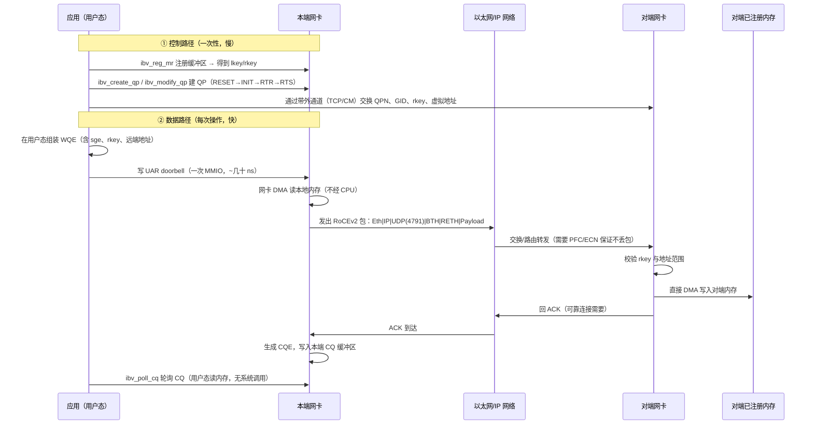

# 第 1 章　RDMA 的本质与 RoCE 的定位

> **本章目标**：建立正确的心智模型。读完你应该能回答：RDMA 为什么快（不是「因为不走内核」这么简单）、RoCE 相对 IB/iWARP 的取舍、以及一次 RoCE 操作在硬件里到底发生了什么。
>
> **本章对应源码**：无（概念章）。但每节末尾都指出「这个概念在第几章、哪个文件里落地」。

---

## 1.1 一句话定义与三个「不」

**RDMA = Remote Direct Memory Access**：本端网卡在**不打扰对端 CPU** 的前提下，直接读写对端已注册的用户态内存。

拆开看，RDMA 有三个「不」，这三个「不」就是它全部性能优势的来源，也是它全部复杂性的来源：

| 特性 | 含义 | 带来了什么 | 代价是什么 |
|---|---|---|---|
| **不经过对端 CPU** | 数据由对端网卡直接 DMA 进/出用户内存，对端内核协议栈不参与 | 零拷贝、无上下文切换、对端 CPU 占用≈0 | 对端必须**预先注册内存**并交出 `rkey`；权限模型必须自己做 |
| **不需要系统调用** | 数据平面（post send / poll cq）完全在用户态完成（**限硬件 verbs 设备**） | 单次操作开销 ~100ns 级（而非 ~1μs 级） | 控制平面必须提前把 QP/CQ/MR 建好并 mmap 到用户态 |
| **不保证（默认）可靠传输** | 可靠性由**网卡硬件**用序列号/ACK/重传实现，而不是 TCP 协议栈 | 省掉协议栈处理，且能在丢包时快速重传 | 需要无损或近无损网络（PFC/ECN）来避免重传带来的尾延迟 |

> **限定条件**：以上「零拷贝 / ~100ns / 数据平面不需要特权」都是对**硬件 verbs 设备**成立。**Soft-RoCE（`rxe`）与 Soft-iWARP（`siw`）是例外**：它们的「数据平面」实际经内核网络栈收发报文（`kernel:drivers/infiniband/sw/rxe/rxe_net.c:365-430`），没有用户态直通，也不具备上述延迟（见第 3.6 节）。

> **常见误解纠正**：「RDMA 快是因为绕过了内核」只对了一半。真正的关键在于 **①零拷贝 ②无 CPU 中断参与 ③固定长度的硬件解析路径**。即使你把 TCP 完全卸载到网卡（TOE），也仍然要经过 socket 缓冲区（拷贝）和中断，达不到 RDMA 的延迟水平。

**RoCE 在其中的位置**：RoCE（**RDMA over Converged Ethernet**）不是一套新的 RDMA 语义，而是**把 IB 的传输层（IBTA 的 verbs 语义与报文语义）搬到以太网/IP 上承载**。因此学 RoCE 要同时学两件事：

1. **verbs 语义**（与 IB 完全相同）——这是「RDMA 是什么」；
2. **以太网封装与无损网络**（RoCE 特有）——这是「RoCE 部署为什么难」。

本教程的结构就按这两条线展开：第 3～6 章讲 ①，第 2、11 章讲 ②，第 7～9 章讲两者在软件栈里的实现。

---

## 1.2 三种主流 RDMA 技术对比

| 维度 | InfiniBand (IB) | **RoCEv2** | iWARP |
|---|---|---|---|
| 承载网络 | 专用 IB 网络（需要 IB 交换机） | **标准以太网 + UDP/IP** | 标准以太网 + TCP/IP |
| 封装 | 链路层专有（LRH+GRH+BTH…） | **Eth + IP + UDP(4791) + IB BTH** | Eth + IP + TCP + DDP/RDMAP |
| 传输层可靠性 | 网卡硬件（ACK/NAK/重传） | **网卡硬件**（同 IB） | TCP（在网卡上做 TCP 卸载） |
| 是否可路由 | 需要 IB 路由器（少见） | **完全可路由（三层可达）** | 完全可路由 |
| 拥塞控制 | 基于 Credit 的链路流控 | **PFC（无损）+ ECN/DCQCN（拥塞控制）** | TCP 拥塞控制 |
| 典型延迟（同代硬件） | 最低 | 略高于 IB（多一层封装） | 较高（TCP 处理） |
| 生态与成本 | 封闭但成熟 | **开放、可复用现有以太网运维体系** | 开放，但生态小 |
| 主要厂商 | NVIDIA/Mellanox | NVIDIA、Broadcom、华为、阿里、Intel… | Intel、Chelsio |
| 学习价值 | 理解「纯正」RDMA | **云数据中心主流，就业需求最大** | 对比理解「为什么不用 TCP」 |

**为什么业界选了 RoCEv2**：数据中心已经是以太网（Clos/Spine-Leaf）的天下。RoCEv2 让 RDMA 流量和普通 IP 流量共存于同一张物理网络，不需要为 RDMA 单独建网；同时保留了 IB 的 verbs 语义与硬件可靠性。

**RoCEv1 vs RoCEv2（必须分清）**：

| | RoCEv1 | RoCEv2 |
|---|---|---|
| 封装 | Ethernet（EtherType **`0x8915`**）+ IB GRH + BTH | Ethernet + **IPv4/IPv6** + **UDP（目的端口 `4791`）** + IB BTH |
| 能否跨三层路由 | **不能**（纯二层） | **能** |
| GID 类型 | `IB_GID_TYPE_ROCE`（v1） | `IB_GID_TYPE_ROCE_UDP_ENCAP`（v2） |
| 现代部署 | 基本淘汰 | **默认选择** |

> 本教程后续若不特别说明，「RoCE」均指 **RoCEv2**。

---

## 1.3 一次 RDMA WRITE：硬件视角的完整过程

这是全书最重要的一张图。请务必理解到「每一步是谁在做、数据在哪块内存里」。



### 关键对比：RDMA WRITE vs RDMA SEND

| | **RDMA WRITE**（单边） | **SEND/RECV**（双边） |
|---|---|---|
| 对端是否感知 | **完全不感知**（不消耗对端 WQE，不产生对端 CQE） | 对端必须**预先 post 一个 RECV**，并产生 CQE |
| 对端 CPU 参与 | 零 | 需要应用提前投递接收缓冲 |
| 需要交换的信息 | 对端 `rkey` + 远端虚拟地址 + 长度 | 只需 QPN/连接（数据落在对端预先投递的缓冲） |
| 类比 | 直接往对端内存里写 | 类似消息队列（但有硬件流控） |
| 典型用途 | 存储（NVMe-oF）、参数同步、KVCache 传输 | 控制消息、小消息、需要「通知」语义的场景 |

**这条区别是面试与工程选型的高频考点。**记忆锚点：*WRITE/READ 是「我一个人就能干完」，SEND 是「需要对方配合」。*

> **【必会】为什么 WRITE 还需要「交换 rkey」？** 因为 `rkey` 是内存访问的凭证。对端网卡收到 WRITE 请求后用 `rkey` 查 MPT（Memory Protection Table）得到物理地址与权限，验证通过才 DMA。`rkey` 泄露 = 内存可被任意读写，这是 RoCE 安全的核心风险点（第 15 章展开）。

---

## 1.4 五种传输类型（Transport Type）与选型

| QP 类型 | 连接性 | 可靠性 | 消息边界 | 典型场景 | 备注 |
|---|---|---|---|---|---|
| **RC**（Reliable Connection） | 一对一 | 可靠、有序 | 有 | 存储、大部分高性能场景 | 最常用；支持全部 opcode（含 READ/ATOMIC） |
| **UC**（Unreliable Connection） | 一对一 | 不可靠（可能丢） | 有 | 低延迟、可容忍丢包的自定义协议 | **不支持 RDMA READ / ATOMIC** |
| **UD**（Unreliable Datagram） | 一对多 | 不可靠、可能乱序 | 有 | 组播、服务发现、管理报文 | 单个消息上限 = MTU；必须有 GRH；接收端不知来源 QPN |
| **XRC**（eXtended RC） | 一对多（接收侧共享） | 可靠有序 | 有 | 大规模并行（HPC/MPI） | 解决「一个进程对上万个对端要建上万个 QP」的扩展性问题 |
| **DC**（Dynamic Connected，DCT/DCI） | 动态 | 可靠有序 | 有 | 大规模集群、连接数爆炸场景 | ConnectX-4 以后支持；用户态库支持有限 |
| **RAW_PACKET** | 无 | 无 | 无 | 自己构造以太网帧（perftest 的 raw_ethernet 模式） | 不是「传输」，是绕过传输层直接发包 |

用户态枚举定义在 `rdma-core:libibverbs/verbs.h:932`（`enum ibv_qp_type`，`IBV_QPT_RC = 2`…）；内核侧对应 `include/rdma/ib_verbs.h` 的 `enum ib_qp_type`。

**选型决策树（工程直觉）**：

```
需要远端直接读写我的内存，且对端不想参与？
├─ 是 → 用 RC + RDMA WRITE/READ
└─ 否 → 需要给对方「有消息到达」的通知？
        ├─ 小消息 / 需要语义边界 → RC + SEND/RECV（或用 WRITE_WITH_IMM，一次完成「写+通知」）
        └─ 一对多 / 组播 / 服务发现 → UD
连接数超过几千（每对都要一个 QP，内存吃紧）？
└─ 是 → XRC（发送侧扩展）或 DC（动态连接）
```

---

## 1.5 RoCE 的代价：为什么它「难伺候」

RoCE 把 IB 的可靠传输搬到了以太网，但以太网默认是**有损、尽力而为**的。而 RDMA 的可靠传输依赖**重传**，重传会导致：

- **尾延迟飙升**：一次丢包 → 检测到 → 重传，延迟从 2μs 跳到几十 μs 甚至 ms；
- **吞吐塌陷**：GO-BACK-N 式重传导致带宽利用率骤降；
- **Incast 拥塞**：多打一场景下交换机队列溢出必然丢包。

因此 RoCE 部署的铁律是：**让网络尽量不丢包**。主要手段：

| 手段 | 作用层面 | 解决的问题 | 副作用/注意 |
|---|---|---|---|
| **PFC**（Priority Flow Control，802.1Qbb） | 二层，逐跳 | 用 PAUSE 帧阻止上游发送，做到「无损」 | 可能引发 **PFC Storm / 死锁 / HOL 阻塞**；配置错了会拖垮整网 |
| **ECN + DCQCN** | 三层，端到端 | 交换机标记拥塞（ECN），端侧降速，避免队列堆满 | 参数需要调；与 PFC 配合使用（PFC 兜底，ECN 为主） |
| **合适的 MTU** | 二层/三层 | 减少包数量，降低 PPS 压力 | 全网必须一致 |
| **流标签 / 源端口熵** | 三层/四层 | 让 ECMP 哈希均匀，避免某条链路热点 | RoCEv2 用 UDP 源端口做熵（第 2 章详解） |
| **限速（rate limit）** | 端侧 | 防止单个 QP 打满网络 | perftest 的 `--rate_limit` 就是干这个 |

> **【行业重点】** 在真实数据中心里，**RoCE 的问题 90% 出在网络配置而不是网卡**。所以「会配 PFC/ECN、会看计数器、会定位丢包点」是 RoCE 工程师最核心的实战能力，第 11、12 章会详细展开。

---

## 1.6 软件栈全景：从应用到硬件

这张图是第 3 章的预告，也是全书目录的来源：

```
┌─────────────────────────────────────────────────────────────────┐
│ 应用：perftest / NVMe-oF / MPI / NCCL / 你的程序                │  ← 第 10 章（生态）
├─────────────────────────────────────────────────────────────────┤
│ API 层：Verbs API（ibv_*）        │  RDMA_CM API（rdma_*）      │  ← 第 4 章（编程模型）
│         libibverbs.so             │  librdmacm.so                │  ← 第 6 章（库内部）
├───────────────────────────────────┴──────────────────────────────┤
│ 厂商用户态驱动：libmlx5.so（含 Direct Verbs / Direct Rules）     │  ← 第 9 章（mlx5 用户态）
├─────────────────────────────────────────────────────────────────┤
│ 内核 ABI：/dev/infiniband/uverbsN（write/ioctl/mmap）            │  ← 第 7 章（uverbs）
│           /dev/infiniband/rdma_cm                                 │
├─────────────────────────────────────────────────────────────────┤
│ 内核：ib_uverbs.ko → ib_core.ko（对象模型/verbs 分发）           │  ← 第 7 章
│       rdma_cm.ko（连接管理）                                     │
├─────────────────────────────────────────────────────────────────┤
│ 硬件驱动：mlx5_ib.ko（WQE/CQE、doorbell）                        │  ← 第 8 章（内核驱动）
│           mlx5_core.ko（固件命令、EQ 中断、netdev）              │
├─────────────────────────────────────────────────────────────────┤
│ 硬件：PCIe + UAR/BlueFlame + QP/CQ 上下文 + RoCEv2 封装引擎      │  ← 第 2、9 章
└─────────────────────────────────────────────────────────────────┘
```

**记住这条主线**：*控制平面走内核（慢、安全、需要特权），数据平面在用户态（快、需要提前 mmap 好一切）。* 整本书就是在解释这句话。

---

## 1.7 【行业重点】为什么企业需要 RoCE 人才

| 场景 | 用 RoCE 做什么 | 对工程师的要求 |
|---|---|---|
| **AI 训练集群** | 参数同步（AllReduce/NCCL）、KVCache 传输、Checkpoint | 会调 GPUDirect RDMA、会分析集合通信带宽、懂多 QP 与 ECMP |
| **分布式存储** | NVMe-oF/RDMA、Ceph、SPDK | 懂 RDMA WRITE、MR 注册开销、`rkey` 生命周期与安全 |
| **高性能数据库/内存计算** | 远端内存访问、共享缓存池 | 懂 READ 延迟优化、原子操作、内存注册策略 |
| **云平台网络** | RoCE 多租户、SR-IOV VF 分配、QoS 隔离 | 懂 VF/PF、representor、PFC 隔离、拥塞隔离 |
| **交换机/网卡自研** | 驱动适配、协议栈调优 | 懂 uverbs ABI、WQE 编码、固件命令接口 |

**能力分层（你可以用来自我定位）**：

1. **L1 会用**：能跑通 perftest，会看 `ibv_devinfo`，知道 `-d`（设备）/`-i`（端口）/`-x`（GID index）是什么。
2. **L2 会调**：能解释带宽/时延数字，会调 QP 深度/MTU/inline，会读计数器定位丢包。
3. **L3 会写**：能用 verbs 或 RDMA_CM 写正确的程序，懂同步与内存模型，能排查 `WC` 错误码。
4. **L4 懂内部**：能讲清 uverbs ABI、WQE 构造、doorbell、CQE 生成，能读 `mlx5_ib` 源码改行为。
5. **L5 懂体系**：能设计 RoCE 网络（PFC/ECN/DCQCN/ECMP/多租户），能做容量规划与故障域分析。

本教程的目标是把你带到 **L4**，并对 **L5** 给出完整的知识框架与实操方法。

---

## 1.8 本章自检

请在不看资料的情况下回答（答案散落在后续章节）：

1. RDMA 的「三个不」分别是什么？各自带来什么代价？
2. RoCEv1 和 RoCEv2 的封装区别是什么？哪个能跨三层路由？
3. RC 和 UD 的三个主要区别是什么？
4. RDMA WRITE 和 SEND 的本质区别是什么？
5. 为什么 RoCE 必须配 PFC/ECN？不配会发生什么？
6. 控制平面和数据平面分别在哪执行？为什么？（提示：mmap 与 doorbell）

**下一章**：我们把镜头拉近，逐字节看清 RoCEv2 的报文结构 —— 这是你读懂抓包、读懂 `rxe` 驱动、读懂 PFC/ECN 配置的基础。
