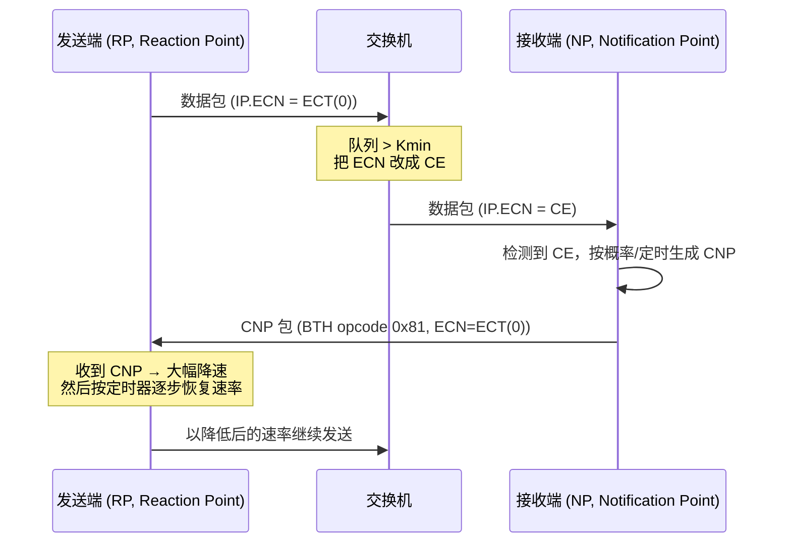

# 第 2 章　RoCEv2 协议与无损以太网

> **本章目标**：能逐字段解释一个 RoCEv2 报文，理解 PFC/ECN/DCQCN 为什么要存在、以及 GID/流标签/源端口熵这些「RoCE 特有的软件概念」为什么长这样。
>
> **本章对应源码**（强烈建议对照阅读）：
> - `kernel:drivers/infiniband/sw/rxe/rxe_hdr.h` —— **逐字段的报文头定义**，全书最直观的 RoCE 报文教材
> - `kernel:drivers/infiniband/sw/rxe/rxe_net.c` —— 以太网/IP/UDP 头的实际填充
> - `kernel:drivers/infiniband/sw/rxe/rxe_icrc.c` —— ICRC 的计算与「哪些字段被屏蔽」
> - `kernel:include/rdma/ib_pack.h` —— 各头长度常量与 opcode 枚举
> - `kernel:include/rdma/ib_verbs.h:5064-5125` —— 流标签与 UDP 源端口熵的官方算法
> - `kernel:include/rdma/ib_addr.h:174` —— `iboe_get_mtu()`：以太网 MTU 如何折算成 IB MTU
>
> **配套实验**：[`labs/lab04-soft-roce-and-protocol-analysis.md`](labs/lab04-soft-roce-and-protocol-analysis.md)（用 Soft-RoCE 抓包，逐字节解码本章的每一个字段）

---

## 2.1 RoCEv2 报文的完整分层结构

一个「RoCE MTU = 1024」的 RDMA WRITE 报文，从线路上的字节顺序看是这样：

```
┌───────────────────────────────────────────────────────────────────────────────┐
│ 以太网头 (14 B)                                                               │
│  ┌──────────────┬──────────────┬─────────┐                                    │
│  │ Dst MAC (6B) │ Src MAC (6B) │ Type(2B)│   ← Type = 0x0800(IPv4)/0x86DD(IPv6)│
│  └──────────────┴──────────────┴─────────┘                                    │
├───────────────────────────────────────────────────────────────────────────────┤
│ [可选] VLAN 标签 (4 B)：802.1Q 的 PCP(3bit，**PFC 优先级**)/DEI/VID             │
├───────────────────────────────────────────────────────────────────────────────┤
│ IPv4 头 (20 B) 或 IPv6 头 (40 B)                                              │
│   IPv4: TOS(=DSCP 6bit + ECN 2bit) / TTL / Protocol=17(UDP) / SrcIP / DstIP    │
├───────────────────────────────────────────────────────────────────────────────┤
│ UDP 头 (8 B)：SrcPort=熵(0xC000–0xFFFF) / DstPort=**4791** / Len / Checksum=0 │
├───────────────────────────────────────────────────────────────────────────────┤
│ ★ 从这里开始是「IB 传输层」，RoCEv1 用 EtherType=0x8915 直接从这里开始 ★        │
│ BTH (12 B) —— 基础传输头，所有包都有                                           │
│ [RETH (16 B)] —— RDMA READ/WRITE/ATOMIC 请求才有（远端地址+rkey+长度）          │
│ [DETH (8 B)]  —— UD 才有（qkey + 源 QPN）                                      │
│ [AETH (4 B)]  —— ACK/NAK 才有（syndrome + MSN）                                │
│ [ATMETH(28 B)] —— 原子操作请求才有                                             │
│ [ATMACK(8 B)] —— 原子操作应答才有                                              │
│ [IMMDT (4 B)] —— 带 Immediate 的 SEND/WRITE 才有                               │
│ [IETH (4 B)]  —— SEND with Invalidate 才有                                     │
│ [FETH (4 B)]  —— FLUSH 才有                                                    │
│ [RDETH(4 B)]  —— 可靠数据报（RD）才有                                           │
├───────────────────────────────────────────────────────────────────────────────┤
│ Payload（0 ≤ len ≤ MTU），按 4 字节对齐，不足处由 BTH.pad 指示                  │
├───────────────────────────────────────────────────────────────────────────────┤
│ ICRC (4 B) —— 不变式 CRC，覆盖 IP+UDP+BTH+扩展头+Payload（**不含以太网头**）    │
└───────────────────────────────────────────────────────────────────────────────┘
```

### 字节开销速算表（工程中极常用）

| 组成 | 字节数 | 源码常量 |
|---|---|---|
| 以太网头 | 14 | `IB_ETH_BYTES` |
| VLAN 标签（可选） | 4 | `IB_VLAN_BYTES` |
| IPv4 头 | 20 | `IB_IP4_BYTES` |
| IPv6 头 | 40 | `IB_GRH_BYTES`（同值，`ib_pack.h:16`） |
| UDP 头 | 8 | `IB_UDP_BYTES` |
| BTH | 12 | `IB_BTH_BYTES` |
| ICRC | 4 | `IB_ICRC_BYTES` |

**关键换算（很多现场问题的根源）**：

```
线缆帧长（不含前导/FCS）  =  RoCE MTU (IB MTU)  +  58 字节（IPv4，无 VLAN）
                                              +  62 字节（IPv4 + VLAN）
                                              +  78 字节（IPv6）
```

> 58 = 14（以太头）+ 20（IPv4）+ 8（UDP）+ 12（BTH）+ 4（ICRC）；带 VLAN 再加 4 字节；IPv6 用 40 字节头（比 IPv4 多 20）。**这是「网线上这一帧有多长」，不是 netdev MTU 的换算关系** —— 两者很容易被混为一谈，而现场配不出 4096 的 RoCE MTU 正是混淆它们的后果。

> **【必会】58 字节的第二个用途：算净荷效率。** 单包消息的线速效率 = `MTU ÷ (MTU + 帧开销)`，但**两种操作的帧开销不同**：**RDMA WRITE 的单包消息（`RDMA_WRITE_ONLY`）必须携带 RETH（16 字节，见 2.3），而 SEND 不携带任何扩展头**。所以 **WRITE 的帧开销是 `58 + 16 = 74` 字节，SEND 是 `58` 字节**（多包 WRITE 只有 FIRST 带 RETH，开销被摊薄，因此小包时差异最明显）。据此：MTU 1024 时 WRITE 效率 `1024/1098 ≈ 93.3%`、SEND 效率 `1024/1082 ≈ 94.6%`；MTU 256 时分别只有 `77.6%` 与 `81.5%`。**因此 `ib_write_bw` 按 74 字节算、`ib_send_bw` 按 58 字节算，两者混用会得出错误的「线速上限」。**

**netdev MTU 的口径（与上面的帧长不是一回事）**：netdev MTU 是 L3 净荷上限，只数 `IP + UDP + BTH + Payload + ICRC`：

- **理论最小**：IPv4 下要承载 RoCE MTU 4096，需要 `20 + 8 + 12 + 4096 + 4 = 4140`；
- **内核实际折算（保守）**：`ib_addr.h:174` 的 `iboe_get_mtu()` 从 netdev MTU 里减掉 `IB_GRH_BYTES + IB_UDP_BYTES + IB_BTH_BYTES + IB_EXT_XRC_BYTES + IB_EXT_ATOMICETH_BYTES + IB_ICRC_BYTES`，即 `40 + 8 + 12 + 4 + 28 + 4 = 96` 字节（按最坏情况算，包含了 IPv6 GRH、XRC 与原子扩展头），再向下取整到 256/512/1024/2048/4096。因此要得到 4096 必须 `netdev MTU ≥ 4096 + 96 = 4192`。

> **【行业重点】为什么现场经常配不出 4096 的 RoCE MTU？**
> 因为 mlx5 端口的 `active_mtu` 直接由 `iboe_get_mtu()` 导出（`kernel:drivers/infiniband/hw/mlx5/main.c:630/634`：`ndev_ib_mtu = iboe_get_mtu(ndev->mtu); props->active_mtu = min(props->max_mtu, ndev_ib_mtu);`），按内核的 **96 字节**口径，`netdev MTU ≥ 4192` 才能得到 4096。若按线缆帧长的 58 字节去算，把 netdev MTU 设成 `4096 + 58 = 4154`，内核仍按 96 字节折算（4154 − 96 = 4058），结果只会得到 **IB_MTU_2048**。**实践建议：直接把 netdev MTU 设成 4200。**
> 好在很多交换机的默认 Jumbo 是 9216（够用），但若中间有隧道（VXLAN 再加 50 B）或某台交换机没开 Jumbo，就会「带宽上不去、包被分片」。**核对方法**：`ibv_devinfo -v | grep -i mtu` 看 `max_mtu` 与 `active_mtu`，`ip link show` 看 netdev MTU，两者都要够。

---

## 2.2 BTH：唯一「所有包都有」的头

`rxe_hdr.h:61-67` 给出的定义（已按大端序排列）：

```c
struct rxe_bth {
    u8      opcode;   /* 操作码：高 3 bit = 传输类型，低 5 bit = 操作 */
    u8      flags;    /* SE / MIG / pad / TVer */
    __be16  pkey;     /* 分区键，默认 0xffff */
    __be32  qpn;      /* 高 8 bit = FECN/BECN/保留，低 24 bit = 目的 QPN */
    __be32  apsn;     /* 高 1 bit = ACK 请求，低 24 bit = PSN */
};
```

逐字段拆解（**位域图**）：

```
字节 0：opcode
  bit7..5  Transport: 000=RC 001=UC 010=RD 011=UD 100=CNP 111=MSP
  bit4..0  Operation: 见下表
字节 1：flags
  bit7     SE   (Solicited Event) —— 请求对端产生 CQ 事件
  bit6     MIG  (Migrate)         —— 路径迁移状态
  bit5..4  pad  (0..3)            —— payload 4 字节对齐的填充字节数
  bit3..0  TVer (Transport Version) —— 当前为 0
字节 2-3：pkey（Partition Key，相当于 VLAN 的 IB 对应物；RoCE 中通常 0xffff）
字节 4-7：QPN 字段
  bit31    FECN (Forward ECN) —— 交换机置位，表示「去的方向拥塞了」
  bit30    BECN (Backward ECN)—— 表示「回来的方向拥塞了」
  bit29..24 保留
  bit23..0 目的 QPN
字节 8-11：APSN 字段
  bit31    AckReq (请求 ACK)
  bit30..24 保留
  bit23..0 PSN (Packet Sequence Number，用于可靠性：检测丢失/乱序/重传)
```

> **注意 FECN/BECN 在 RoCEv2 中的实际行为**：IBTA 规定 FECN/BECN 由交换机设置。**但 RoCEv2 中实际使用的是 IP 头的 ECN 位（`ECT(0)`/`CE`）**，而不是 BTH 的 FECN/BECN（后者是 IB 链路层流控的遗产）。DCQCN 依赖的是 IP ECN —— 这一点在排查「ECN 不生效」时非常关键。`rxe` 的 `BTH_FECN_MASK`/`BTH_BECN_MASK`（`rxe_hdr.h:76-77`）只说明字段存在。

**opcode 编码表**（`ib_pack.h:51-161`，数值 = 传输类型 | 操作码）：

| opcode | 含义 | 方向 |
|---|---|---|
| `0x00` | RC SEND_FIRST | 请求 |
| `0x04` | RC SEND_ONLY | 请求 |
| `0x05` | RC SEND_ONLY_WITH_IMMEDIATE | 请求 |
| `0x0a` | RC RDMA_WRITE_ONLY | 请求 |
| `0x0b` | RC RDMA_WRITE_ONLY_WITH_IMMEDIATE | 请求 |
| `0x0c` | RC RDMA_READ_REQUEST | 请求 |
| `0x10` | RC RDMA_READ_RESPONSE_ONLY | 响应 |
| `0x11` | RC ACKNOWLEDGE | 响应 |
| `0x12` | RC ATOMIC_ACKNOWLEDGE | 响应 |
| `0x13` | RC COMPARE_SWAP | 请求 |
| `0x14` | RC FETCH_ADD | 请求 |
| `0x16` | RC SEND_LAST_WITH_INVALIDATE | 请求 |
| `0x17` | RC SEND_ONLY_WITH_INVALIDATE | 请求 |
| `0x1c` | RC FLUSH | 请求 |
| `0x1d` | RC ATOMIC_WRITE | 请求 |
| `0x60` | UD SEND_FIRST | 请求 |
| `0x64` | UD SEND_ONLY | 请求 |
| `0x65` | UD SEND_ONLY_WITH_IMMEDIATE | 请求 |
| **`0x81`** | **CNP（Congestion Notification Packet）** | 由被拥塞方发给发送方，DCQCN 的核心信号 |

> **【必会】看到 `0x81` 就是 CNP 包**。抓包时如果 CNP 比例很高，说明网络在持续报拥塞，需要查 ECN 阈值与 DCQCN 参数（第 11 章）。

**大消息如何分片**：RDMA 消息大于 MTU 时，硬件自动拆成 FIRST / MIDDLE / LAST 三个阶段的包（例如 `0x06/0x07/0x08`），只有 FIRST 携带 RETH 中的远端地址与长度。**这与 IP 分片完全不同** —— 是 IB 传输层自己的分片，且每个分段都有独立 PSN；一旦丢包，接收端回的 NAK 只带「期望的 PSN」，发送端从**最早未确认的 PSN** 起把在途窗口整段重发（**Go-Back-N**，见 2.6.1），而不是按 IP 那样整包重来。

---

## 2.3 各类扩展头（Extended Transport Header）

### RETH —— RDMA 单边操作的灵魂（16 字节）

```c
struct rxe_reth {          /* rxe_hdr.h:526 */
    __be64  va;      /* 远端虚拟地址（对端注册内存的地址空间） */
    __be32  rkey;    /* 远端内存键：访问凭证 */
    __be32  len;     /* 本条消息的 DMA 长度 */
};
```

这三个字段就是你在 `ibv_send_wr` 里填的 `wr.rdma.remote_addr`、`wr.rdma.rkey`，以及 SGE 长度之和。

> **【必会】`rkey` 就是安全边界**。对端网卡收到 RETH 后查 MPT（Memory Protection Table）：`rkey` 是否存在、是否允许 WRITE/READ、`va + len` 是否落在注册区间内。任何一项不满足 → 回 NAK（`AETH_NAK_REM_ACC_ERR = 0x62`）→ 本端 CQE 带 `IBV_WC_REM_ACCESS_ERR`。

### DETH —— UD 才有（8 字节）

```c
struct rxe_deth {          /* rxe_hdr.h:463 */
    __be32  qkey;    /* QKey：UD 的保护键，类似 PPK；GSI 用 0x80010000 */
    __be32  sqp;     /* 低 24 bit = 源 QPN */
};
```

UD 没有连接，所以接收端需要 DETH 才知道「谁发的」，这就是为什么 `ibv_wc` 里有 `src_qp` 字段。

### AETH —— ACK/NAK（4 字节）

```c
struct rxe_aeth {          /* rxe_hdr.h:773 */
    __be32  smsn;    /* 高 8 bit = Syndrome，低 24 bit = MSN(Message Sequence Number) */
};
```

Syndrome 取值（`rxe_hdr.h:780-791`）：

| Syndrome | 含义 | 对应到用户态 WC 状态 |
|---|---|---|
| `0x00` | ACK | `IBV_WC_SUCCESS` |
| `0x1f` | ACK_UNLIMITED | ACK 且已收到全部 |
| `0x20` | RNR NAK | `IBV_WC_RNR_RETRY_EXC_ERR`（接收端没投 RECV） |
| `0x60` | NAK PSN_SEQ_ERROR | `IBV_WC_RETRY_EXC_ERR` 类 |
| `0x61` | NAK INVALID_REQ | `IBV_WC_REM_INV_REQ_ERR` |
| `0x62` | NAK REM_ACC_ERR | `IBV_WC_REM_ACCESS_ERR`（rkey/权限错误） |
| `0x63` | NAK REM_OP_ERR | `IBV_WC_REM_OP_ERR` |

> **【实战】** 看到 `IBV_WC_REM_ACCESS_ERR` → 90% 是 `rkey` 过期 / 长度超界 / 权限（`IBV_ACCESS_REMOTE_WRITE` 没设）。看到 `IBV_WC_RNR_RETRY_EXC_ERR` → 对端没及时 post RECV，调 `rnr_retry` 或检查对端逻辑。

### 其他扩展头一览

| 头 | 字节 | 出现场景 | 关键字段 |
|---|---|---|---|
| `ATMETH` | 28 | COMPARE_SWAP / FETCH_ADD 请求 | `va`、`rkey`、`swap_add`、`comp` |
| `ATMACK` | 8 | 原子操作应答 | `orig`（操作前的原值） |
| `IMMDT` | 4 | 带 Immediate 的 SEND/WRITE | `imm`（32 bit 立即数，透传到 `ibv_wc.imm_data`） |
| `IETH` | 4 | SEND with Invalidate | `rkey`（让对端失效该 MR） |
| `FETH` | 4 | FLUSH | `sel`（选择级别）、`plt`（place） |
| `RDETH` | 4 | 可靠数据报 | `een`（EE 上下文号） |

---

## 2.4 ICRC：不是普通校验和

RoCEv2 的 ICRC 是**「不变式 CRC」**（Invariant CRC），设计目标是：**报文在网络上被合法修改的字段不参与计算，从而端到端 CRC 不变。** 这正是 `rxe_icrc.c` 做的事情（`kernel:drivers/infiniband/sw/rxe/rxe_icrc.c:34-92`）：

| 参与计算的字段 | 被屏蔽（置为常量）的字段 |
|---|---|
| IP 源/目的地址 | IPv4 `ttl` → `0xff` |
| IPv4 `protocol` / IPv6 `nexthdr` | IPv4 `check`（校验和）→ 常量 |
| IPv4 `tot_len` / IPv6 `payload_len` | IPv4 `tos` → `0xff` |
| UDP 源/目的端口 | IPv6 `flow_lbl` → `0xff...`、`priority` → `0xf`、`hop_limit` → `0xff` |
| UDP 长度 | UDP `check` → 常量 |
| BTH 的 `opcode`/`pkey`/`qpn`/`psn` | BTH 中 `qpn` 字段的高 8 bit（FECN/BECN/保留）被置 1 |
| 所有扩展头 + Payload | 以太网头（Dst MAC / Src MAC / VLAN）**完全不参与** |

CRC 初值为 `0xdebb20e3`（注释说明它等价于「种子 `0xfffffff` + 8 字节 `0xff` 模拟被屏蔽的 LRH」），最后取反：`*icrcp = ~icrc;`。

**三个必须记住的推论**：

1. **以太网头改了（比如经过 NAT/改写 MAC）不影响 ICRC** —— 但 RoCE 仍不能被 NAT 穿越，因为 IP 地址参与 ICRC。
2. **IP 地址不能改** —— 所以 RoCE 不能跨 NAT，这是 RoCE 多租户/跨域场景的硬约束。
3. **UDP checksum 在实践中为 0**（`rxe_net.c:309` 把 `udph->check` 显式置 0；`rxe` 的接收路径也不校验它）。RoCEv2 的完整性由 ICRC 保证，因此主流实现（含 mlx5 硬件）都不计算 UDP 校验和。
   > 注意：IBTA 规范建议 RoCEv2 使用非零 UDP checksum，现实中厂商普遍用 0。**抓包时 Wireshark 会把它标成 "Illegal" 或 "checksum incorrect"，这不是故障信号** —— 别在这上面浪费时间。

---

## 2.5 GID：RoCE 的地址体系

### GID 是什么

**GID（Global Identifier）= 128 bit 的 IPv6 地址格式标识符**，是 RDMA 世界里的「全局地址」。

- 在 IB 里，GID 由子网前缀 + 端口 GUID 构成；
- **在 RoCE 里，GID 直接由 IP 地址派生**（`ib_addr.h:148-152` 注释明确写了：*"RoCE GIDs are derived from the IP addresses"*）。

| GID 类型 | 枚举值 | 派生方式 | 用途 |
|---|---|---|---|
| `IB_GID_TYPE_IB` | `IB_UVERBS_GID_TYPE_IB` | 端口 GUID | 原生 IB |
| `IB_GID_TYPE_ROCE` | `IB_UVERBS_GID_TYPE_ROCE_V1` | 基于 MAC 的 link-local | **RoCEv1** |
| `IB_GID_TYPE_ROCE_UDP_ENCAP` | `IB_UVERBS_GID_TYPE_ROCE_V2` | IPv4 映射或 IPv6 地址 | **RoCEv2** |

（`ib_verbs.h:144-149`；`ib_network_to_gid_type()` 在 `ib_verbs.h:191` 给出映射。）

### IPv4 场景下 GID 长什么样

RoCEv2 用 **IPv4-mapped IPv6** 表示 GID：

```
GID (16 字节) = 0000:0000:0000:0000:0000:ffff:AABB:CCDD
                                        └─────┬─────┘
                                        IPv4 地址 A.B.C.D
```

所以 `192.168.1.10` 对应 GID `::ffff:192.168.1.10`。这也是内核判断「这个 GID 是 IPv4 还是 IPv6」的依据 —— `ib_verbs.h:211` 的 `ipv6_addr_v4mapped()`。

### GID 表（GID Table）与 RoCE 的「地址自动生成」

**RoCE 的 GID 表由内核根据网卡的 IP 地址与 VLAN 自动维护**，这是 RoCE 与 IB 最大的运维差异。

核心实现：`kernel:drivers/infiniband/core/roce_gid_mgmt.c`

| 行为 | 触发 |
|---|---|
| netdev 上新增 IP → 新增对应 GID | netdev `NETDEV_UP` / `inetaddr` 通知 |
| IP 删除 → 对应 GID 变为无效 | netdev 通知 |
| VLAN 设备增加 → 生成带 VLAN 的 GID 条目 | VLAN netdev 注册 |
| 网卡绑定/解绑 → 增删 link-local GID | `NETDEV_...` 事件 |

每种 GID 类型（RoCEv1/v2）在同一 IP 上各占一个表项，所以 `show_gids` 会看到同一个 IP 出现两行（v1 与 v2）。

**查看 GID 表**：

```bash
# 方法一：OFED 附带脚本 show_gids（注意：rdma-core 仓库不含它，输出列随版本而异）
show_gids                 # 逐行列出 dev/port/index/type/GID/netdev
# 方法二：直接看 sysfs
ls /sys/class/infiniband/<dev>/ports/1/gids/        # 0,1,2,...
cat /sys/class/infiniband/<dev>/ports/1/gids/0
cat /sys/class/infiniband/<dev>/ports/1/gid_attrs/types/0    # 显示 "IB/RoCE v1" / "RoCE v2"
# 方法三：ibv_devinfo
ibv_devinfo -v | grep -A20 "GID table"
```

> **【行业重点】`--gid-index` 选错是 RoCE 新手最常见的第一号故障。**
> - 你要跑 RoCEv2，就必须选 `type` 为 **`RoCEv2`** 的那一行；
> - 网卡有多个 IP（管理网 + 业务网）时，必须选**业务网 IP 对应的 GID**；
> - 有 VLAN 子接口时，必须选**对应 VLAN 的 GID**，否则报文不带 VLAN tag，交换机可能丢弃或走错 VRF。
>
> 排查口诀：**`show_gids` 确认 index → `ibv_devinfo -v` 确认 port 1 是 Ethernet → perftest 用 `-x <index>`**。

---

## 2.6 无损以太网：PFC + ECN + DCQCN

### 2.6.1 为什么必须无损

RDMA 的 RC 传输用 **PSN + ACK/NAK** 实现可靠。丢包 → NAK/超时 → **Go-Back-N 重传** → 该 QP 上所有在途包全部重发。后果：

- 延迟从 μs 级跳到 ms 级（尾延迟杀手）；
- 带宽骤降（重传占用带宽）；
- 多打一（Incast）场景下会**持续拥塞崩溃**。

### 2.6.2 PFC（Priority Flow Control，802.1Qbb）

**原理**：交换机检测到某优先级的出队列超过阈值 → 向**上游**发 PAUSE 帧（针对该优先级）→ 上游暂停发送该优先级流量 → 队列排空 → 发 RESUME。

- 是**逐跳（hop-by-hop）**的，不是端到端；
- 粒度是**优先级（Priority，0–7）**，由一个 3 bit 的 PCP 字段承载；
- 因此需要**全网的优先级到流量类的映射一致**（DSCP → PCP → 交换机队列）。


**PFC 的风险（面试与实战高频）**：

| 风险 | 机理 | 防护 |
|---|---|---|
| **PFC Storm / 死锁** | 多跳互相 PAUSE 形成环路，全局停摆 | 严格的无环拓扑 + `pfcwd`（PFC Watchdog）自动检测并 bypass 该队列 |
| **HOL 阻塞** | 同一优先级里既有 RoCE 又有普通流量，普通流量被一起暂停 | **RoCE 独占一个优先级**，绝不复用 |
| **PAUSE 帧吃带宽** | 持续 PAUSE 使链路空转 | 用 ECN 做主要控制，PFC 只做兜底 |
| **非对称配置** | 一端开 PFC 一端没开 → 无效 | 全网逐跳核对 |

**网卡侧配置（以 mlx5 为例，`mlxconfig`/`ethtool` 视角）**：

```bash
# 看网卡是否开启 PFC（DCB 视角）
mlnx_qos -i <netdev>                          # MLNX_OFED 工具，看 PFC/TC 映射
# 或
lldptool -t -i <netdev> -V PFC                # 看 LLDP 协商出的 PFC 配置
```

**交换机侧（以 Cumulus/NVIDIA Onyx 为例）**：

```
interface swp1
  pfc priority 3                              # 对优先级 3 开启 PFC
```

### 2.6.3 ECN + DCQCN

**ECN（Explicit Congestion Notification，RFC 3168）**：交换机队列超过阈值时，不去丢包，而是把 IP 头的 ECN 位从 `ECT(0)`（`0b10`）改成 `CE`（`0b11`）。

**DCQCN（Data Center Quantized Congestion Notification）** 是端侧算法（NVIDIA/Mellanox 主推，等价于 RoCE 的拥塞控制），流程如下：



关键参数（交换机侧称 RED/WRED，网卡侧称 DCQCN 参数）：

| 参数 | 含义 | 典型要求 |
|---|---|---|
| `Kmin` | 开始标记 CE 的队列水位 | 依据交换机 buffer 与 RTT 设定 |
| `Kmax` | 全部标记 CE 的水位 | `Kmax > Kmin`，窗口不宜过宽 |
| `Pmax` | 最大标记概率 | 避免 100% 标记导致过度降速 |
| DCQCN `alpha` 更新/降速因子 | 网卡侧降速激进程度 | 与厂商固件默认值配合 |
| `ClampTgtRate` / 最小速率 | 防止降到 0 | 保证吞吐不塌陷 |

**ECN 生效的完整前提（缺一不可）**：

1. 发送端网卡在 RoCE 包上打 `ECT(0)`：**DSCP 取自 `traffic_class` 的高 6 位**（`ibv_qp_attr.ah_attr.grh.traffic_class`；perftest 用 `--tclass` 指定，其值原样写入该字段，所以要填 `DSCP << 2`，例如 DSCP 26 → `104`）；而 **`ECT(0)` 的 ECN 位由驱动固定置位**，与用户填的 DSCP 无关（mlx5：`kernel:drivers/infiniband/hw/mlx5/ah.c:88-89` 的 `ah->av.tclass |= MLX5_ECN_ENABLED /* BIT(1) */`）；**DSCP 必须匹配交换机上启用了 ECN 的那个队列**；
2. 交换机对该队列开启 ECN 且有阈值配置；
3. 接收端网卡被配置为「对 CE 包产生 CNP」（mlx5 上由固件/驱动参数控制）；
4. 发送端网卡启用了 DCQCN 并响应 CNP。

> **【实战排障顺序】** 带宽上不去 → 先看 CNP 计数、再看 ECN 标记计数、再看 PFC PAUSE 计数：
> ```bash
> # ① 网卡侧标准计数器（RoCE 相关）
> ethtool -S <netdev> | grep -Ei 'prio.*pause|pfc|ecn|cnp'
> # ② 驱动侧 RoCE 拥塞计数器（mlx5）
> ethtool -S <netdev> | grep -Ei 'roce'      # np_ecn_marked_roce_packets / roce_adp_retrans / roce_slow_restart_cnps
> # ③ RDMA 子系统标准计数器
> rdma statistic show link
> # ④ ★ DCQCN 参数（RP/NP）的唯一驱动侧入口 —— mlx5 的 debugfs
> ls /sys/kernel/debug/mlx5/<PCI>/cc_params/          # 需要 debugfs 已挂载且有 cc_query_allowed 能力
> cat /sys/kernel/debug/mlx5/<PCI>/cc_params/rp_threshold
> cat /sys/kernel/debug/mlx5/<PCI>/cc_params/np_min_time_between_cnps
> # ⑤ 交换机侧
> show interface swp1 counters   # 看 PFC PAUSE 与 ECN 标记
> ```
> 详见第 12 章。**注意**：`mlx5_ib` 的 `cong.c` **只提供 debugfs 旋钮，没有 verbs 级 DCQCN 配置接口**（`kernel:drivers/infiniband/hw/mlx5/cong.c`，最终经 `MLX5_CMD_OP_MODIFY_CONG_PARAMS` 命令下发）。

### 2.6.4 PFC 与 ECN 的分工（一句话总结）

> **ECN/DCQCN 是「主动油门」，PFC 是「安全气囊」。**
> （补充一点措辞：PFC 不是「弹一次就完」的装置，而是**持续的逐跳反压** —— 只要上游还在发，PAUSE 帧就会反复发出；这正是它一旦误配就会拖垮整网的原因。）
> 正常运行时靠 ECN 提前降速，避免队列溢出；PFC 只在极端突发时兜底，保证「不丢包」这个 RDMA 的硬前提。**只开 PFC 不开 ECN** 会导致 PFC 频繁触发、链路空转、吞吐低下；**只开 ECN 不开 PFC** 则在突发时仍会丢包，导致重传。

---

## 2.7 ECMP 与流标签：让 RoCE 流量分散

现代数据中心是 Clos 架构（Spine-Leaf），同一对 Leaf 之间有**多条等价路径**，靠 **ECMP**（等价多路径）哈希分流。传统 ECMP 哈希基于 5 元组 `(源IP, 目的IP, 协议, 源端口, 目的端口)`。

**RoCEv2 的问题**：目的端口固定 `4791`，源 IP/目的 IP 固定，所以**如果源端口也固定，整条 QP 的流量会被哈希到同一条链路** → 那条链路拥塞、其他链路空闲 → 带宽只有 `1/N`。

**解决方案：把流标签编码进 UDP 源端口。**

内核给出的官方算法（`kernel:include/rdma/ib_verbs.h:5064-5125`）：

```c
/* 1) 20 bit flow label → 14 bit UDP 源端口，并强制落入 0xC000–0xFFFF 区间 */
static inline u16 rdma_flow_label_to_udp_sport(u32 fl)
{
    u32 fl_low = fl & 0x03fff, fl_high = fl & 0xFC000;
    fl_low ^= fl_high >> 14;
    return (u16)(fl_low | IB_ROCE_UDP_ENCAP_VALID_PORT_MIN);   /* 0xC000 */
}

/* 2) 用户没指定 flow label 时，用 (本地QPN × 远端QPN) 折叠出对称的 20 bit 值 */
static inline u32 rdma_calc_flow_label(u32 lqpn, u32 rqpn)
{
    u64 v = (u64)lqpn * rqpn;
    v ^= v >> 20;
    v ^= v >> 40;
    return (u32)(v & IB_GRH_FLOWLABEL_MASK);                   /* 0x000FFFFF */
}
```

**为什么用 `lqpn × rqpn`**：乘法**对称**，所以连接两端算出**同一个 flow label**，双向流量落在同一条路径上（避免乱序）。注释里写得很清楚：*"This function will create symmetric flow_label value based on the local and remote qpn values."*

**驱动侧的实际选用逻辑**（`kernel:drivers/infiniband/hw/mlx5/qp.c:3573`）：

```c
static void mlx5_set_path_udp_sport(void *path, const struct rdma_ah_attr *ah, ...)
{
    u32 fl = ah->grh.flow_label;
    if (!fl)
        fl = rdma_calc_flow_label(lqpn, rqpn);       /* 用户没设 → 按 QPN 对推导 */
    MLX5_SET(ads, path, udp_sport, rdma_flow_label_to_udp_sport(fl));
}
```

创建 AH 时也有对应逻辑（`kernel:drivers/infiniband/hw/mlx5/ah.c:35` 的 `mlx5_ah_get_udp_sport`）。

### 工程结论（非常重要）

| 做法 | 效果 |
|---|---|
| **不做任何设置（默认）** | 每个 QP 有独立 flow label → 多 QP 自动分散到多条链路。**这通常就是你要的。** |
| 给所有 QP 设同一个 `flow_label` | 所有流量走同一条链路 → 带宽受限（只在需要严格同路径时使用） |
| 用 `perftest --flow_label <N>` | 手动指定，用于复现/验证哈希行为 |
| 单 QP 想跑满多链路带宽 | **做不到**（一条 QP 一个流标签）。必须**多 QP**（`perftest -q N`）+ 多线程 |

> **【行业重点】「为什么我 200G 网卡单 QP 只跑到 100G？」**
> 高频答案：**ECMP 哈希把这条 QP 的全部分到了同一条上行链路**，而该链路带宽只有总带宽的一半。验证与解决：
> 1. 用 `perftest -q 4`（4 个 QP）看总带宽是否翻倍 → 若是，则确认是哈希问题；
> 2. 检查交换机 ECMP 哈希是否包含源端口（有些老设备/配置不含 L4 端口）；
> 3. 确认 `flow_label` 没被程序中写死为 0 或固定值。
> 这在第 12 章会作为一个完整的案例展开。

---

## 2.8 从报文回到软件：字段与 API 的对应表

这张表是本章与后面编程章节的桥梁 —— **你在 verbs 里设的每一个字段，最终都落在报文的某一个字节里**：

| 报文位置 | 谁设置的 | 用户态 API |
|---|---|---|
| 以太网 Dst MAC | 邻居解析（ARP/ND） | 由 CM 或 `libibverbs/neigh.c` 解析后填入 AH；用户一般不直接设 |
| VLAN tag | netdev/GID 的 VLAN 信息 | 由 `sgid_index` 选中的 GID 决定 |
| IPv4 SrcIP | 本端 GID | `ah_attr.grh.sgid_index`（对应本端 IP） |
| IPv4 DstIP | 对端 GID | `ah_attr.grh.dgid` |
| IPv4 TOS (DSCP/ECN) | `traffic_class`（高 6 位 = DSCP，低 2 位 ECN 由驱动置 `ECT(0)`） | `ah_attr.grh.traffic_class`；perftest 用 `--tclass`（值 = `DSCP << 2`；`--tos` 仅 `-R`/RawEth 合法） |
| IPv4 TTL | `hop_limit` | `ah_attr.grh.hop_limit`；verbs 路径 perftest 固定填 `0xFF`，`--hop_limit` 仅 RawEth 可用 |
| UDP DstPort = 4791 | 协议固定 | 不可配 |
| UDP SrcPort（熵） | `flow_label` 或自动推导 | `ah_attr.grh.flow_label`；perftest `--flow_label` |
| BTH QPN | **对端** QP 号（不是本端 `qp_num`） | RC：`ibv_qp_attr.dest_qp_num`；UD：`ibv_send_wr.wr.ud.remote_qpn`（`rxe_req.c:447-448`）；由建连时交换得到 |
| BTH PSN | 硬件自增 | 不可配（`qp_attr` 里有 `psn` 初值） |
| BTH pkey | `pkey_index` | `ah_attr.grh`/`qp_attr.pkey_index`（RoCE 通常 0xffff） |
| RETH va/rkey/len | `wr.rdma.*` | `ibv_send_wr.rdma.remote_addr` / `.rkey` + SGE |
| IMMDT imm | `wr.imm_data` | `ibv_send_wr.imm_data`（`IBV_WR_SEND_WITH_IMM` 等） |
| DETH qkey | `qkey` | UD QP 的 `ibv_send_wr.wr.ud.remote_qkey`（QP 类型在 `ibv_qp_init_attr.qp_type` 设置）；路径由 AH 决定 |
| AETH syndrome | 硬件自动 | 反映到 `ibv_wc.status` |
| MTU 分片 | 硬件自动 | `ibv_qp_attr.path_mtu` |

> **这张表值得抄在笔记本第一页。** 它是「协议知识」与「代码能力」之间的唯一通道。

---

## 2.9 抓包实战：亲手看一个 RoCEv2 包

```bash
# root
# 1) 找到 RoCE 流量所在的网卡（注意：RoCE 流量走 netdev）
ip -br link
# 2) 抓包：RoCEv2 目的端口 4791
tcpdump -i <netdev> -nn -vvv 'udp port 4791' -c 20
# 3) 十六进制 + 逐字节看（推荐，配合 Wireshark 打开）
tcpdump -i <netdev> -nn -s 0 -w /tmp/roce.pcap 'udp port 4791'
```

**Wireshark 解析要点**：

1. Wireshark 能识别 `UDP port 4791` 为 `InfiniBand`，会自动展开 BTH/扩展头（若没解析，手动 `Decode As → INFINIBAND`）。
2. 看 **OpCode** 确认操作类型（`0x0a` = RDMA WRITE Only）。
3. 看 **Destination QP** 与你在程序里打印的 `qp_num` 是否一致（调试连接问题的利器）。
4. 看 **IP ECN 字段**：`Not-ECT` / `ECT(1)` / `ECT(0)` / `CE` —— 判断 ECN 是否真的生效。
5. 看 **UDP Source Port** 是否落在 `0xC000–0xFFFF` —— 确认流标签机制在工作。

**配套练习**（第 12 章有完整脚本）：一边跑 `ib_write_bw`，一边抓包，数清「一个 8KB WRITE 被分成了几个包、每个包的 opcode 是什么、PSN 是否连续」。

---

## 2.10 【行业重点】本章知识的真实应用场景

| 现场问题 | 用本章哪个知识解决 |
|---|---|
| 带宽只有预期一半 | ECMP 哈希 / flow label（2.7）；MTU 是否够（2.1） |
| 长尾延迟抖动大 | PFC 频繁触发 / ECN 阈值不当（2.6） |
| `REP_ACCESS_ERR` 频繁 | RETH 的 rkey 与权限（2.3） |
| 跨机房/跨三层不通 | RoCEv2 vs v1 的封装（2.1）；IP 参与 ICRC 所以不能 NAT（2.4） |
| 选了 GID 但连不上 | GID 类型（RoCEv1/v2）与 VLAN（2.5） |
| 包被分片、吞吐异常 | RoCE MTU 与 netdev MTU 的 96 字节折算口径（2.1） |
| 想验证交换机 ECN 配置 | CNP 计数与 IP ECN 字段（2.6.3） |

---

## 2.11 本章自检

1. RoCEv2 的 UDP 目的端口是多少？源端口的取值范围与作用是什么？
2. BTH 里哪一位表示「请求 ACK」？QPN 字段的高 8 bit 是什么？
3. RETH 的三个字段是什么？为什么 `rkey` 是安全核心？
4. ICRC 覆盖哪些部分？为什么改 IP 地址会导致 ICRC 错误而改 MAC 不会？
5. `iboe_get_mtu()` 是怎么把 netdev MTU 折算成 IB MTU 的？RoCE MTU 4096 需要 netdev 至少多大？
6. IPv4 场景下 `192.168.1.10` 对应的 GID 是什么？
7. 为什么 `lqpn × rqpn` 被用作默认 flow label？
8. PFC 和 ECN 各自解决什么问题？为什么两个都要开？
9. 收到 CNP 包（`0x81`）说明什么？
10. 一个 `IBV_WC_REM_ACCESS_ERR` 最可能的原因是什么？

**下一章**：我们从协议回到软件，画出完整的 RoCE 软件栈，并给出「每个组件负责什么、出了问题找谁」的对照表。
