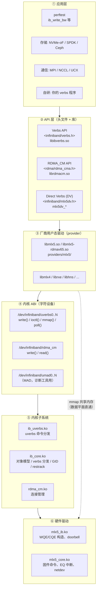
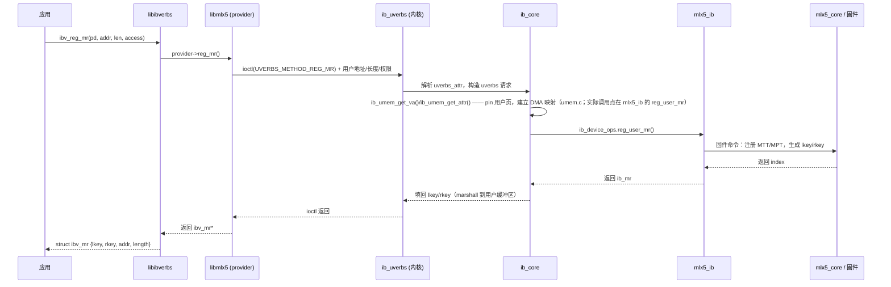

# 第 3 章　RoCE 软件栈全景与组件职责

> **本章目标**：把第 1 章的架构图变成可以「指哪打哪」的运维与调试地图。读完你应该能回答：**一个问题该找哪个组件？一条命令背后是谁在工作？**
>
> **本章对应源码**：`rdma-core:README.md`、`kernel:drivers/infiniband/core/Makefile`、`kernel:drivers/infiniband/hw/mlx5/Makefile`、`rdma-core:CMakeLists.txt`、`rdma-core:Documentation/versioning.md`

---

## 3.1 完整分层（含每一层的「产物」与「接口」）



**两条必须记住的路径**：

| | 控制平面（慢，~μs–ms） | 数据平面（快，~100ns；**仅硬件 verbs 设备**） |
|---|---|---|
| 典型操作 | `ibv_open_device`、`ibv_alloc_pd`、`ibv_reg_mr`、`ibv_create_qp`、`ibv_modify_qp`、`rdma_connect` | `ibv_post_send`、`ibv_post_recv`、`ibv_poll_cq` |
| 经过哪些层 | 应用 → libibverbs/librdmacm → `write/ioctl` → `ib_uverbs` → `ib_core` → `mlx5_ib` → `mlx5_core` → 固件 | 应用 → libmlx5（用户态直接构造 WQE）→ 写 UAR → 网卡；轮询 CQ 内存 |
| 是否需要特权 | **需要**（内核要分配硬件资源） | **不需要** |
| 出错时看哪里 | `dmesg`、`strace`、`ibv_*` 返回码 | CQE 状态码、硬件计数器、perftest 输出 |

> **例外（必须限定设备）**：上表「数据平面在用户态、~100ns、不需要特权」只对**硬件 verbs 设备**成立。**Soft-RoCE（`rxe`）/ Soft-iWARP（`siw`）是例外**：它们的「数据平面」实际走内核网络栈（`kernel:drivers/infiniband/sw/rxe/rxe_net.c:365-430`），每次收发包都要进出内核，既没有用户态直通也不具备上表的延迟（见 3.6）。另外 **DV / raw-packet 路径**（`mlx5dv_*`、`IBV_QPT_RAW_PACKET`）的 WQE/报文头构造方式与通用 verbs 不同，也不在上表的描述范围内。

---

## 3.2 组件职责对照表（一张表解决 80% 的定位问题）

| 组件 | 产物/文件 | 负责什么 | 出问题的典型症状 | 排查手段 |
|---|---|---|---|---|
| **ib_core.ko** | 内核模块 | 设备注册、verbs 分发、GID 表、sysfs/netlink、资源追踪 | 设备不出现、GID 不对、`rdma link show` 异常 | `dmesg`、`/sys/class/infiniband/`、`rdma link show` |
| **ib_uverbs.ko** | 内核模块 | `/dev/infiniband/uverbsN`、命令解析、mmap 映射 | `ibv_open_device` 失败、EPERM/ENODEV、ioctl 返回 EINVAL | `ls -l /dev/infiniband/`、`strace`、`dmesg` |
| **rdma_cm.ko / rdma_ucm.ko** | 内核模块 | RDMA CM 连接管理、地址/路由解析、事件队列 | `rdma_resolve_addr` 超时、CM 事件异常 | `dmesg`、`rdma_cm` 相关 trace、`ibacm` 状态 |
| **mlx5_ib.ko** | 内核模块 | QP/CQ/MR 硬件对象、WQE 构造、doorbell、拥塞控制 | QP 建不起来、`post_send` 返回 ENOMEM、CQE 状态错误 | `dmesg`、`/sys/kernel/debug/mlx5/`、`devlink health` |
| **mlx5_core.ko** | 内核模块 | PCI、固件命令、EQ/MSI-X 中断、netdev、链路状态 | 链路 down、固件命令超时、中断风暴 | `dmesg`、`ethtool -S`、`devlink health show` |
| **libibverbs.so** | 用户态库 | verbs 通用实现、设备发现、provider 加载、命令封装 | `ibv_get_device_list` 返回空、ABI 不匹配 | `ldd`、`IBV_...` 环境变量、`ibv_devinfo` |
| **librdmacm.so** | 用户态库 | CM 事件通道、地址/路由解析、`rdma_*` API | CM 事件收不到、连接被拒 | `strace -f`、`ibacm` |
| **libmlx5.so** | 用户态 provider | mlx5 verbs 实现、DV、WQE 快速路径 | 性能异常、DV 初始化失败 | `MLX5_DEBUG` 类环境变量、`mlx5dv_query_device` |
| **ibacm** | 守护进程 | 缓存地址/路由解析结果，加速 CM | 首次连接特别慢 | `systemctl status ibacm`、`ibacm` 日志 |
| **rdma-ndd** | 守护进程 | 维护 node description | `ibstat` 里 nodename 异常 | `systemctl status rdma-ndd` |
| **perftest** | 应用 | 性能/正确性测试 | 带宽时延不达标 | 见第 6、12 章 |

---

## 3.3 设备发现与命名规则（RoCE 运维第一课）

### 3.3.1 三层名字：netdev / ibdev / uverbs 节点

一块 RoCE 网卡在系统里有**三个名字**，理解它们的对应关系是排障的基础：

```bash
# ① 网络设备名（netdev）—— 你配 IP 的那个
$ ip -br link
enp1s0f0np0     UP    aa:bb:cc:dd:ee:01
enp1s0f1np1     UP    aa:bb:cc:dd:ee:02

# ② RDMA 设备名（ibdev）—— verbs 程序里的 "-d" 参数
#    现代上游内核（≥5.x 后期）由驱动直接注册为：
#      mlx5_0 / mlx5_1              -> 普通情形（drivers/infiniband/hw/mlx5/main.c 的 ib_register_device）
#      mlx5_bond_0                  -> RoCE LAG / bond 激活时
#    部分发行版与 MLNX_OFED 用 udev 规则改名为带 PCI 槽位信息的名字：
#      roceP1p1s0f0                 -> "roce" + PCI 域(P1) + 总线(p1) + 槽位(s0) + 功能(f0)
#    ★ 结论：不要靠名字猜对应关系，用 rdma link show 的 netdev 列（下一节）
$ ls /sys/class/infiniband/
mlx5_0  mlx5_1

# ③ uverbs 字符设备节点
$ ls -l /dev/infiniband/
crw-rw-rw- 1 root root 231, 0 ... uverbs0
crw-rw-rw- 1 root root 231, 1 ... uverbs1
crw-rw-rw- 1 root root  10, 58 ... rdma_cm
crw-rw-rw- 1 root root 231, 3 ... umad0
```

**从 ibdev 反查 netdev 的权威方法**：

```bash
# ★ 最可靠的一条命令：直接看 ibdev ↔ netdev 的绑定
rdma link show
# 输出（示例）：
# link mlx5_0/1 state ACTIVE physical_state LINK_UP netdev enp1s0f0
#      ^^^^^^^                                        ^^^^^^^^^^
#      perftest 的 -d                                你配 IP 的那个口

# 每个 ibdev 的 ports/N/ 下有一个 gid_attrs/ndevs/ 目录，列出该端口涉及的 netdev
cat /sys/class/infiniband/mlx5_0/ports/1/gid_attrs/ndevs/0
for i in /sys/class/infiniband/mlx5_0/ports/1/gid_attrs/ndevs/*; do
    echo "$(basename $i): $(cat $i)"
done
```

> **【行业重点】容器/虚拟机里最常见的坑**：容器里 `ibv_get_device_list()` 返回空，几乎总是**没有把 `/dev/infiniband/uverbsN` 和 `/dev/infiniband/rdma_cm` 映射进容器**。Kubernetes 场景需要 RDMA device plugin；Docker 场景用 `--device=/dev/infiniband/uverbs0 --device=/dev/infiniband/rdma_cm`。注意**是 uverbs 节点，不是 netdev**。

### 3.3.2 端口（port）的概念

一个 `ib_device` 可以有多个**端口（port 1, 2, …）**。对 RoCE 网卡来说，通常：

- 双口网卡 → 两个 `ib_device`（`mlx5_0`、`mlx5_1`），各自只有 `port 1`；
- 单口多平面（multi-plane/HCA）→ 一个 `ib_device` 有两个 port。

**verb/命令里的 `-i` 或 `port` 参数永远是「该 ibdev 的端口号」，绝大多数 RoCE 场景就是 `1`。**

```bash
# 查看端口属性（含链路层类型：Ethernet 还是 InfiniBand）
ibv_devinfo -d mlx5_0 -v | grep -Ei 'link_layer|state|phys_state|active_mtu|max_mtu|port_lid'
# 或
cat /sys/class/infiniband/mlx5_0/ports/1/state        # 4: ACTIVE
cat /sys/class/infiniband/mlx5_0/ports/1/link_layer   # Ethernet
```

---

## 3.4 内核模块依赖与加载顺序

```bash
# 依赖关系（简化）
mlx5_ib  →  mlx5_core  →  (PCI, devlink)
ib_uverbs → ib_core
rdma_ucm  → rdma_cm → ib_core
```

```bash
# 查看当前加载状态
lsmod | grep -E 'mlx5|ib_|rdma'
# 典型输出（RoCE 主机）
# mlx5_ib       xxxxx  0
# ib_uverbs     xxxxx  1 mlx5_ib
# ib_core       xxxxx  8 mlx5_ib,ib_uverbs,rdma_cm,rdma_ucm,...
# rdma_cm       xxxxx  1 rdma_ucm
# rdma_ucm      xxxxx  0
# mlx5_core     xxxxx  1 mlx5_ib
```

**模块参数与调优入口（RoCE 相关）**：

| 模块 | 参数 | 作用 |
|---|---|---|
| `mlx5_ib` | `mlx5_ib.profile` 相关、调试参数 | 驱动级调试 |
| `mlx5_core` | `debug_mask` | 打开固件命令/事件日志 |
| `ib_core` | —— | GID/缓存行为（多为自动） |
| `rdma_rxe` | `rxe_...` | 软件 RoCE 用于学习（见 3.6） |

```bash
# 需要重新加载时
# root
modprobe -r mlx5_ib && modprobe mlx5_ib      # ★ 生产环境慎用：会中断本机该网卡上的全部 RDMA 业务
# 查看可用的模块参数
systool -m mlx5_ib -v 2>/dev/null || modinfo mlx5_ib
```

---

## 3.5 用户态组件与 ABI 版本

### 3.5.1 库的布局（为什么要理解 `.so` 命名）

rdma-core 66.0 的构建产物命名遵循 `Documentation/versioning.md` 的规则：

```
libibverbs.so                       → symlink，指向当前版本
libibverbs.so.1                     → SONAME（稳定 ABI 名）
libibverbs.so.1.x.y                 → 实际文件
libmlx5-rdmav65.so                  → provider 私有 ABI 实现（65 = IBVERBS_PABI_VERSION）
/usr/lib64/libibverbs/libmlx5.so    → symlink，libibverbs 通过此路径 dlopen
```

**关键点**：`IBVERBS_PABI_VERSION`（本仓为 **65**，见 `rdma-core:CMakeLists.txt`）是 **provider 与 libibverbs 之间的私有 ABI 版本**。它是「库-驱动」配对版本，与内核 ABI 无关。

```bash
# 验证 provider 是否被正确加载（最常用的两条命令）
ibv_devinfo -v | head -30          # 能列出设备说明 provider 加载成功
ibv_devinfo -l                      # 只列设备名
# 查 libibverbs 搜到哪些 provider
ls -l /usr/lib64/libibverbs/
# 如果设备列不出来，用 ltrace/strace 看 dlopen 路径
strace -f -e trace=openat ibv_devinfo 2>&1 | grep -i mlx5
```

### 3.5.2 ABI 三条兼容规则（非常重要，很多「玄学问题」源于此）

| 关系 | 兼容方向 | 说明 |
|---|---|---|
| 用户态 libibverbs ↔ 内核 `ib_uverbs` | **新库 + 老内核 = 部分可用** | 新库先探测内核是否支持 ioctl 通道（`has_ioctl_write()`，`rdma-core:libibverbs/device.c:200`），并对每个 op 做逐条降级：`ENOTTY` 表示整个 ioctl 框架缺失、`EPROTONOSUPPORT` 表示单个方法不支持，两者都会让该操作退回旧 `write()` 通道（`_execute_ioctl_fallback()`，`cmd_fallback.c:83`） |
| provider `.so` ↔ libibverbs | **必须严格匹配 PABI 版本** | 版本不匹配会拒绝加载（这就是 `.so` 名字里带 `rdmav65` 的原因） |
| 内核 → 用户态 ABI | **只增不改** | uAPI 结构体只允许尾部追加字段 + `comp_mask`，保证老程序仍能运行 |

> **【实战】升级 MLNX_OFED 后程序报 `EINVAL` 的经典原因**：用户态库升级了但内核模块没升级（或反之），导致结构体大小/命令号不一致。**排查方法**：`ofed_info -s`（OFED 栈版本）、`dpkg -l | grep ibverbs`（用户态库版本）、`cat /sys/class/infiniband_verbs/abi_version` 与 `.../uverbsN/abi_version`（内核与驱动的 uverbs ABI）。
>
> **注意**：`modinfo mlx5_ib` 里**没有** `version` 字段（本内核的 `mlx5_ib` 未定义 `MODULE_VERSION`），所以 `modinfo mlx5_ib | grep version` 命中的只是 `srcversion`/`vermagic`（内核源码快照标识），**不能用来判断 OFED 版本**。详见 [`reference/versions-and-abi.md`](reference/versions-and-abi.md)。

### 3.5.3 `/dev/infiniband/uverbsN` 的两条 syscall 路径（write 与 ioctl）

同一个字符设备上有**两套并行的 ABI**：老的 `write()` 路径用扁平命令号寻址（`IB_USER_VERBS_CMD_GET_CONTEXT`（0）到 `IB_USER_VERBS_CMD_OPEN_QP`（40），`EX` 变体置位 `IB_USER_VERBS_CMD_FLAG_EXTENDED = 0x80000000`，`IB_USER_VERBS_CMD_THRESHOLD = 50` 之后留给扩展命令，见 `include/uapi/rdma/ib_user_verbs.h:46-106`、`:156`）；新的 `ioctl(RDMA_VERBS_IOCTL, ...)` 路径用 `(object_id, method_id, attr_id)` 三元组寻址（定义在 `include/uapi/rdma/ib_user_ioctl_cmds.h`）。两条路径挂在同一棵 uAPI 描述树上，但入口函数与处理函数完全不同：

| 维度 | 旧路径：`write()` | 新路径：`ioctl(RDMA_VERBS_IOCTL, ...)` |
|---|---|---|
| 内核入口 | `ib_uverbs_write()`（`uverbs_main.c:512`） | `ib_uverbs_ioctl()`（`uverbs_ioctl.c:531`） |
| 调用形式 | `write(fd, &cmd_hdr, count)` | `ioctl(fd, RDMA_VERBS_IOCTL, &ioctl_hdr)`（`rdma_user_ioctl_cmds.h:41`） |
| 寻址方式 | 扁平命令号 `IB_USER_VERBS_CMD_*`（0..40；`EX` 变体再加 `IB_USER_VERBS_CMD_FLAG_EXTENDED`） | `(object_id, method_id)` 选方法，`hdr.num_attrs` 个属性各带自己的 `attr_id` |
| 命令/方法声明 | `include/uapi/rdma/ib_user_verbs.h` 的 `enum ib_uverbs_write_cmds` | `include/uapi/rdma/ib_user_ioctl_cmds.h` 的 `UVERBS_OBJECT_*` / `UVERBS_METHOD_*` / `UVERBS_ATTR_*` |
| 处理函数位置 | `uverbs_cmd.c`（`ib_uverbs_create_qp` 等 `ib_uverbs_*`） | `uverbs_ioctl.c`（框架）+ `uverbs_std_types_*.c`（每类对象的方法表） |
| 两路径的关系 | —— | `UVERBS_METHOD_INVOKE_WRITE`（`uverbs_std_types_device.c:20`）：从 ioctl 侧回头调用**任意**旧 write 命令 |

**新路径为什么存在（三条设计理由，都能在源码里找到）**：

1. **未知属性默认静默忽略 → 前向兼容**：`uverbs_set_attr()`（`uverbs_ioctl.c:300`）在描述树里查不到某个 `attr_id` 时，只有当用户态在 `ib_uverbs_attr.flags` 里置了 `UVERBS_ATTR_F_MANDATORY` 才返回 `-EPROTONOSUPPORT`，否则**直接忽略**（`uverbs_ioctl.c:315-317`）。于是「新用户态 + 老内核」不会因为多带几个属性就整体失败。
2. **半扩展结构体是安全的**：`UVERBS_ATTR_STRUCT()`（`uverbs_ioctl.h:468`）会置 `.zero_trailing = 1`，`uverbs_process_attr()`（`uverbs_ioctl.c:182-185`）据此拒绝「超过内核已知长度且尾部非零」的输入。用户态可以按新结构体发，老内核只读它认识的前缀——只要多出来的字节是 0。
3. **两条路径在 ioctl 上合流**：`UVERBS_METHOD_INVOKE_WRITE`（`uverbs_std_types_device.c:51`，参数为 `UVERBS_ATTR_WRITE_CMD` + `UVERBS_ATTR_CORE_IN`/`UVERBS_ATTR_CORE_OUT`，见 `ib_user_ioctl_cmds.h:81-83`）让用户态用 ioctl 的编组方式调用所有旧 write 命令，新库因此不必为老命令保留 `write()` 代码路径。

> **运维含义**：`uapi_finalize_disable()`（`uverbs_uapi.c:526`）在**设备注册时**（`uverbs_alloc_api()` 建树末尾，`uverbs_uapi.c:665`）就把本设备驱动不支持的 method/object 从 per-device radix tree 里**物理删除**。所以 ioctl 返回 `-EPROTONOSUPPORT` 是可靠的「这台设备不支持这个功能」信号，而不是参数错误（`uverbs_ioctl.c:483-484`）。

---

## 3.6 没有 RDMA 网卡怎么学？—— 软件实现

**这是初学者最容易忽略、但实际上最有效的一条学习路径。**

| 软件实现 | 模块 | GID 类型 | 能学到什么 | 限制 |
|---|---|---|---|---|
| **`rxe`**（Soft-RoCE） | `rdma_rxe.ko` | **真实 RoCEv2**（UDP 4791） | verbs 编程、RoCEv2 报文（源码逐字节构造）、CM 流程 | 性能低（走内核网络栈）；部分高级特性不支持 |
| **`siw`**（Soft-iWARP） | `siw.ko` | iWARP | 对比理解 | 不是 RoCE |
| **`rxe` + 同一台机器 loopback** | —— | —— | **单机跑通 perftest**，验证代码正确性 | 测不出真实性能 |

**启用 Soft-RoCE（两台机器或单机都行）**：

```bash
# root
# 1) 加载模块（在要用的 netdev 上启用）
modprobe rdma_rxe
rdma link add rxe0 type rxe netdev enp1s0f0     # 关键：绑定到一个真实 netdev
# 2) 验证
rdma link show
ibv_devinfo -d rxe0 -v | head -20
# 3) 现在可以用 rxe0 跑 perftest（本质是 UDP 4791 的真实 RoCEv2 报文）
ib_write_bw -d rxe0 -i 1 -x 0 --report_gbits -F
```

**为什么 `rxe` 是理解 RoCE 的最佳读物**（这是本教程反复推荐它的原因）：

- `kernel:drivers/infiniband/sw/rxe/rxe_net.c:365-430` —— **你能看到 UDP/IP 头是怎么被填出来的**：`prepare_udp_hdr(skb, qp->src_port, ROCE_V2_UDP_DPORT)`，`prepare_ipv4_hdr(..., av->grh.traffic_class, av->grh.hop_limit, ...)`。
- `kernel:drivers/infiniband/sw/rxe/rxe_hdr.h` —— 每个头字段与位掩码都有定义和注释。
- `kernel:drivers/infiniband/sw/rxe/rxe_qp.c:306` —— 源端口熵的软件实现：`qp->src_port = RXE_ROCE_V2_SPORT + (hash_32(qp_num(qp), 14) & 0x3fff);`（`RXE_ROCE_V2_SPORT = 0xc000`，见 `rxe.h:38`）。

> **推荐练习**：用 `rxe` 跑一次 `ib_write_bw`，同时 `tcpdump -i <netdev> udp port 4791 -X`，然后对照 `rxe_hdr.h` 逐字段核对。**做完这一次，你对 RoCE 的理解会超过大多数只跑过硬件测试的人。**

---

## 3.7 【行业重点】发行版与生态选择

| 选择 | 组成 | 优点 | 注意 |
|---|---|---|---|
| **MLNX_OFED / DOCA-OFED** | NVIDIA 官方打包（驱动 + rdma-core + 工具 + 固件工具） | 特性最全（DCQCN 调参、`mlnx_qos`、`mlxconfig`、`devlink`） | 与内核版本强绑定；升级需谨慎 |
| **inbox（发行版自带）** | 内核自带驱动 + 发行版 rdma-core | 稳定、免运维、与内核同步 | 新硬件/新特性支持滞后；缺厂商工具 |
| **上游 rdma-core（本仓）** | 自行编译最新库 | 最新 API（DV/DR、pyverbs） | 需与内核 ABI 匹配 |

**厂商工具速查（RoCE 必备）**：

| 工具 | 来自 | 用途 |
|---|---|---|
| `ibstat` / `ibv_devinfo` | rdma-core | 设备与端口状态 |
| `show_gids` | OFED 附带脚本（rdma-core 仓库不含） | **GID 表（RoCE 必用）**；输出列随版本而异，建议同时用 `ibv_devinfo -v` 核对 |
| `ibv_asyncwatch` | rdma-core | 观察异步事件（端口 down、QP 错误） |
| `mlnx_qos` | MLNX_OFED | **PFC / TC / DSCP 映射配置** |
| `mlxconfig` | MLNX_OFED | 固件级配置（RoCE 模式、PFC 能力） |
| `ethtool -S` | 内核 | 网卡计数器（PFC/ECN/丢包；RoCE 相关：`np_ecn_marked_roce_packets`、`roce_adp_retrans`、`roce_slow_restart_cnps`） |
| **`/sys/kernel/debug/mlx5/<PCI>/cc_params/`** | mlx5_ib `cong.c` | **DCQCN 的 RP/NP 全参数**（`rp_threshold`、`rp_min_rate`、`np_min_time_between_cnps` 等 22 项）。需 debugfs 挂载 + `cc_query_allowed`/`cc_modify_allowed` 能力 |
| `devlink health` | 内核 | 驱动健康状态与固件诊断 |
| **`devlink dev param`** | 内核 | `ENABLE_ROCE` 等运行时开关（关 RoCE 只留以太网） |
| `perfquery` / `ibqueryerrors` | rdma-core | IB 侧错误计数（IB 场景） |
| `rdma statistic` | 内核 | RDMA 标准计数器 |

---

## 3.8 一次调用的完整生命周期（把本章串起来）

以 `ibv_reg_mr()` 为例，走通全栈：



**从这个流程你能读出三条工程结论**：

1. **`ibv_reg_mr` 是重操作**：要 pin 物理页（`ib_umem_get_va()`/`ib_umem_get_attr()`，**本内核已无 `ib_umem_get()`**）+ 写硬件表（固件命令）。所以**不要在数据路径里反复注册/注销**，要复用。
2. **`rkey` 是内核/硬件生成的**，不是用户随便填的。
3. **每一步都可能失败**：`ENOMEM`（pin 页失败/超过 `max_mr`）、`EPERM`（`memlock` 限制）、`EINVAL`（权限组合非法）。**第 4 章会给出完整的错误码对照表。**

---

## 3.9 本章自检

1. 控制平面和数据平面分别经过哪些层？为什么数据平面不需要特权？
2. 一块 RoCE 网卡的 netdev、ibdev、uverbs 节点分别是什么？如何互查？
3. `IBVERBS_PABI_VERSION` 是什么？它和内核 ABI 版本有什么区别？
4. 容器里 `ibv_get_device_list()` 返回空，最可能的原因是什么？
5. `rxe0` 的 `RXE_ROCE_V2_SPORT` 是怎么算的？它的作用是什么？
6. 为什么 `ibv_reg_mr` 不应该出现在数据路径里？
7. 说出三个「RoCE 专用」的排查工具及其用途。

**下一章**：进入本书的核心 —— Verbs 对象模型与完整编程模型。
