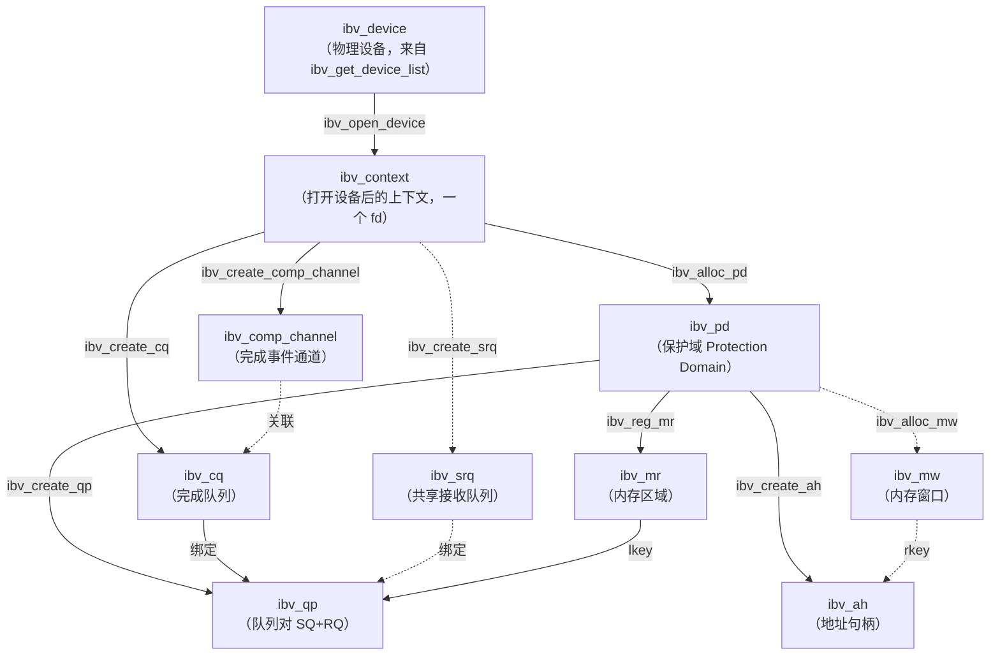
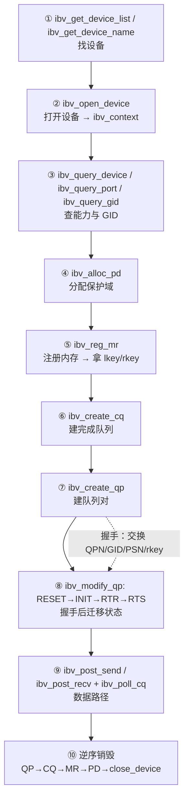
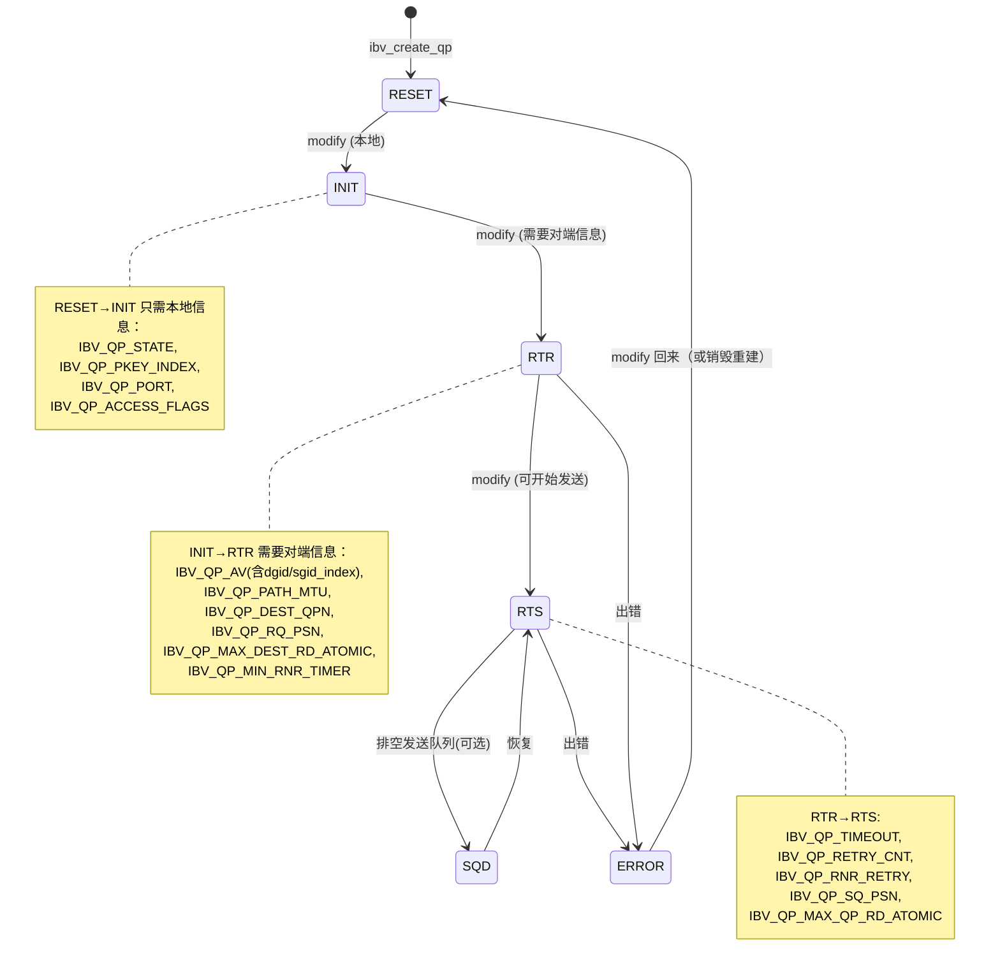

# 第 4 章　Verbs 对象模型与编程模型（核心章节）

> **本章目标**：把 verbs API 从「一堆函数」变成「一棵对象树 + 四条规则」。读完你应该能**独立写出正确的 verbs 程序**，并解释每一步为什么必须那么做。
>
> **本章对应源码**：
> - `rdma-core:libibverbs/verbs.h` —— API 权威定义（本章所有结构体/枚举的真实出处，均给出精确行号）
> - `rdma-core:libibverbs/examples/rc_pingpong.c` —— **最权威的官方示例**，本章的状态迁移序列逐行取自它（`pp_connect_ctx()`，`rc_pingpong.c:104-160`）
> - `rdma-core:libibverbs/verbs.c` —— 通用实现
> - `kernel:include/rdma/ib_verbs.h` —— 内核侧对应物
>
> **配套实验**：[`labs/lab02-verbs-programming.md`](labs/lab02-verbs-programming.md)（用 strace 验证每个对象创建的 syscall、故意注入错误观察 WC 状态码）

---

## 4.1 对象树：一张图记住所有 verbs 对象



### 四种「绑定」关系（决定了正确性与性能）

| 关系 | 谁绑谁 | 为什么 | 违反了会怎样 |
|---|---|---|---|
| **PD → MR, QP, AH, MW** | MR/QP/AH 属于某个 PD | 内存保护：QP 只能用**同 PD** 的 MR | `ibv_post_send` 返回 `EINVAL` 或 WC 报 `LOC_PROT_ERR` |
| **CQ → QP** | QP 创建时指定 `send_cq`/`recv_cq` | 完成事件投递到哪个 CQ | 创建失败 |
| **SRQ → QP（可选）** | QP 用 `srq` 共享接收队列 | 多 QP 共享接收缓冲，省内存 | —— |
| **comp_channel → CQ（可选）** | CQ 关联事件通道 | 用事件通知代替轮询 | —— |

> **【必会】PD 是「安全域」**。一个 QP 不能读写另一个 PD 的 MR。这是硬件级的隔离，**不要为了省事把所有东西都塞进一个 PD** —— 多租户/多业务场景要按 PD 隔离。

---

## 4.2 完整编程流程（10 步，建议背下来）



> **注意第 8 步前的握手**：RDMA 的 QP 要进入 RTR/RTS，必须知道**对端的 QPN、GID/LID、PSN**；要用 RDMA WRITE 还要知道**对端的 `rkey` 与虚拟地址**。这些信息**没有任何协议替你传**，必须自己用带外通道（TCP socket 或 RDMA_CM 的 `private_data`）交换。这是初学者第一个卡点。

---

## 4.3 逐个对象的 API 详解

### 4.3.1 设备与上下文

```c
/* 设备列表（返回 NULL 结尾的数组；用完必须 free） */
struct ibv_device **ibv_get_device_list(int *num_devices);
const char *ibv_get_device_name(struct ibv_device *device);
void ibv_free_device_list(struct ibv_device **list);

/* 打开设备（每个进程对每个设备通常只打开一次） */
struct ibv_context *ibv_open_device(struct ibv_device *device);
int ibv_close_device(struct ibv_context *context);

/* 查询能力（ibv_device_attr 见 verbs.h:183） */
int ibv_query_device(struct ibv_context *context, struct ibv_device_attr *attr);
int ibv_query_port(struct ibv_context *context, uint8_t port_num,
                   struct ibv_port_attr *port_attr);   /* verbs.h:428 */
int ibv_query_gid(struct ibv_context *context, uint8_t port_num,
                  int index, union ibv_gid *gid);
```

**必须检查的关键能力字段**（`ibv_device_attr`）：

| 字段 | 含义 | 为什么要查 |
|---|---|---|
| `max_qp` | 最大 QP 数 | 多 QP 程序必须核对 |
| `max_cqe` | CQ 最大深度 | `ibv_create_cq(cqe)` 不能超 |
| `max_mr` / `max_mr_size` | MR 数量与单块最大长度 | 大内存注册要分块 |
| `max_qp_wr` | 每 QP 最大 WR 数 | **决定 `tx_depth`（perftest 的 `--tx_depth`）** |
| `max_sge` | 每 WR 最大 SGE 数 | 分散聚合能力 |
| `max_qp_rd_atom` / `max_qp_init_rd_atom` | 未完成 READ/ATOMIC 上限 | 影响单边操作并发度 |
| `atomic_cap` | 原子操作能力 | 用原子前必须查 |

> **易错点**：`max_mtu` / `max_msg_sz` **不属于 `ibv_device_attr`**，它们和 `active_mtu`/`gid_tbl_len` 一样定义在 `struct ibv_port_attr`（`rdma-core:libibverbs/verbs.h:430/434`），见下一张表。

**`ibv_port_attr` 里 RoCE 场景最关心的字段**：

| 字段 | 取值 | 含义 |
|---|---|---|
| `state` | `IBV_PORT_ACTIVE`(4) | 端口可用 |
| `link_layer` | `IBV_LINK_LAYER_ETHERNET`(2) | **Ethernet = RoCE；InfiniBand = IB** |
| `gid_tbl_len` | 例如 8 / 16 / 32 | GID 表长度，决定 `--gid-index` 的合法范围 |
| `active_mtu` / `max_mtu` | `IBV_MTU_1024` 等（`verbs.h:367`） | 与对端必须协商一致 |
| `max_msg_sz` | 例如 2^31 | 单条消息最大字节数（`verbs.h:434`）；大消息要分片 |

> **【易错点】`active_mtu` 是「折算」出来的，不是设出来的**：RoCE 下它由内核从 **netdev MTU** 推导 —— 保守扣掉 **96 B**（`kernel:include/rdma/ib_addr.h:179-181`：`IB_GRH_BYTES + IB_UDP_BYTES + IB_BTH_BYTES + IB_EXT_XRC_BYTES + IB_EXT_ATOMICETH_BYTES + IB_ICRC_BYTES` = 40+8+12+4+28+4），mlx5 再取 `min(max_mtu, iboe_get_mtu(ndev->mtu))`（`kernel:drivers/infiniband/hw/mlx5/main.c:630/634`）。**要得到 4096 的 RoCE MTU，netdev MTU 必须 ≥ 4192**（实践直接设 4200）。
> 别和另一个数混淆：**58 B**（14 以太 + 20 IPv4 + 8 UDP + 12 BTH + 4 ICRC）是**线缆帧开销**口径，只用来算有效载荷效率（带 VLAN 62 B、IPv6 78 B；单包的 RDMA WRITE 还要多 16 B 的 RETH，即 74 B，`kernel:drivers/infiniband/sw/rxe/rxe_hdr.h:526-530`）—— 它**不是** netdev MTU 的门槛。详见第 2.1 节。

### 4.3.2 PD（保护域）

```c
struct ibv_pd *ibv_alloc_pd(struct ibv_context *context);      /* 函数声明 verbs.h:2585（642 是 struct ibv_pd） */
int ibv_dealloc_pd(struct ibv_pd *pd);
```

轻量对象，一个进程几个到几十个即可。

### 4.3.3 MR（内存区域）★ 关键

```c
struct ibv_mr *ibv_reg_mr(struct ibv_pd *pd, void *addr, size_t length, int access);
int ibv_dereg_mr(struct ibv_mr *mr);
/* 扩展版：支持 iova / fd（dma-buf）/ dmah（设备内存）等，函数声明 verbs.h:2684（697 是 struct ibv_mr_init_attr） */
struct ibv_mr *ibv_reg_mr_iova2(struct ibv_pd *pd, void *addr, size_t length,
                                uint64_t iova, unsigned int access);
```

`struct ibv_mr`（`verbs.h:678`）：

```c
struct ibv_mr {
    struct ibv_context *context;
    struct ibv_pd      *pd;
    void               *addr;     /* 注册的虚拟地址（你的缓冲区） */
    size_t              length;
    uint32_t            handle;
    uint32_t            lkey;     /* 本地键：填在 ibv_sge.lkey 里 */
    uint32_t            rkey;     /* 远端键：交给对端用于远端访问 */
};
```

**访问权限（`enum ibv_access_flags`，`verbs.h:615`）**：

| 标志 | 值 | 什么时候需要 |
|---|---|---|
| `IBV_ACCESS_LOCAL_WRITE` | `1<<0` | **接收缓冲区必须设**（网卡要往里写）；本地 WRITE 到自己的 MR 也要 |
| `IBV_ACCESS_REMOTE_WRITE` | `1<<1` | 允许**对端** RDMA WRITE 进来 |
| `IBV_ACCESS_REMOTE_READ` | `1<<2` | 允许**对端** RDMA READ 读走 |
| `IBV_ACCESS_REMOTE_ATOMIC` | `1<<3` | 允许对端原子操作（**通常必须同时设 `REMOTE_WRITE`**） |
| `IBV_ACCESS_MW_BIND` | `1<<4` | 允许绑定内存窗口 |
| `IBV_ACCESS_ZERO_BASED` | `1<<5` | 使用零基地址（`remote_addr` 从 0 开始编址） |
| `IBV_ACCESS_ON_DEMAND` | `1<<6` | ODP：按需缺页，适合大/稀疏内存 |
| `IBV_ACCESS_HUGETLB` | `1<<7` | 大页（**建议配合大页使用**） |
| `IBV_ACCESS_RELAXED_ORDERING` | 见头文件 | PCIe Relaxed Ordering，**提升带宽**（perftest 默认开） |
| `IBV_ACCESS_FLUSH_GLOBAL` / `_PERSISTENT` | `1<<8` / `1<<9` | 持久内存 flush 语义 |

**权限组合速查（直接抄）**：

| 用途 | access |
|---|---|
| 只做 SEND/RECV 的发送缓冲 | `IBV_ACCESS_LOCAL_WRITE` |
| **接收缓冲**（SEND 的对端） | `IBV_ACCESS_LOCAL_WRITE` |
| 本端发 RDMA WRITE，对端只收 | 本端 `IBV_ACCESS_LOCAL_WRITE`；**对端** `IBV_ACCESS_LOCAL_WRITE \| IBV_ACCESS_REMOTE_WRITE` |
| 本端发 RDMA READ，对端被读 | **对端** `IBV_ACCESS_LOCAL_WRITE \| IBV_ACCESS_REMOTE_READ` |
| 原子操作 | **对端** `IBV_ACCESS_LOCAL_WRITE \| IBV_ACCESS_REMOTE_WRITE \| IBV_ACCESS_REMOTE_ATOMIC` |
| 想又快又通用（perftest 默认） | `LOCAL_WRITE \| REMOTE_WRITE \| REMOTE_READ \| REMOTE_ATOMIC` |

> **【行业重点】MR 注册性能与内存注册策略**
> - `ibv_reg_mr` 会把用户页 **pin 住（不可换出）** 并建立 DMA 映射，很贵（μs–ms 级，取决于页数与是否大页）。
> - 因此**必须**：① 启动时注册、长期复用；② 用 **hugepage（2MB/1GB）** 减少页表项数量（`IBV_ACCESS_HUGETLB`）；③ 需要动态增长时考虑 **ODP**（`IBV_ACCESS_ON_DEMAND`）。
> - `ulimit -l`（memlock）是硬限制，注册失败先查它。
> - **`rkey` 是安全凭证**：不要打印到日志、不要发给不信任的节点。用完可 `ibv_dereg_mr` 使其失效。

**错误码对照**：

| `errno` | 原因 | 处理 |
|---|---|---|
| `ENOMEM` | memlock 超限 / 超过 `max_mr` | `ulimit -l unlimited`；分块注册 |
| `EPERM` | 权限不合法或安全策略拒绝 | 检查 access 组合 |
| `EINVAL` | 参数非法（addr 未对齐等） | 检查对齐（通常要求页对齐） |
| `EACCES` | 内存不可访问 | 检查指针有效性 |

### 4.3.4 CQ（完成队列）

```c
struct ibv_cq *ibv_create_cq(struct ibv_context *context, int cqe, void *cq_context,
                             struct ibv_comp_channel *channel, int comp_vector);
int ibv_destroy_cq(struct ibv_cq *cq);
int ibv_poll_cq(struct ibv_cq *cq, int num_entries, struct ibv_wc *wc);
int ibv_req_notify_cq(struct ibv_cq *cq, int solicited_only);
```

| 参数 | 含义 | 实践建议 |
|---|---|---|
| `cqe` | CQ 深度（能容纳多少个未收割的 CQE） | **必须 ≥ 在途 WR 数**，否则 CQ overrun（`IBV_EVENT_CQ_ERR`）。perftest 建 CQ 时用的是 `tx_depth × num_of_qps` / `rx_depth × num_of_qps`（`perftest:src/perftest_resources.c:2052-2061`），即按 QP 数放大 |
| `cq_context` | 回调上下文 | 可放自己的结构体指针 |
| `channel` | 完成事件通道 | `NULL` = 纯轮询（性能最好）；非 `NULL` = 可阻塞等待 |
| `comp_vector` | 中断向量（多队列分散） | 多 QP 时分散到不同向量可减少锁竞争 |

**`ibv_poll_cq` 返回值的三种含义（必须正确处理）**：

```c
do {
    n = ibv_poll_cq(cq, 1, &wc);
} while (n == 0);            /* 0 = 暂时没有完成事件，继续轮询 */
if (n < 0) { /* 出错，CQ 可能已损坏 */ }
/* n > 0：成功取出一个 WC，检查 wc.status */
```

**WC（`struct ibv_wc`，`verbs.h:593`）字段**：

| 字段 | 含义 |
|---|---|
| `wr_id` | **你投递 WR 时填的 ID，原样返回** —— 用它关联「哪个请求完成了」 |
| `status` | 完成状态，**必须检查**（`ibv_wc_status_str()` 可转字符串） |
| `opcode` | 完成的操作类型（`IBV_WC_SEND`/`RDMA_WRITE`/`RECV`…，`verbs.h:517`） |
| `vendor_err` | 厂商私有错误码 |
| `byte_len` | **接收到的字节数**（接收完成时有效） |
| `qp_num` | 本端 QP 号 |
| `src_qp` | **UD 专用**：发送方 QPN |
| `wc_flags` | `IBV_WC_GRH`（UD 带 GRH）、`IBV_WC_WITH_IMM`（带立即数） |
| `imm_data` | 立即数（网络字节序！`verbs.h:599` 注释明确说明） |

**状态码诊断表（`enum ibv_wc_status`，`verbs.h:489`）**：

| 状态 | 典型原因 | 处理方向 |
|---|---|---|
| `IBV_WC_SUCCESS` | 正常 | —— |
| `IBV_WC_LOC_LEN_ERR` | 本地 SGE 长度问题 / 接收缓冲太小 | 加大接收缓冲 |
| `IBV_WC_LOC_PROT_ERR` | **lkey 非法或 PD 不匹配** | 检查 SGE 里填的 `lkey` 是否来自同 PD 的 MR |
| `IBV_WC_LOC_ACCESS_ERR` | 本地访问违例（如未设 `LOCAL_WRITE` 就接收） | 补权限 |
| `IBV_WC_REM_ACCESS_ERR` | **对端 rkey/权限/长度错误** | 核对 `rkey` 是否失效、是否设了 `REMOTE_WRITE`、`remote_addr+len` 是否越界 |
| `IBV_WC_REM_INV_REQ_ERR` | 对端认为请求非法（如 UC 上发 READ） | 检查 QP 类型支持的操作 |
| `IBV_WC_REM_OP_ERR` | 对端操作错误 | 看对端日志 |
| `IBV_WC_RNR_RETRY_EXC_ERR` | **对端没及时 post RECV**，重试耗尽 | 对端提前投递 RECV；调大 `rnr_retry` |
| `IBV_WC_RETRY_EXC_ERR` | ACK 超时重试耗尽 | 查网络（丢包/不通）、`timeout`、`retry_cnt` |
| `IBV_WC_WR_FLUSH_ERR` | QP 进 ERROR 后，SQ 中剩余 WR 被冲刷 | **这是「连带失败」**，真正原因在第一个出错的 WC |
| `IBV_WC_RESP_TIMEOUT_ERR` | 响应超时 | 网络或对端问题 |
| `IBV_WC_MW_BIND_ERR` | 内存窗口绑定失败 | 检查 MW 与权限 |

> **【实战铁律】WC 报错时，永远先看 `wr_id` 对应的第一个错误，再处理 `WR_FLUSH_ERR` 的连带项。**
> 出现 `WR_FLUSH_ERR` 说明 QP 已进 ERROR 态，此时**必须重建 QP**（modify 回 RESET 也行，但实践中建议重建）。

**两种收割模式对比**：

| 模式 | 代码 | 优点 | 缺点 |
|---|---|---|---|
| **轮询（busy-poll）** | `while (!ibv_poll_cq(...)) ;` | **延迟最低**（无中断开销） | 占满一个 CPU 核（100%） |
| **事件通知** | `ibv_req_notify_cq` + `ibv_get_cq_event` + `ibv_ack_cq_events` | 省 CPU | 每次唤醒有系统调用 + 中断延迟（+1–3 μs） |

**混合策略（生产推荐）**：先轮询若干次（如 50 次），未完成再 `ibv_req_notify_cq` 进入阻塞等待 —— 兼顾低延迟与低 CPU。

> `ibv_get_cq_event` 取到事件后**必须** `ibv_ack_cq_events(cq, n)`，否则 CQ 销毁会阻塞。

### 4.3.5 QP（队列对）★★ 全章最重要

```c
struct ibv_qp *ibv_create_qp(struct ibv_pd *pd, struct ibv_qp_init_attr *qp_init_attr);
int ibv_destroy_qp(struct ibv_qp *qp);
int ibv_modify_qp(struct ibv_qp *qp, struct ibv_qp_attr *attr, int attr_mask);
int ibv_query_qp(struct ibv_qp *qp, struct ibv_qp_attr *attr, int attr_mask,
                 struct ibv_qp_init_attr *init_attr);
int ibv_post_send(struct ibv_qp *qp, struct ibv_send_wr *wr, struct ibv_send_wr **bad_wr);
int ibv_post_recv(struct ibv_qp *qp, struct ibv_recv_wr *wr, struct ibv_recv_wr **bad_wr);
```

> QP 号直接读字段：`qp->qp_num`（`struct ibv_qp` 的成员，类型 `uint32_t`）。这是握手时要告诉对端的第一个信息。

**`ibv_qp_init_attr`（`verbs.h:950`）**：

```c
struct ibv_qp_init_attr {
    void              *qp_context;
    struct ibv_cq     *send_cq;
    struct ibv_cq     *recv_cq;
    struct ibv_srq    *srq;        /* NULL = 不用 SRQ */
    struct ibv_qp_cap  cap;        /* max_send_wr / max_recv_wr / max_send_sge / max_recv_sge / max_inline_data */
    enum ibv_qp_type   qp_type;    /* IBV_QPT_RC / UC / UD / ...  */
    int                sq_sig_all; /* 1 = 每个 WR 都产生 CQE（简单但慢）；0 = 按需 SIGNALED */
};
```

> **【性能重点】`sq_sig_all` 与 `IBV_SEND_SIGNALED`**
> 每个 CQE 都是硬件/内存开销。高性能程序设 `sq_sig_all = 0`，只给**每 N 个 WR 中的最后一个**加 `IBV_SEND_SIGNALED`（例如每 16 或 64 个发一个），用「批量确认」减少 CQE 数量、提升带宽。perftest 内部也是这个思路。
> 代价：出错时要回退到「上一个已 signal 的 WR」重新发送未确认的 WR。

**QP 状态机（`enum ibv_qp_state`，`verbs.h:1082`）**：



**三次 `ibv_modify_qp` 的完整写法（逐字段注释，RoCE 场景）**：

```c
/* ---------- (1) RESET → INIT：只涉及本地资源 ---------- */
{
    struct ibv_qp_attr attr = {
        .qp_state        = IBV_QPS_INIT,
        .pkey_index      = 0,                 /* RoCE 通常用 0（pkey=0xffff） */
        .port_num        = port_num,          /* RoCE 场景一般是 1 */
        .qp_access_flags = IBV_ACCESS_LOCAL_WRITE  |
                           IBV_ACCESS_REMOTE_WRITE |
                           IBV_ACCESS_REMOTE_READ  |
                           IBV_ACCESS_REMOTE_ATOMIC,
    };
    if (ibv_modify_qp(qp, &attr,
                      IBV_QP_STATE      |
                      IBV_QP_PKEY_INDEX |
                      IBV_QP_PORT       |
                      IBV_QP_ACCESS_FLAGS))
        die("modify_qp to INIT failed");
}

/* ---------- (2) INIT → RTR：必须已拿到对端信息 ---------- */
{
    struct ibv_qp_attr attr = {
        .qp_state           = IBV_QPS_RTR,
        .path_mtu           = IBV_MTU_1024,    /* 必须与对端一致！ */
        .dest_qp_num        = remote_qpn,      /* 对端 QP 号（握手得到） */
        .rq_psn             = 0,               /* 对端 SQ 的 PSN 起点 */
        .max_dest_rd_atomic = 1,               /* 允许对端同时多少个 READ/ATOMIC */
        .min_rnr_timer      = 12,              /* RNR NAK 定时器（12 ≈ 0.64ms） */
        .ah_attr = {
            .is_global     = 1,                /* ★ RoCE 必须为 1（要用 GRH） */
            .grh = {
                .dgid        = remote_gid,     /* ★ 对端 GID（地址的来源） */
                .sgid_index  = sgid_index,     /* ★ 本端 GID index（决定源 IP/VLAN） */
                .hop_limit   = 64,             /* ★ 会写成 IP TTL */
                .traffic_class = 0,            /* ★ 会写成 IP TOS（DSCP/ECN） */
                .flow_label  = 0,              /* ★ 0 = 自动按 QPN 推导（利于 ECMP） */
            },
            .port_num      = port_num,
        },
    };
    if (ibv_modify_qp(qp, &attr,
                      IBV_QP_STATE              |
                      IBV_QP_AV                 |
                      IBV_QP_PATH_MTU           |
                      IBV_QP_DEST_QPN           |
                      IBV_QP_RQ_PSN             |
                      IBV_QP_MAX_DEST_RD_ATOMIC |
                      IBV_QP_MIN_RNR_TIMER))
        die("modify_qp to RTR failed");
}

/* ---------- (3) RTR → RTS：可以开始发送了 ---------- */
{
    struct ibv_qp_attr attr = {
        .qp_state        = IBV_QPS_RTS,
        .timeout         = 14,     /* 本地 ACK 超时：4.096us * 2^14 ≈ 67ms */
        .retry_cnt       = 7,      /* 重试 7 次 */
        .rnr_retry       = 7,      /* RNR 重试 7 次（7 = 无限重试） */
        .sq_psn          = 0,      /* 本端 SQ 的 PSN 起点 */
        .max_rd_atomic   = 1,      /* 本端同时允许多少个未完成 READ/ATOMIC */
    };
    if (ibv_modify_qp(qp, &attr,
                      IBV_QP_STATE            |
                      IBV_QP_TIMEOUT          |
                      IBV_QP_RETRY_CNT        |
                      IBV_QP_RNR_RETRY        |
                      IBV_QP_SQ_PSN           |
                      IBV_QP_MAX_QP_RD_ATOMIC))
        die("modify_qp to RTS failed");
}
```

> **以上序列与官方示例 `rc_pingpong.c:104-160` 完全一致**（该示例用 `.ah_attr.is_global = 0` + `dlid` 走 IB 路径，并在检测到 `gid.global.interface_id` 非零时才切到 `is_global = 1`。**RoCE 场景直接设 `is_global = 1` 即可**）。

**关键参数取值指南**：

| 参数 | 含义 | 推荐取值 | 备注 |
|---|---|---|---|
| `path_mtu` | 路径 MTU | `IBV_MTU_1024` 或 `IBV_MTU_4096` | **两端必须一致**；且不能超过 `max_mtu` |
| `timeout` | 本地 ACK 超时 = `4.096μs × 2^timeout` | 14（≈67ms） | 值越大越能容忍网络抖动，但故障发现越慢 |
| `retry_cnt` | 重试次数 | 7（特殊值 = 无限重试） | 7 是最大值；链路层实现里 7 不会递减，即永不放弃（`kernel:drivers/infiniband/sw/rxe/rxe_comp.c:775-776`） |
| `rnr_retry` | RNR 重试 | 7（特殊值 = 无限重试） | 设置为 7 可避免对端投递慢导致的 `RNR_RETRY_EXC_ERR` |
| `min_rnr_timer` | RNR NAK 定时器 | 12（≈0.64ms） | 接收侧告诉发送侧「多久后再试」 |
| `max_rd_atomic` | 本端未完成 READ/ATOMIC 上限 | 1–16 | 影响单边操作并发；`max_dest_rd_atomic` 是对端视角 |
| `sq_psn` / `rq_psn` | PSN 起点 | **两端约定同一初值**（常为 0） | 不一致会导致 PSN 序列错误 |

### 4.3.6 投递工作请求（WR）

**发送：`ibv_send_wr`（`verbs.h:1188`）+ `ibv_sge`（`verbs.h:1177`）**

```c
struct ibv_sge {
    uint64_t addr;    /* 本地缓冲区地址（必须是已注册 MR 内的地址） */
    uint32_t length;  /* 长度 */
    uint32_t lkey;    /* 该 MR 的 lkey */
};

struct ibv_send_wr {
    uint64_t            wr_id;       /* 用户标识，CQE 里原样返回 */
    struct ibv_send_wr *next;        /* 链表：一次 post 多个 WR */
    struct ibv_sge     *sg_list;     /* SGE 数组（分散/聚集） */
    int                 num_sge;
    enum ibv_wr_opcode  opcode;      /* 见下表 */
    unsigned int        send_flags;  /* SIGNALED / INLINE / FENCE / SOLICITED */
    union { __be32 imm_data; uint32_t invalidate_rkey; };
    union {
        struct { uint64_t remote_addr; uint32_t rkey; } rdma;         /* WRITE/READ */
        struct { uint64_t remote_addr; uint64_t compare_add;
                 uint64_t swap; uint32_t rkey; } atomic;              /* 原子操作 */
        struct { struct ibv_ah *ah; uint32_t remote_qpn;
                 uint32_t remote_qkey; } ud;                          /* UD */
    } wr;
};
```

**opcode 与所需字段对照表（★ 极易出错，务必记牢）**：

| opcode | 语义 | 需要 `wr.rdma` | 需要 SGE | 对端需要 RECV |
|---|---|---|---|---|
| `IBV_WR_SEND` | 双边发送 | ✗ | ✓ | **✓** |
| `IBV_WR_SEND_WITH_IMM` | 发送 + 4B 立即数 | ✗ | ✓ | **✓** |
| `IBV_WR_RDMA_WRITE` | 单边写 | ✓（`remote_addr`,`rkey`） | ✓（源数据） | ✗ |
| `IBV_WR_RDMA_WRITE_WITH_IMM` | 单边写 + 通知 | ✓ | ✓ | ✗（但会产生接收 CQE） |
| `IBV_WR_RDMA_READ` | 单边读 | ✓ | ✓（**本地目的缓冲**） | ✗ |
| `IBV_WR_ATOMIC_CMP_AND_SWP` | 比较并交换 | `wr.atomic` | ✓（4 或 8 字节） | ✗ |
| `IBV_WR_ATOMIC_FETCH_AND_ADD` | 取回并加 | `wr.atomic` | ✓ | ✗ |
| `IBV_WR_LOCAL_INV` | 本地失效 MR | ✗ | ✗ | ✗ |
| `IBV_WR_SEND_WITH_INV` | 发送 + 让对端失效 rkey | ✗ | ✓ | ✓ |

> **注意 `IBV_WR_RDMA_READ` 的 SGE 方向与 WRITE 相反**：
> - WRITE：SGE 指向**本地源数据**，`remote_addr` 是**对端目的地址**；
> - READ：SGE 指向**本地目的缓冲**，`remote_addr` 是**对端源地址**。
> **搞反了不会报错，只会拿到错数据** —— 这是最难查的一类 bug。

**`send_flags`（`verbs.h:1154`）**：

| 标志 | 作用 | 何时用 |
|---|---|---|
| `IBV_SEND_SIGNALED` | 该 WR 完成时产生 CQE | 需要知道完成时；批量发送时每 N 个加一次 |
| `IBV_SEND_INLINE` | 数据**内联进 WQE**，网卡直接从 WQE 取数据（不做 DMA 读） | **小消息（≤ `max_inline_data`）延迟最低**；perftest 的 `--inline_size` |
| `IBV_SEND_FENCE` | 保证此 WR 之前的 RDMA READ 全部完成 | 需要顺序保证时（有性能代价） |
| `IBV_SEND_SOLICITED` | 置 BTH 的 SE 位，让对端只对 solicited 消息产生 CQE | 减少对端 CQE 数量 |
| `IBV_SEND_IP_CSUM` | 让网卡算 IP 校验和（RAW_PACKET 用） | raw ethernet 模式 |

**接收：`ibv_recv_wr`（`verbs.h:1238`）**

```c
struct ibv_recv_wr {
    uint64_t            wr_id;
    struct ibv_recv_wr *next;
    struct ibv_sge     *sg_list;
    int                 num_sge;
};
```

**投递接收缓冲的正确姿势（RC 场景）**：

```c
/* 关键：接收缓冲必须提前投递足够多，否则对端 SEND 会收到 RNR NAK */
for (int i = 0; i < rx_depth; i++) {
    struct ibv_sge     sge = { .addr   = (uintptr_t)buf + i * size,
                               .length = size,
                               .lkey   = mr->lkey };
    struct ibv_recv_wr wr  = { .wr_id = i, .sg_list = &sge, .num_sge = 1 };
    struct ibv_recv_wr *bad;
    if (ibv_post_recv(qp, &wr, &bad)) die("post_recv failed");
}
/* 每收到一个 RECV 完成，就要补投一个，保持「信用」 */
```

> **【必会】RDMA WRITE **不会**消耗对端的 RECV WR**，但 **`RDMA_WRITE_WITH_IMM` 会**（因为要在对端产生一个带立即数的接收 CQE）。这是「WRITE 与 WRITE_WITH_IMM」在资源规划上的关键差异。

**发送的批量投递（链表）**：

```c
struct ibv_send_wr wrs[N], *bad;
for (int i = 0; i < N; i++) {
    wrs[i].next = (i == N-1) ? NULL : &wrs[i+1];
    wrs[i].send_flags = (i == N-1) ? IBV_SEND_SIGNALED : 0;   /* 只最后一个要 CQE */
    /* ... 填 opcode / sg_list / wr.rdma ... */
}
if (ibv_post_send(qp, &wrs[0], &bad)) {
    /* bad 指向第一个失败的 WR；它之前的都已成功入队 */
    fprintf(stderr, "post_send failed at %p\n", (void*)bad);
}
```

### 4.3.7 AH（地址句柄）—— UD 专用

```c
struct ibv_ah *ibv_create_ah(struct ibv_pd *pd, struct ibv_ah_attr *attr);
int ibv_destroy_ah(struct ibv_ah *ah);
```

`struct ibv_ah_attr`（`verbs.h:793`）与 `struct ibv_global_route`（`verbs.h:722`）：

```c
struct ibv_global_route {
    union ibv_gid dgid;          /* 目的 GID（RoCE 用这个） */
    uint32_t      flow_label;    /* → UDP 源端口熵 */
    uint8_t       sgid_index;    /* 本端 GID 索引 */
    uint8_t       hop_limit;     /* → IP TTL */
    uint8_t       traffic_class; /* → IP TOS / DSCP */
};
struct ibv_ah_attr {
    struct ibv_global_route grh;
    uint16_t dlid;               /* IB 用（RoCE 忽略） */
    uint8_t  sl;                 /* Service Level（IB） */
    uint8_t  src_path_bits;
    uint8_t  static_rate;
    uint8_t  is_global;          /* ★ RoCE 必须 1 */
    uint8_t  port_num;
};
```

UD 发送时：

```c
wr.opcode        = IBV_WR_SEND;
wr.wr.ud.ah      = ah;             /* 目的地址 */
wr.wr.ud.remote_qpn  = remote_qpn; /* 对端 QP 号 */
wr.wr.ud.remote_qkey = 0x11111111; /* QKey，两端必须一致 */
```

### 4.3.8 SRQ（共享接收队列）

**解决的问题**：每个 QP 都要预投递 `rx_depth` 个接收缓冲。1000 个 QP × 128 深度 = 12.8 万个缓冲。SRQ 让多个 QP 共享一个接收队列池。

```c
struct ibv_srq *ibv_create_srq(struct ibv_pd *pd, struct ibv_srq_init_attr *srq_init_attr);
int ibv_modify_srq(struct ibv_srq *srq, struct ibv_srq_attr *attr, int attr_mask);
int ibv_post_srq_recv(struct ibv_srq *srq, struct ibv_recv_wr *wr, struct ibv_recv_wr **bad_wr);
int ibv_destroy_srq(struct ibv_srq *srq);
```

使用要点：

1. `ibv_create_qp` 时把 `init_attr.srq` 指向 SRQ（**RC/UC/UD 都支持**，但一个 QP 只能属于一个 SRQ）；
2. 用 `ibv_post_srq_recv` 投递缓冲；
3. `ibv_query_qp` 时注意 `IBV_QP_...`/`qp_attr.srq` 相关字段；
4. **`IBV_EVENT_QP_LAST_WQE_REACHED`** 事件用于感知「关联 QP 的最后一个 WQE 被处理」；
5. `ibv_modify_srq` 可动态调 `srq_limit`，触发 `IBV_EVENT_SRQ_LIMIT_REACHED` 来「补充缓冲」。

### 4.3.9 异步事件（必须处理）

RDMA 是**异步**的：端口可能 down、QP 可能 fatal、CQ 可能 overrun。这些通过 **async fd** 上报。

```c
struct ibv_context *ctx = ibv_open_device(dev);
int fd = ctx->async_fd;                       /* 可直接 poll() */
/* 或注册回调 */
ibv_register_async_event?  /* 实际上是通过 ibv_get_async_event / ibv_ack_async_event 拉取 */
struct ibv_async_event event;
if (ibv_get_async_event(ctx, &event) == 0) {
    switch (event.event_type) {
    case IBV_EVENT_QP_FATAL:      /* QP 进 ERROR */
    case IBV_EVENT_CQ_ERR:        /* CQ overrun —— 深度不够！ */
    case IBV_EVENT_PORT_ERR:      /* 链路 down */
    case IBV_EVENT_GID_CHANGE:    /* GID 表变了（RoCE 换 IP 时） */
        ...
    }
    ibv_ack_async_event(&event);             /* 必须 ack */
}
```

**事件类型总表**见 [`reference/glossary-quickref.md`](reference/glossary-quickref.md) 的「2.7 异步事件类型总表」。

**RoCE 工程师必须处理的三个事件**：

| 事件 | 为什么重要 |
|---|---|
| `IBV_EVENT_GID_CHANGE` | **RoCE 特有**：netdev 上 IP/VLAN 变化会导致 GID 表变化，缓存的 GID index 可能失效 |
| `IBV_EVENT_PORT_ERR` / `IBV_EVENT_PORT_ACTIVE` | 链路抖动时程序应暂停并按需重建 QP |
| `IBV_EVENT_QP_FATAL` | 必须重建 QP（见 WC 错误处理铁律） |

---

## 4.4 【行业重点】常见错误与最佳实践清单

### 4.4.1 新手最容易犯的 10 个错误

| # | 错误 | 后果 | 正确做法 |
|---|---|---|---|
| 1 | 接收缓冲没有 `IBV_ACCESS_LOCAL_WRITE` | 收不到数据 / `LOC_ACCESS_ERR` | 接收 buff 一定加该权限 |
| 2 | SGE 里填了错误的 `lkey`（跨 PD 或过期） | `LOC_PROT_ERR` | 严格用同 PD 的 `mr->lkey` |
| 3 | 两端 `path_mtu` 不一致 | 带宽异常或连不上 | 显式设置且一致 |
| 4 | `sgid_index`（perftest 的 `-x`）选错 GID | 连不上（最常见！） | 核对 `show_gids` |
| 5 | 忘记 post 足够的 RECV | 对端 `RNR_RETRY_EXC_ERR` | 预投递 `rx_depth` 个并及时补充 |
| 6 | CQ 深度 < 在途 WR 数 | `IBV_EVENT_CQ_ERR`（overrun） | `cqe ≥ 在途 WR 数` |
| 7 | RDMA READ 的 SGE 填成源而不是目的 | **静默数据错误** | 记牢方向 |
| 8 | `sq_sig_all = 1` 且不设 SIGNALED 策略 | 带宽上不去（CQE 太多） | 批量确认 |
| 9 | 忘记处理异步事件 | 悄无声息地卡死/错数据 | 起一个事件线程 |
| 10 | `imm_data` 忘了字节序转换 | 立即数不正确 | `imm_data` 是 `__be32`，用 `htonl`/`ntohl` |

### 4.4.2 高性能 verbs 程序的 8 条实践

1. **大页内存**：`mmap(MAP_HUGETLB)` 或 `/dev/hugepages`，配合 `IBV_ACCESS_HUGETLB`，减少 TLB miss 与 MR 注册开销。
2. **NUMA 亲和**：缓冲区、CQ、QP 所在的网卡要同 NUMA 节点；线程绑核（`sched_setaffinity`）。
3. **批量投递 + 稀疏 CQE**：一次 `post_send` 挂多个 WR，只给最后一个 `SIGNALED`。
4. **INLINE 小消息**：`≤ max_inline_data` 的消息用 `IBV_SEND_INLINE`，省一次 DMA。
5. **轮询收 CQE**，或「轮询 N 次 + 事件」。绝不用「纯事件 + 立即阻塞」跑延迟敏感负载。
6. **开 Relaxed Ordering**：`IBV_ACCESS_RELAXED_ORDERING`（PCIe 层面放宽顺序，提升带宽）。
7. **多 QP 分散**：单 QP 受 ECMP 单路径限制（第 2.7 节）；多 QP + 多 CQ + 多 comp_vector 才能吃满多链路。
8. **避免数据路径上的系统调用**：不要在收发循环里 `reg_mr`/`create_qp`/打印日志。

### 4.4.3 资源销毁顺序（逆序创建，且必须先确保无在途操作）

```c
ibv_destroy_qp(qp);        /* 1. 先销毁 QP（停止一切传输） */
ibv_destroy_cq(cq);        /* 2. 再销毁 CQ（QP 已不再引用它） */
ibv_dereg_mr(mr);          /* 3. 再注销 MR（QP/CQ 已不引用） */
ibv_dealloc_pd(pd);        /* 4. 再释放 PD */
ibv_close_device(ctx);     /* 5. 最后关闭设备 */
```

> **注意 `ibv_destroy_cq` 的行为**：只要还有 QP（或其它对象）引用该 CQ，内核 `ib_destroy_cq_user()` 会**立即返回 `-EBUSY`**（`kernel:drivers/infiniband/core/verbs.c:2258-2259`：`if (atomic_read(&cq->usecnt)) return -EBUSY;`），而不是阻塞等待。所以看到 `EBUSY` → 先销毁所有关联 QP。
> 真正会让 `ibv_destroy_cq` **永久阻塞**的是：**`ibv_get_cq_event` 取过事件却忘了 `ibv_ack_cq_events`**（用户态 `cmd_cq.c:262-264` 会在 `pthread_cond_wait` 里一直等 `comp_events_completed` 对齐）—— 这是著名的坑。

---

## 4.5 本章代码模板（可直接作为骨架）

一个最小但完整的 RC 连接建立骨架（只保留关键决策点）：

```c
#include <infiniband/verbs.h>
#include <stdio.h>
#include <stdlib.h>
#include <string.h>

#define PORT_NUM   1
#define GID_INDEX  3          /* ！！必须按 show_gids 改成你的 RoCEv2 行 */
#define BUF_SIZE   (1 << 20)
#define RX_DEPTH   128

struct ctx {
    struct ibv_context *context;
    struct ibv_pd      *pd;
    struct ibv_mr      *mr;
    struct ibv_cq      *cq;
    struct ibv_qp      *qp;
    char               *buf;
};

static void die(const char *m) { perror(m); exit(1); }

/* ① 找设备并打开 */
static struct ctx *init_ctx(const char *dev_name)
{
    struct ctx *c = calloc(1, sizeof(*c));
    struct ibv_device **list = ibv_get_device_list(NULL);
    if (!list) die("ibv_get_device_list");

    struct ibv_device *dev = NULL;
    for (int i = 0; list[i]; i++)
        if (!strcmp(ibv_get_device_name(list[i]), dev_name))
            dev = list[i];
    if (!dev) { fprintf(stderr, "device %s not found\n", dev_name); exit(1); }

    if (!(c->context = ibv_open_device(dev))) die("ibv_open_device");
    ibv_free_device_list(list);

    /* ② 查端口，确认是以太网（RoCE）且 GID index 合法 */
    struct ibv_port_attr pa;
    if (ibv_query_port(c->context, PORT_NUM, &pa)) die("ibv_query_port");
    if (pa.link_layer != IBV_LINK_LAYER_ETHERNET)
        fprintf(stderr, "warning: link_layer is not Ethernet\n");
    if (GID_INDEX >= pa.gid_tbl_len)
        fprintf(stderr, "warning: GID_INDEX %d >= gid_tbl_len %d\n",
                GID_INDEX, pa.gid_tbl_len);

    /* ③ PD */
    if (!(c->pd = ibv_alloc_pd(c->context))) die("ibv_alloc_pd");

    /* ④ 内存 + MR（大页 + Relaxed Ordering + 全权限） */
    if (posix_memalign((void **)&c->buf, 4096, BUF_SIZE)) die("posix_memalign");
    memset(c->buf, 0, BUF_SIZE);
    c->mr = ibv_reg_mr(c->pd, c->buf, BUF_SIZE,
                       IBV_ACCESS_LOCAL_WRITE  |
                       IBV_ACCESS_REMOTE_WRITE |
                       IBV_ACCESS_REMOTE_READ  |
                       IBV_ACCESS_REMOTE_ATOMIC |
                       IBV_ACCESS_RELAXED_ORDERING);
    if (!c->mr) die("ibv_reg_mr (check ulimit -l)");

    /* ⑤ CQ：深度必须 >= 在途 WR 数 */
    if (!(c->cq = ibv_create_cq(c->context, RX_DEPTH * 2, NULL, NULL, 0)))
        die("ibv_create_cq");

    /* ⑥ QP */
    struct ibv_qp_init_attr qia = {
        .send_cq = c->cq,
        .recv_cq = c->cq,
        .cap     = { .max_send_wr  = 128,
                     .max_recv_wr  = RX_DEPTH,
                     .max_send_sge = 1,
                     .max_recv_sge = 1,
                     .max_inline_data = 64 },
        .qp_type   = IBV_QPT_RC,
        .sq_sig_all = 0,        /* 手动控制 SIGNALED，性能更好 */
    };
    if (!(c->qp = ibv_create_qp(c->pd, &qia))) die("ibv_create_qp");
    printf("local qp_num = 0x%06x, rkey = 0x%08x\n", c->qp->qp_num, c->mr->rkey);

    /* ⑦ INIT（本地信息即可） */
    /* ⑧ RTR（需要握手得到的 remote_qpn / remote_gid） */
    /* ⑨ RTS（可以发数据） */
    /* —— 这三步见 4.3.5 节的完整代码 —— */

    return c;
}
```

**完整的可运行版本请直接读官方示例**（强烈推荐，代码质量高、边界处理全）：

| 示例 | 学什么 |
|---|---|
| `rdma-core:libibverbs/examples/rc_pingpong.c` | **RC + SEND/RECV + 状态迁移 + 带外握手**（首选） |
| `rdma-core:libibverbs/examples/ud_pingpong.c` | UD + AH + QKey |
| `rdma-core:libibverbs/examples/srq_pingpong.c` | SRQ 用法 |
| `rdma-core:librdmacm/examples/rdma_client.c` / `rdma_server.c` | **用 RDMA_CM 简化建连** |
| `rdma-core:librdmacm/examples/rping.c` | CM 综合示例 |

---

## 4.6 内存模型与同步（容易被忽略但极其重要）

RDMA 的数据是**网卡 DMA** 进出的，与 CPU 缓存之间存在一致性问题：

| 场景 | 风险 | 处理 |
|---|---|---|
| 你先写 buffer，再 `post_send` | **CPU 写可能还在 cache 里，网卡读到旧数据** | 一般网卡会 snoop PCIe 保持一致性；但若用 `IBV_SEND_INLINE` 或非缓存内存需注意 |
| 收到数据后读 buffer | 网卡 DMA 写内存后，CPU cache 可能是旧的 | 通常 x86 上 CQE 的读取构成天然屏障；严谨做法用 `ibv_wc` 后再读，并用 `rte_smp_rmb` 类屏障 |
| 多线程共享 QP | QP 不是线程安全的 | **一个 QP 只由一个线程使用**；或用锁 |
| 一边 poll CQ 一边 post_send | 通常安全（不同队列） | 但销毁时的竞争要避免 |

**实践规则**：

1. **一个 QP / CQ 由一个线程独占**（最常见也最安全的模型）。
2. 收到 CQE 后再读数据区，不要「先读再等」。
3. 需要跨线程传递时用**无锁队列 + 显式内存屏障**。
4. **不要在没收到 CQE 前复用发送缓冲**（会被网卡覆盖）。

---

## 4.7 本章自检

1. 画出 verbs 对象树，并说明 PD 的作用。
2. QP 四次状态迁移分别需要哪些 `IBV_QP_*` 掩码？哪些需要**对端信息**？
3. `IBV_WR_RDMA_READ` 的 SGE 指向什么？与 WRITE 有何不同？
4. 接收缓冲区必须设置哪个 access flag？为什么？
5. `rnr_retry = 7` 的特殊含义是什么？
6. `sq_sig_all = 0` 时，如何知道一批 WR 完成了？
7. 看到 `IBV_WC_WR_FLUSH_ERR` 说明什么？应该怎么处理？
8. `IBV_WC_REM_ACCESS_ERR` 的排查清单是什么？
9. 资源销毁为什么必须是逆序？`ibv_destroy_cq` 卡住通常是什么原因？
10. 为什么单 QP 吃不满多链路带宽？怎么解决？

**下一章**：把上面的骨架补全成两个**可编译、可运行**的完整程序（RC 版与 UD 版），并逐步升级到 RDMA WRITE/READ 与 RDMA_CM。
