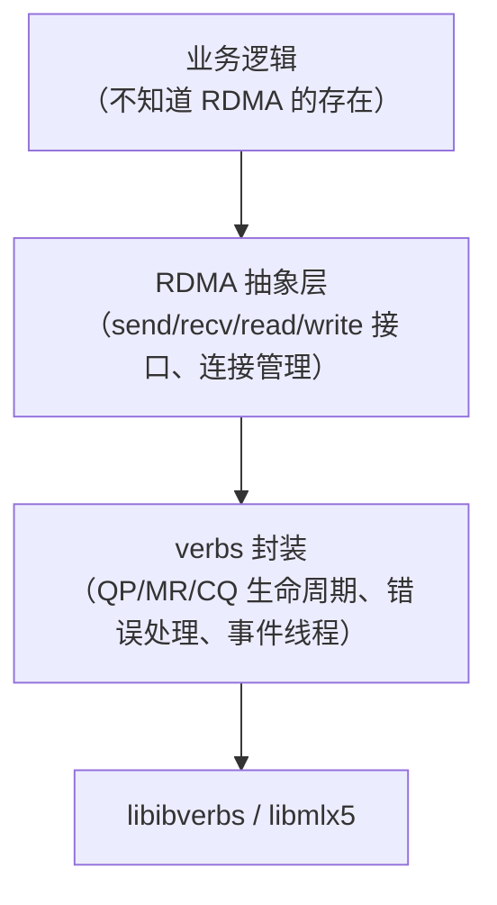

# 第 5 章　从零写出可运行的 RoCE 程序

> **本章目标**：把第 4 章的对象模型变成**能编译、能运行、能验证**的代码。读完你应该能独立写 RC 与 UD 两类程序，并知道生产代码该怎么组织。
>
> **本章对应源码**（对照阅读效果最好）：
> - `rdma-core:libibverbs/examples/rc_pingpong.c`（1276 行）—— **最小 RC 参考实现**
> - `rdma-core:libibverbs/examples/ud_pingpong.c` —— UD + AH
> - `rdma-core:librdmacm/examples/rdma_client.c` / `rdma_server.c` —— **用 RDMA_CM 的最简写法**（166 / 187 行，**强烈推荐先读这个**）
> - `rdma-core:librdmacm/examples/cmatose.c` / `rping.c` —— CM 事件驱动
>
> **配套实验**：[`labs/lab02-verbs-programming.md`](labs/lab02-verbs-programming.md)（编译运行本章的代码 + 10 个练习的验证方法）

---

## 5.1 先看结论：三种写法的取舍

| 写法 | 代码量 | 适用场景 | 代表 |
|---|---|---|---|
| **RDMA_CM（`rdma_*` API）** | **最少（~150 行）** | 绝大多数生产场景 | `librdmacm/examples/rdma_client.c` |
| 裸 verbs + 自己 TCP 握手 | 中（~400 行） | 想完全控制建连过程、需要自定义协议 | `libibverbs/examples/rc_pingpong.c` |
| RDMA_CM + 自己建 QP | 中（~300 行） | 需要 CM 的地址解析但自己控制 QP 参数 | `cmatose.c`、perftest `-R` |

> **【强烈建议的学习顺序】**：
> 1. 先读 `librdmacm/examples/rdma_client.c` + `rdma_server.c`（**166 / 187 行，30 分钟能读完**）—— 建立「一个完整的 RDMA 程序长什么样」的直觉；
> 2. 再读 `libibverbs/examples/rc_pingpong.c`（**1276 行，看清所有细节**）—— 理解 CM 帮你做了什么；
> 3. 然后自己写本章的练习；
> 4. 最后对照 `kernel:` 侧源码，理解每一步在内核里发生了什么。
>
> **不要跳过第 1 步直接读 pingpong。** 1276 行的细节会淹没你。

---

## 5.2 方式一：用 RDMA_CM 写最小可运行程序（推荐入门）

### 5.2.1 为什么推荐从 RDMA_CM 开始

回到第 4 章的结论：**「握手交换 QPN/GID/rkey」是初学者的第一个卡点**。RDMA_CM 帮你做了这些事：

| RDMA_CM 帮你做的 | 对应第 4 章的手工步骤 |
|---|---|
| 地址解析（IP → GID/设备/端口） | 自己查 GID 表、选 index |
| 路由解析（拿到 path record） | 自己解析对端 GID（第 7.8 节的内核逻辑） |
| **建立 QP 并自动迁移到 RTS** | 自己调 3 次 `ibv_modify_qp` |
| 交换 `private_data` | 自己设计 TCP 握手协议 |
| 处理 rej/超时/断开 | 自己处理所有异常路径 |

**代价**：你对建连过程的控制力下降（比如无法精确指定 `flow_label`、`hop_limit` 等）。但**这些都可以在 `rdma_create_qp` 后用 `ibv_modify_qp` 补**。

### 5.2.2 服务端完整代码（约 80 行）

```c
/* cm_server.c —— 编译：gcc cm_server.c -o cm_server -lrdmacm -libverbs
 * 用法：./cm_server <gid_index>        （gid_index 可用 show_gids 查，或省略让 CM 自动选）
 * 与 rdma-core:librdmacm/examples/rdma_server.c 同源思路，加了详细注释。
 */
#include <stdio.h>
#include <stdlib.h>
#include <string.h>
#include <errno.h>
#include <rdma/rdma_cma.h>

#define BUF_SIZE  4096
#define MSG       "Hello from server over RoCEv2!"

static void die(const char *msg)
{
    fprintf(stderr, "%s: %s\n", msg, strerror(errno));
    exit(1);
}

int main(int argc, char **argv)
{
    struct rdma_event_channel *ec;
    struct rdma_cm_id *listen_id, *conn_id;
    struct rdma_cm_event *event;
    struct ibv_pd *pd;
    struct ibv_cq *cq;
    struct ibv_mr *mr;
    struct ibv_qp_init_attr qp_attr = {0};
    struct rdma_conn_param conn_param = {0};
    char *buf;
    int gid_index = (argc > 1) ? atoi(argv[1]) : -1;

    /* ---------- ① 建事件通道 ---------- */
    ec = rdma_create_event_channel();
    if (!ec) die("rdma_create_event_channel");

    /* ---------- ② 建监听 id 并绑定 ---------- */
    if (rdma_create_id(ec, &listen_id, NULL, RDMA_PS_TCP))
        die("rdma_create_id");

    /* Rdma 的端口参数格式：port = RDMA_PS_TCP(0x0106) << 16 | <你的服务端口>
     * 这里服务端口 7471；用 0.0.0.0 表示监听所有地址 */
    struct sockaddr_in sin = {
        .sin_family = AF_INET,
        .sin_port   = htons(7471),
        .sin_addr   = { .s_addr = htonl(INADDR_ANY) },
    };
    if (rdma_bind_addr(listen_id, (struct sockaddr *)&sin))
        die("rdma_bind_addr");

    /* 指定 GID index（可选）。不设时 CM 会按内核默认策略自动挑 RoCEv2 GID
     * （kernel:drivers/infiniband/core/cma.c 的 default_gid_type） */
    if (gid_index >= 0) {
        struct rdma_cm_id *tmp = listen_id;   /* 需在建连前设置 */
        (void)tmp;
        /* 注意：更常见的做法是在 rdma_create_qp 时由 CM 自动选，
         * 或对已建立的 id 用 rdma_set_option(RDMA_OPTION_IB, ...) 指定。
         * 这里为保持代码简单，仅演示参数存在。 */
    }

    if (rdma_listen(listen_id, 1)) die("rdma_listen");
    printf("[server] listening on port 7471 ...\n");

    /* ---------- ③ 等连接请求 ---------- */
    if (rdma_get_cm_event(ec, &event)) die("rdma_get_cm_event");
    if (event->event != RDMA_CM_EVENT_CONNECT_REQUEST)
        die("expected CONNECT_REQUEST");
    conn_id = event->id;                    /* ★ 新的连接 id */
    if (rdma_ack_cm_event(event)) die("rdma_ack_cm_event");

    /* ---------- ④ 在连接 id 上建 PD / CQ / MR / QP ---------- */
    /* ★ 关键：用 conn_id->verbs（CM 已经帮我们选好设备和端口） */
    pd = ibv_alloc_pd(conn_id->verbs);
    if (!pd) die("ibv_alloc_pd");

    cq = ibv_create_cq(conn_id->verbs, 16, NULL, NULL, 0);
    if (!cq) die("ibv_create_cq");

    buf = malloc(BUF_SIZE);
    if (!buf) die("malloc");
    strcpy(buf, MSG);

    /* 接收缓冲必须 LOCAL_WRITE；发 SEND 给对方也要 REMOTE_WRITE 才够通用 */
    mr = ibv_reg_mr(pd, buf, BUF_SIZE,
                    IBV_ACCESS_LOCAL_WRITE | IBV_ACCESS_REMOTE_WRITE);
    if (!mr) die("ibv_reg_mr (check ulimit -l)");

    qp_attr.send_cq = cq;
    qp_attr.recv_cq = cq;
    qp_attr.cap.max_send_wr  = 16;
    qp_attr.cap.max_recv_wr  = 16;
    qp_attr.cap.max_send_sge = 1;
    qp_attr.cap.max_recv_sge = 1;
    qp_attr.qp_type = IBV_QPT_RC;

    /* ★ rdma_create_qp：QP 由 librdmacm **用户态**创建
     *   （内部就是 ibv_create_qp_ex，rdma-core:librdmacm/cma.c:1668），并置为 INIT；
     *   RTR/RTS 由 CM 事件驱动，在内核 cma.c 里完成
     *   （cma_modify_qp_rtr/rts，kernel:drivers/infiniband/core/cma.c:1176-1236） */
    if (rdma_create_qp(conn_id, pd, &qp_attr)) die("rdma_create_qp");

    /* ---------- ⑤ 投递接收缓冲（SEND/RECV 是双边的，必须先挂 RECV） ---------- */
    struct ibv_sge sge = {
        .addr = (uintptr_t)buf, .length = BUF_SIZE, .lkey = mr->lkey,
    };
    struct ibv_recv_wr rr = { .wr_id = 1, .sg_list = &sge, .num_sge = 1 };
    struct ibv_recv_wr *bad;
    if (ibv_post_recv(conn_id->qp, &rr, &bad)) die("ibv_post_recv");

    /* ---------- ⑥ 接受连接 ---------- */
    conn_param.responder_resources = 1;   /* 允许对端发起多少个 READ/ATOMIC */
    conn_param.initiator_depth     = 1;
    conn_param.retry_count         = 7;
    conn_param.rnr_retry_count     = 7;
    if (rdma_accept(conn_id, &conn_param)) die("rdma_accept");

    /* ---------- ⑦ 等 ESTABLISHED ---------- */
    if (rdma_get_cm_event(ec, &event)) die("rdma_get_cm_event");
    if (event->event != RDMA_CM_EVENT_ESTABLISHED)
        die("expected ESTABLISHED");
    if (rdma_ack_cm_event(event)) die("rdma_ack_cm_event");
    printf("[server] connected. local QPN=0x%06x, GID index used=%d\n",
           conn_id->qp->qp_num, gid_index);

    /* ---------- ⑧ 收一个消息 ---------- */
    struct ibv_wc wc;
    while (ibv_poll_cq(cq, 1, &wc) == 0)
        ;                                   /* 忙轮询（生产可换事件模式） */
    if (wc.status != IBV_WC_SUCCESS) {
        fprintf(stderr, "WC error: %s\n", ibv_wc_status_str(wc.status));
        return 1;
    }
    printf("[server] received %u bytes: %.*s\n",
           wc.byte_len, wc.byte_len, buf);

    /* ---------- ⑨ 回一条消息 ---------- */
    strcpy(buf, MSG);
    sge.addr = (uintptr_t)buf;
    struct ibv_send_wr sr = {
        .wr_id = 2, .sg_list = &sge, .num_sge = 1,
        .opcode = IBV_WR_SEND, .send_flags = IBV_SEND_SIGNALED,
    };
    if (ibv_post_send(conn_id->qp, &sr, &bad)) die("ibv_post_send");
    while (ibv_poll_cq(cq, 1, &wc) == 0)
        ;
    printf("[server] sent reply.\n");

    /* ---------- ⑩ 收尾（逆序销毁，见第 4.4.3 节） ---------- */
    rdma_disconnect(conn_id);
    rdma_destroy_qp(conn_id);
    ibv_dereg_mr(mr);
    free(buf);
    ibv_destroy_cq(cq);
    ibv_dealloc_pd(pd);
    rdma_destroy_id(conn_id);
    rdma_destroy_id(listen_id);
    rdma_destroy_event_channel(ec);
    return 0;
}
```

### 5.2.3 客户端完整代码（约 70 行）

```c
/* cm_client.c —— 编译：gcc cm_client.c -o cm_client -lrdmacm -libverbs
 * 用法：./cm_client <server_ip>
 */
#include <stdio.h>
#include <stdlib.h>
#include <string.h>
#include <errno.h>
#include <arpa/inet.h>
#include <rdma/rdma_cma.h>

#define BUF_SIZE 4096

static void die(const char *msg)
{
    fprintf(stderr, "%s: %s\n", msg, strerror(errno));
    exit(1);
}

static int wait_event(struct rdma_event_channel *ec, enum rdma_cm_event_type want,
                      struct rdma_cm_event **out)
{
    struct rdma_cm_event *e;
    if (rdma_get_cm_event(ec, &e)) die("rdma_get_cm_event");
    if (e->event != want) {
        fprintf(stderr, "expected event %d, got %d\n", want, e->event);
        return -1;
    }
    *out = e;
    return 0;                      /* 由调用者 ack */
}

int main(int argc, char **argv)
{
    struct rdma_event_channel *ec;
    struct rdma_cm_id *id;
    struct rdma_cm_event *event;
    struct ibv_pd *pd;
    struct ibv_cq *cq;
    struct ibv_mr *mr;
    struct ibv_qp_init_attr qp_attr = {0};
    struct rdma_conn_param conn_param = {0};
    char *buf;
    struct sockaddr_in sin = {0};

    if (argc < 2) {
        fprintf(stderr, "usage: %s <server_ip>\n", argv[0]);
        return 1;
    }

    /* ---------- ① 事件通道 + id ---------- */
    ec = rdma_create_event_channel();
    if (!ec) die("rdma_create_event_channel");
    if (rdma_create_id(ec, &id, NULL, RDMA_PS_TCP))
        die("rdma_create_id");

    /* ---------- ② 解析地址（IP → RDMA 设备/GID/端口） ---------- */
    sin.sin_family = AF_INET;
    sin.sin_port   = htons(7471);
    if (inet_pton(AF_INET, argv[1], &sin.sin_addr) != 1)
        die("inet_pton");

    /* ★ 这一步对应内核 cma_resolve_addr → rdma_resolve_ip
     *   RoCE 下会由 IP 生成 sgid/dgid 并从邻居表取目的 MAC（第 7.8.5 节） */
    if (rdma_resolve_addr(id, NULL, (struct sockaddr *)&sin, 2000))
        die("rdma_resolve_addr");
    if (wait_event(ec, RDMA_CM_EVENT_ADDR_RESOLVED, &event)) return 1;
    if (rdma_ack_cm_event(event)) die("rdma_ack_cm_event");
    printf("[client] address resolved. Using device %s\n",
           ibv_get_device_name(id->verbs->device));

    /* ---------- ③ 解析路由 ---------- */
    if (rdma_resolve_route(id, 2000)) die("rdma_resolve_route");
    if (wait_event(ec, RDMA_CM_EVENT_ROUTE_RESOLVED, &event)) return 1;
    if (rdma_ack_cm_event(event)) die("rdma_ack_cm_event");
    printf("[client] route resolved.\n");

    /* ---------- ④ 建资源 ---------- */
    pd = ibv_alloc_pd(id->verbs);
    if (!pd) die("ibv_alloc_pd");
    cq = ibv_create_cq(id->verbs, 16, NULL, NULL, 0);
    if (!cq) die("ibv_create_cq");

    buf = malloc(BUF_SIZE);
    if (!buf) die("malloc");
    mr = ibv_reg_mr(pd, buf, BUF_SIZE,
                    IBV_ACCESS_LOCAL_WRITE | IBV_ACCESS_REMOTE_WRITE);
    if (!mr) die("ibv_reg_mr");

    qp_attr.send_cq = cq;
    qp_attr.recv_cq = cq;
    qp_attr.cap.max_send_wr  = 16;
    qp_attr.cap.max_recv_wr  = 16;
    qp_attr.cap.max_send_sge = 1;
    qp_attr.cap.max_recv_sge = 1;
    qp_attr.qp_type = IBV_QPT_RC;
    if (rdma_create_qp(id, pd, &qp_attr)) die("rdma_create_qp");

    /* ---------- ⑤ 投递接收缓冲（要收对端的回复） ---------- */
    struct ibv_sge sge = { .addr = (uintptr_t)buf,
                           .length = BUF_SIZE, .lkey = mr->lkey };
    struct ibv_recv_wr rr = { .wr_id = 1, .sg_list = &sge, .num_sge = 1 };
    struct ibv_recv_wr *bad;
    if (ibv_post_recv(id->qp, &rr, &bad)) die("ibv_post_recv");

    /* ---------- ⑥ 连接（可以带 private_data 传业务信息） ---------- */
    conn_param.responder_resources = 1;
    conn_param.initiator_depth     = 1;
    conn_param.retry_count         = 7;
    conn_param.rnr_retry_count     = 7;
    if (rdma_connect(id, &conn_param)) die("rdma_connect");
    if (wait_event(ec, RDMA_CM_EVENT_ESTABLISHED, &event)) return 1;
    if (rdma_ack_cm_event(event)) die("rdma_ack_cm_event");
    printf("[client] connected. local QPN=0x%06x\n", id->qp->qp_num);

    /* ---------- ⑦ 发一条消息 ---------- */
    strcpy(buf, "Hello from client over RoCEv2!");
    sge.addr = (uintptr_t)buf;
    sge.length = strlen(buf) + 1;
    sge.lkey = mr->lkey;
    struct ibv_send_wr sr = {
        .wr_id = 2, .sg_list = &sge, .num_sge = 1,
        .opcode = IBV_WR_SEND, .send_flags = IBV_SEND_SIGNALED,
    };
    if (ibv_post_send(id->qp, &sr, &bad)) die("ibv_post_send");

    struct ibv_wc wc;
    while (ibv_poll_cq(cq, 1, &wc) == 0)
        ;
    if (wc.status != IBV_WC_SUCCESS) {
        fprintf(stderr, "send WC error: %s\n", ibv_wc_status_str(wc.status));
        return 1;
    }
    printf("[client] send completed (%u bytes sent).\n", sge.length);

    /* ---------- ⑧ 收回复 ---------- */
    while (ibv_poll_cq(cq, 1, &wc) == 0)
        ;
    if (wc.status != IBV_WC_SUCCESS) {
        fprintf(stderr, "recv WC error: %s\n", ibv_wc_status_str(wc.status));
        return 1;
    }
    printf("[client] received reply (%u bytes): %.*s\n",
           wc.byte_len, wc.byte_len, buf);

    /* ---------- ⑨ 收尾 ---------- */
    rdma_disconnect(id);
    rdma_destroy_qp(id);
    ibv_dereg_mr(mr);
    free(buf);
    ibv_destroy_cq(cq);
    ibv_dealloc_pd(pd);
    rdma_destroy_id(id);
    rdma_destroy_event_channel(ec);
    return 0;
}
```

### 5.2.4 编译与运行

```bash
# 编译（需要 librdmacm-dev / libibverbs-dev）
gcc -O2 -Wall cm_server.c -o cm_server -lrdmacm -libverbs
gcc -O2 -Wall cm_client.c -o cm_client -lrdmacm -libverbs

# 运行（hostA 先起 server）
# hostA
./cm_server
# hostB
./cm_client 192.168.100.1
```

**期望输出**：

```
# server
[server] listening on port 7471 ...
[server] connected. local QPN=0x0000a1, GID index used=-1
[server] received 31 bytes: Hello from client over RoCEv2!
[server] sent reply.

# client
[client] address resolved. Using device mlx5_0
[client] route resolved.
[client] connected. local QPN=0x0000b3
[client] send completed (32 bytes sent).
[client] received reply (32 bytes): Hello from server over RoCEv2!
```

> **【注意】** 上面的服务端代码里 `gid_index` 参数部分做了简化注释。**RDMA_CM 场景下通常不需要手工指定 GID** —— CM 会自动按第 7.8.4 节的四层策略选出 RoCEv2 GID。要指定时用 `rdma_set_option()`（见 `librdmacm/examples/` 里的实际用法）。
>
> 如果你需要**精确控制 GID/flow_label/hop_limit**，请用 5.3 节的裸 verbs 方式。

---

## 5.3 方式二：裸 verbs + 自己握手（理解底层）

### 5.3.1 为什么要学这一种

RDMA_CM 把细节藏起来了。**要真正理解 RoCE，你必须至少手写一次「自己交换 QPN/GID/PSN/rkey」的版本。** 而且生产代码也有理由这么做：

- 你的系统已有自己的控制通道（gRPC/自研协议），不想再引一个 TCP；
- 你需要精确控制 `path_mtu`/`timeout`/`retry_cnt`/`flow_label`；
- 你用的设备/固件对 CM 支持不好。

**权威参考**：`rdma-core:libibverbs/examples/rc_pingpong.c`（1276 行，官方示例，边界处理完整）。**建议完整读一遍。**

### 5.3.2 核心结构：要交换什么

参考 `rc_pingpong.c` 的做法（其 `struct pingpong_dest`）：

```c
struct peer_info {
    int      lid;              /* IB 用；RoCE 下填 0 */
    int      qpn;              /* ★ 对端 QP 号 */
    int      psn;              /* ★ PSN 初值 */
    unsigned rkey;             /* ★ 用 WRITE/READ 时必须 */
    uint64_t vaddr;            /* ★ 用 WRITE/READ 时必须（远端虚拟地址） */
    union ibv_gid gid;         /* ★ RoCE 必须（对端 GID = 对端 IP 的 v4-mapped 形式） */
    int      gid_index;        /* 本端用的 GID index */
};
```

**交换方式**：TCP socket（`rc_pingpong.c:162-346` 的 `pp_client_exch_dest` / `pp_server_exch_dest`）。GID 以 33 字节十六进制字符串传输（两个辅助函数定义在 `rdma-core:libibverbs/examples/pingpong.c:57` 的 `wire_gid_to_gid` 与 `:72` 的 `gid_to_wire_gid`，`rc_pingpong.c` 只是调用方）。

**握手协议（自己定，但强烈建议用这个顺序）**：

```
client                          server
   |------ my_info ----------------->|     （双向交换，注意 TCP 的长度前缀问题）
   |<----- your_info ----------------|
   |                                |
   |  两端都拿到对方信息后，各自 modify_qp: RESET→INIT→RTR→RTS
   |                                |
   |<========== 数据路径 ===========>|
```

> **【踩坑提醒】TCP 上必须处理「分段/粘包」**。`rc_pingpong.c` 用的是「**定长文本格式串**（`%04x:%06x:%06x:%s`）+ 按 `sizeof msg` 校验**单次** `read()`」的做法（`rc_pingpong.c:209/214`、`:306-309`）—— 它并没有循环补读，短读就直接报错。**不要假设一次 `recv()` 就能收到完整结构体** —— 这是自己写握手时最常见的 bug，生产代码请循环 `read()` 直到读满（或加长度前缀）。

### 5.3.3 关键代码片段（RoCE 专用的状态迁移）

```c
/* ---------- INIT ---------- */
{
    struct ibv_qp_attr attr = {
        .qp_state        = IBV_QPS_INIT,
        .pkey_index      = 0,
        .port_num        = 1,
        .qp_access_flags = IBV_ACCESS_LOCAL_WRITE  |
                           IBV_ACCESS_REMOTE_WRITE |
                           IBV_ACCESS_REMOTE_READ  |
                           IBV_ACCESS_REMOTE_ATOMIC,
    };
    if (ibv_modify_qp(qp, &attr,
                      IBV_QP_STATE | IBV_QP_PKEY_INDEX |
                      IBV_QP_PORT  | IBV_QP_ACCESS_FLAGS))
        die("modify_qp: RESET->INIT");
}

/* ---------- RTR（RoCE 要点全在这里） ---------- */
{
    union ibv_gid remote_gid;
    /* remote_gid 来自握手；IPv4 场景是 ::ffff:x.x.x.x 形式 */

    struct ibv_qp_attr attr = {
        .qp_state           = IBV_QPS_RTR,
        .path_mtu           = IBV_MTU_1024,        /* ★ 两端必须一致 */
        .dest_qp_num        = peer.qpn,            /* ★ 来自握手 */
        .rq_psn             = peer.psn,            /* ★ 来自握手 */
        .max_dest_rd_atomic = 1,
        .min_rnr_timer      = 12,
        .ah_attr = {
            .is_global     = 1,                    /* ★★ RoCE 必须为 1
                                                    *    （内核 mlx5_ib_create_ah 会拒绝 is_global=0）*/
            .port_num      = 1,
            .grh = {
                .dgid          = remote_gid,       /* ★ 对端 GID */
                .sgid_index    = local_gid_index,  /* ★ 本端 GID index（决定源 IP/VLAN）*/
                .hop_limit     = 64,               /* ★ → IP TTL */
                .traffic_class = 0,                /* ★ → IP TOS/DSCP。要配 PFC/ECN 就改这里！
                                                    *   例：DSCP 26 → 26 << 2 = 104 */
                .flow_label    = 0,                /* ★ 0 = 自动按 lqpn×rqpn 推导（利于 ECMP）*/
            },
        },
    };
    if (ibv_modify_qp(qp, &attr,
                      IBV_QP_STATE | IBV_QP_AV | IBV_QP_PATH_MTU |
                      IBV_QP_DEST_QPN | IBV_QP_RQ_PSN |
                      IBV_QP_MAX_DEST_RD_ATOMIC | IBV_QP_MIN_RNR_TIMER))
        die("modify_qp: INIT->RTR");
}

/* ---------- RTS ---------- */
{
    struct ibv_qp_attr attr = {
        .qp_state      = IBV_QPS_RTS,
        .timeout       = 14,          /* 4.096μs × 2^14 ≈ 67ms（rxe_qp.c:766） */
        .retry_cnt     = 7,
        .rnr_retry     = 7,           /* 7 = 无限重试 */
        .sq_psn        = my_psn,
        .max_rd_atomic = 1,
    };
    if (ibv_modify_qp(qp, &attr,
                      IBV_QP_STATE | IBV_QP_TIMEOUT | IBV_QP_RETRY_CNT |
                      IBV_QP_RNR_RETRY | IBV_QP_SQ_PSN | IBV_QP_MAX_QP_RD_ATOMIC))
        die("modify_qp: RTR->RTS");
}
```

> **【三个 RoCE 专属的必设项】**（缺一个就连不上或行为异常）：
> 1. **`.ah_attr.is_global = 1`** —— 内核 `mlx5_ib_create_ah()` 对 RoCE 且无 GRH 的情况直接返回 `-EINVAL`（第 8.9.2 节）。
> 2. **`.ah_attr.grh.sgid_index`** —— 决定**源 IP 与 VLAN**。选错等于从错误的网口发出去。
> 3. **`.ah_attr.grh.dgid`** —— 对端 GID，**必须是 IPv4-mapped 或 IPv6 形式**，且两端地址族要匹配（源 GID 由内核按 `sgid_index` 解析：`rdma_fill_sgid_attr()`，`kernel:drivers/infiniband/core/verbs.c:501/522-523`；族不匹配后面的目的 MAC 解析就会失败，即 5.5.2 的失败原因③）。

### 5.3.4 从 GID 反查 IP（调试用，非常有用）

```c
/* 判断一个 GID 是不是 IPv4-mapped，并打印出 IP */
#include <arpa/inet.h>

static void print_gid(union ibv_gid *gid)
{
    char buf[INET6_ADDRSTRLEN];

    if (IN6_IS_ADDR_V4MAPPED((struct in6_addr *)gid->raw)) {
        struct in_addr a;
        memcpy(&a, gid->raw + 12, 4);
        printf("GID = ::ffff:%s  (RoCEv2 over IPv4)\n", inet_ntoa(a));
    } else {
        inet_ntop(AF_INET6, gid->raw, buf, sizeof(buf));
        printf("GID = %s  (RoCEv2 over IPv6 或 RoCEv1)\n", buf);
    }
}
```

**IPv4 → GID 的构造**（自己握手时要用）：

```c
/* 把 192.168.100.1 变成 GID（::ffff:192.168.100.1） */
static int ipv4_to_gid(const char *ip, union ibv_gid *gid)
{
    struct in_addr a;
    if (inet_pton(AF_INET, ip, &a) != 1) return -1;
    memset(gid->raw, 0, 16);
    gid->raw[10] = 0xff;
    gid->raw[11] = 0xff;
    memcpy(gid->raw + 12, &a, 4);
    return 0;
}
```

> **【实用技巧】**：与其让用户传 GID 字符串，不如**让用户传 IP，程序自己转 GID**。这样配置简单得多，也更不容易出错。`perftest` 的 `-x` 之所以麻烦，就是因为它要的是 index 而不是 IP。

---

## 5.4 方式三：RDMA WRITE / READ（单边操作）

单边操作是 RoCE 真正的威力所在。**与 SEND/RECV 的关键差异：对端不需要投递任何 RECV，也不需要运行任何代码。**

### 5.4.1 RDMA WRITE

```c
/* 前提：握手时拿到了对端的 rkey 与 vaddr */
struct ibv_sge sge = {
    .addr   = (uintptr_t)local_buf,   /* 本地源数据 */
    .length = len,
    .lkey   = mr->lkey,
};

struct ibv_send_wr wr = {
    .wr_id      = 100,
    .sg_list    = &sge,
    .num_sge    = 1,
    .opcode     = IBV_WR_RDMA_WRITE,   /* 或 IBV_WR_RDMA_WRITE_WITH_IMM */
    .send_flags = IBV_SEND_SIGNALED,
    .wr.rdma = {
        .remote_addr = peer.vaddr,      /* ★ 对端虚拟地址（握手得到） */
        .rkey        = peer.rkey,       /* ★ 对端 rkey（握手得到） */
    },
};
struct ibv_send_wr *bad;
if (ibv_post_send(qp, &wr, &bad)) die("post_send RDMA_WRITE");
```

**对端不需要做任何事** —— 数据直接落进对端 `peer.vaddr` 指向的内存（只要落在对端 MR 的 `[addr, addr+length)` 范围内且 `rkey` 权限允许）。

### 5.4.2 带立即数的 WRITE（推荐用于「写 + 通知」）

```c
wr.opcode   = IBV_WR_RDMA_WRITE_WITH_IMM;
wr.imm_data = htonl(0x1234);           /* ★ 注意：网络字节序！ */
/* 对端会收到一个 IBV_WC_RECV_RDMA_WITH_IMM 完成，
   并且 ★ 消耗一个 RECV WR（这点与普通 WRITE 不同） */
```

> **【必须记住的差异】**：
> - `IBV_WR_RDMA_WRITE`：对端**零感知**，不消耗 RECV WR，不产生对端 CQE；
> - `IBV_WR_RDMA_WRITE_WITH_IMM`：对端**会收到一个完成**（带 `imm_data`），**消耗一个 RECV WR**。
>
> **因此 `WRITE_WITH_IMM` 的对端必须预先投递足够多 RECV**，否则本端会收到 RNR。
> 这是「只写不通知」与「写完通知一声」的资源差异 —— 第 4.3.6 节强调过，这里给出代码形态。

### 5.4.3 RDMA READ（注意 SGE 方向！）

```c
/* ★★★ 极易出错：READ 的 SGE 指向【本地目的缓冲】，remote_addr 指向【对端源地址】 */
struct ibv_sge sge = {
    .addr   = (uintptr_t)local_buf,    /* 读回来的数据放这里 */
    .length = len,
    .lkey   = mr->lkey,                /* 本地缓冲的 lkey */
};

struct ibv_send_wr wr = {
    .wr_id      = 200,
    .sg_list    = &sge,
    .num_sge    = 1,
    .opcode     = IBV_WR_RDMA_READ,
    .send_flags = IBV_SEND_SIGNALED,
    .wr.rdma = {
        .remote_addr = peer.vaddr,     /* 从对端的这个地址读 */
        .rkey        = peer.rkey,      /* 对端必须给 REMOTE_READ 权限 */
    },
};
ibv_post_send(qp, &wr, &bad);
/* 收到 CQE 后，local_buf 里就是读回来的数据 */
```

> **【血泪教训】WRITE 与 READ 的 SGE 语义相反，搞反了不会报错，只会拿到错误的数据。**
>
> | 操作 | SGE 指向 | `remote_addr` 指向 |
> |---|---|---|
> | `IBV_WR_RDMA_WRITE` | 本地**源**数据 | 对端**目的**地址 |
> | `IBV_WR_RDMA_READ` | 本地**目的**缓冲 | 对端**源**地址 |
>
> **记忆锚点**：SGE 永远是「本地的那个」，`remote_addr` 永远是「对端的那个」。

### 5.4.4 READ 的并发度：`max_rd_atomic`

```c
/* 想提高 READ 吞吐，必须让多个 READ 同时在飞 */
/* ① 建 QP 时（或 RTR/RTS 迁移时）设置 */
attr.max_rd_atomic      = 16;   /* 本端允许同时有 16 个未完成的 READ/ATOMIC */
attr.max_dest_rd_atomic = 16;   /* 允许对端同时发起 16 个（RTR 时设置） */

/* ② 然后在应用层一次投递多个 READ（用 wr.next 链起来） */
```

**这也是 perftest 的 `-o/--outs` 参数的作用**（第 6 章），且它的值会被对端的 `max_qp_rd_atom` 上限压低。

### 5.4.5 对端要做的事（作为「被写/被读」的一方）

```c
/* 被写方/被读方只需要： */
/* ① 用正确的权限注册内存 */
mr = ibv_reg_mr(pd, buf, size,
                IBV_ACCESS_LOCAL_WRITE   |   /* 自己和接收都需要 */
                IBV_ACCESS_REMOTE_WRITE  |   /* 允许对端 WRITE 进来 */
                IBV_ACCESS_REMOTE_READ   |   /* 允许对端 READ 走 */
                IBV_ACCESS_REMOTE_ATOMIC);   /* 允许对端原子操作 */

/* ② 把 rkey 与 buffer 地址通过握手告诉对端 */
peer.rkey  = mr->rkey;
peer.vaddr = (uint64_t)(uintptr_t)buf;    /* 或 buf + offset，看协议设计 */

/* ③ 然后就什么都不用做了（不需要 post_recv！） */

/* ④ 想知道「对端写完了没」→ 让对端用 WRITE_WITH_IMM，然后 poll_cq */
```

---

## 5.5 UD：无连接与组播

### 5.5.1 UD 的三个特殊之处

| 差异 | 说明 |
|---|---|
| **需要 `ibv_ah`** | 目的地由「地址句柄」描述，且 **RoCE 下必须提供目的 MAC** |
| **需要 `qkey`** | 两端必须一致；`remote_qkey` 填在 `wr.ud` 里 |
| **接收端需要 GRH** | `ibv_wc.wc_flags & IBV_WC_GRH` 为真时才能拿到发送方信息 |

### 5.5.2 创建 AH（RoCE 下内核会自动解析 MAC）

**先纠正一个非常普遍的误解**：`struct ibv_ah_attr` **没有 `.roce.dmac` 成员**，用户态**无法也不应该手工填目的 MAC**。它的真实定义是（`rdma-core:libibverbs/verbs.h:793`）：

```c
struct ibv_ah_attr {
    struct ibv_global_route grh;        /* dgid / flow_label / sgid_index / hop_limit / traffic_class */
    uint16_t                dlid;       /* IB 用；RoCE 忽略 */
    uint8_t                 sl;
    uint8_t                 src_path_bits;
    uint8_t                 static_rate;
    uint8_t                 is_global;  /* RoCE 必须为 1 */
    uint8_t                 port_num;
};
```

**目的 MAC 由内核自动解析**：

```c
/* kernel:drivers/infiniband/core/verbs.c:669 —— rdma_create_user_ah() 内部
 * （ibv_create_ah 的用户态路径；rdma_create_ah() 在内核/LAG 路径，不解析 dmac） */
if (ah_attr->type == RDMA_AH_ATTR_TYPE_ROCE) {
    err = ib_resolve_eth_dmac(pd->device, ah_attr);     /* ★ 内核帮你填 dmac 与 hop_limit */
    if (err) goto err;
}
ah = _rdma_create_ah(...)
```

```c
/* kernel:drivers/infiniband/core/verbs.c:1798 —— 组播与单播两条路 */
ib_resolve_eth_dmac(device, ah_attr)
  if (rdma_is_multicast_addr(&ah_attr->grh.dgid)) {
      ipv6_addr_v4mapped ? ip_eth_mc_map(addr, ah_attr->roce.dmac)      /* :1808 组播：由 IP 算 MAC */
                         : ipv6_eth_mc_map(...);
  } else {
      ret = ib_resolve_unicast_gid_dmac(device, ah_attr);                /* :1814 单播：走邻居解析 */
  }
/* :812 —— 单播路径 */
ib_resolve_unicast_gid_dmac(device, ah_attr)
  /* 若目的链路本地且源 GID 是 RoCEv1，不用 IP 栈 */
  if (rdma_link_local_addr(dgid) && sgid_attr->gid_type == IB_GID_TYPE_ROCE)
      rdma_get_ll_mac(dgid, ah_attr->roce.dmac);                        /* :825 由 MAC 运算得到 */
  else
      rdma_addr_find_l2_eth_by_grh(&sgid, &dgid, ah_attr->roce.dmac,
                                   sgid_attr, &hop_limit);              /* :830 ★ 这就是 ARP/ND 解析 */
  grh->hop_limit = hop_limit;                                           /* :834 顺带把 hop_limit 也定了 */
```

**所以正确的 UD + RoCE 代码是**：

```c
struct ibv_ah_attr ah_attr = {0};          /* ★ 一定要清零：内核会检查未用字段 */

ah_attr.is_global  = 1;                    /* ★ RoCE 必须为 1 */
ah_attr.port_num   = 1;                    /* ★ 必填：内核要按端口找 GID 表项 */
ah_attr.grh.dgid       = remote_gid;       /* ★ 对端 GID（= 对端 IP 的 v4-mapped 形式） */
ah_attr.grh.sgid_index = local_gid_index;  /* ★ 必填：内核要用它找源 GID 与 netdev */
ah_attr.grh.traffic_class = 104;           /* DSCP 26（要配 PFC/ECN 就改这里） */
ah_attr.grh.flow_label    = 0;             /* 0 = 自动推导（利于 ECMP） */
/* ah_attr.grh.hop_limit 不用填：内核解析后会用邻居的 hop_limit 覆盖（verbs.c:834） */
/* ★★★ 完全不需要填 dmac —— 内核的 ib_resolve_eth_dmac() 会搞定 ★★★ */

struct ibv_ah *ah = ibv_create_ah(pd, &ah_attr);
if (!ah) {
    /* 常见失败原因（按命中率）：
     * ① is_global = 0            → 内核 mlx5_ib_create_ah 直接返回 -EINVAL
     * ② sgid_index 越界或指向无效 GID
     * ③ dgid 与 sgid 地址族不匹配（一个 IPv4-mapped 一个纯 IPv6）
     * ④ 邻居解析失败（对端 IP 不可达 / ARP 表没有条目）→ -EHOSTUNREACH / -ENETUNREACH
     */
    fprintf(stderr, "ibv_create_ah failed: %s\n", strerror(errno));
    fprintf(stderr, "提示：确认 sgid_index 正确、对端 IP 可达（ping 一下先）\n");
    return -1;
}
```

**`ibv_resolve_eth_l2_from_gid()` 的定位（重要澄清）**：

```c
/* rdma-core:libibverbs/verbs.h:3735 */
int ibv_resolve_eth_l2_from_gid(struct ibv_context *context,
                                struct ibv_ah_attr *attr,
                                uint8_t eth_mac[ETHERNET_LL_SIZE],
                                uint16_t *vid);
```

它的作用是**在用户态主动查询「给定 dgid/sgid_index，对应的 MAC 和 VLAN 是什么」**，用于：

| 用途 | 说明 |
|---|---|
| **调试/诊断** | 打印出内核将会用哪个 MAC，验证 GID 选择是否正确 |
| **自定义数据路径（DV/raw）** | 你要自己构造 WQE 的 AV 时，需要知道 MAC |
| **raw ethernet 模式** | 需要自己构造以太网头，所以必须手工给 MAC —— perftest 下是 `-B/--source_mac` 与 `-E/--dest_mac`（`perftest:src/perftest_parameters.c:3178-3179`；raw 模式会强制校验，`:1837-1847`） |

> **【结论】对标准的 RC QP 与 UD AH 场景，你都不需要它** —— 内核会自动解析。
> **但它是排查「AH 创建失败」的最佳工具**：先调它看能不能解析出 MAC，就能区分「是 GID 选错了」还是「是邻居不可达」。
>
> ```c
> /* 排查用法 */
> uint8_t mac[6]; uint16_t vid;
> if (ibv_resolve_eth_l2_from_gid(ctx, &ah_attr, mac, &vid) == 0)
>     printf("OK: dmac=%02x:%02x:%02x:%02x:%02x:%02x vid=%u\n",
>            mac[0],mac[1],mac[2],mac[3],mac[4],mac[5], vid);
> else
>     printf("解析失败: %s —— 检查 sgid_index 与对端 IP 可达性\n", strerror(errno));
> ```

### 5.5.3 UD 发送

```c
struct ibv_send_wr wr = {
    .wr_id      = 300,
    .sg_list    = &sge,
    .num_sge    = 1,
    .opcode     = IBV_WR_SEND,
    .send_flags = IBV_SEND_SIGNALED,
    .wr.ud = {
        .ah           = ah,                 /* ★ 地址句柄 */
        .remote_qpn   = peer.qpn,           /* ★ 对端 QP 号 */
        .remote_qkey  = 0x11111111,         /* ★ QKey，两端必须一致 */
    },
};
ibv_post_send(qp, &wr, &bad);
```

**UD 消息大小限制**：**单个消息不能超过 MTU**（第 4 章的表）。要发更大数据必须应用层分片 —— 这是 UD 与 RC 的重要差异。

### 5.5.4 UD 接收：必须处理 GRH

```c
struct ibv_wc wc;
while (ibv_poll_cq(cq, 1, &wc) == 0)
    ;

if (wc.status == IBV_WC_SUCCESS && (wc.wc_flags & IBV_WC_GRH)) {
    /* ★ UD 收到的数据前面有 40 字节 GRH！ */
    struct ibv_grh *grh = (struct ibv_grh *)recv_buf;
    printf("from QPN 0x%06x, src QP=%u, GRH present\n", wc.qp_num, wc.src_qp);

    /* 真正的数据在 GRH 之后 */
    size_t payload_offset = sizeof(struct ibv_grh);
    printf("payload (%u bytes): %.*s\n",
           wc.byte_len - payload_offset,
           wc.byte_len - payload_offset,
           recv_buf + payload_offset);

    /* 从 GRH 能拿到发送方的 GID */
    print_gid((union ibv_gid *)&grh->sgid);
}

/* 注意：wc.src_qp 是发送方的 QPN（UD 没有连接，只能这样才能知道谁发的） */
```

> **【易错点】UD 收到的数据包含 GRH 前缀（40 字节）**，处理 payload 时必须跳过。这是 UD 程序最常见的 bug 之一。
> `ibv_wc` 里的 `wc_flags & IBV_WC_GRH` 就是用来判断这一点的。

### 5.5.5 UD 的接收缓冲必须轮转补投

```c
/* UD 与 RC 一样：每收到一个消息就消耗一个 RECV WR，必须补投 */
while (ibv_poll_cq(cq, 1, &wc) > 0) {
    if (wc.status != IBV_WC_SUCCESS) { /* 处理错误 */ continue; }
    /* 处理数据... */

    /* ★ 立刻补投，保持接收信用 */
    struct ibv_recv_wr rr = {
        .wr_id   = wc.wr_id,          /* 复用同一个 wr_id */
        .sg_list = &recv_sges[wc.wr_id % RX_DEPTH],
        .num_sge = 1,
    };
    struct ibv_recv_wr *bad;
    if (ibv_post_recv(qp, &rr, &bad)) die("post_recv refill");
}
```

---

## 5.6 生产级代码的组织方式

### 5.6.1 推荐的架构分层



**为什么要分层**：第 4 章讲过「一个 QP 由一个线程独占」是最安全的模型。**把 verbs 封装在一层里，上层业务就只需要调 `rdma_send(conn, buf, len)`，不用管 QP/MR/WC。** 这也是 UCX、SPDK 等框架的做法。

### 5.6.2 必须实现的基础设施（生产代码清单）

| 组件 | 为什么必须 | 实现要点 |
|---|---|---|
| **异步事件线程** | 设备热拔/GID 变化/端口 down 都会让程序失效 | 单独线程 `ibv_get_async_event()` 循环；收到 `DEVICE_FATAL` 通知全程序退出；收到 `GID_CHANGE` 重建连接 |
| **错误处理与重连** | QP 进 ERROR 后不可恢复，必须重建 | 检测到 `WR_FLUSH_ERR`/`QP_FATAL` → 销毁旧 QP → 重建 → 恢复协议状态 |
| **MR 池** | `ibv_reg_mr` 是重操作（第 7.6 节） | 启动时注册大块内存，自己切片分配；避免运行时注册 |
| **连接池 / QP 复用** | 建立 QP 是慢操作 | 预建 QP 池；或按需建但缓存 |
| **背压与流控** | 对端接收缓冲有限 | 基于「已确认的完成数」控制投递速率；避免 RNR |
| **优雅关闭** | 直接 `exit()` 会泄漏资源甚至损坏对端状态 | `rdma_disconnect` → 等对端确认 → 逆序销毁（第 4.4.3 节） |
| **监控埋点** | 出问题要能定位 | 暴露 `comp_events_reported`、QP 状态、投递/完成计数 |

### 5.6.3 【必看】几个会导致「诡异 bug」的细节

| 细节 | 症状 | 正确做法 |
|---|---|---|
| **`imm_data` 字节序** | 立即数不正确 | `imm_data` 是 `__be32`，发送端 `htonl()`、接收端 `ntohl()` |
| **用 `wc.wr_id` 关联请求** | 无法知道哪个请求完成了 | 用递增 ID 或指针；**不要用 `byte_len` 猜** |
| **CQ 深度小于在途 WR 数** | `IBV_EVENT_CQ_ERR`（CQ overrun） | `cqe >= 在途 WR 数`；用 `req_notify_cq(0)` 时收 all |
| **接收缓冲不够** | 对端收到 RNR；本端 `byte_len` 截断 | 加大 `rx_depth`；**每个 RECV 后立刻补投** |
| **`IBV_SEND_INLINE` 超过 `max_inline_data`** | `post_send` 返回 `EINVAL` | 先 `ibv_query_qp` 查实际的 `max_inline_data`（可能比请求的小） |
| **多线程共享 QP** | 数据错乱 / 崩溃 | 一个 QP 一个线程，或用锁 |
| **销毁顺序错误** | `ibv_destroy_cq` 永久阻塞 | 严格逆序（第 4.4.3 节） |
| **忘了 `ibv_ack_cq_events`** | `ibv_destroy_cq` 永久阻塞 | 取到事件后必须 ack |
| **UD 忘了跳过 GRH** | 数据前 40 字节是垃圾 | 检查 `wc_flags & IBV_WC_GRH` |
| **WRITE/READ 的 SGE 方向搞反** | **静默的数据错误** | 记住：SGE 是本地的 |

---

## 5.7 本章练习（做完你就掌握了 verbs）

建议按顺序做，每个练习都在 `rxe`（第 3.6 节）上先验证，再上真卡。

| # | 练习 | 验收标准 |
|---|---|---|
| 1 | 编译并跑通 5.2 的 CM 客户端/服务端 | 两端打印出收到的消息；`tcpdump` 能看到 UDP 4791 报文 |
| 2 | 把 5.2 改成用 **RDMA WRITE** 传数据（对端零参与） | 对端不用 `post_recv` 也能收到数据；对端缓冲内容正确 |
| 3 | 加上 **WRITE_WITH_IMM** 通知 | 对端收到 `IBV_WC_RECV_RDMA_WITH_IMM` 且 `imm_data` 值正确 |
| 4 | 改成 **RDMA READ** | 主动端读回的数据与对端缓冲一致 |
| 5 | 用 **UD** 重写发送侧，并用 `ibv_resolve_eth_l2_from_gid()` 解析 MAC | 能收发；正确跳过 GRH；打印出 `wc.src_qp` |
| 6 | 加**异步事件线程** | 用 `ibv_asyncwatch` 或自己制造端口抖动，程序能感知并重建 |
| 7 | 加**正确性校验**（发送端填模式，接收端校验） | 故意改错一位能被检测出来 |
| 8 | 把 tx_depth/CQ 深度/SGE 数设置成**不合法值** | 观察 `ibv_create_qp`/`ibv_modify_qp` 的报错（学会读 errno） |
| 9 | 用 `--tx_depth` 很大的 perftest 与你的程序**对比性能** | 理解自己程序的瓶颈在哪 |
| 10 | 打印出 QP 的所有状态（`ibv_query_qp`）在四个状态点的值 | 验证第 4 章的状态机描述 |

---

## 5.8 本章自检

1. RDMA_CM 帮你做了哪五件事？对应裸 verbs 里你要自己做的什么？
2. RoCE 的 RTR 迁移里，哪三个字段是 RoCE 专属且必设的？各自的作用？
3. `ibv_resolve_eth_l2_from_gid()` 解决什么问题？为什么 UD + RoCE 需要它而 RC 不需要？
4. `IBV_WR_RDMA_WRITE` 与 `IBV_WR_RDMA_WRITE_WITH_IMM` 在对端资源消耗上有什么区别？
5. RDMA READ 的 SGE 指向什么？与 WRITE 有何不同？搞反了的后果是什么？
6. UD 收到的数据为什么要跳过 40 字节？怎么判断？
7. 提高 RDMA READ 吞吐需要设哪两个参数？
8. 生产代码必须实现的基础设施有哪几项？为什么「异步事件线程」排第一？
9. `imm_data` 为什么要注意字节序？
10. 如果让你给自己公司的系统加 RoCE 支持，你会先写哪三个模块？

**下一章**：把 perftest 用透 —— 这是你日常最常用的工具。
