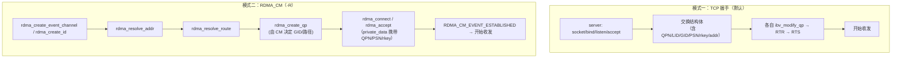

# 第 6 章　perftest 深入：从命令行到数据路径

> **本章目标**：把 perftest 从「会敲命令」变成「会设计实验 + 会解释数字」。perftest 是 RoCE 领域**事实标准**的性能与正确性验证工具，也是最好的 verbs 参考实现之一。
>
> **本章对应源码**（`perftest:src/`）：
> `perftest_parameters.h`（结构与默认值）、`perftest_parameters.c`（选项解析）、`perftest_communication.c`（握手）、`perftest_resources.c`（资源与收发循环）、`get_clock.c`（计时）、`host_validation.c`（正确性校验）
>
> 版本：**perftest 6.30**（`configure.ac: AC_INIT([perftest],[6.30],...)`）
>
> **配套实验**：[`labs/lab01-environment-and-first-test.md`](labs/lab01-environment-and-first-test.md)（基础用法与第一次测试）、[`labs/lab03-tuning-and-troubleshooting.md`](labs/lab03-tuning-and-troubleshooting.md)（A/B 实验纪律与基线建立）

---

## 6.1 perftest 家族：先选对工具

perftest 编译出**一组**二进制，每个测一种「verbs 操作 × 度量指标」的组合：

| 二进制 | verbs 操作 | 单边/双边 | 度量 | 说明 |
|---|---|---|---|---|
| `ib_send_bw` / `ib_send_lat` | `IBV_WR_SEND`（+RECV） | **双边** | 带宽 / 时延 | 对端必须有 RECV，最接近「消息传递」 |
| `ib_write_bw` / `ib_write_lat` | `IBV_WR_RDMA_WRITE` | **单边** | 带宽 / 时延 | 对端不需要 RECV；**测带宽的首选** |
| `ib_read_bw` / `ib_read_lat` | `IBV_WR_RDMA_READ` | **单边** | 带宽 / 时延 | 受 `--outs`（`-o`）影响大 |
| `ib_atomic_bw` / `ib_atomic_lat` | `CMP_AND_SWP` / `FETCH_AND_ADD` | 单边 | 带宽 / 时延 | `-A` 选类型 |
| `raw_ethernet_bw` / `raw_ethernet_lat` | `IBV_QPT_RAW_PACKET` | —— | 带宽 / 时延 | 自己构造 Eth/IP/UDP 头 |
| `raw_ethernet_burst_lat` | 同上 | —— | 时延（突发） | 接收侧一次 `ibv_poll_cq` 收 `--burst_size` 个完成 |
| `raw_ethernet_fs_rate` | 同上 | 每秒流数 | 流表/steering 性能 | 见 `src/raw_ethernet_fs_rate.c` |
| `ib_send_bw -c UD` 等 | 同上但换传输类型 | —— | —— | `-c UD/UC/XRC/DC/SRD` |

> **【易错】二进制名 ≠ 源文件名**。以 `perftest:Makefile.am` 为准：
> `bin_PROGRAMS += raw_ethernet_bw raw_ethernet_lat raw_ethernet_burst_lat raw_ethernet_fs_rate`，
> 而它们各自的源码是 `raw_ethernet_bw_SOURCES = src/raw_ethernet_send_bw.c`、`raw_ethernet_lat_SOURCES = src/raw_ethernet_send_lat.c`、
> `raw_ethernet_burst_lat_SOURCES = src/raw_ethernet_send_burst_lat.c`、`raw_ethernet_fs_rate_SOURCES = src/raw_ethernet_fs_rate.c`。
> 也就是说 **`raw_ethernet_send_bw` 只是源文件名，敲它启动不了任何东西** —— README 里 "Options for raw_ethernet_send_bw" 这种标题就是历史遗留。

**选型口诀**：

- 测 **RoCE 网络与网卡能力**、要「干净」的数字 → **`ib_write_bw`**（单边，对端零负担，最能反映网卡+网络极限）
- 测 **消息传递模式**（生产里用 SEND/RECV 的应用）→ `ib_send_bw`
- 测 **想验证「对端 CPU 完全不参与」** → `ib_write_lat`（注意：本端并不 `ibv_poll_cq`，而是**自旋轮询对端写回的那个数据字节**，见 6.4.1）
- 测 **RDMA READ 场景（存储读路径）** → `ib_read_bw`，别忘了调 `-o`（`--outs`）
- 学**协议封装** → `raw_ethernet_bw`（源码 `raw_ethernet_send_bw.c`）

---

## 6.2 参数全解（按语义分组）

> 下面所有选项名与默认值均来自 `perftest:src/perftest_parameters.c` 的选项表与 `perftest_parameters.h` 的常量定义（已逐一核对）。

### 6.2.1 设备与寻址（RoCE 必调）

| 选项 | 短 | 默认 | 作用 | RoCE 注意 |
|---|---|---|---|---|
| `--ib-dev=<dev>` | `-d` | 第一个设备 | 选 RDMA 设备 | RoCE 下是 `mlx5_0` 之类的 **ibdev**，不是 netdev |
| `--ib-port=<port>` | `-i` | `1`（`DEF_IB_PORT`） | 端口号 | RoCE 基本恒为 1 |
| `--gid-index=<index>` | `-x` | `-1`（`DEF_GID_INDEX`） | **显式指定 GID 索引** | 给 `-x` 时同时把 `use_gid_user` 置 1（**不再自动选**）；不给 `-x` 时 perftest 会**自动打分选一个 GID**（见下方说明） |
| `--port=<port>` | `-p` | `18515`（`DEF_PORT`） | TCP 握手端口（`-R` 时是 CM 端口） | 防火墙需放通 |
| `--tos=<tos>` | `-T` | `-1`（`DEF_TOS`，即不下发） | **只作用于 RDMA-CM 路径**：`rdma_set_option(cm_id, RDMA_OPTION_ID, RDMA_OPTION_ID_TOS, ...)` | 非 `-R` 且非 RawEth 时给出 `--tos` 会直接报错退出；**它不是 RoCE 上的 DSCP 旋钮** |
| `--tclass=<value>` | | `0` | 原样填 `ah_attr.grh.traffic_class`（`ctx_modify_qp_to_rtr()` 里 `attr->ah_attr.grh.traffic_class = user_param->traffic_class;`） | **写进去的是完整 IP TOS 字节 ≠ DSCP**：DSCP 只占高 6 位，低 2 位是 ECN。例：要 DSCP 26 应写 `--tclass=104`（= 26<<2）；**直接填 `--tclass=26` 得到的是 DSCP 6**。**普通 RC/UC QP 也能用**（只要走 GRH）；RoCE 上要改 DSCP，应该用它而不是 `--tos` |
| `--hop_limit=<n>` | `-L` | `64`（`DEF_HOP_LIMIT`） | IP TTL / Hop Limit | 源码里只允许 RawEth 使用（非 RawEth 给出即报错），别和 `--tclass` 混用 |
| `--flow_label=<n>` | | 0 | GRH 流标签 → **UDP 源端口熵** | perftest 只在**显式设置**时才写 `grh.flow_label`（`if (user_param->flow_label)`，`perftest:src/perftest_resources.c:3553-3555`），**默认不写**；`lqpn×rqpn` 折算是**内核驱动**的事（`mlx5_set_path_udp_sport()`，`kernel:drivers/infiniband/hw/mlx5/qp.c:3577-3582` 的 `rdma_calc_flow_label(lqpn, rqpn)`，且仅在带 `DEST_QPN` 的 modify_qp 路径生效）。设固定 flow_label 会让该 QP 固定走一条 ECMP 路径 |
| `--sl=<sl>` | `-S` | `0`（`DEF_SL`） | Service Level | RoCE 下影响 `eth_prio`（见第 8 章 `mlx5_set_path`） |
| `--pkey_index=<n>` | | 0 | 分区键索引 | RoCE 通常 0（pkey = 0xffff） |
| `--mcg`（**无参数**） | `-g` | off | 加入组播组（只 1 个 QP，且仅 SEND verb） | README 写的 `--mcg=<num_of_qps>` 是**过期**的，源码 `long_options[]` 里 `mcg` 的 `has_arg = 0` |
| `--MGID=<gid>` | `-M` | 无 | 组播组地址（`user_mgid`） | 与 `-g` 配对使用；不给时用默认 IPv6 型 GID |
| `--ipv6` / `--ipv6-addr` | | off | 使用 IPv6 | IPv6 下 RoCE MTU 开销多 20 字节 |

> **GID 到底是显式指定还是自动选？**（`perftest:src/perftest_communication.c`）
>
> 结论先说：**RoCEv2 并不要求显式 `-x`**。不写 `-x` 时，perftest 会自己选一个 GID：
> 在 `check_link()/check_link_and_mtu()`（`perftest:src/perftest_parameters.c`）里，只要链路是 `IBV_LINK_LAYER_ETHERNET` 且 `gid_index == -1`，就会被置为 `0`；随后 `set_up_connection()`
> 里 `if (user_param->gid_index != DEF_GID_INDEX || user_param->use_gid_user)` 成立、而 `use_gid_user == 0`，于是走 `else` 分支调用
> **`get_best_gid_index()`** —— 它遍历整个 GID 表（`attr.gid_tbl_len`），对每一项调用 **`compute_gid_score()`** 打分，取最高分：
>
> | 打分项 | 权重（`enum gid_score_weights`） | 规则 |
> |---|---|---|
> | 地址族 | `GID_SCORE_ADDR_FAMILY = 100` | 与偏好一致（`--ipv6` 偏好 IPv6，默认偏好 IPv4-mapped）加分 |
> | 全局作用域 | `GID_SCORE_GLOBAL_SCOPE = 10` | 非 link-local 加分（IPv6 `fe80::/10`、IPv4-mapped `169.254.0.0/16` 不加分） |
> | RoCE 版本 | `GID_SCORE_ROCE_MAX = 9` | RoCEv2 得 2 分、RoCEv1 得 1 分（**v2 优先于 v1**） |
>
> 权重刻意设计成「高优先级项 > 所有低优先级项之和」，所以顺序是 **地址族 > 全局作用域 > RoCEv2 > RoCEv1**（全零 GID 与查询失败的项直接跳过）。
> 工程建议：**自动选能用，但生产上仍然显式给 `-x`（或直接用 `-R` 让 CM 选）**，因为自动打分依赖设备 GID 表的排列顺序，换机器/换固件/换驱动版本都可能选中另一格，实验不可复现。

### 6.2.2 传输与连接类型

| 选项 | 短 | 默认 | 作用 |
|---|---|---|---|
| `--connection=<type>` | `-c` | `RC` | `RC` / `UC` / `UD` / `XRC` / `DC` / `SRD` / `RawEth` |
| `--rdma_cm` | `-R` | off | **用 RDMA_CM 建连**（替代 TCP 握手），走地址/路由解析 |
| `--comm_rdma_cm` | `-z` | off | 用 rdma_cm **模块**只做数据交换，QP 仍由程序自己建 |
| `--use-srq` | | off | 使用 SRQ |
| `--use-null-mr` | | off | 使用 null MR（测试特定路径） |
| `--outs=<n>` | `-o` | 设备 `max_qp_rd_atom` | **未完成 READ/ATOMIC 请求数**（字段 `out_reads`；在 `ctx_modify_qp_to_rtr()/_to_rts()` 里落到 `max_dest_rd_atomic = 本端 out_reads`、`max_rd_atomic = 对端 out_reads`）。仅 `ib_read_*` / `ib_atomic_*` 可用（其他 verb 给出即报错）；实际生效值会被三次钳制，见下方说明 |
| `--qp-timeout=<t>` | `-u` | `14`（`DEF_QP_TIME`） | QP timeout = `4μs × 2^t` |
| `--retry_count=<n>` | | 7（`DEF_RETRY_COUNT`） | rdma_cm 模式下的 `retry_cnt` |
| `--mtu=<mtu>` | `-m` | 设备 `active_mtu` | **两端必须一致**（`check_mtu()` 会交换并取较小值）；`--mtu=4096` 通常显著提升带宽 |

> **注意：没有 `--outstanding` 这个选项。** 源码 `long_options[]` 里只有 `{ .name = "outs", .has_arg = 1, .val = 'o' }`，
> `usage()` 打印的是 `-o, --outs=<num> num of outstanding read/atom(default max of device)`。
> 拼错的 `--outstanding` 只会被 getopt 当成未知选项。
>
> **`-o/--outs` 的三条规则**（逐条源码核对）：
> 1. **只对 READ / ATOMIC 生效**：`case 'o':` 中若 `verb != READ && verb != ATOMIC`，直接报
>    `Setting Outstanding reads only available on READ verb` 并退出 —— 也就是只有 `ib_read_bw/lat`、`ib_atomic_bw/lat` 能用；
> 2. **本端钳制**：`ctx_set_out_reads()`（`perftest:src/perftest_parameters.c`）与设备的 `attr.max_qp_rd_atom` 比较（DC 走 `get_device_max_reads_dc()`），
>    用户值偏大就打印 `Number of outstanding reads is above max = %d` 并改成上限；给 0 或负数则直接取上限；
> 3. **对端钳制**：`compare_max_qp_rd_atom()`（`perftest:src/perftest_negotiation.c`）在对端 `max_qp_rd_atom` 更小时把 `out_reads` 降到对端值，
>    并打印 `out_reads is greater than remote max_qp_rd_atom, using remote max_qp_rd_atom`（该比较在 `connection_type != DC` 时参与协商）。
>
> 所以实际生效的是 **`min(你给的值, 本端 max_qp_rd_atom, 对端 max_qp_rd_atom)`** —— `-o 16` 不一定真的是 16。

### 6.2.3 队列深度与批量（性能调优核心）

| 选项 | 短 | 默认 | 作用 | 调优直觉 |
|---|---|---|---|---|
| `--tx-depth=<dep>` | `-t` | **BW=128（`DEF_TX_BW`）, LAT=1（`DEF_TX_LAT`）** | SQ 深度（`max_send_wr`，范围 `MIN_TX = 1` ~ `MAX_TX = 15000`） | 带宽测试要「足够深以填满管道」；延迟测试要浅 |
| `--rx-depth=<dep>` | `-r` | SEND/WRITE_IMM=**512（`DEF_RX_SEND`）**, READ/ATOMIC=**1（`DEF_RX_RDMA`）**；纯 WRITE 会被 `force_dependecies()` 强制改成 **1** | RQ 深度（范围 1 ~ `MAX_RX = 16384`；非 SEND/WRITE 系 verb 时 >1 直接报 `On RDMA verbs rx depth can be only 1`） | SEND 测试要够深否则 RNR |
| `--qp=<n>` | `-q` | 1（`DEF_NUM_QPS`） | **QP 数量** | ★ 单 QP 受 ECMP 单路径限制（第 2.7 节）；多 QP 才能吃满多链路。**`-q > 1` 只允许用在 BW 测试**：源码 `case 'q':` 中 `if (tst != BW && num_of_qps > 1)` 会报 `Multiple QPs only available on bw tests` 并退出 |
| `--post_list=<n>` | `-l` | 1 | 一次 `post_send` 投递多少个 WQE | 增大可减少 `post_send` 调用次数、提升小消息 PPS。**仅 BW / LAT_BY_BW 可用**（否则报 `Post list is supported in BW tests only`）；`iters` 必须是 `post_list` 的整数倍；未显式给 `-Q` 时 `cq_mod` 会被自动设成 `post_list` |
| `--recv_post_list=<n>` | | 1 | 一次投递多少 RECV | 同上，接收侧 |
| `--cq-mod=<n>` | `-Q` | 100（`DEF_CQ_MOD`） | 每 n 个完成才产生一个 CQE（范围 `MIN_CQ_MOD = 1` ~ `MAX_CQ_MOD = 1024`；**关掉它是 `-Q 1`，不是 `-Q 0`**） | 减少 CQE 开销；**延迟测试千万别用**。另有自动规则：`size > 8192`（`MSG_SIZE_CQ_MOD_LIMIT`）且非 UD、非 `-a`、非 `-e` 时，若用户没显式指定 `-Q`，`cq_mod` 会被自动设为 1（即关闭） |
| `--inline_size=<n>` | `-I` | 自动（`DEF_INLINE = -1`） | 内联进 WQE 的最大消息 | 小消息延迟优化；`IBV_SEND_INLINE`。自动值**只在 LAT 测试里填**：WRITE 220 / SEND RC·UC·XRC 236 / UD 188 / DC 150，BW 测试为 0；显存（CUDA/MLU/MUSA）与 DM 内存会被强制设 0 |
| `--duration=<sec>` | `-D` | 5 秒（`DEF_DURATION`） | **按时间而非次数跑**（`-D` 在本版本是 `--duration`，**不是** 老 README 里的 `--duplicates`） | 测稳定性/抖动更合适 |
| `--margin=<sec>` | `-f` | 初值 `DEF_INIT_MARGIN = -1`；在 `--duration` 下自动取 `duration / 4` | `--duration` 下丢弃前后各 N 秒的预热/收尾 | 让数字更可信；源码还强制 `duration > 2 × margin`，否则报 `please check that DURATION > 2*MARGIN` 退出（头文件里的 `DEF_MARGIN (2)` 在本版本中并未被使用） |
| `--iters=<n>` | `-n` | **WRITE/WRITE_IMM 的 BW 测试：5000（`DEF_ITERS_WB`）；其余 1000（`DEF_ITERS`）** | 交换次数 | 范围 `MIN_ITER = 5` ~ `MAX_ITER = 4294967296`；小消息要加次数才有统计意义。BW 且 `iters > 20000` 时 peak 会被自动关掉 |
| `--size=<size>` | `-s` | **BW: 65536；LAT: 2** | 消息大小 | |
| `--all` | `-a` | off | 从 2 到 2^23 逐档扫 | **画曲线必备** |
| `--bidirectional` | `-b` | off | 双向 | 更接近真实负载 |
| `--run_infinitely` | | off | 一直跑，**每 `<duration>` 秒打印一次**（`<duration>` 默认 5 秒，即 `-D` 改的是打印间隔） | 长稳测试 |
| `--rate_limit=<value>` | | 0 | **QP 限速**（默认单位 Gbps，用 `--rate_units=M/g/p` 改） | 防止测试打爆生产网络；也用于模拟特定速率 |
| `--rate_limit_type=HW/SW/PP` | | 关闭 | 限速维度（HW 硬件限速 / SW 软件 / PP 硬件包调速，PP 仅 RawEth） | `--latency_gap` 另有专门用途（仅 LAT） |
| `--limit_bw=<val>` / `--limit_msgrate=<val>` | `-w` / `-y` | 0 | **不是限速，是最低验收阈值**：实测低于它就在收尾时报 `Error: BW result is below bw limit` 并以失败退出（`is_bw_limit_passed`），适合放进 CI | 名字容易误会，别和 `--rate_limit` 混 |
| `--typical_pkt_size` / `--burst_size` | | | 配合限速/突发 | |

### 6.2.4 报告与输出

| 选项 | 短 | 作用 |
|---|---|---|
| `--report_gbits` | | **以 Gb/s 报告**（不加则是 MB/s）—— 最常用 |
| `--report-both` | | **双向（`-b`）BW 测试中分别报告 TX / RX 两个方向的结果**（与单位无关） |
| `--report-cycles` | `-C` | 以 CPU 周期报告（用于精确比较） |
| `--report-histogrm` | `-H` | 打印全部结果（直方图），默认只打印汇总。⚠ **源码里的长选项就是少一个 a 的 `report-histogrm`**，而 `usage()` 帮助文本却把它印成 `-H, --report-histogram` —— 所以长选项只能写 `--report-histogrm`（仅**时延类测试**（LAT / LAT_BY_BW / FS_RATE）可用） |
| `--report-unsorted` | `-U` | 不排序输出（同样仅时延类测试（LAT / LAT_BY_BW / FS_RATE）可用，且隐含 `-H`） |
| `--report-per-port` | | 逐端口报告 |
| `--report-counters` | | 报告性能计数器（**需要带参数**：`--report-counters=<...>`） |
| `--out_json` / `--out_json_file=<file>` | | **输出 JSON**，便于自动化与画图 |
| `--output=<bandwidth\|message_rate\|latency>` | | 只输出某一列（`OUTPUT_BW` / `OUTPUT_MR` / `OUTPUT_LAT`）。**没有 `--pp` 这个选项**；PP 只是 `--rate_limit_type` 的一个取值 |
| `--noPeak` | `-N` | 取消 peak 带宽计算（**camelCase**，注意大小写）。另有自动行为：BW 测试且 `iters > 20000` 时会自动关闭 peak 并打印警告 |
| `--version` | `-V` | 版本 |
| `--help` | `-h` | 帮助（**权威**选项列表，比任何网文都准） |

### 6.2.5 进程/CPU 绑定（测稳定性关键）

| 选项 | 作用 |
|---|---|
| `--pin_cores=<list>` | 把测试线程绑到指定核 |
| `--numa_node=<n>` | 显式指定 NUMA 节点（覆盖外部绑定） |
| `--disable_numa` | 禁用 NUMA 绑定 |
| `--cpu_util` | 打印 CPU 利用率 |
| `--use_hugepages` | 用大页分配缓冲区 |
| `--odp` | 用 ODP（按需分页）内存 |
| `--mmap` / `--mmap-offset` | 自管 mmap 内存 |
| `--mr_per_qp` | 每个 QP 单独注册 MR |

### 6.2.6 GPU / 加速器（GPUDirect RDMA）

| 选项 | 作用 |
|---|---|
| `--use_cuda=<device>` | 用 CUDA 显存作为缓冲区（GPUDirect RDMA） |
| `--use_cuda_dmabuf` | 走 **dma-buf** 路径注册显存 |
| `--use_cuda_bus_id` / `--use_cuda_pcie_mapping` | 指定 GPU / PCIe 映射方式 |
| `--use_rocm` / `--use_rocm_dmabuf` | AMD ROCm |
| `--use_neuron` / `--use_neuron_dmabuf` | AWS Neuron |
| `--use_mlu` / `--use_mlu_dmabuf` | 寒武纪 MLU |
| `--use_musa` / `--use_musa_dmabuf` | 摩尔线程 MUSA |
| `--use_opencl` | OpenCL |
| `--gpu_touch` | 触摸显存（触发映射/预热） |

### 6.2.7 正确性验证（很多人忽略，但极其重要）

| 选项 | 作用 |
|---|---|
| `--data_validation` | **校验收发数据正确性**（不只是快，还要对） |
| `--data_validation_debug` | 打印校验内部参数（chunk 大小、ring 大小）与失败细节 |

#### 6.2.7.1 `--data_validation` 的硬性约束（源码逐条核对）

`check_params()` 里这一段全是 `exit(1)`，不满足就直接退出 —— **别在生产命令里随手加**：

| 约束 | 源码报错信息（`perftest:src/perftest_parameters.c`） |
|---|---|
| 只能 **RC** | `--data_validation requires RC connection type` |
| 只能 **WRITE 或 READ** verb | `--data_validation is only supported with WRITE or READ verb` |
| 只能 **BW 测试** | `--data_validation is only supported in bandwidth tests` |
| 内存后端只能是 `MEMORY_HOST` 或 `MEMORY_CUDA` | `--data_validation requires --use_cuda or host memory`（ROCm/MLU/MUSA/Neuron/OpenCL/DM 等其它后端都不行）；host 内存还要求 CPU 支持 SIMD：`--data_validation requires host CPU SIMD support (AVX2/SSE4.2/NEON)` |
| `tx_depth >= 32` | `--data_validation requires tx_depth >= 32 (use -t)` |
| `iters >= 32`（ITERATIONS 模式下） | `--data_validation requires iterations >= 32 (use -n)` |
| 与 `-a` 互斥 | `--data_validation is incompatible with -a (run all sizes)` |
| 与 `--post_list > 1` 互斥 | `--data_validation is incompatible with --post_list > 1` |
| 与 `--run_infinitely` 互斥 | `--data_validation is incompatible with --run_infinitely` |
| 与 `--mr_per_qp` 互斥 | `--data_validation is incompatible with --mr_per_qp` |
| 与 `--payload_file_path`（payload 修改）互斥 | `--data_validation is incompatible with payload modification` |
| 与 `--gpu_touch` 互斥 | `--data_validation is incompatible with --gpu_touch` |
| 与 `--use-null-mr` 互斥 | `--data_validation is incompatible with --use-null-mr` |

> 注意 `--data_validation` 默认值不满足 `tx_depth >= 32`（BW 默认 128 可以，但如果为了别的目的把 `-t` 调到 8，校验就会直接报错退出），
> 而且 `data_validation` 本身是**参与协商的字段**：一端开、一端不开，`negotiate_params()` 会直接判定 `data_validation mismatch` 退出（见 6.3.4）。

#### 6.2.7.2 它到底怎么校验（机制）

实现分两半：`perftest:src/validation_common.h`（纯逻辑，host 与 CUDA 共用）＋ `perftest:src/host_validation.c`（host 侧校验线程）、`src/cuda_validation.h`（GPU 侧）：

- **数据模式**：`VALIDATION_PATTERNS_COUNT = 3`，三字节模式轮转 `VALIDATION_PATTERN_0/1/2 = 0x01 / 0x02 / 0x03`，由 `validation_cycle_to_pattern(cycle)` 决定第 `cycle` 轮该填哪个字节；
- **尾部标记（tail marker）**：每个 chunk 的末尾额外挂一个 `uint64_t` 标记（`tail_markers` 区），发送侧用 **`IBV_WR_ATOMIC_FETCH_AND_ADD`（`compare_add = 1`）**打到对端的标记区（`perftest:src/perftest_resources.c` 里构造 WQE，WR 访问标志含 `IBV_ACCESS_REMOTE_ATOMIC`）；
  对端收到标记递增后才去校验对应 chunk（`marker_to_expected_pattern(marker_val)` 把 1-based 标记折算成期望模式）。**这就是"数据到齐了没有"的凭据**，也解释了为什么它必须要 RC + ATOMIC 能力；
- **不一致的分类**（`enum validation_mismatch_type` + `classify_validation_mismatch()`，`perftest:src/validation_common.h`）：
  - `VALIDATION_MISMATCH_REAL`（**真错误 = 数据损坏**，会计入 `errors_found` 并记录 QP/chunk/偏移/期望值/实际值）；
  - `VALIDATION_MISMATCH_RACE`（DMA 覆写竞争：失配字节及其后 4 字节是"下一个已知模式"，判为校验线程与 DMA 抢跑，只计 `race_overwrites`）；
  - `VALIDATION_MISMATCH_STALE`（DMA 尾部未落完：失配落在 chunk 末尾 `max(2×payload, 256)` 字节内，`cpu_relax()` 后重试即通过，只计 `dma_stale_retries`）。
  **只有 `REAL` 才算数据面出错**；race/stale 是测量方法自身的噪声，属于正常现象（`--data_validation_debug` 会把三类计数都打出来）。

> **【行业重点】性能测试必须配正确性验证。**
> 只跑带宽不校验，可能把「数据错了但很快」当成好结果。发版/验收/调参后，都应该用
> `ib_write_bw --data_validation -t 128 -n 5000` 与 `ib_read_bw --data_validation -o 16 -n 5000` 各跑一遍（注意上面那张约束表：
> **`--data_validation` 不能和 `-a`、`--run_infinitely` 一起用，也不能用在 `ib_send_bw` 上**）。

### 6.2.8 高级/厂商特性

| 选项 | 作用 |
|---|---|
| `--use_rss` | RX Hash / RSS（多队列分流） |
| `--use_ooo` | Out-of-Order 传输 |
| `--use_data_direct` | Data Direct 放置 |
| `--use_cc_unprotected` | 不受拥塞控制保护的 QP |
| `--no_enhanced_reorder` | 关闭增强重排 |
| `--disable_pcie_relaxed` | 关闭 PCIe Relaxed Ordering（**默认开，关掉通常更慢**） |
| `--tph_mem` | TPH（TLP Processing Hints）内存 |
| `--vlan_en` / `--vlan_pcp` | **VLAN 与 PCP**（raw ethernet 模式下手动构造 VLAN 标签） |
| `--ethertype` | 自定义 EtherType |
| `--sniffer` / `--promiscuous` | 抓包/混杂模式 QP |
| `--use_old_post_send` | 用旧的 post_send 路径对比 |

### 6.2.9 权威默认值表（与源码逐项核对）

以下常量全部来自 `perftest:src/perftest_parameters.h`，赋值点在 `init_perftest_params()`（`perftest:src/perftest_parameters.c`）。
**遇到任何网文/README 与本表冲突，以本表为准**（README 仍停留在老版本：它写 `-s` 默认 1、`-n` 至少 100、`-r` 默认 600、`--mcg=<num_of_qps>`，全部已过期）。

| 常量 | 值 | 含义 |
|---|---|---|
| `DEF_PORT` | `18515` | TCP/CM 端口 |
| `DEF_SIZE_BW` | `65536` | BW 测试默认消息大小（`-s`） |
| `DEF_SIZE_LAT` | `2` | LAT 测试默认消息大小（`-s`） |
| `DEF_ITERS` | `1000` | 默认迭代次数（`-n`） |
| `DEF_ITERS_WB` | `5000` | **WRITE/WRITE_IMM 的 BW** 测试默认迭代次数 |
| `DEF_TX_BW` | `128` | BW 默认 `--tx-depth` |
| `DEF_TX_LAT` | `1` | LAT 默认 `--tx-depth` |
| `DEF_RX_SEND` | `512` | SEND/WRITE_IMM 默认 `--rx-depth`（纯 WRITE 随后被 `force_dependecies()` 改成 1） |
| `DEF_RX_RDMA` | `1` | READ/ATOMIC 默认 `--rx-depth` |
| `DEF_CQ_MOD` | `100` | 默认 `--cq-mod`（`size > 8192` 且未显式指定时会被自动关成 1） |
| `DEF_QP_TIME` | `14` | 默认 `--qp-timeout`（= `4μs × 2^14`） |
| `DEF_GID_INDEX` | `-1` | 默认 GID 索引；Ethernet 链路上会被置 0 并触发自动打分选 GID |
| `DEF_NUM_QPS` | `1` | 默认 `-q` |
| `DEF_DURATION` | `5` | 默认 `-D/--duration` 秒数 |
| `DEF_MARGIN` | `2` | **定义了但本版本未被使用**；`--margin` 初值是 `DEF_INIT_MARGIN = -1`，在 `--duration` 下自动取 `duration / 4` |
| `DEF_HOP_LIMIT` | `64` | 默认 `--hop_limit` |
| `DEF_TOS` | `-1` | 默认 `--tos`（-1 = 不通过 CM 下发 TOS；`--tclass` 默认 0） |
| `DEF_SL` | `0` | 默认 `--sl` |
| `DEF_INLINE` | `-1` | `--inline_size` 自动：**LAT** 下 WRITE `220`、SEND RC/UC/XRC `236`、UD `188`、DC `150`；BW 下 `0`；显存/DM 内存下 `0` |
| `DEF_RETRY_COUNT` | `7` | rdma_cm 重试次数 |
| `MIN_ITER` | `5` | `-n` 下限 |
| `MAX_ITER` | `4294967296` | `-n` 上限 |
| `MAX_TX` | `15000` | `-t` 上限 |
| `MAX_RX` | `16384` | `-r` 上限 |
| `MAX_QP_NUM` | `16384` | `-q` 上限 |
| `MIN_SRQ_UD_RX_DEPTH` | `100` | UD + SRQ 时的最小 RX 深度 |
| `UC_MAX_RX` | `16000` | UC 模式下 `rx-depth` 自动取 `min(iters, 16000)` |
| `MAX_CQ_MOD` / `MIN_CQ_MOD` | `1024` / `1` | `-Q` 范围 |
| `MAX_SIZE` | `8388608` | 消息大小上限（`-a` 扫到 2^23） |

### 6.2.10 选项拼写陷阱（全部在 `long_options[]` 里核对过）

`perftest` 的选项表是手工维护的，历史包袱不少。下面这些坑，**写错一个字符就是 `unrecognized option`**：

- **`--report-histogrm`**：源码里真的少一个 `a`（`{ .name = "report-histogrm", ... }`），而 `usage()` 却把它打印成 `-H, --report-histogram` —— 只信帮助文本会踩坑；
- **`--noPeak`** 是 camelCase（不是 `--nopeak`，也不是 README 里的 `--no peak-bw`）；
- **`-l/--post_list`** 确实存在（BW / LAT_BY_BW 可用），`--recv_post_list` 只能写长选项；
- **`-r` 在 README 里出现了两次**（通用段"默认 600"、SEND 段"BW 默认 512"），它们都是 **`--rx-depth`**，源码里只有一个 `-r`；
- **短选项大小写敏感、极易混淆**：
  | 混淆对 | 说明 |
  |---|---|
  | `-T` / `-t` | `-T` = `--tos`（给 CM），`-t` = `--tx-depth`（队列深度） |
  | `-S` / `-s` | `-S` = `--sl`，`-s` = `--size` |
  | `-P` / `-p` | `-P` = `--client`，`-p` = `--port` |
  | `-x` / `-X` | `-x` = `--gid-index`，`-X` = `--vector`（事件完成向量） |
  | `-Q` / `-q` | `-Q` = `--cq-mod`，`-q` = `--qp`（QP 数） |
  | `-N` / `-n` | `-N` = `--noPeak`，`-n` = `--iters` |
  | `-o` / `-O` | `-o` = `--outs`，`-O` = `--dualport` |
  | `-r` / `-R` | `-r` = `--rx-depth`，`-R` = `--rdma_cm` |
  | `-I` / `-i` | `-I` = `--inline_size`，`-i` = `--ib-port` |
- **`-g` 不带参数**（`--mcg`），组播组地址要用 `-M/--MGID` 指定；`-g` 和 `-x`（gid-index）**没有任何关系**；
- 源码里**没有** `--outstanding`、没有 `--duplicates`、没有 `--pp`；`--output` 必须带参数（`bandwidth` / `message_rate` / `latency`）；
- 长选项**不能随意用下划线/连字符互换**：`--report_gbits`、`--ib-dev`、`--tx-depth`、`--use-srq`、`--use-null-mr`、`--data_validation`、`--out_json_file` 各按源码原样拼写。

> 最可靠的核对方式是直接问二进制自己：`ib_write_bw --help`（`usage()` 输出），
> 但注意上面第 1 条 —— **帮助文本本身也可能印错**，最终以 `long_options[]` 为准。

---

## 6.3 连接建立：perftest 怎么做「带外握手」

这是 perftest 最有教学价值的部分，也是第 4 章「必须自己交换 QPN/GID/rkey」的具体实现。

### 6.3.1 两种建连模式



| | TCP 握手（默认） | `-R`（RDMA_CM） |
|---|---|---|
| 需要交换的信息 | **全部自己定义**：QPN、LID/GID、PSN、`rkey`、远端地址、`out_reads`、`srqn`（MTU 另由 `check_mtu()` 交换，参数一致性另由 `negotiate_params()` 比对） | CM 负责地址/路由/GID 选择；`private_data` 只带业务信息 |
| 代码复杂度 | 高（要自己写序列化） | 低 |
| 对 RoCE 的 GID 选择 | **perftest 自动打分选**（不给 `-x` 时走 `get_best_gid_index()`）；给 `-x` 才由你指定 | **CM 负责**（按目标 IP 自动解析 GID/路由） |
| 生产代码推荐 | 低（除非你已有自己的建连协议） | **高**（成熟、处理了边界情况） |
| perftest 用法 | 默认 | 加 `-R` |

> **【重要】**：`-R` 模式对 RoCE 新手特别友好：**它不需要你手算 GID index**，CM 会根据目标 IP 自动解析出正确的 GID 与 MAC。
> 但要注意：默认模式**也不是**"必须手算" —— 不给 `-x` 时 perftest 会用 `get_best_gid_index()/compute_gid_score()` 自动选（见 6.2.1）。
> 所以「`-R` 能通、默认模式不通」更可能的解释是：**自动打分选中了另一个 GID**（例如选到了 link-local 或 RoCEv1 那一格），
> 或者你显式给的 `-x` 选错了。把它当作「GID 选错」的交叉验证手段是对的，但别把它当成"默认模式没有 GID 选择逻辑"的证据。

### 6.3.2 交换的信息（结构体）

perftest 通过 TCP 交换一个包含连接所需全部信息的结构体：`struct pingpong_dest`（定义在 `perftest:src/perftest_resources.h`，读写实现在 `perftest:src/perftest_communication.c` 的 `ctx_xchg_data()` / `ethernet_write_keys()` / `ethernet_read_keys()` 系列）。

> 与 `rdma-core:libibverbs/examples/rc_pingpong.c` 的 `pp_client_exch_dest`/`pp_server_exch_dest` 是同一套思路（固定宽度、冒号分隔的十六进制文本行）。
> 但格式细节不同：perftest 的 GID 是 **16 个 `%02x` 字节字段**逐字节展开（`KEY_PRINT_FMT_GID`，整行 `KEY_MSG_SIZE_GID = 108` 字节），
> 不是"33 字节字符串"；开了 `--data_validation` 时还会多带一个 `tail_markers_vaddr`（`KEY_MSG_SIZE_GID_DV = 125`）。

**关键字段（真实工程中你需要交换的最小集合）**：

| 字段 | 为什么需要 |
|---|---|
| `qpn` | 填 `ibv_qp_attr.dest_qp_num` |
| `psn` | 填 `rq_psn`（和 `sq_psn` 对齐） |
| `lid` | IB 场景用；RoCE 下填 0/忽略 |
| `gid`（`union ibv_gid`，16 字节） | RoCE 场景用，填 `ah_attr.grh.dgid` |
| `gid_index` | 告诉对端自己用的是第几格 GID（`-1` 表示不用 GID，即 IB 链路） |
| **`rkey`** | 用 RDMA WRITE/READ 时必须（RETH 的 `rkey`） |
| **`vaddr`（远端虚拟地址）** | 用 RDMA WRITE/READ 时必须（RETH 的 `va`） |
| `out_reads` | READ/ATOMIC 的未完成请求深度（就是 `-o/--outs` 那个值，**字段名不是 `outstanding`**）：本端值进 `max_dest_rd_atomic`，对端值进 `max_rd_atomic` |
| `srqn` | 用 SRQ 时需要 |
| `tail_markers_vaddr` | 仅 `--data_validation`：对端 tail marker 区的远端地址，供 `FETCH_AND_ADD` 使用（见 6.2.7.2） |

> 结构体里**没有** `mtu` 字段 —— MTU 由 `check_mtu()` 单独协商校验，不是通过 `pingpong_dest` 传的。

### 6.3.3 server / client 的启动顺序

```bash
# hostA（server）—— 先起，会阻塞在 accept
ib_write_bw -d mlx5_0 -i 1 -x 3 --report_gbits -F

# hostB（client）—— 带 server IP
ib_write_bw -d mlx5_0 -i 1 -x 3 --report_gbits -F 192.168.100.1
```

也可以用 `-Z`（`--server`）/`-P`（`--client`）显式指定角色。

> 启动顺序的源码依据：`establish_connection()`（建 socket）→ `exchange_versions()` → `check_version_compatibility()` → `check_sys_data()` → `check_mtu()` → `alloc_ctx()` → `negotiate_params()` → `ctx_init()` / CM 建连 → `set_up_connection()`（GID 选择与 `pingpong_dest` 交换），见 `perftest:src/write_bw.c`。

### 6.3.4 【重要】两端必须用**完全一致**的选项：`negotiate_params()`

这是 6.28 之后新增、也是最容易被忽视的一层协议：**perftest 会在建连阶段把两边的一批参数逐一比对，不一致就直接退出**，不允许"服务器跑 65536、客户端跑 4096"这种经典误操作。

实现全在 `perftest:src/perftest_negotiation.c` 的 `negotiate_params()`：

| 阶段 | 行为 |
|---|---|
| 版本门槛 | `atof(rem_version) < 6.28` → **直接返回 SUCCESS，完全跳过协商**（老对端只交换版本号，不比对参数） |
| 6.28 ~ 6.29 | 走 `negotiate_params_legacy()`：用 **`struct perftest_parameters_negotiate_legacy`** 这个**冻结的线格式**收发一段定长结构体（头文件注释明确写着 "Do NOT modify: new peers must produce the same bytes on the wire as old peers, or cross-version negotiation will desync"） |
| ≥ 6.30 | 先交换 `NEGOTIATION_VERSION`（当前为 `0`）；相等则用 `negotiate_params_kv_string()` 交换 `name=hexbytes;` 形式的 KV 字符串（分块传输 `ctx_xchg_data_chunked()`，未知 key 忽略）；**版本号不等就打印 `Negotiation version mismatch: ... skipping negotiation` 并跳过比对** |
| 比对 | `COMPARE()` 宏生成一张 `CompareFunction compare_functions[]` 表，逐项调用比较函数；不相等就打印 ` <字段名> mismatch: local=..., remote=...` 并 **FAILURE**（主程序随后报 `Failed to negotiate parameters` 退出） |

被比对的字段（`compare_functions[]` 完整列表，`INT`/`UINT64` 均为网络字节序）：

`test_method`、`connection_type`、`verb`、`tst`（LAT/BW/LAT_BY_BW/FS_RATE）、`atomicType`、`test_type`（ITERATIONS/DURATION）、`report_fmt`（GBS/MBS）、`size`、`iters`、`aes_xts`、`num_of_qps`、`duration`、`use_rdma_cm`、`use_write_with_imm`、`no_enhanced_reorder`、`sig_offload`、`data_validation`、`tx_depth`、`max_qp_rd_atom`；Mellanox 设备上还会比 `mlx5dv_comp_mask`。

两类**特殊**比较：

- `max_qp_rd_atom` 用的是 `compare_max_qp_rd_atom()`，它**不报错**，而是把本端 `out_reads` 降到对端 `max_qp_rd_atom`（只在 `connection_type != DC` 时参与）；
- `mlx5dv_comp_mask` 用的是 `compare_mlx5dv()`，OOO_RECV_WRS 能力不一致时**不报错**，而是自动把 `no_enhanced_reorder` 打开（打印 `OOO_RECV_WRS mismatch, disabling enhanced reorder`）。

> **工程含义**：
> 1. **报错信息是最好用的排障线索**。看到 `size mismatch: local=65536, remote=4096`，说明两端命令行不一致，而不是网络问题；
> 2. 这一层让"同一套命令脚本"成为硬性要求 —— 你的自动化脚本必须把**两端参数写到同一个地方**；
> 3. 与 5.70 那条线区分开：`check_version_compatibility()`（`perftest:src/perftest_communication.c`）拒绝的是**对端版本 < 5.70**，报
>    `Current implementation is not compatible with versions older than 5.70`；而 6.28/6.29/6.30 这三级是**协商线格式**的分界，不是兼容性拒绝（< 6.28 只是"不比对"）。

---

## 6.4 测量方法学：perftest 到底测了什么

理解这一点，你才能正确解释数字。

### 6.4.1 时延（`ib_*_lat`）

**先纠正一个常见误解**：perftest 的时延**不是**统一的「post → poll CQE」。它按 verb 分成 4 个收发循环，
并且**读数要除以 `rtt_factor`**；`ib_write_lat` 甚至根本不靠 CQE 判断对端完成。

4 个循环（都在 `perftest:src/perftest_resources.c`）：

| 测试 | 循环函数 | 怎么知道"对端完成了" | `rtt_factor`（`print_report_lat()`） |
|---|---|---|---|
| `ib_read_lat` / `ib_atomic_lat` | `run_iter_lat()` | 本端 `ibv_poll_cq(send_cq)` 等自己的 CQE（READ/ATOMIC 的完成本身就是"数据回来了"） | **1** |
| `ib_send_lat` / `--send_with_imm` | `run_iter_lat_send()` | `ibv_poll_cq(recv_cq)` 等对端**回发**的那条消息 | **2** |
| `ib_write_lat` | `run_iter_lat_write()` | **不用 CQE**：自旋比较本地缓冲里被对端写回的那个字节 —— `while (*poll_buf != (char)rcnt);` | **2** |
| `ib_write_lat --write_with_imm` | `run_iter_lat_write_imm()` | `ibv_poll_cq(recv_cq)` 等 `IBV_WC_WITH_IMM`（对端发回 immediate） | **2** |

对应的机制：

```text
ib_write_lat（run_iter_lat_write）:
  post_buf = buf[0] + size - 1            /* 本地缓冲最后一个字节 */
  poll_buf = buf[num_of_qps] + size - 1   /* 另一块缓冲的最后一个字节，由对端写回 */
  循环:
    while (*poll_buf != (char)rcnt);      /* 自旋等对端把序号写回来 —— 不是 poll CQE！ */
    *post_buf = (char)++scnt;             /* 把序号写进要发送的那块缓冲 */
    tposted[i] = get_cycles();
    ibv_post_send(qp, &wr);               /* RDMA WRITE */
    do { ibv_poll_cq(send_cq, ...) }      /* 只用来回收发送完成、检查 wc.status */
```

时间差怎么算（`print_report_lat()`，`perftest:src/perftest_parameters.c`）：

- `delta[i] = tposted[i+1] - tposted[i]` —— 即**相邻两次 post 之间的间隔**，它天然包含了"发送 → 对端处理 → 对端写回/回发 → 本端看见"的**整个往返（RTT）**；
- 然后 **`rtt_factor = (verb == READ || verb == ATOMIC) ? 1 : 2`**，`delta` 要除以 `rtt_factor`：
  - READ/ATOMIC：`rtt_factor = 1`，报的就是**完整 RTT**（"post → 自己的 CQE"）；
  - **SEND / WRITE / WRITE_IMM：`rtt_factor = 2`，报的是 RTT 的一半，也就是"单向时延"**；
- 因此**跨 verb 比较时延数字是危险的**：`ib_write_lat` 报 1.8μs 与 `ib_read_lat` 报 3.6μs 可能描述的是同一条链路的同一段物理时间。

其他要点：

- `LAT_MEASURE_TAIL` = **2**：`delta[]` 排序后 `measure_cnt -= 2`，即**丢掉最大的 2 个尾部样本**再算中位数、均值、标准差与百分位（`t_min` 取 `delta[0]`，`t_max` 打印的是 `delta[measure_cnt]`，按源码下标它并不是保留样本里的最大值 —— 存在 1 个样本的偏移，读数字时心里有数）；
- `--report-cycles`（`-C`）直接报周期数，避免 `cpu_freq` 估算误差；
- **`-F`（`--CPU-freq`）不会设置 CPU 频率、也不改变任何测量**。它的真实语义是两件事：
  1. 抑制 `proc_get_cpu_mhz()` 在发现 `/proc/cpuinfo` 各核频率相差 > 2% 时打印的警告
     `Conflicting CPU frequency values detected: ... CPU Frequency is not max.`（`perftest:src/get_clock.c`；`get_cpu_mhz()` 的形参名就叫 `no_cpu_freq_warn`，而实参正是 `-F` 置位的 `user_param->cpu_freq_f` —— **这就是 `-F` 的全部作用**）；
  2. **在频率无法确定时仍然允许出报告**：`print_report_bw()` 里 `if (cycles_to_units == 0 && !user_param->cpu_freq_f) { fprintf(stderr,"Can't produce a report\n"); exit(1); }`（`perftest:src/perftest_parameters.c`）—— 给了 `-F` 就不会因为这个退出（此时 cycles→时间 的换算系数为 0，数字不可信，但程序会给你一份报告）。
  **所以 `-F` 恰恰是"我知道频率有问题、你别拦我"的开关**；正确做法仍然是关掉变频/锁频（`cpupower frequency-set -g performance`，并用 `--report-cycles` 复核）而不是长期依赖 `-F`；
- 计时实现：`perftest:src/get_clock.c`（`cycles_t`、`get_cycles()`、`get_cpu_mhz()`、`proc_get_cpu_mhz()`、`sample_get_cpu_mhz()`）；
- 输出列：`t_min` / `t_max` / `t_typical` / `t_avg` / `t_stdev` / `99% percentile` / `99.9% percentile`。

> **【GPU 场景的硬约束 —— 这正是 `--write_with_imm` 存在的理由】**
> 上面的 `run_iter_lat_write()` 要靠 **CPU 轮询本地缓冲里的字节**来判断对端完成。如果缓冲区在显存里，CPU 读显存既不合法也极慢，
> 所以 perftest 直接禁止这种组合：`check_params()` 里
> `if ((memory_type == MEMORY_CUDA || memory_type == MEMORY_MUSA) && tst == LAT && verb == WRITE)` →
> `Perftest doesn't support device memory latency test with write (without immediate) verb; use --write_with_imm`。
> 加 `--write_with_imm` 后 verb 变成 `WRITE_IMM`（`use_write_with_imm_flag` → `user_param->verb = WRITE_IMM`），
> 走 `run_iter_lat_write_imm()`，完成信号改由**对端回发的 immediate（CQE）**给出 —— CQE 是主机可见的，所以显存时延测试才成立。
> 代价是：**这时的数字是"WRITE_WITH_IMM"的时延，不再是纯 WRITE 的时延**，两者不能混在一张表里比。

> **【关键】`t_avg` 与 `t_typical` 的区别**：`t_typical` 是**中位数**（`get_median()`），`t_avg` 是算术平均。网络抖动大时 `t_avg > t_typical`。**看尾延迟要看 `t_max` 与 99/99.9 分位**，这才是 RoCE 部署要关心的（PFC 触发、ECN 降速都会在这里体现）。

### 6.4.2 带宽（`ib_*_bw`）

```bash
#bytes   #iterations   BW peak[Gb/sec]   BW average[Gb/sec]   MsgRate[Mpps]
65536    1000          196.42            196.15               0.374
```

| 列 | 含义 | 计算 |
|---|---|---|
| `#bytes` | 每次消息的字节数 | `-s` |
| `#iterations` | 完成的迭代次数 | `-n` 或 `--duration` 内实际完成数 |
| **`BW peak`** | 峰值带宽（**所有观测窗口里最好的那一段**） | `print_report_bw()` 在 `tposted[]/tcompleted[]` 上滑窗取最小的"每迭代耗时"`opt_delta`，再换算成带宽；`-N`/`--noPeak` 可关闭（关掉后 peak 显示为 0）。注意 **BW 且 `iters > 20000` 时会自动关闭**，不再计算 peak |
| **`BW average`** | 平均带宽 = **总字节 / 总时间** | 报文里的应用层字节，**不含协议头** |
| `MsgRate[Mpps]` | 每秒消息数（百万） | = `iterations / elapsed / 1e6` |

**跨版本/跨工具对比的铁律**：

> perftest 报的带宽是**有效载荷带宽（goodput）**，即 `size × iterations / time`。
> 与交换机端口的**线速（line rate）**相比，要额外加上协议开销：
> 有效载荷 196 Gb/s（MTU 4096）对应的线速约 **200 Gb/s**；
> 而 **MTU 256 时有效载荷可能只有 ~170 Gb/s 就已经打满 200G 线速**了。
> **所以「MTU 越大，有效载荷带宽越接近线速」** —— 这是第 2.1 节开销表的直接应用。

### 6.4.3 常见「数字不对」的诊断表

| 现象 | 最可能原因 | 排查动作 |
|---|---|---|
| 带宽只有线速一半（单 QP） | **ECMP 哈希单路径** | `-q 4` 看是否翻倍；查交换机 ECMP 是否含源端口 |
| 带宽 ~ 线速但远低于预期 | 单位看错（MB/s vs Gb/s） | 加 `--report_gbits` |
| 带宽明显低于线速 | MTU 太小 | `--mtu=4096`（并确认 `max_mtu` 与 netdev MTU 够） |
| 带宽抖动大 / 时高时低 | PFC 频繁触发或 ECN 降速 | 看 `ethtool -S` 的 pause/ECN/CNP 计数（第 11、12 章） |
| 时延远高于预期（>10μs） | 用了 `-e`（事件模式）而非轮询；或 CPU 没绑核；或 `--cq-mod` 开着 | 去掉 `-e`；`--pin_cores`；`-Q 1`（**最小就是 1**，`-Q 0` 会被范围检查拒绝 —— `MIN_CQ_MOD = 1`） |
| 时延有周期性尖刺 | 变频 / 中断/其他进程抢占 | 关 `cpufreq`；`--pin_cores`；`isolcpus` |
| `ib_read_bw` 带宽低 | `--outs`（`-o`）太小（默认受本端/对端 `max_qp_rd_atom` 限制） | 加大 `-o`（如 `-o 16`），并注意两端都要能给出这个深度 |
| `ib_send_bw` 报 RNR 类错误 | `--rx-depth` 不够 | 加大 `-r` |
| 两机结果差异极大 | 一端 NUMA/PCIe 降速 | `lspci -vv` 看链路速率与宽度 |
| 小消息 PPS 上不去 | 每次只 post 1 个 WR | `-l 16`（post_list）与 `-t` 配合 |
| 刚跑起来就报 `xxx mismatch: local=..., remote=...` | 两端命令行不一致（6.28+ 的参数协商） | 按提示统一两端选项，见 6.3.4 |

---

## 6.5 标准实验命令集（可直接复制）

以下命令统一假设：`-d mlx5_0 -i 1`，并把 **GID 索引显式写成 `-x 3`** 以保证可复现。
（`-x` 才是 `--gid-index`：源码 `long_options[]` 里 `{ .name = "gid-index", .val = 'x' }`。
**`-g` 与 GID 无关** —— 它是"无参数的 `--mcg`"（加入组播组），README 里 `--mcg=<num_of_qps>` 与"`-g` 也是 gid-index"的说法都是老黄历。不给 `-x` 时 perftest 会自动打分选 GID，见 6.2.1。）

```bash
# ── ① 基线：WRITE 带宽（最标准的一条）
# server
ib_write_bw -d mlx5_0 -i 1 -x 3 --report_gbits -F
# client
ib_write_bw -d mlx5_0 -i 1 -x 3 --report_gbits -F 192.168.100.1

# ── ② 全尺寸扫描（画带宽曲线，评估不同消息大小的表现）
ib_write_bw -d mlx5_0 -i 1 -x 3 --report_gbits -F -a
ib_write_bw -d mlx5_0 -i 1 -x 3 --report_gbits -F -a 192.168.100.1

# ── ③ 双向带宽（更接近 AI/存储真实负载）
ib_write_bw ... -b
ib_write_bw ... -b 192.168.100.1

# ── ④ 多 QP（验证 ECMP 与扩展性）
ib_write_bw ... -q 8
ib_write_bw ... -q 8 192.168.100.1

# ── ⑤ MTU 与深度调优对比（A/B 实验）
ib_write_bw ... --mtu=1024 -t 128
ib_write_bw ... --mtu=4096 -t 256
ib_write_bw ... --mtu=4096 -t 512 -l 16

# ── ⑥ 时延（含尾延迟）
ib_write_lat -d mlx5_0 -i 1 -x 3 -F --pin_cores=2,3
ib_write_lat -d mlx5_0 -i 1 -x 3 -F --pin_cores=2,3 192.168.100.1

# ── ⑦ 长稳/抖动测试（按时间跑；不写 --margin 时它会自动取 duration/4）
ib_write_bw ... --duration=60 --margin=2

# ── ⑧ 正确性验证（发版前必做；注意只支持 RC + WRITE/READ + BW，
#      且要求 -t >= 32、-n >= 32，与 -a/--run_infinitely/--post_list>1 互斥）
ib_write_bw ... --data_validation -t 128 -n 5000
ib_read_bw  ... --data_validation -o 16 -n 5000

# ── ⑨ 用 RDMA_CM 建连（交叉验证 GID 选择）
ib_write_bw -d mlx5_0 -i 1 --report_gbits -F -R
ib_write_bw -d mlx5_0 -i 1 --report_gbits -F -R 192.168.100.1

# ── ⑩ SEND/RECV 与 READ
ib_send_bw  -d mlx5_0 -i 1 -x 3 --report_gbits -F -r 1024
ib_read_bw  -d mlx5_0 -i 1 -x 3 --report_gbits -F -o 16

# ── ⑪ JSON 输出（自动化/画图）
ib_write_bw -d mlx5_0 -i 1 -x 3 --report_gbits -F -a --out_json --out_json_file=/tmp/w.json

# ── ⑫ 限速测试（避免打爆生产网）
# 默认单位是 Gbps：--rate_limit=25 就是 25 Gb/s（用 --rate_units=M/g/p 改成 MiBps 或 pps）
ib_write_bw -d mlx5_0 -i 1 -x 3 --report_gbits -F --rate_limit=25 --rate_limit_type=HW
```

---

## 6.6 perftest 源码导读（想深入时看这些）

| 关注点 | 文件与函数 |
|---|---|
| 选项解析与默认值 | `perftest:src/perftest_parameters.c`：`init_perftest_params()`（默认值）、`long_options[]`（长选项表，**唯一权威**）、`usage()`（帮助文本，可能印错，例如把 `report-histogrm` 印成 `report-histogram`）、`force_dependecies()`（派生默认值）、`check_params()` |
| 参数合法性校验 | `perftest:src/perftest_parameters.c` 的 `check_params()`（`--data_validation` 的全部硬约束都在这里 `exit(1)`） |
| 连接建立 | `perftest:src/perftest_communication.c`：`establish_connection()`、`set_up_connection()`（GID 选择 + `pingpong_dest` 交换）、`check_mtu()`、`check_version_compatibility()` |
| 参数/能力协商 | `perftest:src/perftest_negotiation.c`：`negotiate_params()`、`negotiate_params_legacy()`（`perftest_parameters_negotiate_legacy` 冻结线格式）、`negotiate_params_kv_string()`（≥6.30 的 `name=hexbytes;` 格式）、`compare_max_qp_rd_atom()` |
| GID 自动选择 | `perftest:src/perftest_communication.c`：`get_best_gid_index()`、`compute_gid_score()`、`validate_gid_index()` |
| 资源创建/销毁与收发循环 | `perftest:src/perftest_resources.c`（ctx/PD/CQ/QP/MR 创建、`ctx_modify_qp_to_rtr()`/`_to_rts()`、`run_iter_*` 循环 —— 含 `run_iter_lat` / `run_iter_lat_send` / `run_iter_lat_write` / `run_iter_lat_write_imm`） |
| 报告与统计 | `perftest:src/perftest_parameters.c`：`print_report_bw()`（含 `Can't produce a report` 与 `-F` 的关系）、`print_report_lat()`（`rtt_factor`、`LAT_MEASURE_TAIL`、`get_median()`）、`print_report_lat_duration()`、`print_report_fs_rate()` |
| 内存后端抽象 | `perftest:src/memory.h` + `host_memory.c`（普通/大页）、`mmap_memory.c`、`dm_memory.c`（设备内存）、`cuda_memory.c` 等 |
| 计时 | `perftest:src/get_clock.c`、`get_clock.h`（`get_cycles()`、`get_cpu_mhz(no_cpu_freq_warn)`、`proc_get_cpu_mhz()`） |
| 计数器 | `perftest:src/perftest_counters.c` |
| 正确性校验 | `perftest:src/host_validation.c`（校验线程、`validate_one_marker()`）、`validation_common.h`（3 种模式 + `classify_validation_mismatch()`）、`cuda_validation.h` |
| 组播 | `perftest:src/multicast_resources.c`（对应 `-g` = `--mcg`（无参数）与 `-M` = `--MGID`） |
| Raw Ethernet | `perftest:src/raw_ethernet_resources.c` 及**源文件** `raw_ethernet_send_bw.c` / `raw_ethernet_send_lat.c` / `raw_ethernet_send_burst_lat.c` / `raw_ethernet_fs_rate.c`（注意：可执行文件名分别是 `raw_ethernet_bw` / `raw_ethernet_lat` / `raw_ethernet_burst_lat` / `raw_ethernet_fs_rate`） |
| 构建与二进制清单 | `perftest:Makefile.am`（`bin_PROGRAMS` 与各 `*_SOURCES`） |
| 官方选项文档 | `perftest:README`（含每个选项的说明，**部分已过期**，例如 `-s` 默认值、`-n` 下限、`-g, --mcg=<num_of_qps>`、`--report-histogram`）与 `perftest:man/` |

**推荐阅读顺序**：先读顶层入口文件（很短，如 `src/write_bw.c`：`parser()` → `check_link()` → `check_mtu()` → `alloc_ctx()` → `negotiate_params()` → `ctx_init()` → `set_up_connection()`）→ 再看 `perftest_resources.c` 的资源创建与 `run_iter_*` → 最后看 `perftest_communication.c` 的握手与 `perftest_negotiation.c` 的协商。

---

## 6.7 【行业重点】perftest 在真实工作中的用法

| 场景 | 怎么用 |
|---|---|
| **新集群验收** | 分两轮：① 性能基线 = `-a` 扫全尺寸 + `-b` 双向 + `-q 4/8` 多 QP；② 正确性 = 单独一轮 `--data_validation`（**注意它与 `-a` 互斥**，且要 `-t ≥ 32`、`-n ≥ 32`） |
| **故障定位** | 与历史基线对比：某尺寸带宽掉了 → 看 MTU/ECN；时延尖刺 → 看 PFC |
| **调参验证** | 每次只改一个变量（MTU / tx-depth / post_list / pin_cores），记录前后数字 |
| **上线前回归** | 用 `--out_json` 存结果，脚本比对阈值，纳入 CI |
| **容量规划** | `-q N` 找到「多少个 QP 能吃满链路」，指导应用侧 QP 数 |
| **GPU 集群** | `--use_cuda` 对比「显存直通」与「主机内存中转」的差异；**时延测试必须加 `--write_with_imm`**（纯 WRITE 的 CPU 轮询读不了显存，perftest 会直接拒绝） |
| **多租户隔离验证** | 在两个不同优先级/不同 VLAN 上同时跑，验证互不干扰 |

**做一个「基线表」**（强烈建议你自己建一个，长期维护）：

| 硬件 | 测试 | MTU | QP | 期望 BW | 期望 t_avg |
|---|---|---|---|---|---|
| CX-6 200G | `ib_write_bw -s 65536` | 1024 | 1 | ~190 Gb/s | —— |
| CX-6 200G | `ib_write_bw -s 65536` | 4096 | 1 | ~196 Gb/s | —— |
| CX-6 200G | `ib_write_bw -a -q 4` | 4096 | 4 | 接近 200 Gb/s | —— |
| CX-6 200G | `ib_write_lat`（**单向口径**，见 6.4.1） | —— | 1 | —— | ~1.5–2.2 μs |
| CX-6 200G | `ib_read_lat`（**RTT 口径**，别和上一行直接比） | —— | 1 | —— | ~3–4.5 μs |

> 表中数字为**示例量级，随硬件/固件/PCIe/NUMA 而异**；具体数字随固件、PCIe 代次、NUMA 位置而变。**关键不是抄数字，而是建立「自己环境的正常值」**，这样异常才能被立刻发现。

---

## 6.8 本章自检

1. `ib_write_bw` 与 `ib_send_bw` 的本质区别是什么？为什么测网络极限首选前者？
2. 不给 `-x` 时 perftest 怎么选 GID？`compute_gid_score()` 的三条打分项是什么优先级？为什么生产上仍建议显式写 `-x`？`-g` 是干什么的（它和 GID 有关系吗）？
3. 用 RDMA WRITE 时，握手必须交换哪两个额外信息？`struct pingpong_dest` 里为什么**没有** MTU 字段，MTU 又是怎么协商的？
4. `BW peak` 与 `BW average` 有什么区别？`-N` 是干什么的？
5. perftest 报的是有效载荷带宽还是线速？两者差多少（MTU 256 / 4096 各是多少）？
6. 为什么 `-e`（事件模式）会让时延变差？生产程序应该怎么折中？
7. `ib_read_bw` 带宽偏低时第一个该调的参数是什么？它实际生效的值受哪三次钳制？
8. `--data_validation` 为什么是必做项？它有哪些硬约束（至少说出 5 条）？mismatch 分成哪三类、哪一类才算真损坏？
9. 单 QP 吃不满链路带宽时，怎么证明是 ECMP 哈希问题？`-q > 1` 有什么限制？
10. `-F` 到底做了什么？为什么更好的做法是关变频？
11. `ib_write_lat` 的 1.8μs 和 `ib_read_lat` 的 3.6μs 能直接比吗？`rtt_factor` 是什么？为什么 GPU 显存时延测试必须加 `--write_with_imm`？
12. 两端选项不一致时会发生什么？`negotiate_params()` 比对哪些字段？5.70、6.28、6.29、6.30 这几个版本号分别意味着什么？

**下一章**：进入内核 —— 看 libibverbs 的一个 `ibv_reg_mr` 是如何一步步变成固件命令的。
