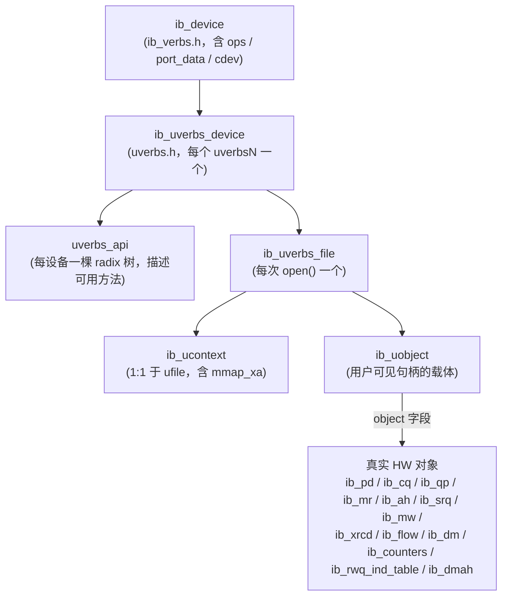
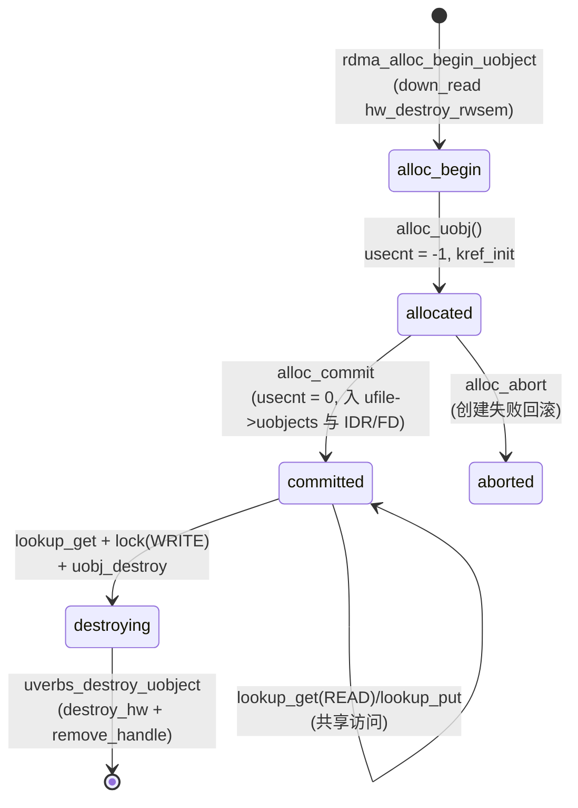
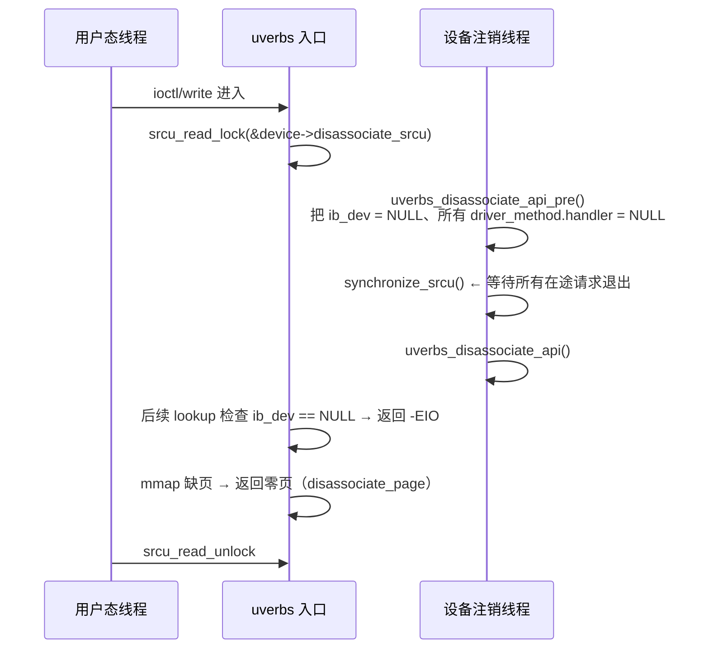
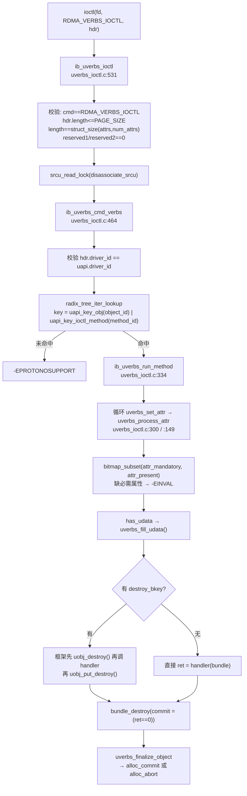
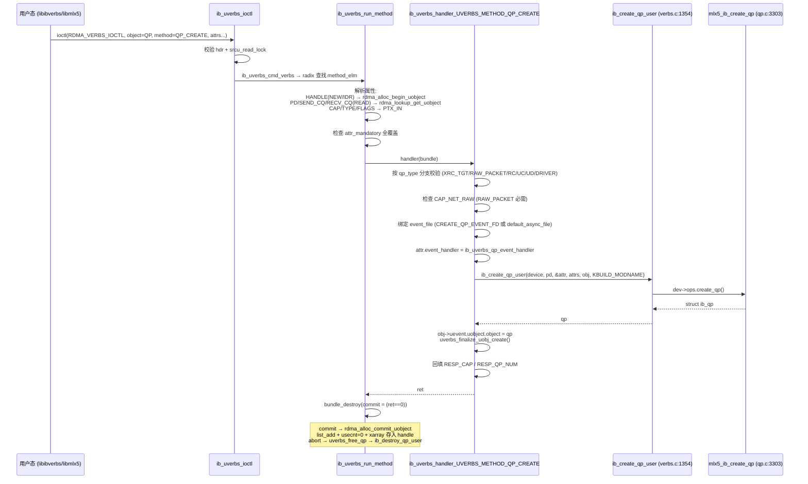
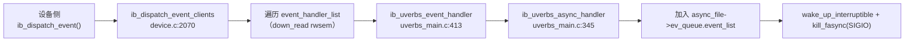
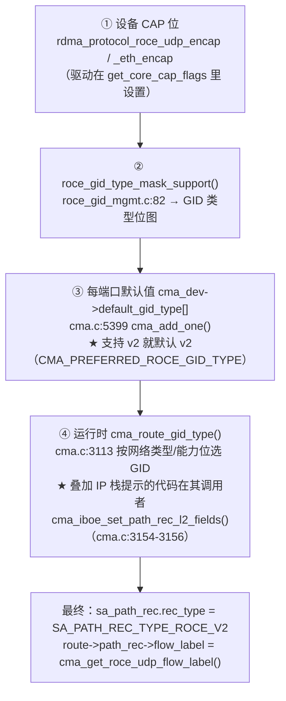

# 第 7 章　内核 RDMA 子系统与 uverbs 机制

> **本章目标**：把「用户态调一个 verbs 函数」变成「内核里一条可以追踪的调用链」。读完你应该能读懂 `drivers/infiniband/core/` 的主要文件，并知道每个对象在内核里的生命周期规则。
>
> **本章对应源码**：`kernel:drivers/infiniband/core/`（全部）、`kernel:include/rdma/ib_verbs.h`、`uverbs_ioctl.h`、`uverbs_types.h`、`kernel:include/uapi/rdma/`
>
> 本章所有符号与行号均在本内核树（**7.2.8**）中逐一核对。

---

## 7.1 内核 RDMA 子系统的模块划分

先看构建单元 —— 这张表决定了「一个功能在哪个 .ko 里」：

| 模块 | 由什么配置打开 | 源码组成（`drivers/infiniband/core/Makefile`） |
|---|---|---|
| **`ib_core.ko`** | `CONFIG_INFINIBAND` | `verbs.o cq.o rw.o sysfs.o device.o cache.o netlink.o roce_gid_mgmt.o mr_pool.o addr.o sa_query.o multicast.o mad.o smi.o agent.o mad_rmpp.o nldev.o restrack.o counters.o trace.o lag.o iter.o frmr_pools.o packer.o ud_header.o` |
| `ib_core.ko`（条件） | `CONFIG_SECURITY_INFINIBAND` / `CONFIG_CGROUP_RDMA` / `CONFIG_INFINIBAND_USER_MEM` / `CONFIG_INFINIBAND_ON_DEMAND_PAGING` | `security.o` / `cgroup.o` / `umem.o umem_dmabuf.o` / `umem_odp.o` |
| **`ib_core.ko`（易错点）** | `CONFIG_INFINIBAND_USER_ACCESS_CORE` | **`ib_core_uverbs.o`** ← 它属于 ib_core，不是 ib_uverbs！ |
| **`ib_uverbs.ko`** | `CONFIG_INFINIBAND_USER_ACCESS` | `uverbs_main.o uverbs_cmd.o uverbs_marshall.o uverbs_std_types.o uverbs_ioctl.o uverbs_std_types_{cq,dmabuf,dmah,flow_action,dm,mr,counters,device,async_fd,srq,wq,qp}.o uverbs_uapi.o` |
| **`ib_uverbs_support.ko`** | `CONFIG_INFINIBAND_USER_ACCESS` | `rdma_core.o ucaps.o uverbs_flow.o` ← **uobject 生命周期核心在这里** |
| **`rdma_cm.ko`** | `CONFIG_INFINIBAND_ADDR_TRANS` | `cma.o cma_trace.o`（+`cma_configfs.o`） |
| **`rdma_ucm.ko`** | 同上 | `ucma.o`（`/dev/infiniband/rdma_cm`） |
| `ib_umad.ko` | `CONFIG_INFINIBAND_USER_MAD` | `user_mad.o` |
| `ib_cm.ko` | `CONFIG_INFINIBAND` | `cm.o cm_trace.o`（IB 原生 CM） |
| `iw_cm.ko` | `CONFIG_INFINIBAND` | `iwcm.o iwpm_util.o iwpm_msg.o`（iWARP） |

> **两个容易搞错的事实**：
> 1. `ib_core_uverbs.c`（提供 mmap entry、`uverbs_get_flags64/32`、`uverbs_copy_to`、udata 兼容辅助）**在 `ib_core.ko` 里** —— 因为它是 ib_core 提供给 uverbs/驱动的公共例程。
> 2. `rdma_core.c`（`alloc_uobj`、`uverbs_destroy_uobject` 等 uobject 生命周期核心）在**独立的 `ib_uverbs_support.ko`** 里，并通过符号命名空间 `"rdma_core"` 导出（例如 `EXPORT_SYMBOL_NS_GPL(rdma_lookup_get_uobject, "rdma_core")`），`uverbs_main.c` 里 `MODULE_IMPORT_NS("rdma_core")` 引入。

**读源码的推荐顺序**：

```
device.c（设备怎么注册） → cache.c（GID 表） → roce_gid_mgmt.c（RoCE GID 自动生成）
  → uverbs_main.c（字符设备入口） → uverbs_ioctl.c（命令分发） → uverbs_std_types_qp.c（QP 方法）
  → ubverbs_cmd.c（老 write 路径对照） → rdma_core.c（uobject 生命周期）
  → verbs.c（通用 ib_* 实现） → cma.c + addr.c（连接管理与 RoCE 地址解析）
```

---

## 7.2 对象模型：`ib_uobject` 是真正的「对象」

### 7.2.1 三层结构



**关键字段**（`kernel:include/rdma/ib_verbs.h`）：

```c
struct ib_uobject {                       /* ib_verbs.h:1564 */
    u64                        user_handle;  /* 返回给用户态的 handle */
    struct ib_uverbs_file     *ufile;
    struct ib_ucontext        *context;
    void                      *object;       /* → 真实 HW 对象 */
    struct list_head           list;         /* 挂 ufile->uobjects */
    struct ib_rdmacg_object    cg_obj;       /* ib_verbs.h:1572，rdmacg 计费载体 */
    int                        id;           /* IDR/FD 编号 */
    struct kref                ref;          /* ① 内存存活 */
    atomic_t                   usecnt;       /* ② 访问互斥 */
    struct rcu_head            rcu;
    const struct uverbs_api_object *uapi_object;
};
```

> **【必会】两套计数的分工**
> - `kref ref`：**内存是否还活着**。归零后 `kfree_rcu()` 释放。
> - `atomic_t usecnt`：**访问是否互斥**。`> 0` = 有 N 个共享读者；`== 0` = 空闲；`== -1` = 独占写锁。
>   `uverbs_try_lock_object()` 用 `atomic_fetch_add_unless(&usecnt, 1, -1)` 实现共享读、`atomic_cmpxchg(&usecnt, 0, -1)` 实现独占写。
> - **新对象的 `usecnt` 初始值就是 `-1`**（创建时已被独占），只有 commit 成功后才置 0。

### 7.2.2 驱动的对象是「嵌在 ib 结构体里」的

```c
/* ib_verbs.h:2450 —— 注意这是 #define 宏，不是函数 */
#define rdma_zalloc_drv_obj(ib_dev, ib_type)                                   \
        rdma_zalloc_drv_obj_gfp(ib_dev, ib_type, GFP_KERNEL)      /* :2442 */
#define DECLARE_RDMA_OBJ_SIZE(ib_struct) size_t size_##ib_struct  /* ib_verbs.h:2453 */
```

驱动在 `ib_device_ops` 里填写一堆 `size_ib_qp`、`size_ib_cq`…（由 `DECLARE_RDMA_OBJ_SIZE()` 生成）。分配时按「驱动私有结构体 + 内嵌 `ib_qp`」的整块尺寸 `kzalloc`，因此 `mlx5_ib` 的 `struct mlx5_ib_qp` 里就内嵌着 `struct ib_qp ibqp;`。

> **这解释了为什么驱动代码里到处是 `to_mqp()` / `to_mcq()` 之类的 container_of 宏。**

### 7.2.3 创建 → 提交 → 销毁：完整状态机



**三种 lookup mode**（`kernel:include/rdma/uverbs_types.h:15-24`）：

| mode | 用途 | 锁语义 |
|---|---|---|
| `UVERBS_LOOKUP_READ` | 引用一个已存在对象 | 共享读（`usecnt++`） |
| `UVERBS_LOOKUP_WRITE` | 要修改对象 | 独占写 |
| `UVERBS_LOOKUP_DESTROY` | 要销毁对象 | 不持有锁；由 `uobj_destroy()` 内部把它转成 LOOKUP_WRITE |

**合法时序**是**同一头文件另一段注释**（`uverbs_types.h:26-56`）单列出来的，共 6 条流程（比 lookup mode 多，因为同一个 mode 会组合出多条路径）：

| 流程 | 步骤 |
|---|---|
| Success flow | `alloc_begin` → `alloc_commit` → […] |
| Access flow | `lookup_get(exclusive=false)` & `uverbs_try_lock_object` → `lookup_put(exclusive=false)` |
| Destruction flow | `lookup_get(exclusive=true)` & `uverbs_try_lock_object` → `remove_commit` → `remove_handle`（可选）→ `lookup_put(exclusive=true)` |
| Allocate Error flow #1 | `alloc_begin` → `alloc_abort` |
| Allocate Error flow #2 | `alloc_begin` → `remove_commit` → `alloc_abort` |
| Allocate Error flow #3 | `alloc_begin` → `alloc_commit`（失败）→ `remove_commit` → `alloc_abort` |

> 注释末尾还有一条硬约束：**任何情况下调用方都必须持有 ufile kref，直到 `alloc_commit` 或 `alloc_abort` 返回**。

**销毁的唯一出口**：`uverbs_destroy_uobject(uobj, reason, attrs)`（`kernel:drivers/infiniband/core/rdma_core.c:156`），调用前**必须持有 `ufile->hw_destroy_rwsem`**（`RDMA_REMOVE_ABORT` 除外 —— `rdma_core.c:145-147` 注释明文：「For RDMA_REMOVE_ABORT, the hw_destroy_rwsem is not required to be held」，同时要求 `alloc_commit` 从未被调用且对象不在 `uobjects_lists` 上）。三种 reason 语义完全不同：

| reason | 场景 | 行为 |
|---|---|---|
| `RDMA_REMOVE_DESTROY` | 用户主动 destroy | 调 `destroy_hw` → `remove_handle`；**usecnt 保持 -1**，需 `uobj_put_destroy()` 归还 |
| `RDMA_REMOVE_ABORT` | 创建失败回滚 | 调 `alloc_abort`；`WARN_ON(!list_empty(&uobj->list))` |
| `RDMA_REMOVE_DRIVER_REMOVE` / `_CLOSE` / `_DRIVER_FAILURE` | 设备热拔 / 进程退出 / 驱动故障 | **先**调 `destroy_hw(uobj, reason, attrs)`，**成功后才** `uobj->object = NULL`；`destroy_hw` 失败则直接返回、对象保留待 ucontext 清理（`rdma_core.c:171-178`）。「驱动已死」不是靠提前置 NULL 规避，而是**把 reason 传给 `destroy_hw`，由驱动自行跳过对已卸载驱动的硬件/回调访问** |

> **一个特别巧妙的设计**：`rdma_alloc_abort_uobject()` 里若 `destroy_hw()` 竟然失败，代码会 `WARN_ON(ret)` 然后**反而 commit**（`:761-762`）。注释解释了原因：**无法销毁的对象只能在 FD close 时泄漏** —— 这比让内核状态不一致要好。

### 7.2.4 设备热拔：SRCU + rwsem 双保险

这是 RDMA 内核最值得学习的设计之一（RoCE 网卡经常热插拔/固件复位，必须处理）：



| 机制 | 位置 | 作用 |
|---|---|---|
| `srcu_read_lock(&device->disassociate_srcu)` | 每个 ioctl/write 入口 | 让 `synchronize_srcu()` 能等到所有在途请求结束 |
| `uverbs_disassociate_api_pre()` | `kernel:drivers/infiniband/core/uverbs_uapi.c:686` | 置 `ib_dev = NULL`、把**驱动方法**的 handler 置 NULL |
| `rdma_lookup_get_uobject()` 的检查 | `rdma_core.c:436-445` | `ib_dev == NULL` → `-EIO`（`DESTROY` 模式除外，仍允许清理） |
| `rdma_umap_fault()` | `uverbs_main.c:730` | disassociate 后所有缺页返回只读零页，**保证用户态读到垃圾而不是别人的内存** |

**异步事件 fd 的例外**：`uverbs_async_event_destroy_uobj()` 会**故意**在 disassociate 之后再投一条 `IB_EVENT_DEVICE_FATAL`（`element = 0`），并**把清空事件队列推迟到 file release 阶段**（`uverbs_async_event_free_event_queue()` 的注释明确说明）。**这就是用户态判断「事件流已经结束」的唯一可靠信号。**

---

## 7.3 两条 syscall 路径：write() 与 ioctl()

`/dev/infiniband/uverbsN` 是一个字符设备（主号 **231**，`uverbs_main.c:66-72`）。它有**两套**完全不同的命令 ABI：

| | 旧：`write()` | 新：`ioctl()` |
|---|---|---|
| 入口 | `ib_uverbs_write()`（`uverbs_main.c:512`） | `ib_uverbs_ioctl()`（`uverbs_ioctl.c:531`） |
| 命令标识 | 平坦序号 `enum ib_uverbs_write_cmds`（0..40，`kernel:include/uapi/rdma/ib_user_verbs.h:49-91`） | `(object_id, method_id, attr_id)` 三元组（`kernel:include/uapi/rdma/ib_user_ioctl_cmds.h`） |
| 头部 | `struct ib_uverbs_cmd_hdr {__u32 command; __u16 in_words; __u16 out_words;}` | `struct ib_uverbs_ioctl_hdr {__u16 length; __u16 object_id; __u16 method_id; __u16 num_attrs; ...}` |
| 扩展命令 | `IB_USER_VERBS_CMD_FLAG_EXTENDED = 0x80000000` 位区分 EX 变体；`IB_USER_VERBS_CMD_THRESHOLD = 50` | 无（对象树下天然扩展） |
| 实现 | `uverbs_cmd.c` | `uverbs_ioctl.c` + `uverbs_std_types_*.c` |
| ioctl 号 | —— | `RDMA_VERBS_IOCTL = _IOWR(0x1b, 1, struct ib_uverbs_ioctl_hdr)` |

**两条路的最终归宿相同**：都落到 `ib_device_ops` 回调与同一套 `ib_uobject` 生命周期代码。

### 7.3.1 ioctl 路径的完整分发链（【源码】重点）



**`uverbs_process_attr()` 支持的 7 种属性类型**（`kernel:include/rdma/uverbs_ioctl.h:21-29`，`uverbs_ioctl.c:160-266` 的 switch 恰好处理这 7 种，其余落 `default` 返回 `-EOPNOTSUPP`）：

| spec type | 语义 | 关键行为 |
|---|---|---|
| `PTR_IN` | 输入指针 | `zero_trailing` 时检查尾部全 0 |
| `PTR_OUT` | 输出指针 | 长度校验 |
| `ENUM_IN` | 枚举选择器 | `elem_id < num_elems`，取 `ids[elem_id]` 作为**实际 spec** 后继续按 PTR_IN 处理 |
| `IDR` | 对象句柄 | `uverbs_get_uobject_from_file()`；**若 access 是 `NEW`，把新 handle 直接 `put_user()` 回写到用户属性缓冲** |
| `FD` | 文件描述符对象 | 同上（IDR 与 FD 的区别是内核侧对象类别） |
| `RAW_FD` | 裸 fd | 只接受 int 范围 |
| `IDRS_ARRAY` | 句柄数组 | `uverbs_process_idrs_array()` |

> `UVERBS_ATTR_TYPE_NA`（`= 0`）是「未指定」的哨兵值，switch 里不作为可处理类型。**本内核树中不存在 `UVERBS_ATTR_TYPE_FLAGS_IN`**（历史遗留已移除），别照抄老文档。

> **【源码精彩点】`uverbs_process_attr()` 里 `ENUM_IN` 的「fallthrough 到 PTR_IN」设计**：让「枚举选中的实际类型」复用同一段指针处理代码。这是内核里少见的、非常优雅的 ABI 表达方式。

### 7.3.2 三条「前向兼容」设计（为什么要有新 ABI）

| 机制 | 位置 | 效果 |
|---|---|---|
| **未知属性静默忽略** | `uverbs_set_attr()`，`uverbs_ioctl.c:310-318` | 内核不认识的属性，只有当用户置了 `UVERBS_ATTR_F_MANDATORY` 才报 `-EPROTONOSUPPORT`；否则**忽略** → 新用户态可以在老内核上运行 |
| **`zero_trailing` 半扩展结构** | `UVERBS_ATTR_STRUCT()`（`kernel:include/rdma/uverbs_ioctl.h:468`）+ `uverbs_is_attr_cleared()` | 用户提供比内核要求更长的结构且尾部非零 → `-EOPNOTSUPP`；尾部为 0 → 安全通过 |
| **`UVERBS_METHOD_INVOKE_WRITE` 桥** | `kernel:drivers/infiniband/core/uverbs_std_types_device.c:20` | 让用户态只用 ioctl 一套 marshalling 就能调用**所有旧 write 命令**（它内部 `uapi_get_method()` 复用同一张 `write_methods` 表） |

对比旧 write 路径：`verify_hdr()` 对长度做**严格检查**（`uverbs_main.c:453`），用户结构体比内核新就会 `-ENOSPC`。**这就是为什么新功能只能走 ioctl。**

（历史趣闻：内核为兼容 rdma-core v18/v19 的 `DESTROY_CQ` 只发 16 字节的 bug，在 `verify_hdr()` 里专门打了个补丁 —— 把 `hdr->in_words` 改成 6 后放行，见 `uverbs_main.c:491-505`。）

### 7.3.3 ABI 版本：`IB_USER_VERBS_ABI_VERSION`

> **纠正常见误解**：本文档早期版本提到过 `UVERBS_IOCTL_VERSION` —— **这个符号在本内核中根本不存在**。全树检索 `include/rdma/`、`include/uapi/rdma/`、`drivers/infiniband/core/` 均无匹配。

真实的版本信息只有三处：

| 位置 | 内容 |
|---|---|
| `kernel:include/uapi/rdma/ib_user_verbs.h:46` | `#define IB_USER_VERBS_ABI_VERSION 6` —— **传统 `write()` uverbs 通道的 ABI 版本**（不是全树的唯一 ABI 常量：`rdma_user_cm.h:43` 还有 `RDMA_USER_CM_ABI_VERSION 4`、`mlx5-abi.h:68` 有 `MLX5_IB_UVERBS_ABI_VERSION 1`） |
| `/sys/class/infiniband_verbs/abi_version` | class 属性，值为字符串 `"6"`（`uverbs_main.c:1132`，`CLASS_ATTR_STRING`） |
| `/sys/class/infiniband_verbs/uverbsN/abi_version` | 每设备属性，返回 `ib_dev->ops.uverbs_abi_ver`（**驱动自己的版本号**，`uverbs_main.c:1103-1120`） |

**ioctl 路径的「版本协商」是这两个检查**：

```c
/* uverbs_ioctl.c:551 — 保留字段必须为 0（未来扩展位） */
if (hdr.reserved1 || hdr.reserved2) return -EPROTONOSUPPORT;
/* uverbs_ioctl.c:476 — 驱动私有命令不能跨驱动误用 */
if (hdr.driver_id != uapi->driver_id) return -EINVAL;
```

> **实践意义**：`uverbsN/abi_version` 是**驱动的** ABI 版本（如 mlx5 报 1），而 `ib_user_verbs.h` 的 6 是**核心框架**版本。排查 ABI 不匹配时两者都要看。

---

## 7.4 方法表的构建：能力裁剪发生在「注册时」而不是「调用时」

这是很多人误解的一点。uverbs 不是「调用时判断驱动支不支持」，而是**构树时就把不支持的方法从 radix 树里删掉**。

```c
/* kernel:drivers/infiniband/core/uverbs_uapi.c:646 */
struct uverbs_api *uverbs_alloc_api(struct ib_device *ibdev)
    → 先合并核心树 uverbs_core_api[]（:628）
    → 再合并驱动树 ibdev->driver_def（:661）
    → uapi_finalize_disable(uapi)（:665）
    → uapi_finalize(uapi)（:666）
```

**「对象是否存在取决于驱动是否实现了某 ops」的机制**：

```c
/* 例：kernel:drivers/infiniband/core/uverbs_std_types_qp.c:381 */
UAPI_DEF_CHAIN_OBJ_TREE_NAMED(UVERBS_OBJECT_QP, UAPI_DEF_OBJ_NEEDS_FN(destroy_qp))
```

`UAPI_DEF_OBJ_NEEDS_FN()`（`uverbs_ioctl.h:391`）用 `offsetof(struct ib_device_ops, ib_fn)` 记录偏移，运行时如果该函数指针为 NULL，就把整个对象/方法禁用。

| 对象 | 依赖的 ops | 位置 |
|---|---|---|
| QP | `destroy_qp` | `uverbs_std_types_qp.c:381` |
| CQ | `destroy_cq` | `uverbs_std_types_cq.c:238` |
| MR | `dereg_mr` | `uverbs_std_types_mr.c:551` |
| PD / COMP_CHANNEL | `dealloc_pd` | `uverbs_std_types.c:247/249` |
| AH | `destroy_ah` | `uverbs_std_types.c:251` |
| MW | `dealloc_mw` | `uverbs_std_types.c:253` |
| FLOW | `destroy_flow` | `uverbs_std_types.c:255` |
| RWQ_IND_TBL | `destroy_rwq_ind_table` | `uverbs_std_types.c:257` |
| XRCD | `dealloc_xrcd` | `uverbs_std_types.c:260` |

**另一条裁剪通道**：`ibdev->uverbs_cmd_mask`（`ib_verbs.h:2949`）—— 旧式机制，`uapi_create_write()` 里 `disabled = !(ibdev->uverbs_cmd_mask & BIT_ULL(cmd))`。

**两条工程结论**：

1. **ioctl 返回 `-EPROTONOSUPPORT` 是可靠的「设备不支持」信号**。协议上它只允许由框架本身返回（`uverbs_ioctl.c:403-409` 有个 `WARN_ON_ONCE(ret == -EPROTONOSUPPORT)` 来强制这一点，并把 handler 误返回的情况改写成 `-EINVAL`）。
2. **radix 树的键是位域压缩的**（`uverbs_ioctl.h:127-157`）：属性 key 6 bit、方法 key 5 bit（shift 6）、对象 key 5 bit（shift 11），核心方法最多 22 个、核心对象最多 20 个；write 命令被编码为「特殊方法」（`UVERBS_API_METHOD_IS_WRITE = 30 << 6`）。**这就是为什么驱动私有属性能插进同一棵树而不冲突。**

---

## 7.5 完整调用链实战

### 7.5.1 `UVERBS_METHOD_QP_CREATE`（新 ioctl 路径）



**【源码】必须注意的两个细节**：

1. **对象 handle 是在属性解析阶段就回写给用户态的**：`uverbs_process_attr()` 里对 `UVERBS_ACCESS_NEW` 的属性执行 `put_user(uobj->id, &user_attrs[idx].data)`（`uverbs_ioctl.c:242-249`）。所以用户态拿到的 handle 来自**内核**（IDR 编号），不是自己编的。
2. **`RDMA_REMOVE_ABORT` 路径会调用 `destroy_hw`**：即使驱动创建 QP 失败，内核也会尝试调一次驱动销毁函数（`destroy_hw_idr_uobject` → `idr_type->destroy_object` = `uverbs_free_qp`）。**驱动的 destroy 函数必须能容忍「部分初始化的对象」** —— 这是写驱动的硬要求。

### 7.5.2 `IB_USER_VERBS_CMD_CREATE_CQ`（旧 write 路径对照）

```
write(fd, &hdr + ib_uverbs_create_cq)
  → ib_uverbs_write()                                uverbs_main.c:512
  → uapi_get_method(uapi, command=18, 无 EXTENDED 位) → write_methods[18]
  → verify_hdr()  非 ex 路径：hdr->in_words*4 == count 等严格检查
  → handler = ib_uverbs_create_cq                     uverbs_cmd.c:1092
      → uverbs_request(attrs, &cmd, sizeof(...))
      → create_cq(attrs, &cmd_ex)                     uverbs_cmd.c:1009
          · uobj_alloc(UVERBS_OBJECT_CQ, attrs, &ib_dev)
          · comp_handler = ib_uverbs_comp_handler     :1054
          · cq_context   = &ev_file->ev_queue
          · obj->uevent.event_file = READ_ONCE(attrs->ufile->default_async_file)  :1071
          · uobj_finalize_uobj_create(&obj->uevent.uobject, attrs)  :1074
          · resp.base.cq_handle = obj->uevent.uobject.id
      → 回到 ib_uverbs_write(): bundle.uobject 非空 → uverbs_finalize_object(NEW, commit)  :623-625
```

> **两条路径的唯一实质差异**：legacy `CREATE_CQ` 只能挂在 `ufile->default_async_file` 上；新 ioctl 可以用 `UVERBS_ATTR_CREATE_CQ_EVENT_FD` 指定任意 async event fd，并用 `UVERBS_ATTR_CREATE_CQ_COMP_CHANNEL` 绑定 comp channel。**这解释了为什么新版程序在多线程下能更好地隔离事件。**
>
> 两条路径最终落到**同一批 ops**（`create_user_cq`/`create_cq`、`destroy_cq`）和**同一套 uobject 生命周期代码** —— 这是「写路径已被统一到 uobjects 框架」的直接证据。

---

## 7.6 内存注册：umem 三后端（本章重点）

### 7.6.1 【重要纠正】`ib_umem_get()` 在本内核中不存在

本文档早期版本使用了 `ib_umem_get()` —— 该函数在本内核树中**已被重构删除**。实际存在的 API 是：

| API | 实现位置 | 语义 |
|---|---|---|
| `ib_umem_get_desc(device, desc, access)` | `kernel:drivers/infiniband/core/umem.c:289` | 从 `struct ib_uverbs_buffer_desc` 出发，按 `type` 分派 DMABUF / VA |
| `ib_umem_get_attr(device, attrs, attr_id, size, access)` | `umem.c:461` | 从 `UVERBS_ATTR_UMEM` 型属性取；**无该属性时返回 NULL（而非错误）** |
| `ib_umem_get_attr_or_va(device, attrs, attr_id, addr, size, access)` | `umem.c:499` | 同上，但无属性时回落到 UHW 传下来的 `addr/size` |
| `ib_umem_get_cq_buf(device, attrs, size, access)` | `umem.c:574` | CQ 专用，兼容 legacy `CREATE_CQ_BUFFER_{VA,LENGTH,FD,OFFSET}` |
| `ib_umem_get_cq_buf_or_va(...)` | `umem.c:603` | CQ 专用 + VA 回落 |
| `ib_umem_get_va(device, addr, size, access)` | 内联（`kernel:include/rdma/ib_umem.h:100`） | 纯 VA 便捷包装 |
| `ib_umem_release(umem)` | `umem.c:618` | 统一释放，按 `is_dmabuf`/`is_odp` 三路分派 |
| `ib_umem_find_best_pgsz(umem, pgsz_bitmap, virt)` | `umem.c:85` | 求硬件可用的最大页大小 |

对应的 UAPI 结构（`kernel:include/uapi/rdma/ib_user_ioctl_verbs.h:276-301`）：

```c
enum ib_uverbs_buffer_type { IB_UVERBS_BUFFER_TYPE_DMABUF, IB_UVERBS_BUFFER_TYPE_VA };
struct ib_uverbs_buffer_desc {
    __u32 type; __s32 fd; __u32 flags; __u32 optional_flags;
    __aligned_u64 addr; __aligned_u64 length;
};
```

以及新的属性声明宏 `UVERBS_ATTR_UMEM(_attr_id, _access)`（`kernel:include/rdma/uverbs_ioctl.h:600`）。

> **设计要点**：`flags` 是**严格位**（未知位置位 → `-EINVAL`），`optional_flags` 是**建议位**（未知位静默清除）。这个「严格 vs 建议」的双字段模式值得在自己的 ABI 里借鉴。

### 7.6.2 VA 后端：`__ib_umem_get_va()`（`umem.c:162-279`）逐步

```
① device->cc_dma_bounce 为真 → -EOPNOTSUPP        （CoCo guest 的 DMA bounce 场景）
② (addr+size) 溢出检查 → -EINVAL
③ !can_do_mlock() → -EPERM
④ access & IB_ACCESS_ON_DEMAND → -EOPNOTSUPP      ★ VA 后端不支持 ODP
⑤ kzalloc umem；填 ibdev/length/address
     iova = addr；writable = ib_access_writable(access)
     owning_mm = current->mm
     dma_attrs = DMA_ATTR_REQUIRE_COHERENT
       （若 IB_ACCESS_RELAXED_ORDERING 再加 DMA_ATTR_WEAK_ORDERING）
⑥ mmgrab(mm)；page_list = __get_free_page()       （一页 page 指针数组）
⑦ npages = ib_umem_num_pages()；为 0 或 > UINT_MAX → -EINVAL
⑧ ★ memlock 限额检查：
     lock_limit = rlimit(RLIMIT_MEMLOCK) >> PAGE_SHIFT
     atomic64_add_return(npages, &mm->pinned_vm) > lock_limit && !capable(CAP_IPC_LOCK)
        → 回滚并返回 -ENOMEM
⑨ gup_flags = FOLL_LONGTERM（writable 时再加 FOLL_WRITE）
⑩ 循环 pin_user_pages_fast() + sg_alloc_append_table_from_pages()
     每批最多 PAGE_SIZE/sizeof(struct page*) 页；每次 cond_resched()
     失败 → unpin_user_pages_dirty_lock() 回滚
⑪ ib_dma_map_sgtable_attrs(device, &umem->sgt_append.sgt, DMA_BIDIRECTIONAL, dma_attrs)
```

**这解释了三件事**：

1. **为什么 `ibv_reg_mr` 可能会 `ENOMEM` 而机器内存明明够** → 第 ⑧ 步的 memlock 限额（`ulimit -l`）。
2. **为什么注册大内存会很慢** → 第 ⑩ 步要逐页 pin（`FOLL_LONGTERM` 把页锁在物理内存里，不可换出）。
3. **为什么大页能显著加速注册并提升性能** → 页数越少，pin 与 sg 表构建越快，TLB miss 也越少。

### 7.6.3 三种后端的本质差异

```c
/* kernel:include/rdma/ib_umem.h:15 — 用两个标志位区分后端 */
struct ib_umem {
    ...
    u32 is_odp : 1;        /* ODP 后端 */
    u32 is_dmabuf : 1;     /* dma-buf 后端 */
    struct sg_append_table sgt_append;
};
```

```c
/* umem.c:618 — 统一释放入口的三路分派 */
int ib_umem_release(struct ib_umem *umem) {
    if (umem->is_dmabuf) return ib_umem_dmabuf_release(to_ib_umem_dmabuf(umem));
    if (umem->is_odp)    return ib_umem_odp_release(to_ib_umem_odp(umem));
    __ib_umem_release(umem->ibdev, umem, 1);
    atomic64_sub(ib_umem_num_pages(umem), &umem->owning_mm->pinned_vm);
    mmdrop(umem->owning_mm);
    kfree(umem);
}
```

| 维度 | `ib_umem`（VA / DMABUF） | `ib_umem_odp` |
|---|---|---|
| pin 时机 | **注册时一次性全量 pin** | 不 pin；缺页 / `ib_umem_odp_map_dma_and_lock()` 时按需映射 |
| 数据结构 | 单个 `sg_append_table` | `mmu_interval_notifier` + `hmm_dma_map` + `page_shift` + `umem_mutex` |
| 页表变化 | 不支持（物理地址固定） | **通过 MMU notifier 感知并失效重映射** |
| 页大小 | `ib_umem_find_best_pgsz()` 现算 | 由 `page_shift` 决定 |
| 触发 | 普通 MR | `IB_ACCESS_ON_DEMAND`，且要求 `IBK_ON_DEMAND_PAGING` |
| 隐式模式 | 无 | `is_implicit_odp`：只作驱动持有 `per_mm` 的锚点，`length = 0`，不能 DMA 映射 |

### 7.6.4 MR 类型分派

```c
/* kernel:include/rdma/ib_verbs.h:917 */
enum ib_mr_type {
    IB_MR_TYPE_MEM_REG,     /* 支持任意 sg list */
    IB_MR_TYPE_SG_GAPS,     /* 允许 sg 间隙 */
    IB_MR_TYPE_DM,          /* 设备内存 MR（HBM/显存） */
    IB_MR_TYPE_USER,        /* 用户态 MR */
    IB_MR_TYPE_DMA,         /* VA == PA，无地址转换 */
    IB_MR_TYPE_INTEGRITY,   /* 数据完整性 (T10-DIF) */
};
```

| uverbs 方法 | 设定 type | 位置 |
|---|---|---|
| `UVERBS_METHOD_REG_MR`（VA 或 dmabuf） | `IB_MR_TYPE_USER` | `uverbs_std_types_mr.c:375` |
| `UVERBS_METHOD_REG_DMABUF_MR` | `IB_MR_TYPE_USER` | `uverbs_std_types_mr.c:248` |
| `UVERBS_METHOD_DM_MR_REG` | `IB_MR_TYPE_DM` | `uverbs_std_types_mr.c:133` |
| 内核 ULP | `ib_alloc_mr()` / `ib_alloc_mr_integrity()` | `verbs.c:2362` / `verbs.c:2412` |

**权限的统一校验**在所有路径之前由 `ib_check_mr_access()`（`ib_verbs.h:4636-4663`）完成：

```c
if ((flags & (IB_ACCESS_REMOTE_ATOMIC | IB_ACCESS_REMOTE_WRITE)) &&
    !(flags & IB_ACCESS_LOCAL_WRITE))                      return -EINVAL;   /* ★ 第 4 章的规则在内核强制执行 */
if (flags & ~IB_ACCESS_SUPPORTED)                          return -EINVAL;
if ((flags & IB_ACCESS_ON_DEMAND) &&
    !(ib_dev->attrs.kernel_cap_flags & IBK_ON_DEMAND_PAGING)) return -EOPNOTSUPP;
if ((flags & IB_ACCESS_FLUSH_GLOBAL && !(cap & IB_DEVICE_FLUSH_GLOBAL)) ||
    (flags & IB_ACCESS_FLUSH_PERSISTENT && !(cap & IB_DEVICE_FLUSH_PERSISTENT)))
                                                           return -EOPNOTSUPP;
```

> **【必会】第 4 章说「`IBV_ACCESS_REMOTE_WRITE` 通常要配合 `LOCAL_WRITE`」，这里能看到内核是真的强制检查的。** 这就是为什么有的程序在别的实现上能跑、换网卡就 `EINVAL`。

---

## 7.7 完成事件与异步事件路径

### 7.7.1 内核 ULP 的 CQ 与用户态 CQ 是两条完全不同的路

| | 内核 ULP（`ib_ipoib`、`nvme-rdma`…） | 用户态（libibverbs 程序） |
|---|---|---|
| 分配 | `__ib_alloc_cq()`（`kernel:drivers/infiniband/core/cq.c:212`） | `UVERBS_METHOD_CQ_CREATE` |
| `comp_handler` | `ib_cq_completion_softirq` / `_workqueue` | **`ib_uverbs_comp_handler`**（`uverbs_std_types_cq.c:127`） |
| 收割方式 | 内核主动 poll（softirq / workqueue / direct） | 用户态 mmap CQ 缓冲 + 自己 poll |
| 中断处理做什么 | 调度 `irq_poll` / `queue_work` | **只 `kmalloc(GFP_ATOMIC)` 一个事件节点挂到队列，然后唤醒** |

四种内核 poll 上下文（`kernel:include/rdma/ib_verbs.h:1709`）：

| `enum ib_poll_context` | 行为 |
|---|---|
| `IB_POLL_SOFTIRQ` | `irq_poll_sched()`，在 softirq 上下文处理 |
| `IB_POLL_WORKQUEUE` | `queue_work(cq->comp_wq, &cq->work)` |
| `IB_POLL_UNBOUND_WORKQUEUE` | 同上但用 unbound wq（避免绑核抖动） |
| `IB_POLL_DIRECT` | 调用者上下文直接处理，不向 HCA 要中断 |

预算常量：`IB_POLL_BUDGET_IRQ = 256`、`IB_POLL_BUDGET_WORKQUEUE = 65536`。

**`ib_req_notify_cq()` 的「重新武装」是内核 CQ 抽象的骨架**：

```c
/* cq.c:158-164 —— softirq 路径 */
if (completed < budget) {
    irq_poll_complete(&cq->iop);
    if (ib_req_notify_cq(cq, IB_POLL_FLAGS) > 0)   /* ★ 返回值 >0 说明可能有遗漏 */
        irq_poll_sched(&cq->iop);                   /* 重新调度自己 */
}
```

**RDMA DIM 自适应中断合并**（`cq.c:26-37` 的 `rdma_dim_prof[]` 有 9 档参数）：`rdma_dim_init()` 只在 `ops.modify_cq && device->use_cq_dim && poll_ctx != IB_POLL_DIRECT` 时启用 —— 这是「高负载时合并中断省 CPU、低负载时立即中断保延迟」的实现。

### 7.7.2 用户态完成事件：`ib_uverbs_comp_handler`

```c
/* kernel:drivers/infiniband/core/uverbs_main.c:310 */
void ib_uverbs_comp_handler(struct ib_cq *cq, void *cq_context)
{
    struct ib_uverbs_event_queue *ev_queue = cq_context;
    if (!ev_queue) return;                    /* 未绑定 comp channel → 丢弃 */
    spin_lock_irqsave(&ev_queue->lock, flags);
    if (ev_queue->is_closed) { spin_unlock; return; }
    entry = kmalloc_obj(*entry, GFP_ATOMIC);  /* ★ 中断上下文里只做极轻的事 */
    if (!entry) { spin_unlock; return; }
    uobj = cq->uobject;
    entry->desc.comp.cq_handle = cq->uobject->uevent.uobject.user_handle;
    entry->counter = &uobj->comp_events_reported;
    list_add_tail(&entry->list,     &ev_queue->event_list);
    list_add_tail(&entry->obj_list, &uobj->comp_list);
    spin_unlock_irqrestore(&ev_queue->lock, flags);
    wake_up_interruptible(&ev_queue->poll_wait);
    kill_fasync(&ev_queue->async_queue, SIGIO, POLL_IN);
}
```

**用户态读取**（`uverbs_event_fops`）：

| 操作 | 实现 |
|---|---|
| `read()` | `ib_uverbs_comp_event_read` → `ib_uverbs_event_read()`（`uverbs_main.c:169`）：空链表且 `is_closed` → `-EIO`；`O_NONBLOCK` → `-EAGAIN`；否则 `wait_event_interruptible()` 睡眠 |
| `poll()` | `ib_uverbs_comp_event_poll` → 有事件返回 `EPOLLIN\|EPOLLRDNORM`；`is_closed` 返回 `EPOLLERR` |
| `fasync()` | 支持 `SIGIO` 异步通知 |

> **重要细节**：读取成功时 `++(*event->counter)`（即 `comp_events_reported` 递增）并从 `obj_list` 摘链。这个计数就是「有多少完成事件被上报给用户态」，**在排障时非常有用**（可对比内核认为上报了多少 vs 用户态实际处理了多少）。

### 7.7.3 异步事件



**对象级事件**走 `uverbs_uobj_event()`（`uverbs_main.c:381`），用 `uobject.user_handle` 作为 `element`。四个 handler：

| handler | 位置 | 备注 |
|---|---|---|
| `ib_uverbs_cq_event_handler` | `uverbs_main.c:389` | |
| `ib_uverbs_qp_event_handler` | `uverbs_main.c:394` | **有 `if (!event->element.qp->uobject) return;` 检查 XRC target QP 是否还活着** |
| `ib_uverbs_wq_event_handler` | `uverbs_main.c:403` | |
| `ib_uverbs_srq_event_handler` | `uverbs_main.c:408` | |

**注册时机**（`ib_uverbs_init_async_event_file()`，`uverbs_main.c:431`）：

```c
mutex_lock(&uverbs_file->ucontext_lock);
if (!uverbs_file->default_async_file) {
    uverbs_uobject_get(&async_file->uobj);
    smp_store_release(&uverbs_file->default_async_file, async_file);   /* ★ 第一个成为默认 */
}
mutex_unlock(&uverbs_file->ucontext_lock);
INIT_IB_EVENT_HANDLER(&async_file->event_handler, ib_dev, ib_uverbs_event_handler);
ib_register_event_handler(&async_file->event_handler);                  /* 挂到 ib_device */
```

**对比 `rdma_notify()`（常见误解纠正）**：

- `rdma_notify(id, event)` 在 **`kernel:drivers/infiniband/core/cma.c:4775`**（不是 `device.c`）。
- 它只对 `RDMA_NODE_IB_CA` 走 `ib_cm_notify()`，**其他 node_type 直接返回 0**（`cma.c:4784-4791`）。
- **【重要】RoCE 设备的 `node_type` 就是 `RDMA_NODE_IB_CA`**，所以 RoCE 也会走 `ib_cm_notify()`；真正返回 0 的是 iWARP（`RDMA_NODE_RNIC`）。
- 用户态通过 `RDMA_USER_CM_CMD_NOTIFY` 触发（`ucma.c:1500`）。

### 7.7.4 CQ 的 mmap 路径（用户态低延迟的关键）

```
ioctl/write 创建 CQ → 驱动调 rdma_user_mmap_entry_insert*() 注册一个 mmap entry
用户态 mmap(fd, ..., offset)
  → ib_uverbs_mmap()                          uverbs_main.c:633（仅当 device->ops.mmap 存在）
      · srcu_read_lock + down_read_trylock(hw_destroy_rwsem)  失败 → -EIO
      · vma->vm_ops = &rdma_umap_ops
      · 调 device->ops.mmap(ucontext, vma)     ← 驱动实现
```

`rdma_umap_ops` 三个回调（`uverbs_main.c:766`）：

| 回调 | 作用 |
|---|---|
| `rdma_umap_open()` | VMA 被 fork/dup 时新建 `rdma_umap_priv`；**若已 disassociate 或拿不到 rwsem，就把 VMA 干掉** |
| `rdma_umap_close()` | `rdma_user_mmap_entry_put()` + 摘链 + free |
| `rdma_umap_fault()` | disassociate 后所有缺页返回只读零页或 `disassociate_page` |

通用 mmap entry 管理在 `kernel:drivers/infiniband/core/ib_core_uverbs.c`：`rdma_user_mmap_io()`（直接把物理页 `remap_pfn_range` 给用户）、`rdma_user_mmap_entry_insert_range()`、`rdma_user_mmap_entry_get_pgoff()` 等。

> **这就是「用户态直接读 CQ 缓冲」的实现基础** —— 第 8 章会看到 mlx5 如何通过 `MLX5_IB_MMAP_*` 把 UAR/BF 和 CQ 缓冲映射进用户态。

---

## 7.8 RoCE 在核心层的落点（本章的 RoCE 专章）

### 7.8.1 唯一的协议判据：`core_cap_flags`

```c
/* kernel:include/rdma/ib_verbs.h */
rdma_protocol_ib(device, port)                 /* :3332 */  core_cap_flags & RDMA_CORE_CAP_PROT_IB
rdma_protocol_roce(device, port)               /* :3339 */  ... PROT_ROCE | PROT_ROCE_UDP_ENCAP
rdma_protocol_roce_udp_encap(device, port)     /* :3346 */  ... PROT_ROCE_UDP_ENCAP     → RoCEv2
rdma_protocol_roce_eth_encap(device, port)     /* :3353 */  ... PROT_ROCE               → RoCEv1
rdma_ib_or_roce(device, port)                  /* :3367 */
rdma_protocol_iwarp(device, port)              /* :3360 */
```

**所有 RoCE 分支都读这个位** —— 驱动在 `get_core_cap_flags()` 里根据固件能力设置它（mlx5 见第 8 章）。

### 7.8.2 RoCE 的 GID 表是「软件管理 + 驱动写入」

这是 RoCE 与 IB 最本质的差异：

| | IB 端口 | **RoCE 端口** |
|---|---|---|
| GID 来源 | 从硬件 `query_gid()` 拉取 | **内核根据 netdev 的 IP/VLAN 自动生成** |
| 缓存构建 | `config_non_roce_gid_cache()`（`cache.c:1395`） | 走 `add_roce_gid()`（`cache.c:350`）→ 调驱动的 `.add_gid` |
| 触发 | 设备注册时 | **netdev / inetaddr / inet6addr 事件** |
| GID 条目持有 ndev | 否 | **是**（`struct roce_gid_ndev_storage`，`cache.c:80`） |

```c
/* kernel:drivers/infiniband/core/cache.c:425 */
static int add_modify_gid(...)
{
    if (rdma_protocol_roce(device, port))                    /* :450 */
        return add_roce_gid(entry);      /* :350 → rdma_cap_roce_gid_table() 时调 ops.add_gid() */
    ... /* 否则写软件表 */
}
```

**GID 类型位图**：

```c
/* kernel:drivers/infiniband/core/roce_gid_mgmt.c:72 */
static const struct {
    bool (*is_supported)(struct ib_device *device, u32 port);
    enum ib_gid_type gid_type;
} PORT_CAP_TO_GID_TYPE[] = {
    { rdma_protocol_roce_eth_encap, IB_GID_TYPE_ROCE },            /* RoCEv1 */
    { rdma_protocol_roce_udp_encap, IB_GID_TYPE_ROCE_UDP_ENCAP },  /* RoCEv2 */
};

/* :82 —— 这就是「RoCE 支持哪些 GID 类型」的权威答案 */
u32 roce_gid_type_mask_support(struct ib_device *ib_dev, u32 port)
{
    if (!rdma_protocol_roce(ib_dev, port)) return 1UL << IB_GID_TYPE_IB;   /* 纯 IB 端口 */
    for (i = 0; i < CAP_TO_GID_TABLE_SIZE; i++)
        if (PORT_CAP_TO_GID_TYPE[i].is_supported(ib_dev, port))
            ret_flags |= 1UL << PORT_CAP_TO_GID_TYPE[i].gid_type;
    return ret_flags;
}
```

**GID 表事件驱动流程**：

```
netdev 上新增 IP / VLAN 变化 / 链路 up
  → netdevice/inetaddr/inet6addr notifier（roce_gid_mgmt_init() 注册，roce_gid_mgmt.c:918）
  → update_gid()                        roce_gid_mgmt.c:98
      对位图内每个 gid_type 分别 ib_cache_gid_add() / ib_cache_gid_del()
  → add_roce_gid() → device->ops.add_gid()      cache.c:350
  → mlx5_ib_add_gid() → set_roce_addr() → 固件命令 SET_ROCE_ADDRESS
```

**GID 条目的 ndev 是 RoCE L2 行为的根**。这直接决定了一个关键事实（下节）：

### 7.8.3 RoCE 的 netdev 只能从 GID 表反查

```c
/* kernel:drivers/infiniband/core/device.c:2656 */
struct net_device *ib_get_net_dev_by_params(...)
{
    if (!rdma_protocol_ib(dev, port))      /* :2666 */
        return NULL;                        /* ★ 对 RoCE 设备永远返回 NULL */
    ...
}
```

因此 **RoCE 的 CM 必须走另一条路**：

```c
/* kernel:drivers/infiniband/core/cma.c:1694 */
struct net_device *cma_get_net_dev(...)
{
    if (rdma_protocol_roce(req->device, req->port))
        net_dev = roce_get_net_dev_by_cm_event(ib_event);        /* ★ RoCE 专用，cma.c:1670 */
    else
        net_dev = ib_get_net_dev_by_params(...);                  /* IB 专用（IPoIB 走这条） */
    if (!net_dev) return ERR_PTR(-ENODEV);
}
```

`roce_get_net_dev_by_cm_event()` 从 `IB_CM_REQ_RECEIVED` 的 `param.req_rcvd.ppath_sgid_attr`（或 SIDR 的 `sgid_attr`）取出 SGID 属性，再在 RCU 下 `rdma_read_gid_attr_ndev_rcu()` + `dev_hold()`。

> **【排障启示】RoCE 连接建立失败报 `-ENODEV` 时**，本质是「CM 事件的 SGID 属性里没有有效的 netdev」。常见原因：GID 表里的那个 IP 对应的 netdev 已经 down / 被删 / VLAN 子接口被移除。**检查 `show_gids` 与 `ip link`。**

### 7.8.4 RoCE 的四层 GID 类型选择（从能力到最终选择）



`cma_add_one()` 的关键代码（`cma.c:5399-5409`）：

```c
rdma_for_each_port(device, i) {
    supported_gids = roce_gid_type_mask_support(device, i);
    if (supported_gids & (1 << CMA_PREFERRED_ROCE_GID_TYPE))       /* = IB_GID_TYPE_ROCE_UDP_ENCAP */
        cma_dev->default_gid_type[i - rdma_start_port(device)] = CMA_PREFERRED_ROCE_GID_TYPE;
    else
        cma_dev->default_gid_type[i - rdma_start_port(device)] = find_first_bit(&supported_gids, BITS_PER_LONG);
    cma_dev->default_roce_tos[i - rdma_start_port(device)] = 0;
}
```

**结论：只要设备支持 RoCEv2，RDMA CM 默认就选 RoCEv2。** 每端口的默认值可通过 **configfs** 改写（`cma.c:287` 的 `cma_set_default_gid_type()`、`:319` 的 `cma_set_default_roce_tos()`，用户接口在 `cma_configfs.c`）。

> **【行业重点】这是 RoCE 的一个「隐形配置点」**：`/sys/kernel/config/rdma_cm/<dev>/ports/1/default_roce_mode` 与 `default_roce_tos` 会影响所有使用 RDMA CM 的上层（NVMe-oF、rsocket…），而应用往往不知道。**排查「CM 建连选了 v1 而不是 v2」时必查此处。**

### 7.8.5 RoCE 路由解析：`cma_resolve_iboe_route()`

```c
/* kernel:drivers/infiniband/core/cma.c:3299 */
static int cma_resolve_iboe_route(struct rdma_id_private *id_priv)
{
    tos = id_priv->tos_set ? id_priv->tos : default_roce_tos;
    route->num_pri_alt_paths = 1;

    ndev = cma_iboe_set_path_rec_l2_fields(id_priv);      /* :3132 → GID 类型 + DMAC 决策 */
    if (!ndev) { ret = -ENODEV; goto err2; }

    rdma_ip2gid(&src_addr, &route->path_rec->sgid);        /* ★ IP → GID */
    rdma_ip2gid(&dst_addr, &route->path_rec->dgid);

    route->path_rec->hop_limit          = addr->dev_addr.hoplimit;
    route->path_rec->pkey               = cpu_to_be16(0xffff);
    route->path_rec->sl                 = iboe_tos_to_sl(ndev, tos);
    route->path_rec->traffic_class      = tos;             /* ★ TOS 进 path record */
    route->path_rec->mtu                = iboe_get_mtu(ndev->mtu);   /* ★ 第 2 章 2.1 的 96 字节折算口径 */
    route->path_rec->rate               = IB_RATE_PORT_CURRENT;
    /* ACK 超时按 IBTA 12.7.34 换算成 PacketLifeTime */
    packet_life_time = id_priv->timeout_set ? id_priv->timeout - 1 : CMA_IBOE_PACKET_LIFETIME;
    if (rdma_protocol_roce_udp_encap(device, port))        /* ★ 只有 RoCEv2 才填 flow label */
        route->path_rec->flow_label = cma_get_roce_udp_flow_label(id_priv);
    queue_work(cma_wq, &work->work);
}
```

**`cma_iboe_set_path_rec_l2_fields()`（`cma.c:3132`）是 RoCEv2 GID 选择的最终落点**：

```c
ndev = dev_get_by_index(net, addr->dev_addr.bound_dev_if);
supported_gids = roce_gid_type_mask_support(id_priv->id.device, id_priv->id.port_num);
gid_type = cma_route_gid_type(addr->dev_addr.network, supported_gids, id_priv->gid_type);
/* 使用 IP 栈给出的提示来选择 GID 类型 */
if (gid_type < ib_network_to_gid_type(addr->dev_addr.network))
    gid_type = ib_network_to_gid_type(addr->dev_addr.network);
route->path_rec->rec_type = sa_conv_gid_to_pathrec_type(gid_type);
route->path_rec->roce.route_resolved = true;
sa_path_set_dmac(route->path_rec, addr->dev_addr.dst_dev_addr);   /* ★ 目的 MAC 来自 IP 邻居表 */
```

配合 `cma_route_gid_type()`（`cma.c:3113`）：

```c
if ((network_type == RDMA_NETWORK_IPV4 || network_type == RDMA_NETWORK_IPV6) &&
    test_bit(IB_GID_TYPE_ROCE_UDP_ENCAP, &supported_gids))
    return IB_GID_TYPE_ROCE_UDP_ENCAP;      /* ★ 能路由 → 必须 v2 */
return default_gid;
```

> **【必会】RoCE 与 IB 地址解析的根本差异**：
> - RoCE：`sgid/dgid` **由 IP 直接生成**（`rdma_ip2gid()`，IPv4 用 v4-mapped 形式）；**目的 MAC 由 IP 邻居表给出**（`addr.dev_addr.dst_dev_addr` → `sa_path_set_dmac()`）。
> - IB：GID 与 LID 通过 SA（Subnet Administrator）查询获得，目的地址是 LID。
>
> **这就是为什么 RoCE 不需要子网管理器（SM），但需要 ARP/ND 正常工作。**

### 7.8.6 RoCE 组播

```c
/* kernel:drivers/infiniband/core/cma.c:5000 */
int cma_iboe_set_mgid(struct sockaddr *addr, union ib_gid *mgid, enum ib_gid_type gid_type)
{
    if (AF_INET6)  memcpy(mgid, &sin6->sin6_addr, 16);
    else if (AF_INET && gid_type == IB_GID_TYPE_ROCE_UDP_ENCAP) {   /* RoCEv2 */
        raw[0..9] = 0; raw[10] = 0xff; raw[11] = 0xff;
        raw[12..15] = sin_addr;                  /* IPv4-mapped IPv6 形式 */
    } else {                                      /* RoCEv1 */
        raw[0] = 0xff; raw[1] = 0x0e; raw[2..9] = 0;
        raw[10] = 0xff; raw[11] = 0xff; raw[12..15] = sin_addr;   /* ff0e::/... */
    }
}
```

**注意**：`cma_iboe_join_multicast()`（`cma.c:5029`）里，**只有 IPv4 + RoCEv2 才发 IGMP**（`cma_igmp_send()`）；IPv6 + RoCEv2 → `-ENOTSUPP`。这是 RoCEv2 组播的一个已知限制。

---

## 7.9 【行业重点】本章知识的应用场景

| 现场问题 | 用本章哪个知识 | 具体动作 |
|---|---|---|
| 程序报 `EIO`（设备正在热拔） | 7.2.4 SRCU + disassociate | 监听 `IBV_EVENT_DEVICE_FATAL`（异步事件 fd），收到即退出事件循环 |
| `-EPROTONOSUPPORT` 到底什么意思 | 7.4 构树时裁剪 | **可靠的「设备不支持」信号**，不是参数错误；对比 `uverbsN/abi_version` 与内核版本 |
| 升级 rdma-core 后报 `ENOSPC` | 7.3.2 旧 write 路径严格长度检查 | 旧路径不支持新结构；换用 ioctl 或降级库 |
| `ibv_reg_mr` 报 `ENOMEM` | 7.6.2 第 ⑧ 步 memlock | `ulimit -l unlimited` 或减少注册量/用大页 |
| 「用户态能不能绕过内核建 QP」 | 7.3、7.4 | 不能。**控制平面必须过内核**；但数据平面可以完全在用户态（第 8 章 DevX/DV） |
| RDMA CM 建连选了 RoCEv1 | 7.8.4 configfs 默认值 | 检查 `default_roce_mode` 与 `default_roce_tos` |
| CM 报 `-ENODEV` | 7.8.3 RoCE 只能从 GID 反查 netdev | 检查 GID 表里的 IP/netdev 是否有效 |
| 想知道 CQ 完成事件有没有丢 | 7.7.2 `comp_events_reported` | 内核计数 vs 用户态实际处理数对比 |

---

## 7.10 本章自检

1. `ib_core_uverbs.o` 属于哪个模块？`rdma_core.o` 属于哪个模块？为什么这个划分重要？
2. `ib_uobject` 的 `kref ref` 与 `atomic_t usecnt` 分别管什么？新对象的 `usecnt` 初值是多少？
3. `uverbs_destroy_uobject()` 的三种 reason 语义有何不同？为什么「`destroy_hw` 失败时反而 commit」是合理设计？
4. 设备热拔时，内核如何保证在途请求不会访问到已释放的驱动对象？两个机制分别是什么？
5. 为什么 ioctl 路径能做前向兼容而 write 路径不能？列出三个具体机制。
6. 内存注册的三个后端分别是什么？`is_odp` / `is_dmabuf` 两个标志位如何分派？
7. `ib_umem_get_va()` 的第 ⑧ 步在检查什么？它会导致什么常见错误？
8. 为什么 `ib_get_net_dev_by_params()` 对 RoCE 永远返回 NULL？RoCE 用什么替代？
9. RoCEv2 的 GID 类型是在哪一层被最终确定的？configfs 能改什么？
10. `-EPROTONOSUPPORT` 与 `-EINVAL` 在 uverbs 里的语义区别是什么？为什么这个区别可靠？

**下一章**：我们把镜头对准硬件驱动 —— 看 `mlx5_ib` 如何把一个 `ibv_post_send` 变成 WQE 加一次门铃写。
