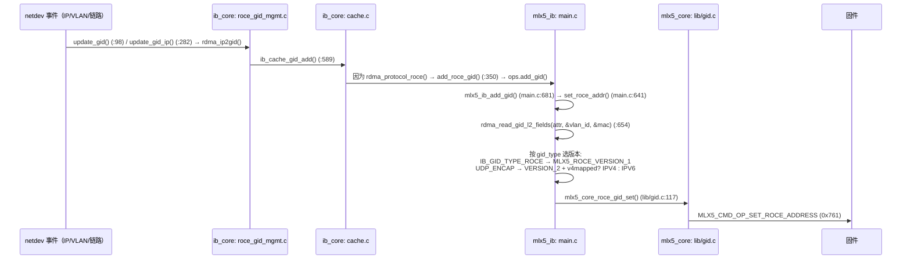
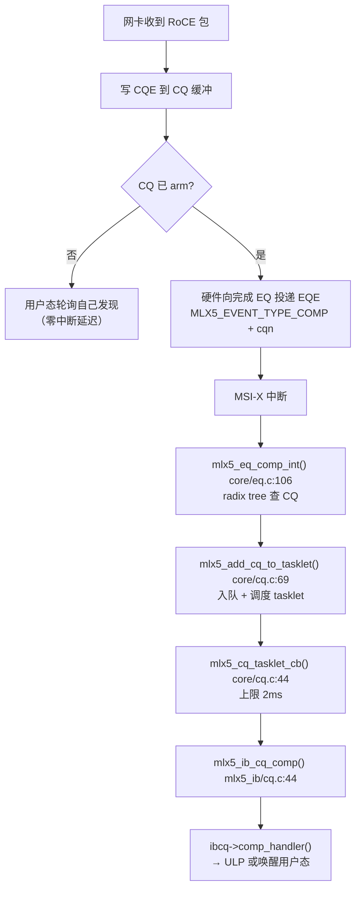

# 第 8 章　硬件驱动解剖：mlx5 RoCE

> **本章目标**：读懂「一块真实 RoCE 网卡的用户态驱动 + 内核驱动」是如何协作的。读完你应该能解释：一次 `ibv_post_send` 为什么只要几十纳秒、BlueFlame/UAR 是什么、WQE 和 CQE 长什么样、RoCEv2 的 AV 里到底存了什么。
>
> **本章对应源码**：
> - `kernel:drivers/infiniband/hw/mlx5/`（`main.c`、`qp.c`、`wr.c`、`cq.c`、`ah.c`、`mr.c`、`cong.c`、`devx.c`）
> - `kernel:drivers/net/ethernet/mellanox/mlx5/core/`（`main.c`、`cmd.c`、`cq.c`、`eq.c`、`uar.c`、`port.c`、`vport.c`、`lib/gid.c`）
> - `kernel:include/linux/mlx5/`（`qp.h`、`doorbell.h`、`device.h`、`mlx5_ifc.h`）
> - `kernel:include/uapi/rdma/mlx5-abi.h`
> - `rdma-core:providers/mlx5/`（用户态侧，第 9 章详解）
>
> **本章所有符号与行号均在本内核树（7.2.8）中逐一核对。凡常见资料中存在但本树不存在的符号，均已显式标注。**

---

## 8.1 【重要】先纠正一批常见的错误认知

很多二手资料（包括一些厂商文档）对本树源码的描述已经不准确。先建立正确认知，能省掉大量调试时间：

| 常见说法 | 本树实际情况 |
|---|---|
| QP 的固件命令在 `mlx5_core`（`mlx5_core_create_qp()`） | **不存在**。`drivers/net/ethernet/mellanox/mlx5/core/qp.c` 在本树中不存在，`mlx5_core_create_qp()` 也不存在。QP 的固件命令封装在 **`drivers/infiniband/hw/mlx5/qpc.c`**：`mlx5_qpc_create_qp()`、`mlx5_core_destroy_qp()` |
| `mlx5_ib/roce.c` 存放 RoCE 胶水代码 | **不存在**。RoCE 全部胶水在 **`main.c`** |
| `mlx5_ib_get_netdev()` | **不存在**。用 ib_core 的 `ib_device_get_netdev()` / `ib_device_set_netdev()` |
| `mlx5_ib_gid_table` | **不存在**。GID 表由 ib_core 的 `cache.c` 持有，mlx5 只注册 `.add_gid` / `.del_gid` 回调 |
| `mlx5_wqe_av` | **内核侧**实际名为 **`struct mlx5_av`** / `struct mlx5_base_av`（`kernel:include/linux/mlx5/qp.h:316/299`），本内核树里没有 `mlx5_wqe_av`。**注意别与用户态混淆**：rdma-core 的 DV 头里确实有一个**同名但不同定义**的 `struct mlx5_wqe_av`（`rdma-core:providers/mlx5/mlx5dv.h:961` 前置声明、`:1317` 定义），它被 `struct mlx5dv_ah.av` 使用（`:963`–`:964`）；两者只是名字撞车 |
| `create_qp_common` | 已重构为 `create_qp()` + `struct mlx5_create_qp_params` |
| `mlx5_core_dcqcn_*` / verbs 级 DCQCN 接口 | **不存在**。`cong.c` **只提供 debugfs 旋钮** |
| `MLX5_BF_REGS_PER_PAGE` | **不存在**。相关常量是 `MLX5_BFREGS_PER_UAR` / `MLX5_NON_FP_BFREGS_PER_UAR` |
| `core/en_netdev.c` | **不存在**（已并入 `en_common.c`） |

> **学习方法论提示**：这正说明「源码是唯一权威」。本教程所有章节都给出精确到行的引用，就是让你有能力自己验证。

---

## 8.2 模块架构：auxiliary bus 解耦

现代 mlx5 不再是「一个巨大的 PCI 驱动」，而是**分成两层、通过 auxiliary bus 连接**：

```mermaid
flowchart TB
    subgraph PCI["PCI 层"]
        HW["ConnectX 网卡"]
    end
    subgraph CORE["mlx5_core.ko（drivers/net/ethernet/mellanox/mlx5/core/）"]
        C1["PCI probe / 固件加载 / HCA 能力协商"]
        C2["命令队列（cmd.c）"]
        C3["EQ / MSI-X 中断（eq.c, pci_irq.c）"]
        C4["UAR / BlueFlame 分配（uar.c）"]
        C5["netdev（en_*）"]
        C6["共享资源：CQ / PD / MR / UAR / EQ"]
    end
    subgraph IB["mlx5_ib.ko（drivers/infiniband/hw/mlx5/）"]
        I1["ib_device 注册与 RoCE 使能（main.c）"]
        I2["QP / CQ / MR / AH（verbs 语义）"]
        I3["WQE 组装 + 门铃（wr.c）"]
        I4["QP 固件命令（qpc.c）"]
        I5["DevX（devx.c）"]
        I6["拥塞控制 debugfs（cong.c）"]
    end
    HW --> CORE
    CORE -->|"auxiliary bus<br/>mlx5r_driver(\"rdma\")<br/>mlx5r_mp_driver(\"multiport\")"| IB
```

**注册细节**：

| 侧 | 代码 |
|---|---|
| mlx5_ib 注册客户端 | `mlx5_ib_init()` → `auxiliary_driver_register(&mlx5r_mp_driver)`（`.name = "multiport"`）与 `mlx5r_driver`（`.name = "rdma"`）（`main.c:5471-5530`） |
| mlx5_core 创建 adev | `mlx5_adev_init(dev)`（`core/main.c:1855`） |
| probe 时决定链路层 | `mlx5r_probe()`（`main.c:5408`）按 `MLX5_CAP_GEN(mdev, port_type)` 判断；若是以太网且 `!mlx5_get_roce_state(mdev)` 则用 `raw_eth_profile`（**只支持 Raw Packet**），否则 `pf_profile`（`main.c:5444-5447`） |

**Kconfig 依赖**（`drivers/infiniband/hw/mlx5/Kconfig`）：

```
CONFIG_MLX5_INFINIBAND  depends on NETDEVICES && ETHERNET && PCI && MLX5_CORE
CONFIG_MLX5_CORE_EN     ← RoCE 的必要条件（netdev 支持）
CONFIG_MLX5_CORE_EN_DCB ← PFC / ETS 配置（走 DCB netlink）
```

> **【排障要点】RoCE 不见了，先查这三个 Kconfig。** 尤其 `MLX5_CORE_EN`：没有 Ethernet 支持就只能是 Raw Packet 模式，`rdma link` 里看不到正常的 RoCE 设备。

---

## 8.3 RoCE 使能：从固件能力到 ib_device

### 8.3.1 以太网 netdev 与 IB 设备的耦合

**两级 notifier 链**（这是 RoCE 与 netdev 联动的核心机制）：

```
① main.c:3805  mlx5_mdev_netdev_track()
     注册 roce->mdev_nb 到 mlx5_core 的 blocking notifier
     并调用 mlx5_core_uplink_netdev_event_replay() 补发历史事件
        ↓ MLX5_DRIVER_EVENT_UPLINK_NETDEV
② main.c:3785  mlx5e_mdev_notifier_event()
     → main.c:3763 mlx5_netdev_notifier_register()
        register_netdevice_notifier_dev_net(netdev, &roce->nb, &roce->nn)
        ↓
③ main.c:205   mlx5_netdev_event()          ← 逐 netdev 事件处理
     NETDEV_REGISTER  → ib_device_set_netdev() 绑定（条件 ndev->dev.parent == mdev->device）
     NETDEV_UNREGISTER→ 解绑
     NETDEV_CHANGE/UP/DOWN → 比较 get_port_state() 与 roce->last_port_state，
                              派发 IB_EVENT_PORT_ERR / IB_EVENT_PORT_ACTIVE
```

每端口的 RoCE 上下文是 `struct mlx5_roce`（`kernel:drivers/infiniband/hw/mlx5/mlx5_ib.h:846`）：`nb`、`nn`、`mdev_nb`、`tracking_netdev`、`tx_port_affinity`、`last_port_state`、`dev`、`native_port_num`。

### 8.3.2 RoCE 初始化与固件使能

```c
/* kernel:drivers/infiniband/hw/mlx5/main.c:4883 */
mlx5_ib_roce_init()
  → 若链路层是 IB_LINK_LAYER_ETHERNET：
      安装 mlx5_ib_dev_common_roce_ops（main.c:4872）
      mlx5_mdev_netdev_track()
      mlx5_enable_eth()（main.c:3822）
        → mlx5_nic_vport_enable_roce(dev->mdev)     /* 非 rep 且非 raw_eth_profile */
        → mlx5_eth_lag_init()
```

**固件侧使能**（`kernel:drivers/net/ethernet/mellanox/mlx5/core/vport.c`）：

```c
mlx5_nic_vport_enable_roce()   /* :1096 引用计数 +1 */
mlx5_nic_vport_disable_roce()  /* :1112 引用计数 -1 */
mlx5_nic_vport_update_roce_state()  /* :1072 */
   → MLX5_SET(modify_nic_vport_context_in, in, field_select.roce_en, 1)
enum mlx5_vport_roce_state { MLX5_VPORT_ROCE_DISABLED = 0, MLX5_VPORT_ROCE_ENABLED = 1 };  /* :1067 */
```

**端口属性里的 RoCE 标志**（`main.c:590-599`）：**仅当** `!dev->is_rep && dev->mdev->roce.roce_en` 为真（`main.c:590`）时才设置 `props->port_cap_flags |= IB_PORT_CM_SUP`、`props->ip_gids = true`、`props->gid_tbl_len = MLX5_CAP_ROCE(mdev, roce_address_table_size)`。**Representor 设备（`is_rep`）会跳过整个分支**，所以要判 RoCE 是否真使能，不能只看 `roce_en`。

> **`ip_gids = true` 是 RoCE 的关键标识** —— 它告诉上层「本端口的 GID 是 IP 派生的」。用户态程序若检查这个标志，就能区分 RoCE 与 IB。

### 8.3.3 端口能力 → RoCE 版本

```c
/* kernel:drivers/infiniband/hw/mlx5/main.c:3555 */
get_core_cap_flags()
    l3_type_cap      = MLX5_CAP_ROCE(mdev, l3_type);
    roce_version_cap = MLX5_CAP_ROCE(mdev, roce_version);
    MLX5_ROCE_VERSION_1_CAP → RDMA_CORE_PORT_IBA_ROCE            (:3587)
    MLX5_ROCE_VERSION_2_CAP → RDMA_CORE_PORT_IBA_ROCE_UDP_ENCAP  (:3590)
    并置 RDMA_CORE_PORT_RAW_PACKET                              (:3578)
```

这些 `core_cap_flags` 正是第 7 章 `rdma_protocol_roce_udp_encap()` 读取的位 —— **闭环了**：固件能力 → `core_cap_flags` → `roce_gid_type_mask_support()` → 用户态看到的 GID 类型。

### 8.3.4 GID 表填充：netdev IP → GID → 固件

**这是 RoCE 最核心的机制之一**，全链路如下：



**默认 GID（RoCEv1 链路本地）的生成**（`kernel:drivers/infiniband/core/cache.c:539`）：

```c
make_default_gid(dev, gid):
    subnet_prefix = 0xfe80000000000000            /* fe80::/64 */
    addrconf_ifid_eui48(&gid->raw[8], dev)        /* MAC → EUI-64 */
```

**VLAN 的处理**：VLAN 设备作为 cookie/ndev 传入，所以**同一个 MAC 的不同 VLAN 子接口各自生成独立 GID**（`rdma_vlan_dev_real_dev()` 用于 bonding 过滤）。

**固件命令的载荷**（`kernel:drivers/net/ethernet/mellanox/mlx5/core/lib/gid.c:117`）：

```c
mlx5_core_roce_gid_set(dev, index, roce_version, roce_l3_type, gid, mac, vlan_valid, vlan_id, port_num)
    → 校验 MLX5_CAP_GEN(dev, port_type) == MLX5_CAP_PORT_TYPE_ETH    (:130)
    → 填 roce_addr_layout:
        vlan_valid / vlan_id              (:135-136)
        source_mac_47_32                  (:139)
        source_l3_address                 (:140)
        roce_version / roce_l3_type       (:142-143)
        vhca_port_num                     (:145-146)
    → MLX5_SET(set_roce_address_in, in, opcode, MLX5_CMD_OP_SET_ROCE_ADDRESS)
    → mlx5_cmd_exec_in()                  (:149-150)
```

相关命令号：`QUERY_ROCE_ADDRESS = 0x760`、`SET_ROCE_ADDRESS = 0x761`。

> **【行业重点】这解释了一个现场常见疑问：「我改了 IP，为什么 RoCE 不通了？」**
> 因为 **GID 表会被重建**。IP 变化 → `del_netdev_ips()` + `add_netdev_ips()` → 旧 GID 失效、新 GID 出现 → **你程序里缓存的 `sgid_index` 可能指向一个已失效的条目**。
> 正确处理：监听 `IBV_EVENT_GID_CHANGE`，收到后重新查询 GID 表并重建 QP/AH。这就是第 4 章强调「必须处理异步事件」的原因。

---

## 8.4 QP：类型、状态与创建

### 8.4.1 类型映射

```c
/* kernel:drivers/infiniband/hw/mlx5/qp.c:824 */
to_mlx5_st():
    IB_QPT_RC          → MLX5_QP_ST_RC
    IB_QPT_UC          → MLX5_QP_ST_UC
    IB_QPT_UD          → MLX5_QP_ST_UD
    IB_QPT_XRC_INI/TGT → MLX5_QP_ST_XRC
    IB_QPT_RAW_PACKET  → MLX5_QP_ST_RAW_ETHERTYPE
    IB_QPT_SMI         → MLX5_QP_ST_QP0
    MLX5_IB_QPT_HW_GSI → MLX5_QP_ST_QP1
    MLX5_IB_QPT_DCI    → MLX5_QP_ST_DCI
    MLX5_IB_QPT_REG_UMR→ MLX5_QP_ST_REG_UMR
```

mlx5 的 QP 类型枚举（`kernel:include/linux/mlx5/qp.h:101-118`）：`RC=0x0, UC=0x1, UD=0x2, XRC=0x3, MLX=0x4, DCI=0x5, DCT=0x6, QP0=0x7, QP1=0x8, RAW_ETHERTYPE=0x9, RAW_IPV6=0xa, SNIFFER=0xb, REG_UMR=0xc, PTP_1588=0xd, SYNC_UMR=0xe`。

**硬件状态**（`qp.h:79-92`）：`RST=0, INIT=1, RTR=2, RTS=3, SQER=4, SQD=5, ERR=6, SQ_DRAINING=7, SUSPENDED=9`。

> **注意**：`IBV_QPS_RESET/INIT/RTR/RTS`（用户态枚举）与 `MLX5_QP_STATE_*`（硬件枚举）**不是同一个东西**，靠 `to_mlx5_state()`（`qp.c:810`）转换。调试寄存器/固件命令时看到的是硬件值。

### 8.4.2 创建路径

```
qp.c:3303 mlx5_ib_create_qp
  → check_qp_type() / process_udata_size() / check_ucmd_data()
    / process_vendor_flags() / process_create_flags() / check_qp_attr()
  → create_qp(dev, pd, qp, &params)                              qp.c:3148
      按类型分派：
        is_rss_raw  → create_rss_raw_qp_tir
        DCT         → create_dct
        DCI         → create_dci
        XRC_TGT     → create_xrc_tgt_qp
        GSI         → mlx5_ib_create_gsi
        其他        → udata ? create_user_qp : create_kernel_qp   (:3179-3182)
  → 设置 qp->ibqp.qp_num（QP0/QP1 特判）                          (:3191-3196)
```

参数容器是 `struct mlx5_create_qp_params`（`qp.c:1742`）。

**用户态 QP**：`create_user_qp()`（`:2273`）→ `_create_user_qp()`（`:963`）：

- 取 UAR / BF 寄存器（见 8.6）
- SQ/RQ 缓冲来自用户态 `buf_addr`（通过 uverbs UMEM 注册）
- 根据 `qp->flags_en & (MLX5_QP_FLAG_UAR_PAGE_INDEX | MLX5_QP_FLAG_BFREG_INDEX)` 三态处理 bfreg（`:986-1009`）
- **用 `UVERBS_ATTR_CREATE_QP_BUF_UMEM`** 传入用户缓冲（`:960`）

**内核态 QP**：`create_kernel_qp()`（`:2477`）→ `_create_kernel_qp()`（`:1132`）：

```c
qp->bf.bfreg = &dev->fp_bfreg;   /* REG_UMR 用 FP（fast path）bfreg */
                或 &dev->bfreg;  /* 其他（:1141-1144） */
qp->bf.buf_size = (1 << MLX5_CAP_GEN(mdev, log_bf_reg_size)) / 2;   /* :1149 —— 奇偶双缓冲！ */
mlx5_frag_buf_alloc_node()  /* :1162 */
```

> **`buf_size = 总大小 / 2` 是关键**：BlueFlame 寄存器被**劈成两半**做奇偶双缓冲，每次门铃后切换，这样「上一次写的门铃数据」不会阻塞「下一次写」。

**Raw Packet QP**（`create_raw_packet_qp()`，`:1602`）：SQ 侧走 `create_raw_packet_qp_tis()`（`:1260`）+ `create_raw_packet_qp_sq()`（`:1367`）；RQ 侧走 `create_raw_packet_qp_rq()`（`:1465`）+ `create_raw_packet_qp_tir()`（`:1552`）。响应里带回 `tisn/sqn/rqn/tirn/tir_icm_addr`（`:1632-1671`）。

### 8.4.3 两层状态表校验（【源码】精彩设计）

`ibv_modify_qp` 的合法性检查分**两层**，这是理解「为什么改 QP 状态要传那么多字段」的关键：

**第一层 —— ib_core 的通用表**（`kernel:drivers/infiniband/core/verbs.c:1458-1462`）：**这是一个匿名 struct 的数组**（没有 `struct qp_transition` 这个类型名）：

```c
static const struct {
    int                    valid;
    enum ib_qp_attr_mask   req_param[IB_QPT_MAX];
    enum ib_qp_attr_mask   opt_param[IB_QPT_MAX];
} qp_state_table[IB_QPS_ERR + 1][IB_QPS_ERR + 1] = { ... };
```

判定函数是 `ib_modify_qp_is_ok()`（`verbs.c:1763`）。例子（`verbs.c:1468-1474`）：

- `IB_QPS_RESET → IB_QPS_INIT` 对 `IB_QPT_UD` 要求 `IB_QP_PKEY_INDEX | IB_QP_PORT | IB_QP_QKEY`
- 对 `IB_QPT_RAW_PACKET` **只要求** `IB_QP_PORT`

**第二层 —— 驱动每类型可选参数掩码**（`kernel:drivers/infiniband/hw/mlx5/qp.c:3668`）：

```c
static enum mlx5_qp_optpar opt_mask[MLX5_QP_NUM_STATE][MLX5_QP_NUM_STATE][MLX5_QP_ST_MAX]
```

按 **(当前态, 目标态, QP 类型)** 三维给出允许的 `MLX5_QP_OPTPAR_*` 位。例子：

| 迁移 | QP 类型 | 允许的可选参数 | 位置 |
|---|---|---|---|
| INIT→RTR | RC | `ALT_ADDR_PATH \| RRE \| RAE \| RWE \| PKEY_INDEX \| LAG_TX_AFF` | `qp.c:3692-3697` |
| RTR→RTS | RC | `ALT_ADDR_PATH \| RRE \| RAE \| RWE \| PM_STATE \| RNR_TIMEOUT` | `qp.c:3716-3721` |
| RTS→RTS | RC | （见源码） | `qp.c:3738-3743` |
| SQER→RTS / SQD→RTS | RC | （见源码） | `qp.c:3760-3785` |

`mlx5_ib_modify_qp()`（`qp.c:4829`）：计算 `cur_state`/`new_state`（`:4876-4877`），DCI 走 `modify_dci_qp_is_ok()`（`:4899`），否则走 `ib_modify_qp_is_ok()`（`:4894`）；GSI 转 `mlx5_ib_gsi_modify_qp`（`:4866`），DCT 转 `mlx5_ib_modify_dct`（`:4871`）。

> **【实战价值】当你看到 `ibv_modify_qp` 返回 `EINVAL` 时，就是这两层表里的某一层拒绝了你的「掩码 + 字段」组合。** 排查方法：核对掩码是否含表里要求的所有位（第一层），以及是否含了表里不允许的位（第二层）。

---

## 8.5 数据路径：WQE、门铃、CQE

### 8.5.1 `mlx5_ib_post_send` 做了什么

```c
/* kernel:drivers/infiniband/hw/mlx5/wr.c:1053 */
mlx5_ib_post_send()
  → GSI 转 mlx5_ib_gsi_post_send (:1079)
  → 持 qp->sq.lock
  → 对每个 WR：
      · 校验 wr->opcode < ARRAY_SIZE(mlx5_ib_opcode) 与 num_sge <= qp->sq.max_gs
      · begin_wqe() 取 WQE 指针与 ctrl 段 (:1100)
      · fence 逻辑用 MLX5_FENCE_MODE_* (:1109-1119)
      · 按 opcode 组装各段（见下表）
  → 收尾时调 mlx5r_ring_db() 敲门铃（每批一次，不是每个 WR 一次）
```

**WQE 的布局单元**（`kernel:include/linux/mlx5/qp.h:156-167`）：

| 常量 | 值 | 含义 |
|---|---|---|
| `MLX5_SEND_WQE_DS` | 16 | 一个 DS = 16 字节 |
| `MLX5_SEND_WQE_BB` | 64 | 一个 Basic Block = 64 字节 |
| `MLX5_SEND_WQE_MAX_WQEBBS` | 16 | 单个 WQE 最多 16 个 BB |

**控制段** `struct mlx5_wqe_ctrl_seg`（`qp.h:206`）：`opmod_idx_opcode`、`qpn_ds`、`fm_ce_se`（fence / cq-update / solicited 位，`qp.h:150-154`）。

**各段类型**：

| 段 | 位置 | 用途 |
|---|---|---|
| `mlx5_wqe_ctrl_seg` | `qp.h:206` | 控制段（必有） |
| `mlx5_wqe_datagram_seg` | `qp.h:350` | **含 `struct mlx5_av`** —— UD/RC 的地址向量直接在 WQE 里！ |
| `mlx5_wqe_raddr_seg` | `qp.h:354` | RDMA READ/WRITE 的远端地址 + rkey |
| `mlx5_wqe_masked_atomic_seg` | `qp.h:292` | 原子操作的 compare/swap 值 |

**UD 的特殊处理**：`handle_qpt_ud()`（`wr.c:1006`）支持 `IB_QP_CREATE_IPOIB_UD_LSO`，会追加 `mlx5_wqe_eth_pad` + `set_eth_seg()`（`:1015-1023`）。

> **【必会】`struct mlx5_wqe_datagram_seg { struct mlx5_av av; }` 这一行揭示了 RoCE 的性能秘诀**：地址向量**不是查表得到**，而是**直接内联在 WQE 里**。网卡读到 WQE 就拿到了目的 MAC、目的 GID、DSCP、hop limit、UDP 源端口 —— **零查表开销**。

### 8.5.2 门铃与 BlueFlame：全章最重要的一段代码

```c
/* kernel:drivers/infiniband/hw/mlx5/wr.c:1027（声明在 wr.h:102，非 static —— umr.c:276 跨文件调用） */
void mlx5r_ring_db(struct mlx5_ib_qp *qp, unsigned int nreq,
                   struct mlx5_wqe_ctrl_seg *ctrl)
{
    struct mlx5_bf *bf = &qp->bf;

    qp->sq.head += nreq;

    /* ① 内存屏障：保证 WQE 描述符先于 doorbell record 被网卡看到 */
    wmb();

    /* ② 写 doorbell record（在普通内存里，网卡会 DMA 读它） */
    qp->db.db[MLX5_SND_DBR] = cpu_to_be32(qp->sq.cur_post);

    /* ③ 内存屏障：保证 DBR 先于 UAR 写 */
    wmb();

    /* ④ ★ 写 UAR（BlueFlame 寄存器）—— 这一步让网卡开始工作 */
    mlx5_write64((__be32 *)ctrl, bf->bfreg->map + bf->offset);

    /* ⑤ ★ 奇偶双缓冲切换 */
    bf->offset ^= bf->buf_size;
}
```

**为什么是 64 位一次写？**（`kernel:include/linux/mlx5/doorbell.h:50-58`）

```c
static inline void mlx5_write64(__be32 val[2], void __iomem *dest)
{
#if BITS_PER_LONG == 64
    __raw_writeq(*(u64 *)val, dest);      /* 一次 8 字节 MMIO */
#else
    __raw_writel((__force u32) val[0], dest);
    __raw_writel((__force u32) val[1], dest + 4);
#endif
}
```

> **【重要】64 位门铃的原子性有前提**（`doorbell.h:43-45` 注释明文）：「Note that the write is not atomic on 32-bit systems! In contrast to 64-bit ones, it requires proper locking. `mlx5_write64` doesn't do any locking, so use it at your own discretion, protected by some kind of lock on 32 bits.」
> 也就是说 **32 位系统上这个 64 位门铃不是原子的，必须由调用方自己加锁**（`mlx5r_ring_db()` 正是靠 `qp->sq.lock` 保护）；64 位系统上一次 `__raw_writeq` 即原子。

**BlueFlame 是什么**：普通门铃只写 8 字节（告诉网卡「SQ 有新 WQE 了，去 DMA 读」）。**BlueFlame 允许把这 8 字节连同 WQE 的控制段（最多 64 字节）一起写进 UAR**，网卡直接从寄存器里拿到数据，**省掉一次 WQE 的 DMA 读** —— 这就是小消息低延迟的关键机制。

**UAR / BF 寄存器的物理映射**（`kernel:drivers/net/ethernet/mellanox/mlx5/core/uar.c:194`）：

```c
map_offset(uar_index, bfreg_index, log_bf_reg_size)
  = dbi / MLX5_BFREGS_PER_UAR * MLX5_ADAPTER_PAGE_SIZE
  + (dbi % MLX5_BFREGS_PER_UAR) * (1 << log_bf_reg_size)
  + MLX5_BF_OFFSET;
```

| 常量 | 值 | 位置 |
|---|---|---|
| `MLX5_BF_OFFSET` | `0x800` | `doorbell.h:36` |
| `MLX5_CQ_DOORBELL` | `0x20` | `doorbell.h:37` |
| `MLX5_BFREGS_PER_UAR` | 4 | `device.h:252` |
| `MLX5_NON_FP_BFREGS_PER_UAR` | 2 | `device.h:254` |
| `MLX5_MAX_UARS` | `1 << 8` | `device.h` |
| `MLX5_MIN_DYN_BFREGS` / `MAX_DYN_BFREGS` | 512 / 1024 | `device.h:251-263` |
| `MLX5_MAX_BFREGS` | `MLX5_MAX_UARS * MLX5_NON_FP_BFREGS_PER_UAR` | 同上 |

> **【必会】三个数字值得记牢**：`MLX5_BF_OFFSET = 0x800`（UAR 页内 BF 区起始）、`MLX5_CQ_DOORBELL = 0x20`（CQ 门铃偏移）、`MLX5_SND_DBR = 1` / `MLX5_RCV_DBR = 0`（`qp.h:186-187`，doorbell record 数组下标）。**读用户态 `libmlx5` 源码时，你会反复看到这三个数字。**

### 8.5.3 CQ 与轮询

```c
/* kernel:drivers/infiniband/hw/mlx5/cq.c:611 */
mlx5_ib_poll_cq()
  → 持 cq->lock
  → 设备内部错误时走软件完成 poll_soft_wc() / mlx5_ib_poll_sw_comp (:622-630)
  → 正常路径 poll_soft_wc + mlx5_poll_one() (:632-638)
  → 有完成则 mlx5_cq_set_ci(&cq->mcq) 更新消费者索引 (:640-641)
```

**CQE 的所有权判定**（这是无锁轮询能工作的基础）：`get_sw_cqe()`（`cq.c:82`）用 `op_own & MLX5_CQE_OWNER_MASK`（`:90`）判断这个 CQE 是不是自己的。硬件写 CQE 时会翻转 owner 位 —— 用户态轮询就靠这个 bit 判断「有没有新完成」，**无需任何系统调用或原子操作**。

**RoCE 特有解析**：`cq.c:178-260` 从 `flags_rqpn` 高位解析出 `roce_packet_type`（用于区分收到的包类型）。

### 8.5.4 完整数据路径（把 8.5.1-8.5.3 串起来）


> **注意整条链路上「内核参与」只有三次**：① 建 QP（控制平面）、② 注册内存（控制平面）、③ mmap（一次性）。**数据路径零内核参与。**

---

## 8.6 用户态共享：mmap 与 BF 寄存器池

### 8.6.1 `alloc_ucontext`：BF 寄存器池的建立

```c
/* kernel:drivers/infiniband/hw/mlx5/main.c:2200 */
mlx5_ib_alloc_ucontext()
  → ABI 版本判定：inlen == sizeof(mlx5_ib_alloc_ucontext_req) → ver 0
                  inlen >= offsetof(..., max_cqe_version)      → ver 2   (:2219-2224)
  → DevX 分支：req.flags & MLX5_IB_ALLOC_UCTX_DEVX
        → mlx5_ib_devx_create(dev, true, uctx->enabled_caps) → context->devx_uid   (:2241-2245)
        → 若启用 RDMA control：mlx5_cmd_add_privileged_uid()                        (:2247-2252)
  → ★ BF 寄存器池：calc_total_bfregs()（:1903，调用于 :2265）
        bfregs_per_sys_page = uars_per_sys_page * MLX5_NON_FP_BFREGS_PER_UAR
        num_static_sys_pages / num_dyn_bfregs / total_num_bfregs
        上限 MLX5_MAX_BFREGS（:1917）
  → bfregi->count / sys_pages 分配（:2271-2282）
  → allocate_uars()（:2284）→ 逐个 mlx5_cmd_uar_alloc()（:1949）
  → mlx5_ib_alloc_transport_domain()（:2289，赋 context->tdn）
        —— RoCE/以太网下 TD 用于 TIR/TIS 等对象
  → LAG 亲和：atomic_add_return(1, &dev->port[port].roce.tx_port_affinity)（:2315-2321）
```

返回给用户态的关键信息（`struct mlx5_ib_alloc_ucontext_resp`，`kernel:include/uapi/rdma/mlx5-abi.h:135-158`）：`bf_reg_size`、`tot_bfregs`、`max_sq_desc_sz`、`num_uars_per_page`、`log_uar_size`、`num_dyn_bfregs`、`cqe_version`、`cmds_supp_uhw`、`eth_min_inline`。

**bfreg 编号的两次转换**（这是用户态能正确找到自己 UAR 的前提）：

```c
/* qp.c:948 —— 把内核 bfregn 编号空间换算成用户态可见编号 */
adjust_bfregn(bfregn) = bfregn / MLX5_NON_FP_BFREGS_PER_UAR * MLX5_BFREGS_PER_UAR
                      + bfregn % MLX5_NON_FP_BFREGS_PER_UAR;
/* qp.c:846 —— bfregn → UAR 索引 */
bfregn_to_uar_index():
    index_of_sys_page = bfregn / bfregs_per_sys_page
    offset            = bfregn % bfregs_per_sys_page / MLX5_NON_FP_BFREGS_PER_UAR
```

驱动把它写进 `resp->bfreg_index`（`qp.c:1073`），用户的 `libmlx5` 用它算出 UAR 页与页内偏移。

**`struct mlx5_bfreg_info`**（`mlx5_ib.h:168-184`）关键字段：`sys_pages`、`num_low_latency_bfregs`、`count`、`lock`、`ver`、`lib_uar_4k`、`lib_uar_dyn`、`num_sys_pages`、`num_static_sys_pages`、`total_num_bfregs`、`num_dyn_bfregs`。哨兵值：`MLX5_IB_INVALID_UAR_INDEX = BIT(31)`、`MLX5_IB_INVALID_BFREG = BIT(31)`（`:145-146`）。

### 8.6.2 mmap 命令编码

```c
/* kernel:include/uapi/rdma/mlx5-abi.h:487 */
enum mlx5_ib_mmap_cmd {
    MLX5_IB_MMAP_REGULAR_PAGE        = 0,   /* UAR 页（best-effort WC） */
    MLX5_IB_MMAP_GET_CONTIGUOUS_PAGES= 1,   /* ★ 本版本返回 -ENOSYS（main.c:2762） */
    MLX5_IB_MMAP_WC_PAGE             = 2,   /* UAR 页 WC，需 mlx5_wc_support_get() */
    MLX5_IB_MMAP_NC_PAGE             = 3,   /* UAR 页 non-cached */
    MLX5_IB_MMAP_CORE_CLOCK          = 5,   /* HCA 内部计时器（选 5 兼容旧 libmlx5） */
    MLX5_IB_MMAP_ALLOC_WC            = 6,   /* 动态分配 UAR 并映射 */
    MLX5_IB_MMAP_CLOCK_INFO          = 7,
    MLX5_IB_MMAP_DEVICE_MEM          = 8,   /* memic 设备内存 */
};
```

偏移编码：`MLX5_IB_MMAP_CMD_SHIFT = 8`、`MLX5_IB_MMAP_CMD_MASK = 0xff`（`mlx5_ib.h:112-115`）；`MLX5_IB_MMAP_OFFSET_START = 9`、`END = 255`（`:107-110`）。

**分派**（`main.c:2744 mlx5_ib_mmap()`）：

| 命令 | 行为 |
|---|---|
| `WC_PAGE` / `ALLOC_WC` | 需 `mlx5_wc_support_get()`，否则 `-EPERM` → 落 `uar_mmap()` |
| `NC_PAGE` / `REGULAR_PAGE` | 落 `uar_mmap()` |
| `GET_CONTIGUOUS_PAGES` | **本版本 `-ENOSYS`** |
| `CORE_CLOCK` | 映射 `mdev->bar_addr + offsetof(struct mlx5_init_seg, internal_timer_h)`（`:2777-2783`） |
| `CLOCK_INFO` | `mlx5_ib_mmap_clock_info_page()`（`:2457`） |
| 默认 | `mlx5_ib_mmap_offset()`（`:2703`），prot 由 `mlx5_ib_mmap_type` 决定 |

**内存属性选择**（`:2721-2730`）：

```c
enum mlx5_ib_mmap_type { MEMIC=1, VAR=2, UAR_WC=3, UAR_NC=4, MEMIC_OP=5, TLP_VAR=6 };  /* mlx5_ib.h:159 */
UAR_NC / VAR / TLP_VAR → pgprot_noncached()
其余                   → pgprot_writecombine()
```

`uar_mmap()`（`:2584`）：一页一映射；`dyn_uar = (cmd == MLX5_IB_MMAP_ALLOC_WC)` 决定索引空间（`:2595-2597`）；`ALLOC_WC` 走 `mlx5_cmd_uar_alloc()` 动态取 UAR 并占用 `bfregi->count[bfreg_dyn_idx]`（`:2630-2651`）。

### 8.6.3 哪些结构在用户态

| 结构 | 机制 | 说明 |
|---|---|---|
| **UAR / 门铃页** | mmap | 用户态由此得到 BlueFlame 基址 |
| **SQ / RQ 缓冲** | 用户态分配 + uverbs UMEM 注册 | `buf_addr` 经 `UVERBS_ATTR_CREATE_QP_BUF_UMEM`（`qp.c:960`） |
| **CQ 缓冲** | 用户态分配 + UMEM | `mlx5_ib_populate_pas(cq->buf.umem, ...)`（`cq.c:786`）把 umem 填成 PAS 交固件 |
| **doorbell record（DBR）** | `mlx5_ib_db_map_user_desc()`（`doorbell.c:50`） | 用 `ib_umem` 固定用户页，按 mm 复用（`context->db_page_list`）；VA 型可共享，FD 型单独 pin。`MLX5_IB_DBR_SIZE = sizeof(__be32) * 2`（`:40`） |
| **定位信息** | `struct mlx5_ib_create_qp_resp`（`mlx5-abi.h:395`） | 含 `bfreg_index`、`ece_options`、`tirn`、`tisn`、`rqn`、`sqn`、`tir_icm_addr` |
| **CQ ↔ EQ 关联** | `mlx5_comp_eqn_get()`（`cq.c:1079`）→ CQC 的 `c_eqn_or_apu_element` | 用户态可用 `MLX5_IB_METHOD_DEVX_QUERY_EQN`（`devx.c:1030`）/ `..._QUERY_UAR`（`devx.c:1079`）查询 |

> **【行业重点】这就是 GPUDirect RDMA / 高性能 verbs 程序能绕过内核的全部基础设施。** 自己写高性能 verbs 程序时，你要关心的就是：**UAR 是否 mmap 好、SQ/CQ 是否在自己的大页内存里、doorbell record 是否放在正确的缓存行上**。

---

## 8.7 verbs 路径 vs DevX / Direct Verbs

| 维度 | 经典 verbs | DevX / Direct Verbs (DV) |
|---|---|---|
| QP 创建 | `ibv_create_qp` → uverbs → `mlx5_ib_create_qp`（`qp.c:3303`）+ CREATE_QP 固件命令 | `UVERBS_HANDLER(MLX5_IB_METHOD_DEVX_OBJ_CREATE)`（`devx.c:1524`），用户态直接给固件命令语义 |
| QP 改状态 | `mlx5_ib_modify_qp`（`qp.c:4829`） | `..._DEVX_OBJ_MODIFY`（`devx.c:1645`） |
| MR 注册 | `mlx5_ib_reg_user_mr` + `mlx5_core_create_mkey`（`mr.c:106`） | `..._DEVX_UMEM_REG`（`devx.c:2391`） |
| CQ 创建 / 查询 | `mlx5_ib_create_cq`（`cq.c:1041`） | `..._DEVX_OBJ_CREATE` / `..._OBJ_QUERY`（`devx.c:1692`） |
| 内存 / UAR | 内核分配 bfregi，mmap 给用户态 | `MLX5_IB_OBJECT_DEVX_UMEM`（`:3207`）、`ASYNC_CMD_FD`（`:3216`）、`ASYNC_EVENT_FD`（`:3231`）、`MLX5_IB_METHOD_VAR_OBJ_ALLOC`（`main.c:4233`） |
| **每包开销** | **零内核参与** | **完全相同：零内核参与** |

> **【重要结论】verbs 与 DevX 的区别只在「控制面开放程度」，不在每包开销。**
> DevX 把「建对象」的语义从固定 verbs 换成更原始的固件命令语义，并允许用户态自定义 QP/CQ/SQ 的缓冲与 UAR 布局。**它不会让你的 `post_send` 更快** —— 因为 `post_send` 本来就不经过内核。
>
> 什么时候需要 DevX：需要硬件特性 verbs 没暴露（如自定义 TIR/TIS、加密、精确的流表控制）、需要更灵活的资源布局（如某些 DPDK/SPDK 场景）。

---

## 8.8 固件命令接口

### 8.8.1 命令队列（mailbox）的结构

```c
/* kernel:include/linux/mlx5/device.h:527 */
struct mlx5_cmd_layout {
    u8     type;
    u8     rsvd0[3];
    __be32 inlen;
    __be64 in_ptr;      /* inbox DMA 指针 */
    __be32 in[4];       /* 内联小 inbox（16 字节） */
    __be32 out[4];      /* 内联小 outbox */
    __be64 out_ptr;
    __be32 outlen;
    u8     token;
    u8     sig;
    u8     rsvd1;
    u8     status_own;  /* ★ 状态 + 所有权位 */
};
```

经典的 **HCR（Hardware Command Register）邮箱模型**：inbox/outbox + 内联小缓冲 + DMA 指针 + token/own 位。

**执行入口**（`kernel:drivers/net/ethernet/mellanox/mlx5/core/cmd.c`）：

| 函数 | 行 | 说明 |
|---|---|---|
| `mlx5_cmd_exec(dev, in, in_size, out, out_size)` | `:2129` | = `mlx5_cmd_do()` + `mlx5_cmd_check()`（`:2132-2134`） |
| `mlx5_cmd_do(dev, in, in_size, out, out_size)` | `:2107` | = `cmd_exec(...)` + `cmd_status_err()`（`:2109-2113`）。**文档明确：不翻译/不拦截 outbox.status**，`status != MLX5_CMD_STAT_OK` 返回 `-EREMOTEIO`，**调用者必须自行检查** |
| `mlx5_cmd_exec_in()` / `mlx5_cmd_exec_inout()` | — | 便捷宏 |
| `mlx5_cmd_exec_polling()` | `:2152` | 轮询模式（中断上下文不可用时） |

### 8.8.2 关键命令号（`kernel:include/linux/mlx5/mlx5_ifc.h:148-243`）

| 命令 | 值 | 命令 | 值 |
|---|---|---|---|
| `CREATE_EQ` | `0x301` | **`CREATE_QP`** | **`0x500`** |
| `DESTROY_EQ` | `0x302` | `DESTROY_QP` | `0x501` |
| `CREATE_CQ` | `0x400` | `RST2INIT_QP` | `0x502` |
| `DESTROY_CQ` | `0x401` | `INIT2RTR_QP` | `0x503` |
| `QUERY_CQ` | `0x402` | `RTR2RTS_QP` | `0x504` |
| `MODIFY_CQ` | `0x403` | `RTS2RTS_QP` | `0x505` |
| `QUERY_ROCE_ADDRESS` | `0x760` | `SQERR2RTS_QP` | `0x506` |
| `SET_ROCE_ADDRESS` | `0x761` | `2ERR_QP` | `0x507` |
| `MODIFY_CONG_PARAMS` | `0x825` | `2RST_QP` | `0x50a` |
| | | `QUERY_QP` | `0x50b` |
| | | `SQD_RTS_QP` | `0x50c` |
| | | `INIT2INIT_QP` | `0x50e` |

> **【必会】这一组 `*_QP` 状态迁移命令，正好对应第 8.4.3 节的两层状态表。** 换句话说：**两层软件校验通过后，每一次 `ibv_modify_qp` 就是一条固件命令**。这也解释了为什么改 QP 状态比 `post_send` 慢好几个数量级。

### 8.8.3 完整 CREATE_QP 调用链（把第 7、8 章串起来）

```
 1. 用户态 ibv_create_qp
    → uverbs 核心 ib_create_qp_user()                  kernel:drivers/infiniband/core/verbs.c:1354
      → create_qp() 内 dev->ops.create_qp(...)         verbs.c:1313

 2. mlx5_ib_create_qp()                                kernel:drivers/infiniband/hw/mlx5/qp.c:3303
      校验 类型 / udata / vendor flags / attr

 3. create_qp()                                        qp.c:3148
      按 qp->type 分派；用户态 → create_user_qp()

 4. create_user_qp()  qp.c:2273  →  _create_user_qp()  qp.c:963
      · bfreg/UAR 分配：alloc_bfreg() qp.c:778 或 bfregn_to_uar_index() qp.c:846
      · 校验用户态 SQ/RQ umem
      · mlx5_ib_populate_pas()                          mem.c:41
      · MLX5_SET(qpc, qpc, st, ...) 写 QPC 字段          qp.c:2060 等

 5. mlx5_qpc_create_qp()                               qpc.c:246   ★ 关键一步
      MLX5_SET(create_qp_in, in, opcode, MLX5_CMD_OP_CREATE_QP)       qpc.c:252
      mlx5_cmd_exec(dev->mdev, in, inlen, out, MLX5_ST_SZ_BYTES(create_qp_out))
                                                                     qpc.c:254-255
      qp->uid = MLX5_GET(create_qp_in,  in,  uid)                     qpc.c:259
      qp->qpn = MLX5_GET(create_qp_out, out, qpn)                     qpc.c:260
      create_resource_common(dev, qp, MLX5_RES_QP)（插 dev->qp_table）qpc.c:262
      失败回滚：MLX5_CMD_OP_DESTROY_QP                                qpc.c:271-276

 6. mlx5_cmd_exec()                                    core/cmd.c:2129
    → mlx5_cmd_do()                                    core/cmd.c:2107
      → cmd_exec()（写邮箱、触发、等 outbox status_own）
      → cmd_status_err()（状态归一化）

 7. 返回路径
      create_user_qp 填 resp->bfreg_index = adjust_bfregn(...)        qp.c:1073
      qp->bfregn = bfregn                                             qp.c:1076
      mlx5_ib_create_qp() → ib_respond_udata(udata, params.resp)      qp.c:3381

 8. 失败清理
      mlx5_ib_create_qp() 的 destroy_qp 标签                          qp.c:3388-3397
        → mlx5_ib_destroy_dct / mlx5_ib_destroy_gsi / destroy_qp_common

 9. 销毁链
      mlx5_ib_destroy_qp() qp.c:3404 → destroy_qp_common
      → mlx5_core_destroy_qp() qpc.c:328
        → destroy_resource_common() qpc.c:195
             radix_tree_delete + mlx5_core_put_rsc + wait_for_completion(&qp->common.free)
        → MLX5_CMD_OP_DESTROY_QP qpc.c:337-340

10. 状态迁移链（独立命令序列）
      mlx5_ib_modify_qp() qp.c:4829
      → 按 cur_state→new_state 选 RST2INIT_QP / INIT2RTR_QP / RTR2RTS_QP /
        RTS2RTS_QP / SQERR2RTS_QP / SQD_RTS_QP / 2RST_QP / 2ERR_QP
      → 路径字段由 mlx5_set_path() 填充 qp.c:3585
```

> **【源码结论】`mlx5_core_create_qp` 在本树中不存在** —— QP 完全属于 `mlx5_ib` 领域，`mlx5_core` 只提供通用命令通道与 CQ/PD/MR/UAR/EQ 等共享资源。**这就是为什么 DevX 也能直接对 `MLX5_CMD_OP_CREATE_QP` 做对象解析**（`devx.c:238, 263, 385, 548-580, 697, 750, 849, 1317`）。

---

## 8.9 RoCEv2 细节：AV、GRH、UDP 源端口熵

### 8.9.1 `struct mlx5_av`：RoCE 报头的「模板」

```c
/* kernel:include/linux/mlx5/qp.h:299-314 —— 原文 */
struct mlx5_base_av {
    union {
        struct {
            __be32 qkey;
            __be32 reserved;
        } qkey;                 /* ★ 内层 struct 名就叫 qkey（不是 global） */
        __be64 dc_key;          /* ★ 是 __be64，与上面的 2×__be32 等宽 */
    } key;
    __be32 dqp_dct;             /* 目的 QPN 或 DCT 号 */
    u8     stat_rate_sl;        /* 高 4 位静态速率，低位 SL */
    u8     fl_mlid;
    union {
        __be16 rlid;            /* IB：目的 LID */
        __be16 udp_sport;       /* ★ RoCEv2：UDP 源端口 */
    };
};

/* kernel:include/linux/mlx5/qp.h:316-337 —— 原文 */
struct mlx5_av {
    union {                     /* ★ mlx5_av 是平铺的，没有 struct mlx5_base_av base 成员 */
        struct {
            __be32 qkey;
            __be32 reserved;
        } qkey;
        __be64 dc_key;
    } key;
    __be32 dqp_dct;
    u8     stat_rate_sl;
    u8     fl_mlid;
    union {
        __be16 rlid;
        __be16 udp_sport;
    };
    u8     reserved0[4];        /* ★ 是 u8[4] 不是 u32[4] */
    u8     rmac[6];             /* ★ 目的 MAC */
    u8     tclass;              /* ★ DSCP + ECN 载体 */
    u8     hop_limit;           /* ★ GRH 跳限 → IP TTL */
    __be32 grh_gid_fl;          /* ★ bit30 = GRH 有效，bit20-27 = sgid_index，低 20 位 = flow_label */
    u8     rgid[16];            /* ★ 目的 GID */
};
```

**字段对照表（这张表就是 RoCEv2 报头与 verbs API 的映射）**：

| AV 字段 | 长度 | 对 RoCEv2 报文的影响 |
|---|---|---|
| `rmac[6]` | 6 B | 以太网目的 MAC |
| `tclass` | 1 B | IP TOS（DSCP + ECN） |
| `hop_limit` | 1 B | IP TTL |
| `grh_gid_fl` bit30 | 1 bit | GRH 是否有效（RoCE 必须为 1） |
| `grh_gid_fl` bit20-27 | 8 bit | `sgid_index`（源 GID 索引 → 决定源 IP 与 VLAN） |
| `grh_gid_fl` 低 20 位 | 20 bit | **flow label** → 转成 UDP 源端口（ECMP 熵） |
| `rgid[16]` | 16 B | 目的 IP（v4-mapped 或 v6） |
| `udp_sport` | 2 B | UDP 源端口 |
| `stat_rate_sl` 高 4 位 | 4 bit | 静态速率限制 |
| `stat_rate_sl` 低位 | — | Service Level → `eth_prio`（PFC 优先级） |

**AV 直接内联在 WQE 里**：`struct mlx5_wqe_datagram_seg { struct mlx5_av av; }`（`qp.h:350`）。`struct mlx5_ib_ah { struct ib_ah ibah; struct mlx5_av av; u8 xmit_port; }`（`qp.h:339`）。

### 8.9.2 `create_ah` 如何填充 AV

```c
/* kernel:drivers/infiniband/hw/mlx5/ah.c:53 */
create_ib_ah()
  /* 通用 GRH 字段 */
  memcpy(ah->av.rgid, &grh->dgid, 16);
  ah->av.grh_gid_fl = cpu_to_be32(grh->flow_label | (1 << 30) | grh->sgid_index << 20);  /* :63-68 */
  ah->av.hop_limit  = grh->hop_limit;
  ah->av.tclass     = grh->traffic_class;
  ah->av.stat_rate_sl = mlx5r_ib_rate(...) << 4;                                        /* :71-74 */

  /* ★ RoCE 分支 */
  if (ah_attr->type == RDMA_AH_ATTR_TYPE_ROCE) {
      if (xmit_slave) ah->xmit_port = mlx5_lag_get_slave_port(...);   /* :77-80 RoCE LAG */
      memcpy(ah->av.rmac, ah_attr->roce.dmac, ...);                   /* :83-84 */
      ah->av.udp_sport = mlx5_ah_get_udp_sport(dev, ah_attr);         /* :85 */
      ah->av.stat_rate_sl |= (rdma_ah_get_sl(ah_attr) & 0x7) << 1;    /* :86 */
      if (gid_type == IB_GID_TYPE_ROCE_UDP_ENCAP)
          ah->av.tclass |= MLX5_ECN_ENABLED;   /* #define MLX5_ECN_ENABLED BIT(1)，:88-89 */
  } else {
      /* IB 分支：填 rlid / fl_mlid / SL 低位 */
  }
```

**两个重要的校验/事实**：

1. `mlx5_ib_create_ah()`（`ah.c:99`）：**RoCE 且没有 GRH 时直接返回 `-EINVAL`**（`:108-110`）。所以 RoCE 上建 AH **必须**设 `is_global = 1`。（第 4 章强调过这一点，这里看到内核强制。）
2. **本树中不存在 `mlx5_ib_modify_ah`** —— AH 创建后不可修改，只能销毁重建。

`mlx5_ib_query_ah()`（`ah.c:132`）从 `grh_gid_fl` 反解：`if (tmp & (1 << 30))` 时 `rdma_ah_set_grh(ah_attr, NULL, tmp & 0xfffff, (tmp >> 20) & 0xff, ah->av.hop_limit, ah->av.tclass)`。

> **【必会】`MLX5_ECN_ENABLED = BIT(1)` 就加在 `tclass` 上** —— 这是「RoCEv2 的 ECN 使能」在驱动层的唯一体现。排查「ECN 不生效」时，可以确认：GID 类型是否为 `IB_GID_TYPE_ROCE_UDP_ENCAP`（只有 v2 才置这个位）。

### 8.9.3 UDP 源端口熵：两处计算，一个算法

**AH 路径**（`ah.c:35`）：

```c
mlx5_ah_get_udp_sport(dev, ah_attr)
  if ((gid_type == IB_GID_TYPE_ROCE_UDP_ENCAP) &&
      (rdma_ah_get_ah_flags(ah_attr) & IB_AH_GRH) &&
      (ah_attr->grh.flow_label & IB_GRH_FLOWLABEL_MASK))
          sport = cpu_to_be16(rdma_flow_label_to_udp_sport(ah_attr->grh.flow_label));
  else
          sport = mlx5_get_roce_udp_sport_min(dev, ah_attr->grh.sgid_attr);  /* 退化值 */
```

**QP path 路径**（`qp.c:3573`）：

```c
mlx5_set_path_udp_sport(path, ah, lqpn, rqpn)
  u32 fl = ah->grh.flow_label;
  if (!fl) fl = rdma_calc_flow_label(lqpn, rqpn);      /* ★ 用 QPN 对推导对称值 */
  MLX5_SET(ads, path, udp_sport, rdma_flow_label_to_udp_sport(fl));
```

**调用条件**（`mlx5_set_path()`，`qp.c:3618-3626`）：**仅当** `qp->type ∈ {RC, UC, XRC_INI, XRC_TGT}` 且 GID 类型是 RoCEv2 且 `attr_mask & IB_QP_DEST_QPN` —— 因为 `rdma_calc_flow_label(lqpn, rqpn)` **需要对端 QPN**。

**退化值**：`mlx5_get_roce_udp_sport_min()`（`main.c:708`）返回 `MLX5_CAP_ROCE(dev->mdev, r_roce_min_src_udp_port)`（仅 RoCEv2 时非 0）。

**算法本身**（`kernel:include/rdma/ib_verbs.h:5064-5125`，所有 RoCEv2 驱动必须一致）：

```c
#define IB_ROCE_UDP_ENCAP_VALID_PORT_MIN (0xC000)
#define IB_ROCE_UDP_ENCAP_VALID_PORT_MAX (0xFFFF)
#define IB_GRH_FLOWLABEL_MASK            (0x000FFFFF)

static inline u16 rdma_flow_label_to_udp_sport(u32 fl) {
    u32 fl_low = fl & 0x03fff, fl_high = fl & 0xFC000;
    fl_low ^= fl_high >> 14;
    return (u16)(fl_low | IB_ROCE_UDP_ENCAP_VALID_PORT_MIN);
}

static inline u32 rdma_calc_flow_label(u32 lqpn, u32 rqpn) {
    u64 v = (u64)lqpn * rqpn;
    v ^= v >> 20;
    v ^= v >> 40;
    return (u32)(v & IB_GRH_FLOWLABEL_MASK);   /* 乘法对称 → 两端算出同一个值 */
}
```

**能力协商**（`core/main.c:650 handle_hca_cap_roce()`）：驱动会主动请求 `sw_r_roce_src_udp_port`（软件计算源端口）能力（`:662-669`），并尝试 `qp_ooo_transmit_default`。**即「软件决定 RoCEv2 源端口」这一能力必须在 HCA cap 阶段谈好。**

### 8.9.4 QP context 里的 RoCE 字段（`mlx5_set_path()`，`qp.c:3627-3658`）

| 字段 | 值 | 含义 |
|---|---|---|
| `eth_prio` | `sl & 0x7` | 以太网优先级（→ VLAN PCP → PFC 队列） |
| `dscp` | `grh->traffic_class >> 2` | **DSCP 是从 `traffic_class` 高 6 位取的** |
| `src_addr_index` | sgid_index | 源地址表索引 |
| `hop_limit` / `tclass` / `flow_label` / `rgid_rip` | GRH 字段 | |
| `stat_rate` | 速率限制 | |
| `vhca_port_num` | 端口 | |
| `ack_timeout` | 超时 | |

> **【行业重点】`dscp = traffic_class >> 2` 这个右移 2 位就是「DSCP 在 TOS 的高 6 位」。**
> 所以你在 perftest 里写 `--tclass=106` 时，DSCP 实际值是 `106 >> 2 = 26`。**配交换机 ACL/QoS 时要用这个换算后的 DSCP 值** —— 这是现场配错 PFC/ECN 的头号原因。
>
> 常见对应：DSCP 26 → TOS 104（`26 << 2`）；DSCP 24 → TOS 96。**注意很多人直接拿 DSCP 值填 `--tclass`，结果 DSCP 变成 `26>>2=6`，完全错位。**

---

## 8.10 拥塞控制与无损网络（驱动侧视角）

### 8.10.1 【重要纠正】驱动侧 DCQCN 只有 debugfs

`kernel:drivers/infiniband/hw/mlx5/cong.c`（489 行）**不实现任何 verbs 拥塞控制接口**，只提供 debugfs 参数旋钮。

**节点类型**（`cong.c:38-42`）：

```c
enum mlx5_ib_cong_node_type {
    MLX5_IB_RROCE_ECN_RP  = 1,   /* Reaction Point（发送侧） */
    MLX5_IB_RROCE_ECN_NP  = 2,   /* Notification Point（接收侧） */
    MLX5_IB_RROCE_GENERAL = 3,
};
```

**参数名单**（`mlx5_ib_dbg_cc_name[]`，`cong.c:44-67`）—— **这就是 DCQCN 的完整可调参数集**：

| 侧 | 参数 |
|---|---|
| **RP（发送侧）** | `rp_clamp_tgt_rate`、`rp_clamp_tgt_rate_ati`、`rp_time_reset`、`rp_byte_reset`、`rp_threshold`、`rp_ai_rate`、`rp_max_rate`、`rp_hai_rate`、`rp_min_dec_fac`、`rp_min_rate`、`rp_rate_to_set_on_first_cnp`、`rp_dce_tcp_g`、`rp_dce_tcp_rtt`、`rp_rate_reduce_monitor_period`、`rp_initial_alpha_value`、`rp_gd` |
| **NP（接收侧）** | `np_min_time_between_cnps`、`np_cnp_dscp`、`np_cnp_prio_mode`、`np_cnp_prio` |
| **general** | `rtt_resp_dscp_valid`、`rtt_resp_dscp` |

**读**：`mlx5_ib_get_cc_params()` → `mlx5_cmd_query_cong_params(mdev, node, out)`（`cong.c:315`）。
**写**：`mlx5_ib_set_cc_params()`（`cong.c:329`）：

```c
MLX5_SET(modify_cong_params_in, in, opcode, MLX5_CMD_OP_MODIFY_CONG_PARAMS);  /* :351，命令号 0x825 */
MLX5_SET(modify_cong_params_in, in, cong_protocol, node);                     /* :355 */
MLX5_SET(modify_cong_params_in, in, field_select_r_roce_rp.field_select_r_roce_rp, attr_mask);  /* :361 */
mlx5_cmd_exec_in(mdev, modify_cong_params, in);                               /* :364 */
```

**debugfs 目录**：`mlx5_ib_init_cong_debugfs()`（`:432`）创建 `mlx5_debugfs_get_dev_root(mdev)/cc_params`（`:456`），要求 `MLX5_CAP_GEN(mdev, cc_query_allowed) && cc_modify_allowed`（`:446-448`）；`rtt_resp_dscp*` 两项额外要求 `roce && roce_cc_general`（`:459-463`，不满足则在建文件的循环里 `continue` 跳过）。**所以上表的 22 项是「上限」：没有 `roce_cc_general` 能力的固件下 `cc_params/` 里只有 20 个文件**（缺 `rtt_resp_dscp_valid`、`rtt_resp_dscp`）。

**硬件自主完成的部分**：ECN 标记与 CNP 生成由 HCA 自己做；驱动只在 QP AV 里置 `MLX5_ECN_ENABLED`（`ah.c:88-89`）并写 `dscp`（`qp.c:3630`）。

**计数器**（`counters.c`）：

| 计数器 | 位置 | 含义 |
|---|---|---|
| `np_ecn_marked_roce_packets` | `:85` | 本端标记 CE 的包数（作为 NP 时） |
| `roce_adp_retrans` | `:102` | 自适应重传次数 |
| `roce_adp_retrans_to` | `:102` | 自适应重传超时次数 |
| `roce_slow_restart` | `:102` | 慢启动重启次数 |
| `roce_slow_restart_cnps` | `:102` | **触发慢启动重启的 CNP 数** ← 判断拥塞的最直接指标 |
| `roce_slow_restart_trans` | `:102` | 慢启动状态转换次数 |

暴露条件：`MLX5_CAP_GEN(dev->mdev, roce_accl)`（`:745, :829`）。

### 8.10.2 PFC 配置在 `mlx5_core`（不在 mlx5_ib）

`kernel:drivers/net/ethernet/mellanox/mlx5/core/port.c`：

| 函数 | 行 | 说明 |
|---|---|---|
| `mlx5_set_port_pause(dev, rx_pause, tx_pause)` | `:505` | 写 `pfcc_reg` 的 `pptx`/`pprx`，经 `mlx5_core_access_reg(..., MLX5_REG_PFCC, 0, 1)`（`:514`） |
| **`mlx5_set_port_pfc(dev, pfc_en_tx, pfc_en_rx)`** | **`:580`** | 置 `pfctx`/`pfcrx` 并按位掩码 `MLX5_SET_TO_ONES(pfcc_reg, in, prio_mask_tx/prio_mask_rx)`（`:586-589`） |
| `mlx5_query_port_pfc()` | `:595` | 查询 PFC |
| `mlx5_query_port_pause()` | `:518` | 查询 pause |
| **`mlx5_set_port_stall_watermark()`** | **`:537`** | 设 `device_stall_critical_watermark` / `minor_watermark` —— **PFC 死锁防护的关键** |

**寄存器号**（`kernel:include/linux/mlx5/driver.h:119-122`）：`MLX5_REG_PAOS = 0x5006`、`MLX5_REG_PFCC = 0x5007`、`MLX5_REG_PPCNT = 0x5008`、`MLX5_REG_PPTB = 0x500b`。

**PPTB**（per-priority buffer 表）是「PFC 与 buffer 的绑定」，由 DCB 栈经 `en_dcbnl.c` / `en/port_buffer.o` 驱动（`CONFIG_MLX5_CORE_EN_DCB`）。

> **【行业重点】PFC 死锁防护靠 `device_stall_watermark`。**
> 当网卡自己的发送队列因为对端 PAUSE 而无法前进时，如果内部 buffer 也满了，就会形成「我等你、你等我」的死锁。`mlx5_set_port_stall_watermark()` 设置一个水位，超过后网卡**主动丢弃**而不是无限等待 —— 这是「宁可丢包也不能全网死锁」的工程折中。**调优 PFC 时这个参数比阈值本身更关键。**

### 8.10.3 与 RoCE 拥塞相关的固件能力

`struct mlx5_ifc_roce_cap_bits`（`kernel:include/linux/mlx5/mlx5_ifc.h:1232-1260`）关键位：

| 位 | 含义 |
|---|---|
| `roce_apm` | 自适应路径迁移 |
| **`sw_r_roce_src_udp_port`** | **支持软件计算源 UDP 端口**（8.9.3 的熵算法前提） |
| `roce_cc_general` | 支持 general 拥塞参数（`rtt_resp_dscp*`） |
| `qp_ooo_transmit_default` | OOO 传输默认值 |
| `qp_ts_format` | 时间戳格式 |
| `l3_type` / `roce_version` | **决定 RoCEv1/v2 与 IPV4/IPV6**（8.3.3） |
| `r_roce_dest_udp_port` / `r_roce_max_src_udp_port` / `r_roce_min_src_udp_port` | UDP 端口范围 |
| `roce_address_table_size` | **GID 表大小**（→ `props->gid_tbl_len`） |

### 8.10.4 运维三件套（RoCE 无损网络）

```bash
# ① DCQCN 参数（唯一的驱动侧入口）
#    22 个参数是「上限」：rp_* 16 个 + np_* 4 个 + general 2 个。
#    其中 general 的 rtt_resp_dscp_valid / rtt_resp_dscp 需要 `roce && roce_cc_general` 能力
#    （cong.c:459-463 用 continue 跳过），部分固件下 cc_params/ 只有 20 个文件。
ls /sys/kernel/debug/mlx5/<PCI>/cc_params/
cat /sys/kernel/debug/mlx5/<PCI>/cc_params/rp_threshold
cat /sys/kernel/debug/mlx5/<PCI>/cc_params/np_min_time_between_cnps

# ② 计数器（判断拥塞与丢包）
ethtool -S <netdev> | grep -Ei 'roce|pause|pfc|ecn|cnp'
# 关注：np_ecn_marked_roce_packets, roce_slow_restart_cnps,
#       roce_adp_retrans, prio*_pause_*, out_of_buffer

# ③ PFC 配置（走 DCB）
mlnx_qos -i <netdev>              # MLNX_OFED 工具
lldptool -t -i <netdev> -V PFC    # 看 LLDP 协商结果

# ④ RoCE 运行时开关
devlink dev param show pci/<PCI> name enable_roce
```

**相关校验函数**：`mlx5_devlink_enable_roce_validate()`（`kernel:drivers/net/ethernet/mellanox/mlx5/core/devlink.c:461`）—— 校验 `MLX5_CAP_GEN(dev, roce)` 或 `roce_rw_supported && MLX5_CAP_GEN_MAX(dev, roce)`，并**禁止在 multi-port slave / LAG 上配置**（`:474`）。

---

## 8.11 中断与 EQ：完成事件是如何被通知的

### 8.11.1 CQ 与 EQ 的绑定

```c
/* kernel:drivers/net/ethernet/mellanox/mlx5/core/cq.c:108 */
mlx5_create_cq()
  1. eq = mlx5_eqn2comp_eq(dev, eqn)        /* :117，eqn 取自 cqc.c_eqn_or_apu_element */
  2. 发 MLX5_CMD_OP_CREATE_CQ               /* :122 */
  3. 取回 cq->cqn、cq->eq = eq、cq->uid      /* :127-131 */
  4. cq->tasklet_ctx.priv = &eq->tasklet_ctx /* :146 */
  5. mlx5_eq_add_cq(&eq->core, cq)           /* :150 —— 注册到完成 EQ */
     mlx5_eq_add_cq(mlx5_get_async_eq(dev), cq)  /* :155 —— 同时注册到异步 EQ */
  6. cq->irqn = eq->core.irqn                /* :165 */
```

`mlx5_eq_add_cq()` / `mlx5_eq_del_cq()`（`kernel:drivers/net/ethernet/mellanox/mlx5/core/eq.c:396/408`）用 `radix_tree_insert/delete(&eq->cq_table.tree, cq->cqn, cq)` —— **CQ 以 cqn 为键挂在 EQ 上**。

### 8.11.2 中断处理

```c
/* kernel:drivers/net/ethernet/mellanox/mlx5/core/eq.c:106 */
mlx5_eq_comp_int()          /* notifier_block 回调，挂在 eq_comp->irq_nb */
    while ((eqe = next_eqe_sw(eq))) {
        dma_rmb();                                       /* :123 读到 EQE 内容前的屏障 */
        cqn = be32_to_cpu(eqe->data.comp.cqn) & 0xffffff;/* :125 */
        cq  = mlx5_eq_cq_get(eq, cqn);                   /* :127 radix tree 查找 + hold */
        if (likely(cq)) {
            ++cq->arm_sn;
            cq->comp(cq, eqe);                           /* :130 ★ 回调 */
            mlx5_cq_put(cq);
        }
        ++eq->cons_index;
        if (++num_eqes >= MLX5_EQ_POLLING_BUDGET) break; /* :139 预算限制 */
    }
    eq_update_ci(eq, 1);                                 /* :143 */
```

> **`MLX5_EQ_POLLING_BUDGET` 是重要的工程细节**：中断处理有预算上限，超过就退出让出 CPU —— **防止中断风暴拖垮系统**。

### 8.11.3 内核态 CQ 的两级延迟任务模型（关键设计）

```c
/* mlx5_ib_create_cq 中设置（cq.c:1011/1012/1019） */
cq->mcq.comp    = mlx5_add_cq_to_tasklet;      /* core/cq.c:69 */
cq->mcq.tasklet_ctx.comp = mlx5_ib_cq_comp;    /* mlx5_ib/cq.c:44 */
cq->mcq.event   = mlx5_ib_cq_event;            /* mlx5_ib/cq.c:51 */
```

**中断上下文里不做任何重活**：

```c
/* core/cq.c:69 —— 只入队 + 调度 tasklet */
mlx5_add_cq_to_tasklet(cq, eqe)
    → list_add_tail(&cq->tasklet_ctx.entry, &eq->tasklet_ctx.list)
    → mlx5_cq_hold(cq)
    → tasklet_schedule(&eq->tasklet_ctx.task)
```

```c
/* core/cq.c:44 —— tasklet 里才真正回调，且有 2ms 上限 */
mlx5_cq_tasklet_cb()
    list_splice_tail_init(...)          /* :53 */
    逐个: mcq->tasklet_ctx.comp(mcq, NULL) + mlx5_cq_put()   /* :59-60 */
    超过 TASKLET_MAX_TIME（2ms，:41-42）→ 重新 tasklet_schedule()  /* :65-66 */
```

**最终回调**：

| 函数 | 位置 | 作用 |
|---|---|---|
| `mlx5_ib_cq_comp()` | `mlx5_ib/cq.c:44` | `ibcq->comp_handler(ibcq, ibcq->cq_context)`（`:48`）—— 交给 ULP（如 `ib_ipoib`、`nvme-rdma`） |
| `mlx5_ib_cq_event()` | `mlx5_ib/cq.c:51` | 只处理 `MLX5_EVENT_TYPE_CQ_ERROR` → 派发 `IB_EVENT_CQ_ERR`（`:58-68`） |
| `notify_soft_wc_handler()` | `mlx5_ib/cq.c:942` | `cq->ibcq.comp_handler(...)`（`:947`），由 `INIT_WORK(&cq->notify_work, ...)`（`:1077`）初始化；`:1509-1512` 当 `notify_flags == IB_CQ_NEXT_COMP` 时 `schedule_work()` |
| `mlx5_ib_arm_cq()` | `mlx5_ib/cq.c:648` | `if (cq->notify_flags != IB_CQ_NEXT_COMP) cq->notify_flags = flags & IB_CQ_SOLICITED_MASK;`（`:657-658`），arm 写入 `arm_db` |

### 8.11.4 完整事件流与「低延迟绕过」



> **【必会】低延迟场景可以完全跳过 EQ/中断链**：用户态**忙轮询 CQ 缓冲**（检查 `op_own` owner 位）+ 每轮写 CQ doorbell（`MLX5_CQ_DOORBELL = 0x20`）。
> **这就是为什么 perftest 默认用轮询而不是 `-e`（事件模式）** —— 事件模式要经历上面整条链，每次唤醒多 1–3 μs。第 6 章讲过这个取舍。

---

## 8.12 【行业重点】生产环境中的 mlx5 RoCE

| 场景 | 涉及的机制 | 关键点 |
|---|---|---|
| **SR-IOV / VF** | `core/sriov.c`、`eswitch.c`、`esw/devlink_port.c`；VF 侧 RoCE 开关 `mlx5_devlink_port_fn_roce_get/set`（`eswitch_offloads.c:5201/5219`） | set 路径改写 `MLX5_SET(cmd_hca_cap, hca_caps, roce, enable)`（`:5256`）并维护 `vport->info.roce_enabled`。**双端口 RoCE 模式下匹配 source vport 可能失败**（`eswitch_offloads.c:137` 注释） |
| **Representors / switchdev** | `mlx5_ib/ib_rep.c` + `main.c:190 mlx5_ib_get_rep_uplink_netdev()` | `dev->is_rep` 为真时**跳过** `mlx5_nic_vport_enable_roce()`（`main.c:3826`）；"RDMA 设备在 switchdev 模式"即此路径 |
| **RoCE LAG / 多端口绑定** | `core/lag/lag.c`：`mlx5_lag_is_roce()`（`:2449`）、`mlx5_lag_is_roce_lag()`（`:1381`，要求非 SRIOV 且 legacy 模式） | IB 侧 `lag_event()`（**定义在 `main.c:3655`**；`:3668` 只是函数体内的 switch）重绑 netdev 并 `roce_del_all_netdev_gids()` + `rdma_roce_rescan_port()`（`:3689-3691`）；AH 支持 `xmit_slave → xmit_port`（`ah.c:77-80`）；ucontext 有 `tx_port_affinity`（`main.c:2315-2321`） |
| **关闭 RoCE（只留以太网）** | `devlink` 的 `ENABLE_ROCE` 参数（`core/devlink.c:580-581`） | 不可用时明确报 "Device doesn't support RoCE"（`:468-470`） |
| **多平面 / multi-host** | `mlx5_ib_get_plane_num()`（`main.c:3254`，读 `vport_ctx.num_plane`）、`mlx5r_mp_probe`（**定义在 `main.c:5348`**，`RDMA_DEVICE_TYPE_SMI`；`:5303` 那行属于 `mlx5_ib_add_sub_dev`） | 多主机通过 SMI 设备类型暴露 |
| **ibdev 命名** | `mlx5_ib_stage_ib_reg_init()`（`main.c:4965`）→ `ib_register_device(&dev->ib_dev, name, ...)` | 本内核用 `"mlx5_%d"`（`:4973`）或 `"mlx5_bond_%d"`（`:4975`，LAG 激活）。**`roceP1p1s0f0` 这类名字不是本树产生的**（是发行版 udev 规则或旧版本） |

**排查命令速查**：

```bash
# 设备与端口
rdma link show                              # ibdev ↔ netdev 绑定（最可靠）
ibv_devinfo -d mlx5_0 -v | head -40
show_gids | grep mlx5_0

# 固件与驱动版本（三者必须一致！）
ofed_info -s                                # MLNX_OFED 版本（若装了 OFED）
cat /sys/class/infiniband/<dev>/fw_ver      # 固件版本
cat /sys/class/infiniband_verbs/abi_version            # 核心 uverbs ABI
cat /sys/class/infiniband_verbs/uverbs0/abi_version    # 驱动的 uverbs ABI
modinfo mlx5_ib | grep -E '^filename|srcversion|vermagic'
# ★ mlx5_ib 没有 MODULE_VERSION，故 modinfo 里没有 `version` 字段

# 健康状态
devlink health show pci/<PCI>
dmesg -T | grep -i mlx5 | tail -50

# UAR / BF 资源是否耗尽（多进程场景常见）
cat /sys/class/infiniband/mlx5_0/device/... # 或看 dmesg 里的 bfreg 分配失败
```

> **【行业重点】`Too many UARs/BF registers` 这类错误的含义**：8.6.1 节说过，每个 ucontext 要分配一批 BF 寄存器（受 `MLX5_MAX_BFREGS` 限制）。**大量进程各自 `ibv_open_device` 会耗尽 BF 寄存器** → 后续进程创建 QP 失败。
> 解决方向：① 进程内共享 ucontext；② 调整 `total_num_bfregs`（`req.total_num_bfregs`）；③ 减少并发进程数。

---

## 8.13 本章自检

1. `mlx5_ib` 与 `mlx5_core` 如何连接？QP 的固件命令在哪一侧？
2. `MLX5_ROCE_VERSION_2_CAP` 如何最终变成用户态看到的「RoCEv2 GID」？（说出完整链条）
3. 为什么改了 IP 之后程序可能失效？应该监听哪个事件？
4. `mlx5r_ring_db()` 里的两个 `wmb()` 分别保证什么？
5. BlueFlame 比普通门铃快在哪？为什么 `buf_size` 是总大小的一半？
6. `MLX5_BF_OFFSET`、`MLX5_CQ_DOORBELL`、`MLX5_SND_DBR` 分别是多少？
7. `struct mlx5_av` 里哪个字段承载 DSCP？为什么 `--tclass=106` 实际 DSCP 是 26？
8. UDP 源端口熵在 AH 路径与 QP path 路径分别怎么算？为什么 QP 路径需要 `IB_QP_DEST_QPN`？
9. mlx5 驱动如何调整 DCQCN 参数？用哪条固件命令？
10. `device_stall_watermark` 防的是什么问题？
11. 为什么「verbs 与 DevX 每包开销相同」？
12. 用户态忙轮询 CQ 靠什么判断有新完成？为什么不需要系统调用？

**下一章**：我们回到用户态，看 `libibverbs` 与 `libmlx5` 如何把上面这一切包装成 `ibv_post_send`。
