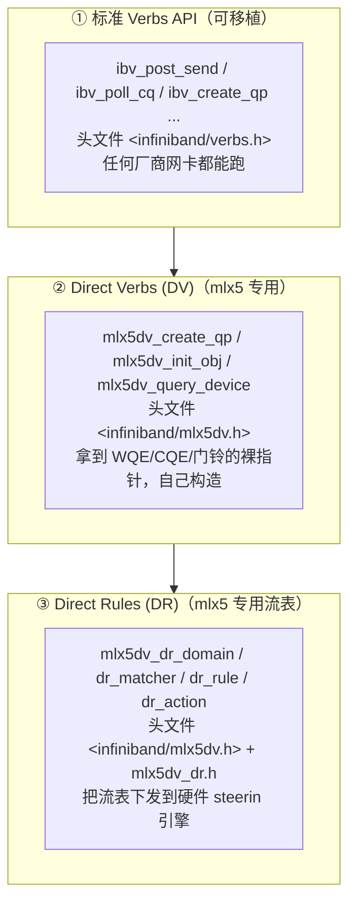
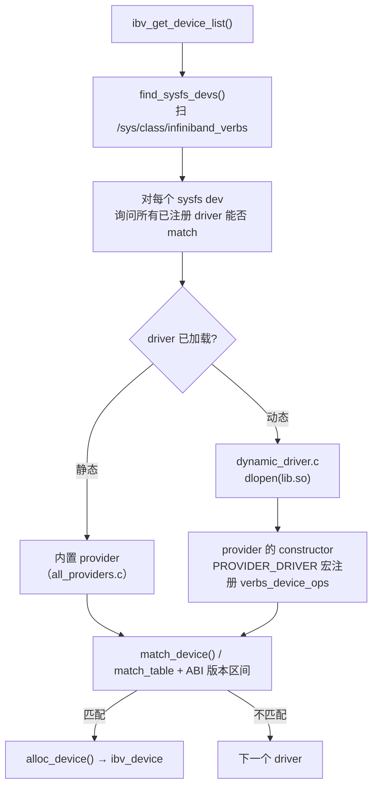
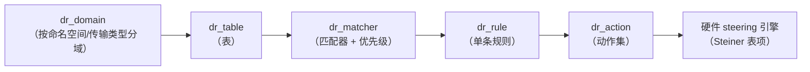

# 第 9 章　用户态驱动：libibverbs 与 libmlx5

> **本章目标**：读懂 `ibv_post_send` 背后到底发生了什么，理解 provider 插件机制，掌握 Direct Verbs（DV）与 Direct Rules（DR）的定位。
>
> **本章对应源码**：
> - `rdma-core:libibverbs/`（`verbs.c`、`device.c`、`init.c`、`cmd_*.c`、`driver.h`、`neigh.c`、`dynamic_driver.c`）
> - `rdma-core:providers/mlx5/`（`mlx5.c`、`verbs.c`、`qp.c`、`cq.c`、`wqe.h`、`mlx5dv.h`、`mlx5_ifc.h`、`dr_*.c`）
> - `rdma-core:kernel-headers/rdma/`（用户态 ABI 的权威定义）

---

## 9.1 三层 API：verbs、DV、DR

mlx5 用户态驱动对外提供**三套**API，定位完全不同。**搞清楚这个分层，你才知道什么时候该用哪一套**：



| | 标准 Verbs | Direct Verbs (DV) | Direct Rules (DR) |
|---|---|---|---|
| 可移植性 | **跨厂商**（NVIDIA/Broadcom/华为/阿里…） | 仅 mlx5 | 仅 mlx5 |
| 你能控制什么 | 语义（发什么、发给谁） | **WQE 的具体编码**、缓冲布局、门铃方式 | **流表规则**（匹配 + 动作） |
| 典型用途 | 99% 的业务程序 | 极致性能（自定义 WQE、避开库开销）、需要硬件特性 | 多租户流量隔离、VLAN/隧道卸载、包分类 |
| 难度 | 低 | 高（要懂 WQE 编码） | 中高（要懂匹配/动作模型） |
| 头文件 | `<infiniband/verbs.h>` | `<infiniband/mlx5dv.h>` | 同上 + `mlx5dv_dr.h` |

> **【行业重点】不要为了「显得高级」而用 DV。** DV 让你直接构造 WQE，意味着**你要自己保证字段正确性** —— 编错了不会报错，只会静默地发错数据或连不上。**先把标准 verbs 用熟，只在有明确性能/功能需求时下探。**

---

## 9.2 provider 插件机制

### 9.2.0 两条命令通道与自动降级（先建立这个认知）

第 7 章讲过内核有 `write()` 与 `ioctl()` 两条 uverbs ABI。**用户态这一侧同样有两条通道，并且能自动降级**：

| 通道 | 用户态实现 | 真正的系统调用 |
|---|---|---|
| **旧 `write()`** | `rdma-core:libibverbs/cmd_fallback.c:233 _execute_cmd_write()` | `write(ctx->cmd_fd, vreq, req_size)`（`:251`）；扩展版在 `:296`，会先设 `hdr.command = IB_USER_VERBS_CMD_FLAG_EXTENDED \| write_method`（`:277`） |
| **新 `ioctl()`** | `rdma-core:libibverbs/cmd_ioctl.c:128 execute_ioctl()` | `ioctl(context->cmd_fd, RDMA_VERBS_IOCTL, &cmd->hdr)`（`:147`） |

**降级逻辑（这是本版本 libibverbs 的一个关键机制）**：

```c
/* rdma-core:libibverbs/device.c:200 —— 设备级探测：故意发一个过短的请求 */
has_ioctl_write()
    → 调用 UVERBS_OBJECT_DEVICE / UVERBS_METHOD_INVOKE_WRITE
      属性 UVERBS_ATTR_WRITE_CMD = IB_USER_VERBS_CMD_QUERY_DEVICE
    → 返回 EPROTONOSUPPORT 或 ENOTTY 则认为内核不支持 ioctl 通道
    → 结果存入 priv->use_ioctl_write（device.c:255）
```

```c
/* rdma-core:libibverbs/cmd_fallback.c:83 —— 逐 op 降级 */
_execute_ioctl_fallback()
    · ENOTTY           → bitmap_fill(priv->unsupported_ioctls, VERBS_OPS_NUM)
                         （整个 ioctl 框架缺失）
    · EPROTONOSUPPORT  → bitmap_set_bit(..., cmd_bit)
                         （仅这一个方法/必需属性不支持）
    · cmd_bit = _CMD_BIT(cmd_name)
              = offsetof(struct verbs_context_ops, cmd_name) / sizeof(void *)
                         （cmd_write.h:114）★ 用函数指针在 ops 表里的下标当位图索引
    · 之后调 _check_legacy()（:49）：只有在命令缓冲区里没有
      UVERBS_ATTR_F_MANDATORY 的非 UHW 属性时才允许退回 write()
```

**工程结论（【行业重点】）**：

1. **同一个 rdma-core 库可以在老内核上跑新程序** —— 会自动退回 `write()` 通道。
2. **`-DIOCTL_MODE=write` / `ioctl` / `both`** 编译开关（`buildlib/config.h.in:65-74` 生成 `VERBS_WRITE_ONLY` / `VERBS_IOCTL_ONLY`）可以裁掉不需要的分支，用于调试「到底走了哪条路」。
3. **要验证走了哪条路**，最直接的办法是 `strace -e trace=write,ioctl ibv_devinfo`；或者编译一个 `ioctl`-only 的库，若程序失败则说明它依赖老通道。

### 9.2.1 设备发现：优先 netlink，回落 sysfs

新版本 libibverbs **优先用 RDMA netlink 枚举设备**，失败才回落 sysfs：

```c
/* rdma-core:libibverbs/init.c:551 */
ibverbs_get_device_list()
  ├─ find_sysfs_devs_nl(&sysfs_list)     ← 优先：走 RDMA_NLDEV_CMD_GET（ibdev_nl.c）
  │     解析 RDMA_NLDEV_ATTR_CHARDEV* 属性，直接拿到设备名、字符设备号、
  │     ABI 版本与 driver_id
  └─ 失败 → find_sysfs_devs()            ← 回落：扫 sysfs（init.c:204）
```

**sysfs 回落路径**（理解它有助于排查权限问题）：

```c
find_sysfs_devs(&tmp_list)                  init.c:204
  → opendir("<sysfs>/class/infiniband_verbs")   init.c:216   ← ★ 枚举入口是这里！
  → 对每个 uverbsN 目录调 setup_sysfs_dev()

setup_sysfs_dev(dirfd, uverbs, list)        init.c:153
  → 读 "<uverbs>/ibdev"          → ibdev_name            init.c:170
  → 拼 ibdev_path = "<sysfs>/class/infiniband/<name>"    init.c:174-178
  → setup_sysfs_uverbs()                                   init.c:123
       · 读 "<uverbs>/dev"          → major:minor → sysfs_cdev  init.c:139
       · 读 "<uverbs>/abi_version"  → sysfs_dev->abi_ver        init.c:146
  → 读 "<uverbs>/node_type"      → decode_knode_type()     init.c:183
  → try_access_device()          → stat("/dev/infiniband/<uverbsN>")  init.c:87
```

> **【必会】三个容易搞错的点**：
> 1. **枚举入口是 `/sys/class/infiniband_verbs`，不是 `/sys/class/infiniband`。** 后者只是被拼成 `ibdev_path`（用于后面读 `node_guid`、`ports/*`）。
> 2. **`try_access_device()` 决定设备是否出现在列表里。** 它检查能否访问对应的 `/dev/infiniband/uverbsN` —— 这就是「容器里 `ibv_get_device_list()` 返回空」的根因。
> 3. **ABI 版本是两级**：全局 `abi_ver`（来自 `class/infiniband_verbs/abi_version`，要求落在 `[3, 6]`，常量在 `libibverbs/kern-abi.h:48-49`）与**每设备** `sysfs_dev->abi_ver`。
>
> 另外：**本版本没有 `ibv_get_device_abi_version()` 这个公开函数，也没有 `IBV_ABI_VERSION` 宏**（常见的过时说法）。ABI 版本只在上述内部路径被检查。

### 9.2.2 provider 的加载与匹配



**provider 的注册宏**（`rdma-core:libibverbs/driver.h:556`）：

```c
#define PROVIDER_DRIVER(provider_name, drv_struct)                             \
    extern const struct verbs_device_ops verbs_provider_##provider_name    \
        __attribute__((alias(stringify(drv_struct))));                 \
    static __attribute__((constructor)) void provider_name##_register_driver(void) \
    {                                                                      \
        verbs_register_driver(&drv_struct);                            \
    }
```

**mlx5 的实例**（ops 表定义在 `rdma-core:providers/mlx5/mlx5.c:2767`，**宏调用在 `mlx5.c:2794`**）：

```c
static const struct verbs_device_ops mlx5_dev_ops = {          /* :2767 */
    .name = "mlx5",
    .match_min_abi_version = MLX5_UVERBS_MIN_ABI_VERSION,   /* ★ 内核 ABI 版本区间 */
    .match_max_abi_version = MLX5_UVERBS_MAX_ABI_VERSION,
    .match_table = mlx5_hca_table,                          /* ★ PCI 设备 ID 表 */
    .alloc_device = mlx5_device_alloc,
    .uninit_device = mlx5_uninit_device,
    .alloc_context = mlx5_alloc_context,
    .import_context = mlx5_import_context,
};
PROVIDER_DRIVER(mlx5, mlx5_dev_ops);                        /* ★ mlx5.c:2794，生成构造函数 */
```

**动态加载**（`rdma-core:libibverbs/dynamic_driver.c:162-186`）：按 provider 目录拼出**带 ABI 后缀的名字**再 `dlopen(so_name, RTLD_NOW)`（`:183/:186`）—— 即 `/usr/lib64/libibverbs/libmlx5-rdmav65.so`（provider 目录来自 `rdma-core:CMakeLists.txt:135`，后缀 `-rdmav65.so` 来自 `:92`）；这个文件本身是安装时生成的符号链接，指向 `/usr/lib64/libmlx5.so.<版本>`（`rdma-core:buildlib/rdma_functions.cmake:173-184`）。**注意 provider 目录里并没有不带后缀的 `libmlx5.so`** —— 那个名字只在 libdir 里为兼容旧构建保留（`rdma_functions.cmake:226-229`）。

**双重版本校验**（这就是第 3 章讲的两条 ABI 规则的实现）：

| 校验 | 依据 | 不通过的行为 |
|---|---|---|
| provider ↔ libibverbs | `.so` 文件名里的 `rdmav65`（= `IBVERBS_PABI_VERSION`） | **拒绝加载** |
| provider ↔ 内核 | `match_min/max_abi_version` vs sysfs 的 `abi_version` | **该设备不匹配此 provider**（尝试下一个） |

**扩展 context 的创建**（`rdma-core:providers/mlx5/mlx5.c:2398`）：

```c
context = verbs_init_and_alloc_context(ibdev, cmd_fd, context, ibv_ctx, RDMA_DRIVER_MLX5);
```

`verbs_init_and_alloc_context` 宏（`driver.h:569`）分配「驱动私有结构体 + 内嵌 `verbs_context`」的整块内存 —— **与内核侧 `rdma_zalloc_drv_obj`（`kernel:include/rdma/ib_verbs.h:2450`）的思路一致**（用户态按 `verbs_context` 尺寸多分配、用 `container_of` 反查；内核按 `ib_device_ops.size_##ib_struct` 多分配）。这是 RDMA 栈里「用户态/内核态设计对称」的一个典型例子（注意：两者机制相似但**不是同一套代码**）。

### 9.2.3 目录布局与文件角色

**`rdma-core:libibverbs/`**：

| 文件 | 角色 |
|---|---|
| `verbs.h` | **用户态 verbs API 权威定义**（`ibv_device`/`ibv_context`/`ibv_pd`/`ibv_mr`/`ibv_cq`/`ibv_qp`/`ibv_wc`/`ibv_send_wr`…）+ **数据平面的 `static inline` 快路径** |
| `verbs_api.h` | **不是"另一份 API 声明"**：它是内核 uAPI 名称别名头 —— 把 `IBV_ACCESS_OPTIONAL_*`、`ibv_advise_mr_advice`、`IBV_QPF_GRH_REQUIRED`、`ibv_flow_action_esp*` 等直接 `#define` 成对应的 `ib_uverbs_*` 名字，让 ABI 一致性由编译器保证 |
| `verbs.c` | 通用 verbs 实现（**控制平面**）：`ibv_query_device`、`ibv_alloc_pd`、`ibv_reg_mr`、`ibv_create_cq`、`ibv_create_qp`、`ibv_modify_qp`、`ibv_create_ah`、`ibv_get_cq_event`、`ibv_find_gid_index`、`ibv_init_ah_from_wc`、`ibv_resolve_eth_l2_from_gid` |
| `device.c`、`sysfs.c`、`init.c`、`ibdev_nl.c`、`enum_strs.c` | 设备发现与打开（见 9.2） |
| `cmd.c` + `cmd_*.c` | **`ibv_cmd_*` 命令封装层**（**手写**，非生成）：把 verbs 调用翻译成 uverbs 的 write/ioctl。按对象拆分（`cmd_qp.c`、`cmd_cq.c`、`cmd_mr.c`、`cmd_pd.c`、`cmd_device.c`、`cmd_srq.c`、`cmd_wq.c`、`cmd_flow.c`、`cmd_dm.c`、`cmd_dmabuf.c`、`cmd_dmah.c`、`cmd_counters.c`、`cmd_comp_cntr.c`、`cmd_rwq_ind.c`、`cmd_xrcd.c`、`cmd_ah.c`、`cmd_mw.c`、`cmd_ioctl.c`） |
| **`cmd_fallback.c`** | **`write()` 通道与「逐 op 降级」逻辑**：`_execute_cmd_write` 里真正的 `write(ctx->cmd_fd, ...)`、`ioctl_write`、`_execute_ioctl_fallback`（见 9.2.4） |
| **`cmd_ioctl.c` / `cmd_ioctl.h`** | **`ioctl()` 通道**：`execute_ioctl()` 里真正的 `ioctl(fd, RDMA_VERBS_IOCTL, ...)`；`struct ibv_command_buffer` 定义 |
| `cmd_write.h` | 双通道宏层：`execute_cmd_write`、`execute_ioctl_fallback`、`_CMD_BIT`（用 ops 表内偏移当位图索引） |
| **`kern-abi.h`** | 内核 ABI 结构拼装宏（`DECLARE_DRV_CMD` 等）+ ABI 版本门限 `IB_USER_VERBS_MIN/MAX_ABI_VERSION`（3/6） |
| `memory.c` | `ibv_fork_init` / `ibv_dontfork_range` / `ibv_dofork_range`（fork 安全） |
| `marshall.c` / `marshall.h` | 内核结构 → 用户结构转换（`ibv_copy_qp_attr_from_kern` 等） |
| **`driver.h`** | **provider 内部 ABI**：`verbs_device_ops`、`verbs_context_ops`、`PROVIDER_DRIVER` 宏 —— **写第三方 provider 的必读** |
| `all_providers.c`、`static_driver.c`、`dynamic_driver.c` | provider 注册与动态加载 |
| **`dummy_ops.c`** | ops 的默认空实现 + **`verbs_set_ops()`**（provider 安装 ops 的唯一入口，会跳过 NULL 成员） |
| `compat-1_0.c` | 与 1.0 版 ABI 的兼容（大量 `COMPAT_SYMVER_FUNC`） |
| `sa-kern-abi.h` | SA path record 的内核 ABI 布局 |
| **`neigh.c`**（19KB） | **通过 netlink 解析邻居（ARP/ND）得到目的 MAC/VLAN**，供 `ibv_resolve_eth_l2_from_gid()` 使用 |
| `opcode.h` | 内核命令 opcode 定义 |
| `libibverbs.map.in` | 导出符号版本表（`IBVERBS_PRIVATE_65`、`verbs_register_driver_65`） |
| `dmabuf_heap.c` | `/dev/dma_heap` 分配封装（GPU 显存注册） |
| `tm_types.h` | Tag Matching 类型 |
| `arch.h`、`ibverbs.h` | 架构相关与库内部头（`verbs_ex_private`、`get_ops`） |

> **【重要纠正】本文档早期版本列出的 `completion.c`、`async_event.c`、`enum.c`、`alloc.c`、`ibv_driver_compat.c` 在本版本中都不存在。** 对应能力分散在 `device.c`（async event）、`enum_strs.c`（枚举转字符串）、`verbs.c`（分配/完成）等文件中。**这也是一个提醒：读任何 RDMA 资料都要核对版本。**

**`rdma-core:providers/mlx5/`**：

| 文件 | 角色 |
|---|---|
| `mlx5.c` | 设备/context 生命周期、DV ops 注册、`mlx5dv_query_device` |
| `verbs.c`（217KB） | **mlx5 用户态驱动主体**：所有 `mlx5_*` verbs 与大部分 `mlx5dv_*` API |
| `qp.c`（112KB） | 用户态 QP：`mlx5dv_create_qp`、`mlx5dv_init_obj`、DV QP 初始化、`mlx5_post_send` 快速路径 |
| `cq.c`（54KB） | 用户态 CQ：`mlx5dv_create_cq`、CQE 解析 |
| `wqe.h`（5KB） | **WQE 布局定义**（用户态构造 WQE 的字段） |
| `dbrec.c` | Doorbell record 管理 |
| `buf.c` | UAR / 缓冲区分配与 mmap 辅助 |
| `mlx5.h`、`mlx5_api.h` | 驱动内部结构与 API |
| **`mlx5dv.h`（64KB）** | **Direct Verbs 对外头文件** |
| `mlx5dv_dr.h`（55KB）+ `dr_*.c` | **Direct Rules**：`dr_domain.c`、`dr_matcher.c`、`dr_rule.c`、`dr_action.c`、`dr_table.c`、`dr_ste*.c`（Steiner 表项编码）、`dr_icm_pool.c`、`dr_devx.c`、`dr_send.c`、`dr_arg.c`、`dr_buddy.c`、`dr_crc32.c`、`dr_dbg.c`、`dr_ptrn.c`、`dr_vports.c` |
| **`mlx5_ifc.h`（134KB）** | **固件接口位域定义**（所有 PRM 结构体的位域）—— 读 WQE/CQE 编码的字典 |
| `mlx5_vfio.c`（93KB） | VFIO 场景（虚拟机直通） |
| `mlx5-abi.h` | 与内核共享的 mlx5 ABI |
| `srq.c` | SRQ 用户态实现 |
| `libmlx5.map` | 导出符号表 |
| `CMakeLists.txt` | 调用 `rdma_shared_provider(mlx5 ...)`（`:17`）；产物是 `libmlx5-rdmav65.so`，安装时在 provider 目录生成同名符号链（`rdma-core:buildlib/rdma_functions.cmake:183`） |

---

## 9.3 快慢路径：`ibv_post_send` 到底做了什么

这是本章最重要的一节。**关键认知：`ibv_post_send` 在 libibverbs 里根本没有实现，它只是一个 `static inline` 转发**：

```c
/* rdma-core:libibverbs/verbs.h:3630 —— 这就是全部实现 */
static inline int ibv_post_send(struct ibv_qp *qp, struct ibv_send_wr *wr,
                                struct ibv_send_wr **bad_wr)
{
    return qp->context->ops.post_send(qp, wr, bad_wr);
}
/* :3639  ibv_post_recv      → qp->context->ops.post_recv(...) */
/* :3038  ibv_poll_cq        → cq->context->ops.poll_cq(cq, num_entries, wc) */
/* :3052  ibv_req_notify_cq  → cq->context->ops.req_notify_cq(cq, solicited_only) */
/* :3220  ibv_post_srq_recv  → srq->context->ops.post_srq_recv(...) */
```

> **【重要纠正常见误解】rdma-core v66 里没有 `__ibv_post_send` / `__ibv_post_recv` / `__ibv_poll_cq` 弱符号。**
> 很多老资料（基于早期的 libibverbs）会讲「libibverbs 提供弱符号默认实现，provider 覆盖它」。**本版本已经不用这套机制了。**
> 现在的做法是：`static inline` + 一次函数指针调用。**应用编译时就把调用点内联了，连一次 PLT 跳转都没有。**

```c
/* rdma-core:libibverbs/verbs.h:2031 —— 这个结构体是 Provider 的"接线板" */
struct ibv_context_ops {
    ...
    int (*poll_cq)(struct ibv_cq *cq, int num_entries, struct ibv_wc *wc);     /* :2047 */
    int (*req_notify_cq)(struct ibv_cq *cq, int solicited_only);               /* :2048 */
    int (*post_srq_recv)(...);                                                 /* :2056 */
    int (*post_send)(struct ibv_qp *qp, struct ibv_send_wr *wr,
                     struct ibv_send_wr **bad_wr);                             /* :2063 */
    int (*post_recv)(struct ibv_qp *qp, struct ibv_recv_wr *wr,
                     struct ibv_recv_wr **bad_wr);                             /* :2065 */
};

/* verbs.h:2074 */
struct ibv_context {
    struct ibv_device      *device;
    struct ibv_context_ops  ops;        /* ★ 函数指针表 —— 数据平面的"接线板" */
    int                     cmd_fd;     /* ★ /dev/infiniband/uverbsN 的 fd —— 控制平面 */
    int                     async_fd;   /* ★ 异步事件 fd */
    int                     num_comp_vectors;
    pthread_mutex_t         mutex;
    void                   *abi_compat;
};
```

**Provider 在哪里接线**（mlx5 的实例）：

```c
/* rdma-core:providers/mlx5/mlx5.c:100 —— 静态 ops 表 */
static const struct verbs_context_ops mlx5_ctx_common_ops = {
    ...
    .poll_cq   = mlx5_poll_cq,        /* :113 */
    .post_send = mlx5_post_send,      /* :127 */
    .post_recv = mlx5_post_recv,      /* :128 */
    ...
};
/* mlx5.c:2581 —— 安装到 context */
verbs_set_ops(v_ctx, &mlx5_ctx_common_ops);
/* mlx5.c:2584 —— 若硬件支持 CQE v1，再用更快的版本覆盖 poll_cq */
verbs_set_ops(v_ctx, &mlx5_ctx_cqev1_ops);   /* .poll_cq = mlx5_poll_cq_v1 */
```

`verbs_set_ops()`（`rdma-core:libibverbs/dummy_ops.c:766`）会把非空成员同时写进 `vctx->context.ops._compat_*`（旧式槽位）与新式路径；**它会跳过 NULL 成员**，所以 provider 可以分多次调用它来按硬件代次逐层覆盖能力。

**调用链（用户在 mlx5 上跑时）**：

```
用户: ibv_post_send(qp, wr, bad_wr)
  → 【编译期内联】verbs.h:3630 的 static inline 展开为：
        qp->context->ops.post_send(qp, wr, bad_wr)
  → 一次间接调用进入 libmlx5 的 mlx5_post_send()          providers/mlx5/qp.c:1158
      → _mlx5_post_send()                                  qp.c:804
          1. 加 qp->sq.lock
          2. 在 mmap 到用户态的 SQ 缓冲上写 WQE
             （ctrl 段 + datagram/raddr 段 + 内联数据段）
          3. qp->sq.cur_post += DIV_ROUND_UP(size * 16, MLX5_SEND_WQE_BB)   /* :1135 */
          4. post_send_db()                                qp.c:754
               · qp->db[MLX5_SND_DBR] = htobe32(qp->sq.cur_post & 0xffff)  /* :769 */
               · 判断是否走 BlueFlame（:780-782）
               · mlx5_bf_copy() 或 mmio_write64_be()       /* :783 / :786 */
               · mmio_flush_writes()                       /* :798 */
               · bf->offset ^= bf->buf_size                /* :799 奇偶切换 */
  → 返回 0
```

**BlueFlame 的触发条件**（`providers/mlx5/qp.c:780-782`，值得精确记住）：

```c
if (!ctx->shut_up_bf && nreq == 1 && bf->uuarn &&
    (inl || ctx->prefer_bf) && size > 1 && size <= bf->buf_size / 16)
        mlx5_bf_copy(bf->reg + bf->offset, ctrl, align(size * 16, 64), qp);
else
        mmio_write64_be(bf->reg + bf->offset, *(__be64 *)ctrl);
```

即：**单个 WR + 有低延迟 UAR + 内联或有 BF 偏好 + WQE 大小合适** 才走 BlueFlame（把 WQE 前部一起写进寄存器）。否则只写 8 字节控制段。

> **【源码细节】为什么 BlueFlame 拷贝不能用 `memcpy()`**（`qp.c:296-300` 的注释原文意思）：
> `memcpy()` 的实现可能使用 move-string-buffer 汇编指令，**不保证拷贝顺序**。而写 BlueFlame 寄存器时顺序很重要，所以必须用 `mmio_memcpy_x64()` 逐 64 字节有序拷贝。

**整条链上的开销**：第 2、4 步是全部实质工作，其余是几十条指令的簿记。**一次 `ibv_post_send` 的量级是 ~50–100 纳秒**（不含网卡处理）。

**对比控制平面**：`ibv_create_qp` → `mlx5dv_create_qp` / `ibv_cmd_create_qp` → **`ioctl()` 系统调用**（`execute_ioctl()`，`rdma-core:libibverbs/cmd_ioctl.c:147`）→ 内核 → 固件命令。耗时量级是 **~10–100 微秒**。**两者差了三个数量级。**

> **【必会】这个对比解释了 verbs 程序的所有性能设计原则**：
> 1. 控制平面操作（create/modify/reg_mr）**必须在启动时做完**，绝不能出现在数据路径里；
> 2. 数据平面操作（post/poll）要在**用户态循环里批量做**，一次系统调用都不该有；
> 3. `sq_sig_all = 0` + 稀疏 `IBV_SEND_SIGNALED` 之所以重要，是因为**每个 CQE 都要占用 CQ 空间并产生内存写**，而处理 CQE 是纯用户态开销 —— 减少 CQE 数量直接等于减少 CPU 开销；
> 4. **libibverbs 在数据路径上不加锁、不做检查** —— 所有同步语义（如 CQ 事件引用计数）都在 `ibv_get_cq_event`/`ibv_ack_cq_events`（`verbs.c:768/786`）这类控制路径上。这也意味着**数据路径的正确性是你的责任**。

---

## 9.4 Direct Verbs (DV)：拿到裸指针

### 9.4.1 DV 的核心 API

| API | 作用 |
|---|---|
| `mlx5dv_query_device(ctx, attrs_out)` | 查询 mlx5 专有能力（标准 `ibv_query_device` 拿不到的） |
| `mlx5dv_create_qp(ctx, attr, mlx5_attr)` | 创建带 mlx5 扩展属性的 QP（如指定 UAR、DV QP） |
| `mlx5dv_create_cq(ctx, attr, mlx5_attr)` | 创建带 mlx5 扩展属性的 CQ |
| **`mlx5dv_init_obj(obj, obj_type)`** | **★ 把已创建对象的内部指针「导出」给用户** |
| `mlx5dv_get_clock_info(ctx, ...)` | 读取 HCA 时钟（精确时间戳） |
| `mlx5dv_alloc_dm(...)` / `mlx5dv_dm_map_op_addr(dm, op)` | 设备内存（HBM/显存）操作 |
| `mlx5dv_reg_dmabuf_mr(...)` | 注册 dma-buf 内存（GPUDirect RDMA） |
| `mlx5dv_map_ah_to_qp(ah, qp_num)` | AH 与 QP 关联（特定硬件特性） |

### 9.4.2 `mlx5dv_init_obj`：DV 的「总开关」

它把内核/驱动内部分配好的缓冲区地址交给用户，这就是「用户态直接读写 WQE/CQE」的前提。

```c
/* rdma-core:providers/mlx5/mlx5dv.h:1012-1021 */
enum mlx5dv_obj_type {
    MLX5DV_OBJ_QP   = 1 << 0,
    MLX5DV_OBJ_CQ   = 1 << 1,
    MLX5DV_OBJ_SRQ  = 1 << 2,
    MLX5DV_OBJ_RWQ  = 1 << 3,     /* ★ RWQ 在 DM 之前 */
    MLX5DV_OBJ_DM   = 1 << 4,
    MLX5DV_OBJ_AH   = 1 << 5,
    MLX5DV_OBJ_PD   = 1 << 6,
    MLX5DV_OBJ_DEVX = 1 << 7,
};

int mlx5dv_init_obj(struct mlx5dv_obj *obj, uint64_t obj_type);   /* :1072 */
```

**导出的结构（`mlx5dv.h:876-931`）—— 这张表就是「用户态能碰到的一切」**：

```c
struct mlx5dv_qp {                          /* :876 */
    __be32      *dbrec;                     /* ★ doorbell record 数组（普通内存） */
    struct { void *buf; uint32_t wqe_cnt; uint32_t stride; } sq;   /* ★ 发送队列 */
    struct { void *buf; uint32_t wqe_cnt; uint32_t stride; } rq;   /* ★ 接收队列 */
    struct { void *reg; uint32_t size; } bf;                        /* ★ BlueFlame 寄存器！ */
    uint64_t     comp_mask;
    off_t        uar_mmap_offset;
    uint32_t     tirn, tisn, rqn, sqn;      /* Raw Packet / RSS 相关句柄 */
    uint64_t     tir_icm_addr;
};

struct mlx5dv_cq {                          /* :901 */
    void        *buf;                       /* ★ CQE 缓冲区 */
    __be32      *dbrec;                     /* ★ CQ doorbell record */
    uint32_t     cqe_cnt;
    uint32_t     cqe_size;                  /* ★ CQE 大小（64 或 128 字节） */
    void        *cq_uar;                    /* ★ CQ 门铃在 UAR 里的地址 */
    uint32_t     cqn;
    uint64_t     comp_mask;
};

struct mlx5dv_srq {                         /* :915 */
    void       *buf;  __be32 *dbrec;
    uint32_t    stride, head, tail, srqn;
    uint64_t    comp_mask;
};

struct mlx5dv_rwq {                         /* :925 */
    void       *buf;  __be32 *dbrec;
    uint32_t    wqe_cnt, stride;
    uint64_t    comp_mask;
};

struct mlx5dv_ah  { struct mlx5_wqe_av *av; uint64_t comp_mask; };   /* :963 */
struct mlx5dv_pd  { uint32_t pdn; uint64_t comp_mask; };             /* :968 */
struct mlx5dv_dm  { void *buf; uint64_t length, comp_mask, remote_va; };  /* :942 */
struct mlx5dv_devx{ uint32_t handle; };                              /* :973 */
```

**【必会】这四个指针就是 DV 的全部价值**：

| 指针 | 你能做什么 |
|---|---|
| `mlx5dv_qp.sq.buf` + `.stride` | 自己算 WQE 地址、自己写 WQE 字段 |
| `mlx5dv_qp.bf.reg` + `.size` | 自己敲门铃（`mlx5_write64`），自己控制奇偶缓冲 |
| `mlx5dv_qp.dbrec` | 自己更新 doorbell record |
| `mlx5dv_cq.buf` + `.cqe_size` + `.cq_uar` | 自己轮询 CQE、自己敲 CQ 门铃 |

### 9.4.3 DV 的性能真相（重要澄清）

> **【行业重点】DV 不会让 `post_send` 变快 —— 因为标准 verbs 的 `post_send` 本来就不经过内核。**
>
> DV 的真实价值是：
> 1. **去掉库函数调用与检查开销**（适合把 verbs 逻辑内联进自己的框架，如 SPDK、DPDK、自研存储引擎）；
> 2. **允许自定义缓冲区布局**（例如把 SQ/CQ 放在特定的 NUMA 节点或大页上）；
> 3. **暴露标准 verbs 没有的硬件能力**（TIR/TIS、精确时间戳、设备内存、加密、`mlx5dv_wr_*` 新 opcode）；
> 4. **让用户自己决定轮询策略**（例如一次读多个 CQE、批量敲 CQ 门铃）。
>
> **不要指望「换成 DV 带宽翻倍」。** 带宽瓶颈通常在网络（ECMP/MTU/拥塞）与内存（NUMA/大页）层面。

`mlx5dv.h:870-874` 的 `enum mlx5dv_qp_comp_mask` 展示了 DV 的扩展点：`MLX5DV_QP_MASK_UAR_MMAP_OFFSET`、`MLX5DV_QP_MASK_RAW_QP_HANDLES`、`MLX5DV_QP_MASK_RAW_QP_TIR_ADDR` —— 都是「标准 verbs 拿不到、但数据路径需要」的信息。

---

## 9.5 Direct Rules (DR)：用户态流表

### 9.5.1 定位

DR 解决的是**「哪些包该进哪个 QP/RQ」**的问题。标准 verbs 只有简陋的 `ibv_create_flow`，DR 提供了完整的匹配-动作流水线，并且可以直接下发到硬件 steering 引擎。



| 文件 | 角色 |
|---|---|
| `dr_domain.c` | 域（`mlx5dv_dr_domain`）：`MLX5DV_DR_DOMAIN_TYPE_NIC_RX/TX`、`FDB` 等 |
| `dr_table.c` | 表（多级表结构） |
| `dr_matcher.c`（46KB） | 匹配器：把用户规则编译成匹配树 |
| `dr_rule.c` | 单条规则 |
| `dr_action.c`（93KB） | 动作：转发、丢弃、改包、计数、采样… |
| `dr_ste*.c`（`dr_ste.c`/`dr_ste_v0.c`/`dr_ste_v1.c`…） | **Steiner 表项编码**（不同硬件代次格式不同） |
| `dr_icm_pool.c` | ICM 内存池（表项存放的硬件内存） |
| `dr_devx.c` | 通过 DevX 下发固件命令 |
| `dr_send.c` | 规则下发的批量发送机制 |
| `dr_buddy.c` | 伙伴分配器（ICM 内存管理） |
| `dr_ptrn.c` / `dr_arg.c` / `dr_crc32.c` / `dr_dbg.c` / `dr_vports.c` | 模式、参数、CRC、调试、vport |

### 9.5.2 什么时候需要 DR

| 场景 | 为什么需要 DR |
|---|---|
| **多租户 RoCE 隔离** | 按 VLAN/GID/源 MAC 把流量分到不同 QP/RQ，实现租户隔离 |
| **大规模 QP 收包分流** | 每个连接一条规则 → **规则下发速率成为扩展性瓶颈**（perftest 的 `raw_ethernet_fs_rate` 就是量这个） |
| **隧道/封装卸载** | 匹配 VXLAN/Geneve 内外层并改包 |
| **流量镜像与采样** | 把特定流量复制到监控口 |
| **SR-IOV 场景** | vport 之间的转发规则 |
| **OVS/DPDK offload** | 把流表卸载到网卡（这是 OVS-DPDK 硬件卸载的基础） |

> **【行业重点】DR 是「云平台 RoCE」的核心技术。** 在公有云里，一块网卡要承载成千上万个租户/容器的 RDMA 流量，靠的就是 DR 把流量精确分流到对应的 QP。**这也是为什么「flow steering 规则下发速率（fps）」是关键扩展性指标** —— 见 perftest 的 `raw_ethernet_fs_rate`。

---

## 9.6 邻居解析：RoCE 的目的 MAC 到底谁在解析

先澄清一个**非常普遍的误解**：**用户态不能也不需要指定目的 MAC**。

`struct ibv_ah_attr`（`rdma-core:libibverbs/verbs.h:793`）只有这些成员：

```c
struct ibv_ah_attr {
    struct ibv_global_route grh;   /* dgid / flow_label / sgid_index / hop_limit / traffic_class */
    uint16_t dlid;                 /* IB 用 */
    uint8_t  sl, src_path_bits, static_rate;
    uint8_t  is_global;            /* RoCE 必须为 1 */
    uint8_t  port_num;
};
```

**没有 `dmac` 字段 —— 那是内核 `struct rdma_ah_attr` 才有的成员**（`kernel:include/rdma/ib_verbs.h`），由内核自己填。

### 9.6.1 内核侧的完整解析链

```c
/* kernel:drivers/infiniband/core/verbs.c:657 rdma_create_user_ah() —— 用户态 AH 创建路径 */
struct ib_ah *rdma_create_user_ah(struct ib_pd *pd, struct rdma_ah_attr *ah_attr,
                                  struct ib_udata *udata)
  ...
  → if (ah_attr->type == RDMA_AH_ATTR_TYPE_ROCE)                    /* :669 */
        err = ib_resolve_eth_dmac(pd->device, ah_attr);             /* :670 ★ 自动解析 */
  → ah = _rdma_create_ah(pd, ah_attr, RDMA_CREATE_AH_SLEEPABLE, udata, NULL);   /* :677 */

/* kernel:drivers/infiniband/core/verbs.c:1798 */
ib_resolve_eth_dmac(device, ah_attr)
  if (rdma_is_multicast_addr(&ah_attr->grh.dgid)) {
      /* 组播：直接由 IP 算出组播 MAC，不需要邻居表 */
      ipv6_addr_v4mapped(dgid) ? ip_eth_mc_map(addr, ah_attr->roce.dmac)     /* :1808 */
                               : ipv6_eth_mc_map(dgid, ah_attr->roce.dmac);   /* :1810 */
  } else {
      ret = ib_resolve_unicast_gid_dmac(device, ah_attr);         /* :1814 */
  }

/* kernel:drivers/infiniband/core/verbs.c:812 */
ib_resolve_unicast_gid_dmac(device, ah_attr)
  /* 目的链路本地 + 源是 RoCEv1 → 不走 IP 栈，直接由 GID 算 MAC */
  if (rdma_link_local_addr(dgid) && sgid_attr->gid_type == IB_GID_TYPE_ROCE)
      rdma_get_ll_mac(dgid, ah_attr->roce.dmac);                  /* :825 */
  else
      /* ★ 真正的 ARP/ND 解析（内核邻居子系统） */
      ret = rdma_addr_find_l2_eth_by_grh(&sgid_attr->gid, &grh->dgid,
                                         ah_attr->roce.dmac,
                                         sgid_attr, &hop_limit);   /* :830 */
  grh->hop_limit = hop_limit;                                     /* :834 顺带定 hop_limit */
```

> **【源码亮点】注意 `:834`**：`hop_limit` 是**内核解析邻居后回填的**，不由用户指定。这解释了第 5 章为什么说「`hop_limit` 不用填」。

> **【易错】两个函数不要搞混**：`rdma_create_user_ah()`（`verbs.c:657-684`）才是 **`ibv_create_ah` 的用户态路径**，`ib_resolve_eth_dmac()` 就调用在这里；`rdma_create_ah()`（`verbs.c:619-641`）是**内核/ULP 与 LAG 走的路径，从不解析 dmac**（只做 `fill_sgid_attr` + LAG slave + `_rdma_create_ah`）。

### 9.6.2 QP 的 `ah_attr` 也走同一条路

```c
/* kernel:drivers/infiniband/core/verbs.c:1845 —— 在 `_ib_modify_qp()`（:1830 起）内 */
if (attr->ah_attr.type == RDMA_AH_ATTR_TYPE_ROCE && is_qp_type_connected(qp)) {
    struct net_device *slave;
    /*
     * If the user provided the qp_attr then we have to
     * resolve it. Kerne users have to provide already
     * resolved rdma_ah_attr's.
     */
    if (udata) {                                          /* ★ 只有用户态发起的才解析 */
        ret = ib_resolve_eth_dmac(qp->device, &attr->ah_attr);   /* :1855 */
        if (ret) goto out_av;
    }
    slave = rdma_lag_get_ah_roce_slave(qp->device, &attr->ah_attr, GFP_KERNEL);  /* :1860 LAG 选 slave */
    ...
}
```

**所以：用户态调 `ibv_modify_qp` 迁移到 RTR 时，内核会自动解析目的 MAC** —— 这就是为什么 perftest 用裸 verbs 跑 RC 时**不需要**给 `-E/--dest_mac`。

> **注释里那句话很关键**：「内核用户必须提供已经解析好的 `rdma_ah_attr`」。也就是说**内核模块（ULP）要自己调解析函数**，只有用户态传上来的才自动解析。
>
> **【归属别弄错】** 上面这段代码在 **`_ib_modify_qp()`（`verbs.c:1830` 起）** 里；公开入口 `ib_modify_qp_with_udata()` 在 **`verbs.c:1954`**，只是一行转发（`return _ib_modify_qp(qp, attr, attr_mask, udata);`）。

### 9.6.3 `ibv_resolve_eth_l2_from_gid()`：用户的主动查询工具

```c
/* rdma-core:libibverbs/verbs.h:3735 */
int ibv_resolve_eth_l2_from_gid(struct ibv_context *context,
                                struct ibv_ah_attr *attr,
                                uint8_t eth_mac[ETHERNET_LL_SIZE],
                                uint16_t *vid);
```

| 用途 | 说明 |
|---|---|
| **★ 排查 AH/QP 创建失败** | 先调它：能解析出 MAC → 问题在别处（GID 权限/参数）；不能解析 → 是 GID 选错或邻居不可达 |
| **自定义数据路径（DV / raw WQE）** | 自己构造 WQE 的 AV 时需要知道 MAC |
| **raw ethernet 模式** | 构造以太网头需要 MAC（perftest 下用 `-B/--source_mac` / `-E/--dest_mac` 手工指定，`perftest:src/perftest_parameters.c:3178-3179`） |
| **诊断脚本** | 批量检查「哪些对端 IP 解析不出 MAC」 |

**底层实现**：`rdma-core:libibverbs/verbs.c:1274`，通过 netlink 查询内核邻居表（`rdma-core:libibverbs/neigh.c`：`process_get_neigh()` `:801`、`process_get_neigh_mac()` `:291`）。这条能力由构建开关 `ENABLE_RESOLVE_NEIGH`（依赖 libnl，`rdma-core:CMakeLists.txt:553-574`）控制 —— **关掉 libnl 后 `ibacm`/`iwpmd` 也不会被构建**。

> **【常见误解纠正】很多资料说「RoCE 的 UD 必须手工提供目的 MAC」—— 这是错的（至少对本版本的内核与 rdma-core 是错的）。**
> 内核已经通过 `ib_resolve_eth_dmac()` 统一处理了 RC/UC/UD 三种情况。**只是 raw ethernet 模式确实需要**（因为那是绕过了协议栈自己造包）。

---

## 9.7 用户态 ABI 的权威来源：`kernel-headers/`

`rdma-core:kernel-headers/rdma/` 是从内核同步过来的 uAPI 头文件 —— **想知道「用户态到底给内核发了什么」，这里是最权威的**：

| 文件 | 内容 |
|---|---|
| `rdma_user_ioctl.h`、`rdma_user_ioctl_cmds.h` | ioctl 框架与命令号（`RDMA_VERBS_IOCTL`、`struct ib_uverbs_ioctl_hdr`） |
| `ib_user_verbs.h` | 传统 uverbs ABI（`IB_USER_VERBS_CMD_*`） |
| `ib_user_ioctl_cmds.h`、`ib_user_ioctl_verbs.h` | 新式 uverbs ABI（`UVERBS_OBJECT_*`/`UVERBS_METHOD_*`/`UVERBS_ATTR_*`） |
| `rdma_user_cm.h` | RDMA CM ABI（`RDMA_USER_CM_CMD_*`） |
| `rdma_netlink.h` | netlink 属性 |
| **`mlx5-abi.h`** | **mlx5 供应商 ABI**：`enum mlx5_ib_mmap_cmd`、`mlx5_ib_alloc_ucontext_resp`、`mlx5_ib_create_qp_resp` 等 |
| `mlx5_user_ioctl_cmds.h`、`mlx5_user_ioctl_verbs.h` | mlx5 的 ioctl 扩展（DevX） |
| `erdma-abi.h`、`hns-abi.h`、`bnxt_re-abi.h`、`efa-abi.h`、`ionic-abi.h`、`irdma-abi.h`、`mana-abi.h`、`mlx4-abi.h`、`mthca-abi.h`、`ocrdma-abi.h`、`qedr-abi.h`、`siw-abi.h`、`rvt-abi.h`、`vmw_pvrdma-abi.h` | 各厂商 ABI |

> **注意：这里没有 `rdma_user_mmap.h`** —— 该文件在本内核与 rdma-core 的 `include/uapi/rdma/` 下**都不存在**（常见资料里的历史遗留）。mmap 条目的结构 `struct rdma_user_mmap_entry` 定义在**非 uapi 头** `kernel:include/rdma/ib_verbs.h:2455`。

**「对着读」的学习方法**（强烈推荐）：

```
想知道 ibv_create_qp 发了什么？
  ① rdma-core:libibverbs/cmd_qp.c         —— 用户态怎么填命令
  ② rdma-core:kernel-headers/rdma/...     —— 命令结构体的权威定义
  ③ kernel:drivers/infiniband/core/uverbs_std_types_qp.c  —— 内核怎么解析
  ④ kernel:drivers/infiniband/hw/mlx5/qp.c                —— 驱动怎么用
这四处串起来，一个 API 就彻底通透了。
```

---

## 9.8 其他 provider 一览（横向对比的价值）

| provider | 内核模块 | 说明 |
|---|---|---|
| **mlx5** | `mlx5_ib.ko` | 本教程主角；ConnectX-4/5/6/7/8；功能最全 |
| `mlx4` | `mlx4_ib.ko` | ConnectX-3 及更早；RoCEv1/v2 都支持但功能受限 |
| `rxe` | `rdma_rxe.ko` | **软件 RoCE**（第 3.6 节）—— 学习首选 |
| `siw` | `siw.ko` | 软件 iWARP |
| `hns` | `hns_roce_hw_v2.ko` | 华为 RoCE |
| `erdma` | `erdma.ko` | 阿里云 eRDMA —— **代码量适中、结构清晰，很好的第二本教材** |
| `bnxt_re` | `bnxt_re.ko` | Broadcom |
| `ionic` | `ionic_rdma.ko` | AMD/Pensando |
| `mana` | `mana_ib.ko` | Microsoft Azure |
| `irdma` | `irdma.ko` | Intel（同时支持 iWARP 与 RoCE） |
| `efa` | `efa.ko` | AWS EFA（不是标准 RoCE，是自研传输） |
| `qedr`、`ocrdma`、`mthca`、`vmw_pvrdma`、`cxgb4`、`usnic`、`hfi1`、`bng_re` | —— | 其他/历史实现 |

> **【学习方法】读第二个 provider 是打通任督二脉的关键。** 推荐顺序：`mlx5`（功能最全）→ `erdma`（最简洁的现代实现）→ `rxe`（协议最直白）。
> 对比时重点看：① GID/AH 怎么处理；② WQE 怎么组装；③ 门铃怎么写；④ 哪些是协议要求的、哪些是厂商选择。

---

## 9.9 本章自检

1. libibverbs 通过什么方式发现设备？为什么不用遍历 `/dev`？
2. `PROVIDER_DRIVER` 宏做了什么？provider 与 libibverbs 的版本校验靠什么？
3. 画出 `ibv_post_send` 从应用到门铃的完整调用链，指出哪一步是耗时的。
4. 控制平面与数据平面的耗时量级差多少？这对程序结构有什么要求？
5. `mlx5dv_init_obj` 导出了哪些指针？每个指针的用途？
6. 为什么「换用 DV 不会让 post_send 变快」？DV 的真实价值是什么？
7. Direct Rules 解决什么问题？为什么 flow steering 规则下发速率是关键指标？
8. 用裸 verbs 建 RC QP 时需要在 `ah_attr` 里填目的 MAC 吗？为什么？
9. `kernel-headers/rdma/` 的作用是什么？给出「对着读」学习法的四个步骤。
10. 如果想再读一个 provider 来加深理解，为什么推荐 `erdma` 或 `rxe`？

**下一章**：我们把 verbs 用起来 —— 从零写出可运行的 RC 与 UD 程序。
