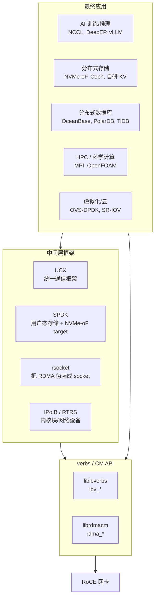
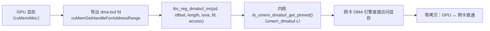
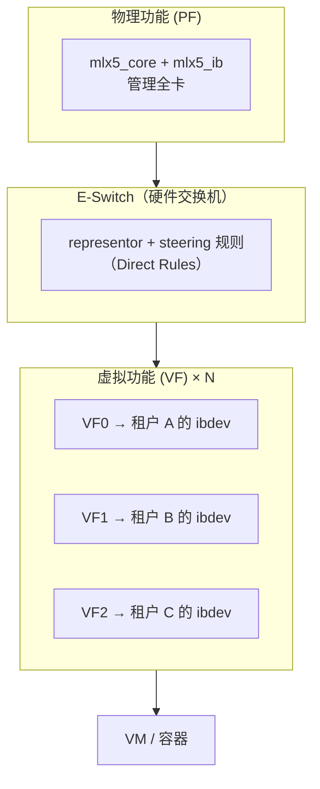
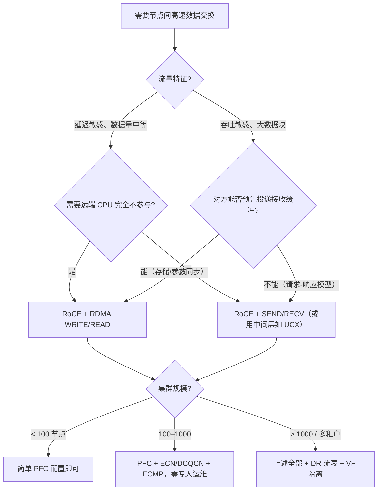

# 第 10 章　上层生态：谁在真正用 RoCE

> **本章目标**：知道 RoCE 在真实系统里被谁调用、怎么调用、以及每个生态位对底层的要求。读完你能判断「一个新场景该不该用 RDMA、该用哪种 verbs 操作」。
>
> **本章对应源码**：`kernel:drivers/infiniband/ulp/`（`rtrs`、`isert`、`srpt`、`iser`、`ipoib`）、`kernel:drivers/infiniband/sw/rxe/`、`rdma-core:librdmacm/rsocket.c`、`rdma-core:Documentation/`

---

## 10.1 生态全景图



**三种「接入方式」**：

| 接入方式 | 特点 | 代表 |
|---|---|---|
| **直接调 verbs** | 性能最好、控制最细、代码量最大 | NCCL、SPDK、自研存储引擎 |
| **用现成中间层** | 开箱即用、有抽象开销 | UCX（MPI/多传输）、rsocket |
| **协议网关** | 不改应用，用内核 ULP 把 RDMA 变成「标准接口」 | NVMe-oF、iSER、IPoIB、RTRS |

---

## 10.2 存储：NVMe-oF / RDMA

**这是 RoCE 在数据中心最成熟的落地场景。**

### 10.2.1 为什么存储特别适合 RDMA WRITE

对比传统 iSCSI/NVMe-oF-TCP：

| | iSCSI / NVMe-oF-TCP | **NVMe-oF/RDMA** |
|---|---|---|
| 数据拷贝 | 内核协议栈多次拷贝 | **零拷贝，网卡直接 DMA 到应用缓冲** |
| CPU 占用 | 每 IO 都有系统调用与中断 | **对端 CPU 几乎零占用** |
| 延迟 | ~50–100 μs | **~10–20 μs** |
| 适合 | 通用 | 高性能数据库、AI 训练的数据加载 |

**关键技术点**：

1. **用 RDMA WRITE 而不是 SEND/RECV** —— 存储请求/响应是「谁想写就写」的模式，WRITE 避免了 target 侧投递缓冲的复杂度。
2. **Host Memory Buffer（HMB）/ 注册内存池** —— target 侧预先注册大块内存并长期复用，避免每次 IO 都 `ibv_reg_mr`（第 4.3.3 节的性能要求）。
3. **`rkey` 的生命周期管理** —— 每次连接协商 `rkey`，不能长期复用同一个 `rkey`（安全考虑）。这是 NVMe-oF 规范里的重点。
4. **多队列 + SQ/CQ 对的隔离** —— NVMe 的多队列模型天然映射到多个 QP，每个队列独立，避免锁竞争。

### 10.2.2 内核侧的实现

| ULP | 目录 | 说明 |
|---|---|---|
| **`rtrs`（RNBD）** | `kernel:drivers/infiniband/ulp/rtrs/` | RDMA Transport for RNBD —— 在 RDMA 上跑块设备导出。**代码量适中，是读「RDMA 存储传输」的好材料** |
| `isert` | `kernel:drivers/infiniband/ulp/isert/` | iSCSI Extensions for RDMA 的 **target** 端 |
| `iser` | `kernel:drivers/infiniband/ulp/iser/` | iSER 的 **initiator** 端 |
| `srpt` / `srp` | `kernel:drivers/infiniband/ulp/srpt/`、`srp/` | SCSI RDMA Protocol（IB 生态，RoCE 少见） |

### 10.2.3 用户态：SPDK

**SPDK（Storage Performance Development Kit）** 是 NVMe-oF target 的主流用户态实现：

- **完全绕过内核**：自己实现 NVMe-oF 协议、自己管 RDMA（用标准 verbs 或 DV）；
- 与 DPDK 共享「轮询模式 + 大页 + 绑核」的设计哲学；
- **为什么用 RoCE**：NVMe-oF target 需要极高的 IOPS 与低延迟，内核协议栈的开销成为瓶颈。

> **【行业重点】存储场景对 RoCE 的特殊要求**：
> - **对丢包零容忍**：一次重传会让 IO 延迟从 15μs 跳到 100μs+，直接打爆数据库的尾延迟 SLA；
> - **因此 PFC/ECN 配置在存储集群里是强制的**，且要留足余量；
> - **多路径（multipath）更重要**：存储要求高可用，RoCE 多路径实现比 TCP 复杂（需要管理 GID/路径的切换）。

---

## 10.3 AI/高性能计算：NCCL / MPI / UCX

### 10.3.1 NCCL：集合通信的事实标准

NCCL（NVIDIA Collective Communications Library）用 RoCE 做 GPU 间通信：

| NCCL 需求 | 对应的 RoCE 机制 |
|---|---|
| AllReduce / AllGather / ReduceScatter | **RDMA WRITE + 环形/树形算法**（单边，不需要对端 CPU 参与） |
| **GPUDirect RDMA** | 显存直接注册为 MR（`ibv_reg_dmabuf_mr`），网卡 DMA 直接读写 HBM |
| 大带宽（数百 Gb/s） | **多 QP + 多 CQ + 多线程**；单 QP 受 ECMP 单路径限制（第 2.7 节） |
| 低延迟（μs 级） | 忙轮询、大页、绑核、NUMA 亲和 |
| 拓扑感知 | 根据网卡/NVLink 拓扑选择通信路径 |

**GPUDirect RDMA 的完整链路**：



> **【关键概念】`ibv_reg_dmabuf_mr` 的背景**：GPU 显存**不能**被 CPU `pin_user_pages`（它不是普通页）。所以必须走 **dma-buf** 这条 Linux 内核通用的「跨设备缓冲区共享」通道。
> 这就是 `kernel:drivers/infiniband/core/umem_dmabuf.c` 存在的原因，也是 perftest `--use_cuda_dmabuf` 选项的由来（第 6 章）。
>
> **学习建议**：读 `umem_dmabuf.c` 比读 `umem.c` 更能理解「为什么 RDMA 内存注册这么复杂」—— 因为它要处理各种不同的内存来源。

### 10.3.2 MPI 与 UCX

| 层 | 说明 |
|---|---|
| **UCX**（Unified Communication X） | 统一通信框架，支持 `rc_verbs`/`rc_mlx5`/`dc_mlx5`/`ud_verbs` 等多种传输，向上给 MPI/OpenSHMEM 提供统一接口。**它是「如何优雅地封装 verbs」的最佳教材** |
| **OpenMPI / MPICH** | 通过 UCX 或原生 verbs BTL 使用 RoCE |
| **典型配置** | `UCX_TLS=rc_mlx5`、`UCX_NET_DEVICES=mlx5_0:1` |

**UCX 的传输层命名很值得学习**：`rc_mlx5` 表示「RC 传输 + mlx5 加速（走 DV）」，`ud_verbs` 表示「UD 传输 + 通用 verbs」。**这种「传输语义 × 实现路径」的正交设计，是高性能网络框架的通用模式。**

### 10.3.3 大规模场景的扩展性问题

| 问题 | 现象 | 解决方向 |
|---|---|---|
| **连接数爆炸** | N 个进程 × M 个对端 = N×M 个 QP，内存与硬件资源耗尽 | **XRC**（接收侧共享）、**DC/DCT**（动态连接） |
| **QP 内存开销** | 每个 QP 的 SQ/RQ 都要内存，1000 QP 就是几 GB | 减小深度、用 SRQ、用 DC |
| **flow steering 规则耗尽** | 每连接一条规则 → 规则表满 | DR 的表复用、聚合规则 |
| **ECMP 哈希不均** | 单 QP 走单路径 | 多 QP、flow label 分散 |
| **集合通信的算法选择** | 环形 vs 树形在不同规模下差异巨大 | NCCL/UCX 的拓扑感知 |

---

## 10.4 网络与虚拟化：把 RDMA 变成「网络设备」

### 10.4.1 IPoIB / RTRS：内核 ULP

| 方案 | 目录 | 作用 |
|---|---|---|
| **IPoIB** | `kernel:drivers/infiniband/ulp/ipoib/` | 把 IB/RoCE 设备呈现为一个**网络接口**（`ib0`），可以直接跑 IP。**代价大**（MTU 受限、组播复杂、性能远低于原生 verbs），但**兼容性最好** |
| **RTRS** | `kernel:drivers/infiniband/ulp/rtrs/` | RNBD 的传输层（见 10.2.2） |

> **【重要区分】IPoIB ≠ RoCE 的原生用法。**
> IPoIB 是「用 RDMA 设备跑 IP」，性能介于普通网卡与原生 RDMA 之间（因为要经过内核网络栈）。**真正的 RoCE 高性能应用都是直接调 verbs，不经过 IPoIB。**
> 但 IPoIB 有一个有用的场景：**RDMA_CM 需要一个 IP 可达的控制通道**。在没有普通以太网口的环境里，可以用 IPoIB 提供这个通道（perftest 的 `-z/--comm_rdma_cm` 就是为这种场景设计的，见第 6 章）。

### 10.4.2 rsocket：零改造把 TCP 程序变成 RDMA

`rdma-core:librdmacm/rsocket.c`（122KB）实现了一套 **socket 兼容 API**：

```c
/* rdma-core:librdmacm/rsocket.h —— r 前缀的 socket 函数 */
rsocket(), rbind(), rlisten(), raccept(),
rconnect(), rsend(), rrecv(), rclose(), ...
```

**两种使用方式**：

| 方式 | 说明 |
|---|---|
| **改代码** | 把 `socket` 换成 `rsocket`、`send` 换成 `rsend`…（重编译即可） |
| **`LD_PRELOAD`** | 用 `librspreload.so` 拦截标准 socket 调用，**源码完全不动** |

```bash
# LD_PRELOAD 用法（librspreload.so 安装到 <libdir>/rsocket/ 子目录）
LD_PRELOAD=/usr/lib64/rsocket/librspreload.so ./your_existing_app
```

> **【行业重点】rsocket 的定位与局限**：
> - **优点**：零改造迁移，特别适合「老的 TCP 程序想蹭 RDMA 性能」；
> - **局限**：① 语义是流式的（bytes stream），无法利用 RDMA WRITE/READ 的单边优势，**性能提升有限**；② 有额外的内存拷贝或复杂的零拷贝管理；③ 调试困难（出问题时要同时理解 socket 语义和 RDMA 语义）。
>
> **结论**：rsocket 适合「过渡方案」，**新项目应该直接设计 verbs 接口**。想学「如何用 RDMA 模拟字节流」，rsocket.c 是最好的读物，但不要把它当成性能方案。

### 10.4.3 虚拟化与云：SR-IOV + representor

这是 RoCE 在公有云的核心形态（第 8.12 节讲过 mlx5 侧的机制）：



| 机制 | 作用 | 源码位置 |
|---|---|---|
| **SR-IOV VF** | 把物理网卡切分成多个独立设备分给租户 | `kernel:drivers/net/ethernet/mellanox/mlx5/core/sriov.c` |
| **VF 的 RoCE 开关** | 控制哪些 VF 能用 RoCE | `mlx5_devlink_port_fn_roce_get/set`（`eswitch_offloads.c:5201/5219`） |
| **representor + switchdev** | 让宿主能看到并管理 VF 的流量 | `kernel:drivers/infiniband/hw/mlx5/ib_rep.c`、`rdma` 设备在 switchdev 模式 |
| **Direct Rules 流表** | 按租户/VLAN 精确分流 | `rdma-core:providers/mlx5/dr_*.c` |
| **VFIO 直通** | VM 内直接用 RDMA，性能接近裸机 | `rdma-core:providers/mlx5/mlx5_vfio.c`（93KB） |

> **【行业重点】云平台的 RoCE 三大难题**：
> 1. **隔离**：租户 A 的流量绝对不能进租户 B 的 QP → 靠 DR 流表 + VLAN/GID 隔离；
> 2. **QoS**：一个租户不能打爆整卡 → 靠 QP rate limit（`ibv_modify_qp_rate_limit`）+ PFC 优先级 + DR 的 flow meter；
> 3. **可观测**：出问题要能定位到租户 → 靠 restrack（`rdma res show`）+ DR 的 flow counter/sampler。
>
> **这三点是「云原生 RoCE 工程师」与「单机 RoCE 工程师」的核心能力差异。**

---

## 10.5 【行业重点】典型部署形态与规模

### 10.5.1 三种典型组网

| 形态 | 规模 | 网络要求 | 典型技术 |
|---|---|---|---|
| **单机架/小集群** | 8–64 节点 | 一层交换机或直连 | 简单 PFC，单 QP 即可 |
| **中等集群** | 64–1000 节点 | Spine-Leaf（2 层 Clos） | **PFC + ECN/DCQCN + ECMP**，多 QP |
| **大规模云/AI 集群** | 1000+ 节点 | 多层 Clos，多租户 | 上述全部 + **DR 流表** + VF 隔离 + 动态连接（DC） |

### 10.5.2 各生态位对底层的关键要求对照表

| 场景 | 主要 verbs 操作 | 对网络最敏感的点 | 对硬件最敏感的点 |
|---|---|---|---|
| **NVMe-oF 存储** | RDMA WRITE / READ | **尾延迟（重传）** | `rkey` 管理、MR 池 |
| **AI 训练（AllReduce）** | RDMA WRITE（环形） | **带宽 + ECMP 均衡** | GPUDirect、多 QP |
| **AI 推理（KVCache 传输）** | RDMA WRITE / READ | 延迟 | 小消息 PPS |
| **分布式数据库** | RDMA WRITE / READ / ATOMIC | **延迟抖动**、原子操作延迟 | 原子操作支持 |
| **HPC / MPI** | SEND/RECV + RDMA | 延迟 + 消息率 | SRQ、XRC/DC |
| **云多租户** | 全部 + DR 流表 | 隔离与公平 | SR-IOV、VFIO、DR |
| **K8s/容器** | 全部 | 设备插件与网络插件配合 | 多 VF、CNI 集成 |

### 10.5.3 容器与 Kubernetes（现代部署的现实）

| 需求 | 实现 |
|---|---|
| 容器内能用 RDMA | 挂载 `/dev/infiniband/uverbsN` + `/dev/infiniband/rdma_cm`（**这就是第 3 章强调的**） |
| 设备分配 | **RDMA device plugin**（K8s）+ 按需分配 VF |
| 网络 | **Multus CNI** 给 Pod 加一块基于 VF 的网卡；或 SR-IOV CNI |
| 资源隔离 | VF 级别隔离 + DR 流表 |

```bash
# 手动验证容器里能不能用 RDMA（排查"容器内 ibv_devinfo 为空"）
docker run --rm -it \
  --device=/dev/infiniband/uverbs0 \
  --device=/dev/infiniband/rdma_cm \
  --cap-add=IPC_LOCK \
  ubuntu:24.04 bash -c "apt update && apt install -y ibverbs-utils && ibv_devinfo"
```

> **注意 `--cap-add=IPC_LOCK`**：注册大内存需要 `CAP_IPC_LOCK`（或足够的 `memlock` 限额）—— 就是第 7.6.2 节 `__ib_umem_get_va()` 第 ⑧ 步检查的那一项。**这是容器里 RDMA 高频故障点之一。**

---

## 10.6 选择指南：一个新场景该不该用 RoCE



**不适合用 RoCE 的场景（诚实评估）**：

| 场景 | 为什么不适合 |
|---|---|
| 小规模、低带宽需求（< 10 Gb/s） | 落地方案复杂度远高于收益，普通 TCP 足够 |
| 团队没有网络运维能力 | RoCE 的故障 90% 在网络配置，运维门槛真实存在 |
| 无法改造应用且性能要求不高 | rsocket 提升有限，不如优化现有 TCP 应用 |
| 跨公网 / 需要 NAT 穿越 | **RoCE 的 IP 参与 ICRC，不能 NAT**（第 2.4 节） |
| 网络无法保证无损 | 若无 PFC/ECN，RoCE 的尾延迟会比 TCP 更差 |

**该不该用 RDMA 的三问**：

1. **你的瓶颈真的是网络协议栈吗？** 先用 profile 确认（多数「网络慢」其实是应用逻辑或存储慢）。
2. **你能控制两端和中间网络吗？** RoCE 需要端到端配置 PFC/ECN。
3. **你有运维能力吗？** 需要有人会看 PFC/ECN 计数器、会定位丢包点。

---

## 10.7 学习路径建议：按生态位深入

| 你想进入的领域 | 推荐深入的内容 |
|---|---|
| **AI 基础设施** | GPUDirect RDMA（dma-buf）、NCCL 通信原语、多 QP/ECMP、`umem_dmabuf.c` |
| **存储** | NVMe-oF 协议、`rtrs`/`isert` 源码、MR 池、SPDK 的 RDMA 模块、`rkey` 生命周期 |
| **云网络** | SR-IOV/VFIO、Direct Rules、representor、多租户隔离、QoS |
| **HPC** | UCX 传输层、XRC/DC、集合通信算法、MPI 集成 |
| **自研网卡/交换机** | 第 7、8 章的内核实现 + WQE/固件接口 + PRM 文档 |
| **网络运维** | 第 11、12 章的 PFC/ECN 配置与排障 |

---

## 10.8 本章自检

1. 存储场景为什么首选 RDMA WRITE 而不是 SEND/RECV？
2. GPUDirect RDMA 为什么必须走 dma-buf？对应的内核文件是哪个？
3. XRC 与 DC 分别解决什么扩展性问题？
4. IPoIB 与原生 verbs 的性能差异来自哪里？IPoIB 还有什么用途？
5. rsocket 的 `LD_PRELOAD` 用法怎么用？它的根本局限是什么？
6. 云平台 RoCE 的三大难题是什么？分别靠什么机制解决？
7. 容器里用 RDMA 需要挂载哪两个设备节点？为什么还需要 `CAP_IPC_LOCK`？
8. 列出三个「不适合用 RoCE」的场景，并说明理由。
9. 判断一个场景该用 WRITE 还是 SEND，你的决策依据是什么？
10. 如果你要进入 AI 基础设施领域，接下来应该重点读哪三份源码？

**下一章**：把 RoCE 网络配起来 —— PFC、ECN、DCQCN 的完整部署与调优方法。
