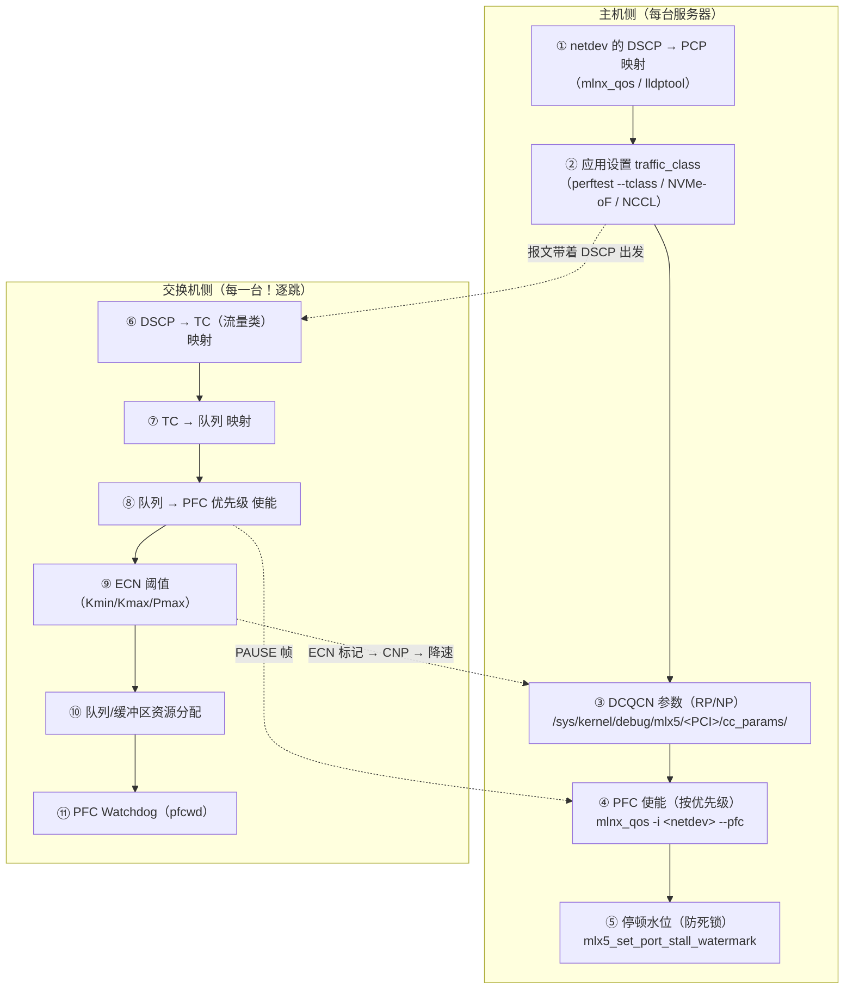
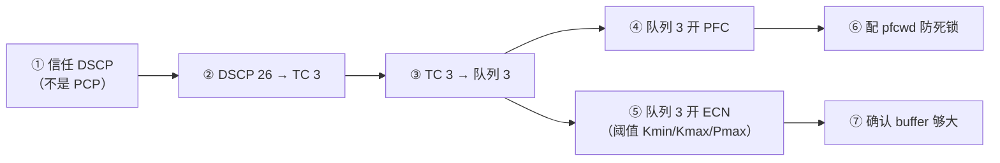

# 第 11 章　无损网络部署：PFC、ECN、DCQCN 实战

> **本章目标**：能独立完成一个 RoCE 无损网络的配置、验证与调优。这是 RoCE 工程师**最有市场价值**的技能。
>
> **配套源码**：`kernel:drivers/net/ethernet/mellanox/mlx5/core/port.c`（PFC 寄存器）、`kernel:drivers/infiniband/hw/mlx5/cong.c`（DCQCN debugfs）、`kernel:drivers/infiniband/core/roce_gid_mgmt.c`（GID）、`rdma-core:libibverbs/examples/devinfo.c`
>
> **前置阅读**：第 2.6 节（PFC/ECN 原理）、第 8.10 节（驱动侧实现）
>
> **配套实验**：[`labs/lab03-tuning-and-troubleshooting.md`](labs/lab03-tuning-and-troubleshooting.md)（计数器采样脚本 + PFC/ECN 故障注入与判读矩阵）

---

## 11.1 配置总览：一张图看清所有要配的东西



> **【最重要的观念】PFC/ECN 是「全网一致」的配置，不是单机配置。**
> 任何一台交换机、任何一个网卡没配对，都可能造成「部分流量丢包」或「PFC 风暴拖垮全网」。
> **上线前必须逐跳核对，并准备好一键回滚脚本。**

---

## 11.2 第一步：确定优先级规划（先设计，再配置）

### 11.2.1 三种常见规划方案

| 方案 | 优先级分配 | 优点 | 缺点 |
|---|---|---|---|
| **极简：只用 1 个优先级** | PCP 3 = RoCE，其余 = 普通 | 配置简单 | 所有 RoCE 流量共享队列，无法按业务隔离 |
| **标准：RoCE + 管理 + 普通** | PCP 3 = 存储 RoCE、PCP 4 = 计算 RoCE、PCP 0 = 普通、PCP 7 = 网络控制 | 业务隔离 | 需要更多队列资源 |
| **多租户** | 每个租户或每类业务一个优先级 | 完全隔离 | 交换机队列资源有限（通常只有 8 个），需谨慎规划 |

### 11.2.2 【必会】DSCP ↔ PCP ↔ TC 的映射链

这是现场**配错最多**的地方。完整链条：

```
应用设置 traffic_class (TOS)
   ↓ (内核：dscp = traffic_class >> 2 —— 见 kernel:drivers/infiniband/hw/mlx5/qp.c:3630)
DSCP (6 bit) 在 IP 头里
   ↓ (网卡/交换机：DSCP → 内部优先级)
内部优先级 (0-7)
   ↓ (网卡出方向：内部优先级 → VLAN PCP)
VLAN PCP (3 bit)
   ↓ (交换机入方向：PCP 或 DSCP → TC)
交换机 TC (流量类)
   ↓
交换机出队列 → 该队列是否开 PFC / ECN
```

**数值换算表（务必背下来）**：

| `--tclass` 值 | `dscp = tclass >> 2` | 说明 |
|---|---|---|
| 0 | 0 | 默认（CS0） |
| 96 | 24 | 常用 RoCE DSCP（CS3） |
| **104** | **26** | **最常用的 RoCE DSCP**（AF31） |
| 106 | 26 | 同上（低 2 位是 ECN 位，会被覆盖） |
| 128 | 32 | CS4 |

> **【行业重点】最常见的配置错误：把 DSCP 值直接填进 `--tclass`。**
> 例如想用 DSCP 26，写成 `--tclass=26` → 实际 `dscp = 26 >> 2 = 6` → 报文落在完全错误的队列 → **PFC/ECN 全部不生效，但表面上「跑起来了」**。
> **正确写法**：`--tclass=104`（即 `26 << 2`）。
>
> **验证方法**：抓包看 IP 头的 DSCP 字段。
> ```bash
> tcpdump -i <netdev> -nn -v 'udp port 4791' | grep -i tos
> # 输出里 "tos 0x68" → DSCP = 0x68 >> 2 = 0x1a = 26 ✓
> ```

---

## 11.3 网卡侧配置

### 11.3.1 用 `mlnx_qos` 配置（MLNX_OFED，最方便）

```bash
# 查看当前配置（先看，再改）
mlnx_qos -i <netdev>

# ① 设置 DSCP → 优先级（内部 traffic class）映射
#    把 DSCP 26 映射到内部优先级 3
mlnx_qos -i <netdev> --dscp2prio=set,26,3

# ② 信任模式：让网卡信任 DSCP（而不是 PCP）
mlnx_qos -i <netdev> --trust=dscp

# ③ 使能 PFC：对优先级 3 开启
mlnx_qos -i <netdev> --pfc=0,0,0,1,0,0,0,0     # 位置 3 为 1
#    格式是 8 个 0/1，对应优先级 0..7

# ④ 设置 ETS（带宽分配，可选）
mlnx_qos -i <netdev> --ets=strict        # 或按百分比分配

# ⑤ 验证
mlnx_qos -i <netdev>
```

**关键参数说明**：

| 参数 | 含义 | 建议 |
|---|---|---|
| `--trust=dscp` | 网卡按 IP 头的 DSCP 决定内部优先级 | **RoCEv2 场景必须用 dscp**（因为 RoCEv2 在 IP 之上） |
| `--trust=pcp` | 按 VLAN PCP 决定 | 仅 RoCEv1 或纯二层场景 |
| `--pfc=<8个0/1>` | 每个优先级的 PFC 开关 | **只对 RoCE 用的那个优先级开** |
| `--dscp2prio=set,<dscp>,<prio>` | DSCP → 内部优先级 | 与交换机侧的映射保持一致 |

### 11.3.2 用标准工具配置（不装 OFED 时）

```bash
# LLDP 协商 PFC（需要交换机也配 PFC 并通过 LLDP 通告）
lldptool -T -i <netdev> -V PFC willing=0, enabled=0,0,0,1,0,0,0,0

# 查看协商结果
lldptool -t -i <netdev> -V PFC

# DCB 工具（部分发行版提供）
dcbtool sc <netdev> pfc e:1 a:1 w:0 pfc0:0 pfc1:0 pfc2:0 pfc3:1 pfc4:0 pfc5:0 pfc6:0 pfc7:0
```

> **【实战选择】** 生产环境优先用 `mlnx_qos`（配置持久、可脚本化、OFED 也用它）。`lldptool` 适合「与交换机自动协商」的场景，但**如果交换机不支持 LLDP PFC 协商，就必须两端手工配死**。

### 11.3.3 驱动侧的 PFC 实现（理解原理）

第 8.10.2 节讲过，PFC 配置最终落到 `mlx5_core` 的寄存器操作：

| 函数 | 位置 | 作用 |
|---|---|---|
| `mlx5_set_port_pfc(dev, pfc_en_tx, pfc_en_rx)` | `kernel:drivers/net/ethernet/mellanox/mlx5/core/port.c:580` | 写 `pfcc_reg` 的 `pfctx`/`pfcrx` 与 `prio_mask_tx/prio_mask_rx` |
| `mlx5_set_port_pause(dev, rx_pause, tx_pause)` | `port.c:505` | 链路级 PAUSE（不分优先级，**一般不用**） |
| **`mlx5_set_port_stall_watermark()`** | `port.c:537` | 设 `device_stall_critical_watermark` / `minor_watermark` —— **防死锁关键** |
| 寄存器 | `MLX5_REG_PFCC = 0x5007`、`MLX5_REG_PPTB = 0x500b` | PFCC 管 PFC，PPTB 管「优先级 ↔ buffer」绑定 |

**Kconfig 依赖**：`CONFIG_MLX5_CORE_EN_DCB`（`kernel:drivers/net/ethernet/mellanox/mlx5/core/Kconfig:125`）—— 没有它就没有 DCB/PFC 支持。

---

## 11.4 交换机侧配置（以 NVIDIA/Cumulus 与 Cisco 为例）

### 11.4.1 配置要点（与厂商无关的逻辑）



### 11.4.2 NVIDIA/Cumulus Linux 示例

```bash
# /etc/cumulus/datapath/traffic.conf 或通过 netq/dcx 工具
# 关键参数（概念性，具体语法随版本变化）
#   - 信任模式：DSCP
#   - DSCP 26 → switch-priority 3
#   - 队列 3：PFC enabled，ECN enabled，Kmin/Kmax 按交换芯片 buffer 设定
#   - pfcwd：action = drop 或 forward，检测周期
```

### 11.4.3 Cisco NX-OS 示例

```
! 定义 QoS 策略：DSCP 26 → 队列 3
class-map type qos match-all ROCE-CLASS
  match dscp 26
policy-map type qos ROCE-POLICY
  class ROCE-CLASS
    set qos-group 3

! 网络 QoS：队列 3 开 PFC
class-map type network-qos ROCE-NQ
  match qos-group 3
policy-map type network-qos ROCE-NQ-POLICY
  class ROCE-NQ
    pause pfc-cos 3
    set cos 3
    mtu 9216

! 队列 3 的 ECN 阈值
policy-map type queuing ROCE-QUEUE-POLICY
  class type queuing c-out-8q-q3
    random-detect minimum-threshold 150000 bytes maximum-threshold 1500000 bytes
      weight 0 ecn

! 全局启用
system qos
  service-policy type network-qos ROCE-NQ-POLICY
```

**ECN 阈值设定原则**（通用）：

| 参数 | 设定依据 |
|---|---|
| `Kmin` | 要**大于**「一条链路的 BDP（带宽时延积）对应的 buffer」，否则正常流量就会被标记；一般取 `1–2 × BDP` |
| `Kmax` | 不要太大（否则退化成尾丢弃）；一般 `Kmin` 的 5–10 倍 |
| `Pmax` | 1%–10%（太高会导致过度降速） |
| **不要设成 `Kmin == Kmax`** | 那就变成硬阈值，失去概率标记的平滑性 |

> **【行业重点】ECN 阈值是最需要「按网络实测调」的参数。**
> 太小 → 正常流量被误标记 → DCQCN 把速率压得远低于链路能力（**表现为「带宽上不去但也没丢包」**）；
> 太大 → 队列已经排满才标记 → 已经丢掉一部分包了（**表现为「带宽上不去且有重传」**）。
> 第 12 章会给出完整的判断方法。

---

## 11.5 DCQCN 参数（网卡侧）

### 11.5.1 唯一的驱动侧入口：debugfs

第 8.10.1 节讲过，`mlx5_ib` 的 `cong.c` **只提供 debugfs 旋钮**：

```bash
# 找到 PCI 地址
ls /sys/class/infiniband/mlx5_0/device/    # 软链接名即 PCI 地址，如 0000:01:00.0

# 列出所有可调参数（22 个）
ls /sys/kernel/debug/mlx5/0000:01:00.0/cc_params/

# 读取
cat /sys/kernel/debug/mlx5/0000:01:00.0/cc_params/rp_threshold
cat /sys/kernel/debug/mlx5/0000:01:00.0/cc_params/np_min_time_between_cnps

# 修改（需要有 cc_modify_allowed 能力；**文件权限是 0600，写入必须 root**）
echo 100 > /sys/kernel/debug/mlx5/0000:01:00.0/cc_params/rp_threshold
```

**前置条件**（`cong.c:446-448`）：`MLX5_CAP_GEN(mdev, cc_query_allowed) && cc_modify_allowed`。若目录不存在，说明固件没给这个能力（通常需要更新固件或使用特定 SKU）。
**权限**：`debugfs_create_file(..., 0600, ...)`（`kernel:drivers/infiniband/hw/mlx5/cong.c:468-472`）——只有 root 能读能写，普通用户（含容器内非特权进程）既看不到参数也改不了。

### 11.5.2 主要参数的含义与调整方向

| 参数 | 侧 | 含义 | 调大/调小的效果 |
|---|---|---|---|
| **`rp_threshold`** | RP | 收到多少 CNP（或 alpha 超过阈值）就触发降速 | 调小 → 更敏感、降速更早；调大 → 更迟钝 |
| **`rp_min_dec_fac`** | RP | 降速的最小比例因子 | 调大 → 降得更狠 |
| **`rp_min_rate`** | RP | 速率下限 | **调太小会导致吞吐塌陷**；要保证能恢复 |
| **`rp_ai_rate`** | RP | 加性增长（AI）速率 | 调大 → 恢复更快、但更容易再拥塞 |
| **`rp_hai_rate`** | RP | 超加性增长（HAI）速率 | 快速恢复阶段的增速 |
| **`rp_max_rate`** | RP | 速率上限 | 可用于限速 |
| **`rp_time_reset`** | RP | 速率恢复定时器 | |
| **`rp_byte_reset`** | RP | 按字节数计数的恢复触发 | |
| **`rp_clamp_tgt_rate`** | RP | 收到 CNP 后是否把目标速率钳到当前速率 | |
| **`rp_dce_tcp_g`** / **`rp_dce_tcp_rtt`** | RP | 速率恢复的时间常数与 RTT | **调优的核心**：`g` 决定恢复的激进程度 |
| **`np_min_time_between_cnps`** | NP | 两个 CNP 之间的最小间隔 | 调太小 → CNP 风暴；调太大 → 反馈不及时 |
| **`np_cnp_dscp`** | NP | CNP 包的 DSCP | **必须与交换机上「高优先级无 PFC 队列」一致**（CNP 不应被 PFC 阻塞） |
| **`np_cnp_prio_mode`** / **`np_cnp_prio`** | NP | CNP 的优先级模式 | |

> **【行业重点】DCQCN 调优的实战原则**：
> 1. **先调交换机 ECN 阈值，再动 DCQCN 参数**。绝大多数「调 DCQCN 没用」的情况，根因是 ECN 阈值不对。
> 2. **一次只改一个参数**，改完必须跑基准测试（`ib_write_bw -a`）并记录。
> 3. **关注 `roce_slow_restart_cnps` 计数**：它直接反映「有多少次因为 CNP 而重启慢启动」。数值持续增长说明拥塞没被控制住。
> 4. **不要把 `rp_min_rate` 调到接近 0**：一旦降到底，恢复需要很长时间，表现为「带宽长时间上不去」。
> 5. **多厂商混布时更谨慎**：不同网卡的 DCQCN 实现细节不同，需要实测。
>
> **【必读限定】上表「调大/调小的效果」是方向性经验**：`cong.c` 只做固件读写转发
> （`mlx5_ib_set_cc_params()` → 固件 `SET_CONGESTION_CONTROL` 命令），
> 参数的**实际语义由固件/交换芯片实现决定**，内核源码不含任何算法文档。
> **请以厂商固件文档为准，并在自己的环境实测验证后再上生产。**

### 11.5.3 CNP 的优先级设计（容易忽略的细节）

**CNP 包不应该走 PFC 队列**。原因：

- CNP 是「拥塞反馈」，如果它自己被 PFC 阻塞，反馈就断了 → 死锁风险；
- 规范建议 CNP 走**高优先级的无 PFC 队列**（通常 PCP 6 或 7）；
- 对应参数就是 `np_cnp_dscp` 和 `np_cnp_prio`。

> **【排障要点】「ECN 不生效」的一个隐蔽原因就是 CNP 的 DSCP 配错** —— CNP 发出去落到了低优先级队列，被自己的数据流量挤掉。

---

## 11.6 验证：怎么证明配置真的生效了

这是本章最重要的一节。**配置完不等于生效**，必须逐项验证。

### 11.6.1 验证清单（逐项打勾）

| # | 验证项 | 命令 | 期望结果 |
|---|---|---|---|
| 1 | GID 正确 | `show_gids` | 有 RoCEv2 + 业务 IP 的行 |
| 2 | 链路速率/宽度 | `ibstat <dev>` / `ethtool <netdev>` | 协商到预期速率 |
| 3 | **网卡 PFC 使能** | `mlnx_qos -i <netdev>` | 目标优先级显示 PFC enabled |
| 4 | **网卡信任 DSCP** | `mlnx_qos -i <netdev>` | trust = dscp |
| 5 | **DSCP → 优先级映射** | `mlnx_qos -i <netdev>` | DSCP 26 → prio 3（或你的规划） |
| 6 | **应用真的发了正确的 DSCP** | `tcpdump -v 'udp port 4791'` | IP TOS 字段 = `dscp << 2` |
| 7 | 交换机收到了 PFC 配置 | 交换机 `show` 命令 | 队列 3 PFC enabled |
| 8 | 交换机 ECN 配置 | 交换机 `show` 命令 | 队列 3 ECN 阈值已设 |
| 9 | **ECN 真的在标记** | `cat .../ports/1/hw_counters/np_ecn_marked_roce_packets` | 压测时计数增长 |
| 10 | **CNP 真的在生成** | `cat .../ports/1/hw_counters/np_cnp_sent` | 压测时计数增长 |
| 11 | **PFC 帧真的在发/收** | `ethtool -S <netdev> \| grep -E 'rx_prio[0-9]_pause\|tx_prio[0-9]_pause'` | 压测时计数有变化（但不应该暴涨） |
| 12 | 无丢包/重传 | `cat .../ports/1/hw_counters/roce_adp_retrans`；`ethtool -S <netdev> \| grep -Ei 'discard\|drop'` | 应该为 0 或极小 |
| 13 | 带宽达到预期 | `ib_write_bw -a` | 接近链路能力 |

### 11.6.2 关键命令与读法

```bash
# ① 网卡 QoS 配置总览
mlnx_qos -i <netdev>
# 关注：PFC enabled 的优先级、trust mode、DSCP→prio 表、ETS 配置

# ② PFC 相关计数器（mlx5 的计数器名是 rx_prioN_pause / tx_prioN_pause）
ethtool -S <netdev> | grep -E 'rx_prio[0-7]_pause|tx_prio[0-7]_pause'
# 输出示例：
#   rx_prio3_pause: 1234          ← 本端**收到** PAUSE：说明本端发太快，被对端反压
#   tx_prio3_pause: 567           ← 本端**发出** PAUSE：说明对端发太快，本端在被压
#   rx_pause_ctrl_phy: ...
#   tx_pause_ctrl_phy: ...

# ③ ECN 与 CNP 计数（RoCE 拥塞控制的核心指标）
#    注意：这几个计数器**不在 ethtool -S 里**，只在 sysfs 的 hw_counters/ 下
#    （kernel:drivers/infiniband/hw/mlx5/counters.c:85/103-106）
for c in np_ecn_marked_roce_packets np_cnp_sent roce_slow_restart \
         roce_slow_restart_cnps roce_adp_retrans roce_adp_retrans_to; do
    echo "$c = $(cat /sys/class/infiniband/<dev>/ports/1/hw_counters/$c)"
done
# 关键字段：
#   np_ecn_marked_roce_packets    ← 本端作为 NP 标记的 CE 包数
#   roce_slow_restart_cnps        ← 因 CNP 触发慢启动重启次数
#   roce_adp_retrans              ← 自适应重传次数（应为 0！）
#   roce_adp_retrans_to           ← 重传超时次数（应为 0！）

# ④ DCQCN 参数
ls /sys/kernel/debug/mlx5/<PCI>/cc_params/
for f in /sys/kernel/debug/mlx5/<PCI>/cc_params/*; do
    printf "%-40s %s\n" "$(basename $f)" "$(cat $f)"
done

# ⑤ 端到端确认 DSCP
tcpdump -i <netdev> -nn -c 5 -v 'udp port 4791'
# 逐包检查 "tos 0x68" 之类

# ⑥ RDMA 标准计数器
rdma statistic show link
```

### 11.6.3 压力测试下的观察（推荐流程）

```bash
# 终端 1：hostA 跑带宽测试
# 注意：-a 是 RUN_ALL，会循环 23 个消息尺寸；-D 60 是**每个尺寸**各测 60 秒，
#       所以一条命令的总时长约 23 × 60s ≈ 23 分钟（perftest:src/write_bw.c:348-352）
ib_write_bw -d mlx5_0 -i 1 -x 3 --report_gbits -F -a -D 60

# 终端 2：hostB 客户端
ib_write_bw -d mlx5_0 -i 1 -x 3 --report_gbits -F -a -D 60 <hostA-ip>

# 终端 3：hostA 上持续采样计数器
while true; do
    echo "=== $(date +%T) ==="
    # PFC 计数器在 ethtool -S
    ethtool -S <netdev> | grep -E 'rx_prio[0-7]_pause|tx_prio[0-7]_pause'
    # ECN/CNP/重传计数器在 sysfs hw_counters
    for c in np_ecn_marked_roce_packets roce_slow_restart_cnps \
             roce_adp_retrans roce_adp_retrans_to; do
        echo "$c = $(cat /sys/class/infiniband/<dev>/ports/1/hw_counters/$c)"
    done
    sleep 5
done
```

**判读矩阵（核心排障工具）**：

| ECN 标记 | CNP | PFC PAUSE | 重传 | 带宽 | 诊断结论 | 处理方向 |
|---|---|---|---|---|---|---|
| 有 | 有 | 无/极少 | 0 | 接近满 | **✅ 理想状态** | 保持 |
| **无** | 无 | 无 | **有** | 低 | **ECN 完全没工作**（DSCP 配错/阈值未设） | 查 11.2.2 的 DSCP 链路与交换机 ECN |
| **无** | 无 | 有（多） | 0 | 低 | **只靠 PFC 兜底，没有 ECN** | 配 ECN（PFC 频繁触发会空转链路） |
| 有 | 有 | 有（多） | 0 | **低** | **过度降速**（ECN 阈值太小 / DCQCN 太激进） | 调大 `Kmin`，调小 `rp_min_dec_fac` |
| 少 | 少 | 少 | 多 | 低 | **ECN 阈值太大**（队列满了才标记） | 调小 `Kmin` |
| 有 | 有 | 有 | 0 | 高但抖动 | 正常工作但接近临界 | 留余量或扩带宽 |

> **【必会】记住两条铁律**：
> 1. **`roce_adp_retrans` 与 `roce_adp_retrans_to` 应该恒为 0**。它们不为 0 就说明**网络在丢包**，任何性能分析都失去意义 —— 先解决丢包。
> 2. **PFC PAUSE 计数不应该持续快速增长**。持续增长说明 ECN 没在起作用，PFC 在兜底，链路有大量空转时间。

---

## 11.7 【行业重点】生产部署的工程要求

### 11.7.1 上线检查清单（Checklist）

```
□ 1. 全网友卡固件版本一致（至少同型号一致）
□ 2. 全网交换机固件版本一致
□ 3. 网卡侧：PFC/trust/DSCP 映射配置已下发并持久化（重启不丢）
□ 4. 交换机侧：DSCP→TC→队列 映射逐跳一致
□ 5. 交换机侧：PFC 只对 RoCE 优先级开启，pfcwd 已启用
□ 6. 交换机侧：ECN 阈值已按实测设定
□ 7. CNP 的 DSCP/优先级已配置（不能走 PFC 队列）
□ 8. MTU 全网一致（含隧道开销！）
□ 9. 应用侧 traffic_class 与网络规划一致（验证 DSCP 实际值）
□ 10. 基准测试通过（带宽/延迟/长时间稳定性）
□ 11. 计数器基线已记录（用于日后对比）
□ 12. 回滚脚本已准备并在测试环境验证过
```

### 11.7.2 配置持久化（重启后不丢）

| 配置 | 持久化方法 |
|---|---|
| 网卡 QoS（PFC/DSCP 映射） | MLNX_OFED：写入 `/etc/mellanox/mlnx-qos.conf` 并配 `mlnx_qos` 开机应用；或发行版 DCB 配置 |
| DCQCN debugfs 参数 | **debugfs 不持久**！必须写 systemd service 或 udev 规则在开机时重放（**这些文件是 0600，重放脚本必须以 root 运行**） |
| 交换机配置 | 写入 startup-config / 配置管理平台 |

```bash
# DCQCN 参数持久化示例（systemd service，以 root 运行）
# /etc/systemd/system/roce-dcqcn.service
[Unit]
Description=Restore RoCE DCQCN parameters
After=network.target

[Service]
Type=oneshot
RemainAfterExit=yes
User=root
ExecStart=/usr/local/sbin/restore-dcqcn.sh

[Install]
WantedBy=multi-user.target

# /usr/local/sbin/restore-dcqcn.sh
#!/bin/bash
CC=/sys/kernel/debug/mlx5/0000:01:00.0/cc_params
[ -d "$CC" ] || exit 0
echo 100     > $CC/rp_threshold
echo 5       > $CC/rp_min_dec_fac
# ... 其余参数
```

> **【实战教训】debugfs 参数重启即失** 是 RoCE 集群「重启后性能变差」的高频原因。**一定要做持久化。**

### 11.7.3 变更管理（血泪教训）

| 原则 | 原因 |
|---|---|
| **先改测试环境，再上生产** | PFC 配错可能导致整个 DC 的存储/训练全挂 |
| **一次只改一类设备**（先网卡，再交换机逐台） | 便于定位问题 |
| **改前先记录当前配置与计数器基线** | 否则无法回滚也无法对比 |
| **准备回滚脚本并验证** | 「知道怎么回滚」比「知道怎么配」更重要 |
| **避开业务高峰** | 配置下发过程中链路会短暂抖动 |
| **改后立即压测验证** | 只看「没报错」是不够的 |

---

## 11.8 常见故障与处理

| 症状 | 最可能原因 | 诊断 | 处理 |
|---|---|---|---|
| 带宽上不去，无丢包 | ECN 阈值太小 → 过度降速 | 看 `np_ecn_marked_roce_packets` 是否很高 | 调大 `Kmin`；调小 `rp_min_dec_fac` |
| 带宽上不去，有重传 | ECN 阈值太大 → 已经丢了 | 看 `roce_adp_retrans` > 0 | 调小 `Kmin` |
| 带宽上不去，PFC 频繁 | 只开 PFC 没开 ECN | `rx_prioN_pause` / `tx_prioN_pause` 快速增长 | 配 ECN |
| **整网卡顿甚至全挂** | **PFC 风暴/死锁** | 交换机上 PFC 计数暴涨，多端口互相 PAUSE | **立即停掉 RoCE 流量**；启用/修正 pfcwd；检查拓扑是否有环；检查 `device_stall_watermark` |
| 某台机器特别慢 | 该机 DSCP 配错 / trust 模式错 | 抓包看该机发出的 DSCP | 修正该机网卡配置 |
| 延迟有周期性尖刺 | DCQCN 参数导致反复降速/恢复 | 采样 `rp_*` 参数与速率 | 调 `rp_dce_tcp_g`、`rp_ai_rate` |
| CNP 不生成 | `np_cnp_dscp` 配错 / NP 能力未开 | 检查参数与固件能力 | 修正 DSCP；确认固件支持 |
| 重启后性能变差 | DCQCN debugfs 未持久化 | 比对参数 | 做持久化（11.7.2） |
| PFC 配置不生效 | 一端配了一端没配 / trust 模式不一致 | 逐跳 `mlnx_qos` + 交换机 `show` | 全网统一 |

> **【紧急处置】怀疑 PFC 风暴时的处理顺序**：
> 1. **先止血**：停掉疑似源头的业务流量（或把 RoCE 优先级 PFC 临时关掉，接受丢包）；
> 2. **再定位**：在交换机上看哪些端口在互发 PAUSE，画出 PAUSE 传播路径；
> 3. **确认拓扑**：有没有环路？有没有配置不一致的跳？
> 4. **配 pfcwd**：让交换机在检测到某队列长时间 PAUSE 时自动 bypass 该队列（牺牲一个优先级保全网）；
> 5. **根治**：修正 ECN（让 ECN 承担主要控制）、统一配置、调整 buffer 水位。
>
> **不要**在 PFC 风暴进行中「逐台改配置试」—— 那会扩大故障面。

---

## 11.9 本章自检

1. 画出 DSCP → PCP → TC → 队列 的完整映射链，并说明 RoCEv2 应该在哪一环「信任」什么。
2. 想用 DSCP 26，`--tclass` 应该填多少？为什么？
3. 怎么验证应用真的发了正确的 DSCP？
4. `mlnx_qos` 的 `--trust=dscp` 与 `--trust=pcp` 分别适用于什么场景？
5. 为什么 CNP 不应该走 PFC 队列？对应哪个参数？
6. `roce_adp_retrans` 不为 0 意味着什么？为什么它是「一票否决」指标？
7. 「带宽上不去但没丢包」最可能是什么原因？怎么处理？
8. 「带宽上不去但有重传」最可能是什么原因？怎么处理？
9. `Kmin` 设太小和设太大分别会导致什么现象？
10. 为什么 DCQCN 的 debugfs 参数必须做持久化？
11. 怀疑 PFC 风暴时，正确的处理顺序是什么？绝对不要做什么？
12. `device_stall_watermark` 在防什么问题？

**下一章**：完整的排障方法论 —— 从「带宽不对」到「找到根因」的系统化流程。
