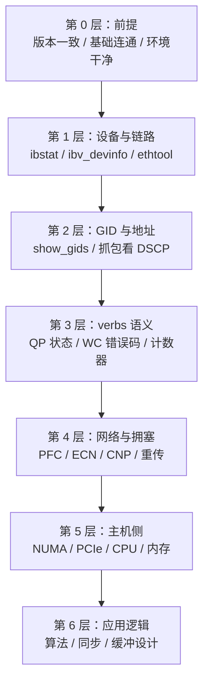
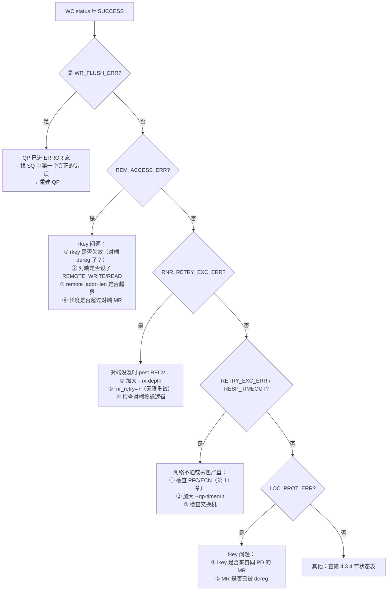
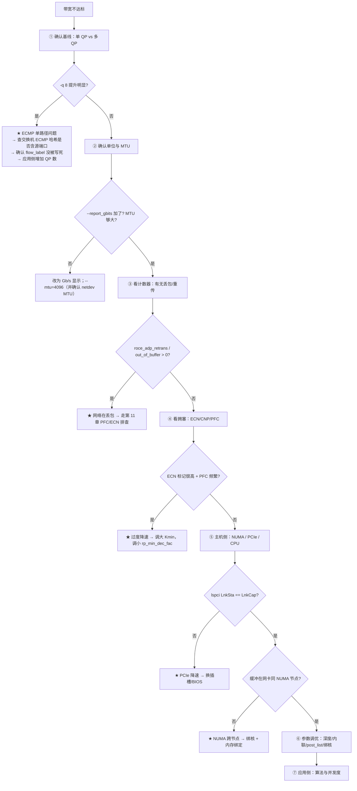
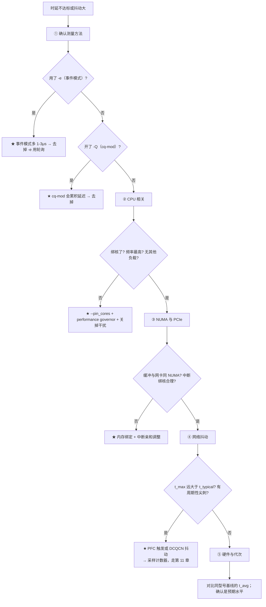

# 第 12 章　性能调优与故障排查方法论

> **本章目标**：把「带宽不对怎么办」变成一套**可复现的流程**，而不是靠经验猜。这是从「会用 RoCE」到「能解决问题」的分水岭。
>
> **本章对应源码**：`perftest:src/*`（工具）、`kernel:drivers/infiniband/hw/mlx5/counters.c`（计数器）、`kernel:drivers/infiniband/core/restrack.c`
>
> **配套实验**：[`labs/lab01-environment-and-first-test.md`](labs/lab01-environment-and-first-test.md)、[`labs/lab03-tuning-and-troubleshooting.md`](labs/lab03-tuning-and-troubleshooting.md)

---

## 12.1 排障的黄金法则

### 12.1.1 分层定位法（先分层，再深入）

**不要一上来就抓包。** 按下面的顺序逐层确认，**在哪一层出现异常就停下深挖**：



> **【核心原则】每一层都要有「通过标准」，通过了才允许往下走。**
> 80% 的「性能问题」最后发现是第 0–2 层的基础问题。**跳过基础层直接调优是最常见的时间浪费。**

### 12.1.2 三条辅助原则

| 原则 | 说明 |
|---|---|
| **控制变量** | 一次只改一个东西。改前记录基线，改后对比。 |
| **可复现** | 记录完整命令、参数、版本、时间。不能复现的问题无法根治。 |
| **先看数字，再看代码** | 计数器/带宽/延迟数字不会撒谎；直觉会。 |

---

## 12.2 第 0 层：前提检查（5 分钟，省几小时）

```bash
#!/bin/bash
# precheck.sh —— 在两台机器上分别跑，逐项确认
DEV=${1:-mlx5_0}
NETDEV=${2:-$(ls /sys/class/infiniband/$DEV/device/net/ 2>/dev/null | head -1)}

echo "=== ① 版本一致性 ==="
echo "内核:      $(uname -r)"
# 注意：不要写成 "dpkg … | head -2 || rpm …" —— 管道的退出码取的是 head（恒为 0），
#       RPM 系统上的 || 分支永远不会执行。按包管理器二选一：
if command -v dpkg >/dev/null 2>&1; then
    echo "rdma-core: $(dpkg -l 2>/dev/null | grep -E 'ibverbs|rdma-core' | head -2)"
elif command -v rpm >/dev/null 2>&1; then
    echo "rdma-core: $(rpm -qa 2>/dev/null | grep -E 'ibverbs|rdma-core' | head -2)"
fi
echo "provider:  $(ls /usr/lib64/libibverbs/ /usr/lib/x86_64-linux-gnu/libibverbs/ 2>/dev/null | grep -E 'mlx5|rdma' | head -3)"
echo "uverbs ABI: $(cat /sys/class/infiniband_verbs/abi_version 2>/dev/null)"
echo "ofed:      $(ofed_info -s 2>/dev/null || echo 'not installed (inbox driver)')"
echo "固件:      $(cat /sys/class/infiniband/$DEV/fw_ver 2>/dev/null)"
echo "perftest:  $(ib_write_bw --version 2>/dev/null)"
echo "→ 两台机器的以上各项应完全一致（至少主版本一致）"
echo "  注意：ibv_devinfo 没有 -V 选项；查 perftest 版本用 ib_write_bw --version"

echo; echo "=== ② 基础链路 ==="
ibstat $DEV | grep -E 'State|Physical state|Rate|Base lid|Link layer'
ethtool $NETDEV | grep -E 'Speed|Duplex|Link detected'
echo "→ State=Active, Link layer=Ethernet, Speed 符合预期"

echo; echo "=== ③ MTU 一致性 ==="
echo "netdev MTU: $(cat /sys/class/net/$NETDEV/mtu)"
ibv_devinfo -d $DEV -v | grep -E 'active_mtu|max_mtu'
echo "→ RoCE MTU 4096 需要 netdev MTU >= 4192（内核 iboe_get_mtu() 按最坏情况扣 96 字节：40+8+12+4+28+4）"
echo "  实践建议直接设 4200；4154 只是线缆帧长口径，按它配只会得到 IB_MTU_2048"

echo; echo "=== ④ memlock 限额 ==="
echo "ulimit -l: $(ulimit -l)"
echo "→ 应为 unlimited 或足够大；否则 ibv_reg_mr 会 ENOMEM"

echo; echo "=== ⑤ CPU 频率 ==="
grep -m1 'cpu MHz' /proc/cpuinfo
cat /sys/devices/system/cpu/cpu0/cpufreq/scaling_governor 2>/dev/null || echo "no cpufreq"
echo "→ 应为 performance。perftest 不读 scaling_governor：它只读 /proc/cpuinfo 的 cpu MHz，"
echo "  各核频率差 > 2% 时只给警告；只有完全测不出频率且没加 -F 才会 exit"

echo; echo "=== ⑥ 环境干扰 ==="
uptime
ps aux --sort=-%cpu | head -5
echo "→ 排除其他大流量进程、避免与别的测试并发"
```

**常见「第 0 层」问题**：

| 问题 | 症状 | 处理 |
|---|---|---|
| 两端 perftest 版本不同 | `mismatch` 报错退出（`negotiate_params()`） | 统一版本 |
| 一端 OFED，一端 inbox | 特性/参数不一致，行为诡异 | 统一驱动栈 |
| 固件版本不同 | 吞吐/拥塞行为差异 | 统一固件 |
| MTU 不一致 | 带宽异常或连不上 | 统一 |
| `ulimit -l` 太小 | `ibv_reg_mr` 失败 | `ulimit -l unlimited` |
| CPU 变频 | 延迟数字不可信 | 设 `performance` governor |
| 有别的测试在跑 | 数字完全不可信 | 确认环境独占 |

---

## 12.3 第 1 层：设备与链路

```bash
# 设备与端口状态
rdma link show                        # ★ ibdev ↔ netdev 绑定（最可靠）
ibv_devinfo -d $DEV -v | head -40
cat /sys/class/infiniband/$DEV/ports/1/state        # 4 = ACTIVE
cat /sys/class/infiniband/$DEV/ports/1/phys_state

# 链路速率与宽度（PCIe 也是瓶颈！）
ethtool $NETDEV | grep -E 'Speed|Link detected'
lspci -vv -s $(basename $(readlink /sys/class/infiniband/$DEV/device)) | grep -E 'LnkCap|LnkSta'
echo "→ LnkSta 应等于 LnkCap。若不等于，说明 PCIe 降速（插槽/线缆/BIOS 问题）"
```

**判读表**：

| 检查项 | 通过标准 | 不通过的常见原因 |
|---|---|---|
| `state` | `4`（ACTIVE） | 网线/光模块、交换机端口未启用 |
| `link_layer` | `Ethernet` | 网卡配置成了 IB 模式（`mlxconfig`）；或连的是 IB 交换机 |
| `phys_state` | `5`（LinkUp） | 物理层问题 |
| `active_speed` | 等于网卡标称速率 | 光模块/线缆规格不足、交换机端口限速 |
| **PCIe `LnkSta`** | **等于 `LnkCap`** | **插槽代次不够、BIOS 设置、金手指接触** |
| `active_mtu` | 符合规划 | 一端 netdev MTU 太小 |

> **【重要但常被忽略】PCIe 是带宽的隐形瓶颈。**
> 一张 200G 网卡需要 **PCIe Gen4 x16**（16 GT/s × 16 lane = 256 GT/s **原始**速率，按 128b/130b 编码折算**有效**约 252 Gb/s）才能跑满；如果插在 Gen3 x16 插槽（8 GT/s × 16 lane，同样编码，**有效约 126 Gb/s**），**带宽上限就是 ~100 Gb/s**，无论你怎么调网络都没用。
> **排查口诀**：带宽约为链路标称的一半 → 先看 `lspci -vv` 的 `LnkSta`。

---

## 12.4 第 2 层：GID 与地址

```bash
# ① GID 表
show_gids | grep $DEV
# → 找 VER=v2 且 IPv4 列等于业务 IP 的那一行，记下 INDEX

# ② 确认 QP 用的是正确的 GID
#    perftest 默认会自动选（compute_gid_score），但显式指定更可复现
ib_write_bw -d $DEV -i 1 -x <INDEX> ...

# ③ 抓包确认真正发出的地址与 DSCP
tcpdump -i $NETDEV -nn -c 10 -v 'udp port 4791'
# 检查：源 IP 是否是业务 IP；TOS 字段是否符合 DSCP 规划；目的端口是否 4791
```

**「连不上」的排查顺序**（按命中率排序）：

| 顺序 | 检查 | 命令 |
|---|---|---|
| 1 | GID index 是否指向 RoCEv2 + 业务 IP | `show_gids` |
| 2 | 两端 IP 是否真的三层可达 | `ping` |
| 3 | ARP/ND 是否正常（RoCE 需要邻居表） | `ip neigh show` |
| 4 | 防火墙是否放了握手端口 | `ss -tlnp` / `iptables -L` |
| 5 | netdev 是否 up 且有 IP | `ip -br addr` |
| 6 | 是否走了 RDMA_CM（`-R`）能通而裸 verbs 不通 | 用 `-R` 交叉验证 |

> **【高效技巧】用 `-R` 与不用 `-R` 交叉对比**（第 6 章讲过）：
> - `-R` 能通、裸 verbs 不通 → **几乎一定是 GID index 选错了**；
> - 两者都不通 → 是网络层（IP/ARP/防火墙）问题。

---

## 12.5 第 3 层：verbs 语义与 WC 错误码

### 12.5.1 WC 错误码的排查树

第 4.3.4 节给出了状态码表，这里给出**排查决策树**：



### 12.5.2 QP 状态与异步事件

```bash
# 观察异步事件（端口 down、QP fatal、CQ error、GID change）
ibv_asyncwatch -d $DEV
# → 应在另一个终端跑，同时压测，观察是否有事件

# 查 QP 状态（需要自己写程序或看应用日志）
# perftest 没有「详细输出」开关：-v 是 --mac_fwd（raw-eth MAC 转发）
# 想控制输出粒度用 --output=bandwidth|message_rate|latency（以 --help 为准）
```

**必须处理的三个事件**（第 4.3.9 节）：`IBV_EVENT_GID_CHANGE`（**RoCE 特有**）、`IBV_EVENT_PORT_ERR`、`IBV_EVENT_QP_FATAL`。

### 12.5.3 计数器

```bash
# RDMA 标准计数器（内核提供）
rdma statistic show link
# 或逐项读
ls /sys/class/infiniband/$DEV/ports/1/counters/
cat /sys/class/infiniband/$DEV/ports/1/counters/port_xmit_data
cat /sys/class/infiniband/$DEV/ports/1/counters/port_rcv_data
# 还有 hw_counters 子目录（驱动私有）
ls /sys/class/infiniband/$DEV/ports/1/hw_counters/

# perftest 也能报计数器（运行前后的增量）
ib_write_bw -d $DEV -i 1 -x <IDX> -W "counters/port_xmit_data,hw_counters/out_of_buffer"
```

**关键计数器对照**：

| 计数器 | 含义 | 正常值 |
|---|---|---|
| `port_xmit_data` / `port_rcv_data` | 收发字节数 | 压测时应快速增长 |
| `port_xmit_packets` / `port_rcv_packets` | 收发包数 | |
| `port_xmit_discards` | 发送丢弃 | **应为 0** |
| `port_rcv_errors` | 接收错误 | **应为 0** |
| `out_of_buffer` | 缓冲区不足丢弃 | **应为 0**（不为 0 说明 PFC/ECN 没配好） |
| `np_ecn_marked_roce_packets` | 标记 CE 的包数 | 压测时应有增长 |
| `roce_adp_retrans` | 自适应重传 | **必须为 0** |
| `roce_slow_restart_cnps` | 因 CNP 重启慢启动 | 少量正常，持续增长说明拥塞 |

---

## 12.6 第 4 层：网络与拥塞（最复杂，也最常见）

第 11.6.3 节给出了**判读矩阵**，这里补充完整的**流程化排查**：

### 12.6.1 带宽问题的标准排查流程



### 12.6.2 时延问题的标准排查流程



### 12.6.3 【行业重点】三个高频「玄学」问题的根治答案

#### 问题 1：「200G 网卡单 QP 只跑到 100G」

**根因**：ECMP 哈希把一条 QP 的分到同一条上行链路。
**验证**：`-q 4` 或 `-q 8` 看总带宽是否翻倍。
**根治**：
```bash
# ① 确认 flow_label 未被写死
#    内核驱动在 modify_qp 时用 rdma_calc_flow_label(lqpn, rqpn) 推导 UDP 源端口
#    （kernel:drivers/infiniband/hw/mlx5/qp.c:3577-3582，仅带 IB_QP_DEST_QPN 的 RC/UC/XRC 路径）；
#    perftest 默认**不**设 flow_label，只在显式 --flow_label 时才写入
#    （perftest:src/perftest_resources.c:3553-3555）
# ② 确认交换机 ECMP 哈希包含 L4 源端口
# ③ 应用侧使用多 QP（推荐 4-16 个，视 ECMP 路径数）
# ④ 确认 UDP 源端口落在 0xC000-0xFFFF（抓包验证）
tcpdump -i $NETDEV -nn -c 20 'udp port 4791' | awk '{print $3}' | cut -d. -f5
```
详见第 2.7 节与第 8.9.3 节。

#### 问题 2：「带宽上不去，但也没看到丢包」

**根因排序**（按命中率）：
1. **ECN 阈值太小 → DCQCN 过度降速**（看 `np_ecn_marked_roce_packets` 是否很高）；
2. **MTU 太小**（小包多，PPS 成为瓶颈）；
3. **PCIe 降速**（看 `lspci -vv`）；
4. **NUMA 跨节点**（内存带宽成为瓶颈）；
5. **SQ 深度不足**（`-t` 太小，管道填不满）。

**排查顺序**：先看 `-a` 扫全尺寸的曲线形状 —— **小包上不去 = PPS 问题；大包上不去 = 带宽/路径问题**。

#### 问题 3：「延迟有周期性尖刺」

**根因排序**：
1. **PFC 触发**（看 `rx_prioN_pause`/`tx_prioN_pause` 是否与尖刺同步）；
2. **DCQCN 反复降速/恢复**（看速率参数与 CNP）；
3. **CPU 变频或抢占**（`--pin_cores` + governor）；
4. **中断在其他核上抖动**（多队列 + 中断亲和）。

**验证方法**：用 `--duration=60 --margin=5` 跑长稳，同时每 5 秒采样计数器，**把尖刺时刻与计数器变化对齐**。

---

## 12.7 第 5 层：主机侧（NUMA / PCIe / CPU）

### 12.7.1 NUMA 亲和（性能影响巨大，容易被忽略）

```bash
# ① 找出网卡所在的 NUMA 节点
cat /sys/class/infiniband/$DEV/device/numa_node
# 或
cat /sys/class/net/$NETDEV/device/numa_node

# ② 查看该节点的 CPU
lscpu | grep -i numa
numactl --hardware

# ③ 让测试进程与内存都绑到该节点
numactl --cpunodebind=<N> --membind=<N> ib_write_bw -d $DEV -i 1 -x <IDX> ...
# 或让 perftest 自己处理（它会自动探测并绑定）
ib_write_bw -d $DEV --pin_cores=<该节点上的核> ...
```

**为什么重要**：跨 NUMA 节点的内存访问会走 UPI/QPI 链路，带宽和延迟都显著变差。**一张 200G 网卡需要的内存带宽可能超过单个 NUMA 节点能提供的量。**

### 12.7.2 PCIe 检查

```bash
# 找到网卡的 PCI 地址
basename $(readlink /sys/class/infiniband/$DEV/device)
# 例：0000:01:00.0

# 看链路能力与实际状态
lspci -vv -s 0000:01:00.0 | grep -E 'LnkCap|LnkSta'
# 期望：LnkSta 的 Speed/Width 与 LnkCap 一致
```

| `LnkCap` | `LnkSta` | 结论 |
|---|---|---|
| Gen4 x16 | Gen4 x16 | ✅ 正常 |
| Gen4 x16 | **Gen3 x16** | ⚠️ 插槽只支持 Gen3 → 带宽上限约一半 |
| Gen4 x16 | **Gen4 x8** | ⚠️ 宽度只有一半 → 带宽上限约一半 |
| Gen4 x16 | Gen1 x1 | ❌ 严重异常（BIOS/金手指/转接卡问题） |

### 12.7.3 CPU 与中断

```bash
# 关掉变频（延迟测试必备）
for gov in /sys/devices/system/cpu/cpu*/cpufreq/scaling_governor; do
    echo performance > $gov
done

# 查看网卡中断的分布与亲和
grep mlx5 /proc/interrupts
for i in $(grep mlx5 /proc/interrupts | cut -d: -f1); do
    echo "IRQ $i: $(cat /proc/irq/$i/smp_affinity_list)"
done
# → 中断应分散在网卡所在 NUMA 节点的多个核上
# ⚠️ 若把上面的 cat 换成 `echo <mask> > /proc/irq/$i/smp_affinity`，请务必注意：
#    改写 smp_affinity 会立即迁移该 IRQ，**在生效瞬间短暂影响该网卡的全部流量**
#    （丢包/延迟抖动）。生产环境要在维护窗口做，并先记录原值以便回滚。

# 确认 NUMA 命中率（strace/perf 辅助）
perf stat -e node-load-misses,node-loads -a sleep 5
```

---

## 12.8 第 6 层：应用逻辑

当 1–5 层都干净时，问题在应用侧。常见清单：

| 模式 | 症状 | 修正 |
|---|---|---|
| 数据路径里有系统调用 | CPU 占用高、吞吐低 | 把 `reg_mr`/`create_qp`/日志移出循环（第 9.3 节） |
| 每个 WR 都 `SIGNALED` | CQE 太多，CPU 忙于收割 | 批量确认（每 16/64 个发一个） |
| 每次只 post 1 个 WR | PPS 上不去 | `post_list`（perftest `-l`）批量投递 |
| 一个 QP 一个线程但只用一个核 | 单核瓶颈 | 多 QP + 多线程 + 多 CQ |
| 接收缓冲不足 | RNR、丢包 | 加大 `rx_depth`，及时补投 |
| 小消息没用 inline | 延迟高 | `IBV_SEND_INLINE`（`-I`） |
| 缓冲没对齐/跨 cache line | 带宽低 | 按 64 字节（cache line）与页对齐 |
| 用普通 4K 页 | TLB miss、注册慢 | 大页（2MB/1GB） |
| 没开 Relaxed Ordering | 带宽略低 | `IBV_ACCESS_RELAXED_ORDERING`（perftest 默认开） |

---

## 12.9 完整案例：从「带宽只有一半」到根因

**这是一个综合案例，串联全书知识。**

### 12.9.1 现象

```
hostA/hostB：ConnectX-6 200Gb/s，通过两台 Leaf 交换机相连（Spine 有两台，4 条等价路径）
测试：ib_write_bw -s 65536 --report_gbits
结果：BW average[Gb/sec] = 96.3      ← 期望 ~190
```

### 12.9.2 按流程排查

```
【第 0 层】
  版本一致 ✓  MTU 一致（4096）✓  ulimit unlimited ✓  governor=performance ✓
  → 通过

【第 1 层】
  state=ACTIVE ✓  link_layer=Ethernet ✓  active_speed=200Gb ✓
  lspci LnkSta: Speed 16GT/s, Width x16 == LnkCap ✓
  → 通过

【第 2 层】
  show_gids: 选用的 index 3 = RoCEv2 + 192.168.100.1 ✓
  tcpdump: 源 IP 正确，TOS 0x68 (DSCP 26) ✓
  → 通过

【第 3 层】
  无 WC 错误；roce_adp_retrans = 0 ✓；out_of_buffer = 0 ✓
  → 通过（不丢包）

【第 4 层】★ 问题在这里
  ① 先做多 QP 对比：
     -q 1  → 96.3 Gb/s
     -q 4  → 191.8 Gb/s      ← 翻倍！
     → 典型 ECMP 单路径症状（第 12.6.3 问题 1）

  ② 抓包看 UDP 源端口：
     tcpdump ... | 分析源端口 → 全部落在同一区间
     → 确认每条 QP 的流量被哈希到同一条上行链路

  ③ 检查交换机 ECMP 哈希配置：
     发现哈希字段只含 源IP+目的IP+协议（★ 不含 L4 端口）
     → 根因确认：4 条等价路径只用了 2 条（96.3 Gb/s ≈ 2 × 50 × 0.96）
```

### 12.9.3 根因与解决

| 项 | 内容 |
|---|---|
| **根因** | 交换机 ECMP 哈希未包含 L4 源端口，单 QP（单一 5 元组）只能走一条路径；本例实际只吃到 2 条等价路径，带宽上限 = 2 × 单路径带宽 ≈ 96G（= 总带宽 / 4 ≈ 50G × 2 × 96%） |
| **方案 A（网络侧，根本解）** | 修改交换机 ECMP 哈希配置，加入 L4 源端口 |
| **方案 B（主机侧，立即可用）** | 应用使用多 QP（4 个即可吃满 4 条路径） |
| **方案 C（应用侧配合）** | 确认 `flow_label` 未被写死；不同 QP 使用不同流标签 |

**验证**：

```bash
# 方案 B 验证（-q 4 达到 191.8 Gb/s，即 200G 链路的 96% 线速）✓
ib_write_bw -d mlx5_0 -i 1 -x 3 --report_gbits -q 4

# 长期方案：配合交换机修改后，-q 1 也应接近满速
```

**经验总结（写进你的排查笔记）**：

> **单 QP 带宽 ≈ 链路带宽 / ECMP 路径数**，这是 RoCE 部署的**第一条要记住的经验公式**。
> 只要看到「带宽是标称的一半/四分之一/八分之一」，先怀疑 ECMP，用 `-q N` 一次验证。

---

## 12.10 工具速查表

| 目的 | 命令 |
|---|---|
| **设备/netdev 绑定** | `rdma link show` |
| 设备与端口属性 | `ibv_devinfo -d <dev> -v` |
| **GID 表（RoCE 必用）** | `show_gids` |
| 端口状态/速率 | `ibstat <dev>` |
| 链路速率与 PCIe | `ethtool <netdev>`；`lspci -vv -s <PCI>` |
| **PFC/DCB 配置** | `mlnx_qos -i <netdev>`；`lldptool -t -i <netdev> -V PFC` |
| **ECN/CNP 计数** | `cat /sys/class/infiniband/<dev>/ports/1/hw_counters/np_ecn_marked_roce_packets`（**不在 `ethtool -S`**） |
| **PFC 计数** | `ethtool -S <netdev> \| grep -E 'rx_prio[0-9]_pause\|tx_prio[0-9]_pause'` |
| **DCQCN 参数** | `ls /sys/kernel/debug/mlx5/<PCI>/cc_params/` |
| RDMA 标准计数器 | `rdma statistic show link`；`/sys/class/infiniband/<dev>/ports/1/counters/` |
| 异步事件 | `ibv_asyncwatch -d <dev>` |
| **抓包验证** | `tcpdump -i <netdev> -nn -v 'udp port 4791'` |
| 性能测试 | `ib_write_bw` / `ib_write_lat` / `-a` / `-q N` / `-D` |
| 正确性验证 | `ib_write_bw --data_validation` |
| NUMA | `cat /sys/class/infiniband/<dev>/device/numa_node`；`numactl --hardware` |
| 中断分布 | `grep mlx5 /proc/interrupts` |
| 驱动健康 | `devlink health show pci/<PCI>` |
| 内核日志 | `dmesg -T \| grep -i -E 'mlx5\|rdma\|infiniband'` |
| RoCE 资源开关 | `devlink dev param show pci/<PCI> name enable_roce` |

---

## 12.11 本章自检

1. 说出分层定位法的六层顺序，以及每层的「通过标准」是什么。
2. 「带宽约为标称的一半」最可能是什么原因？用什么命令一次验证？
3. PCIe `LnkSta` 与 `LnkCap` 不一致意味着什么？
4. `roce_adp_retrans > 0` 与 `np_ecn_marked_roce_packets` 很高，分别指向什么根因？
5. 「带宽上不去但没丢包」的五个可能原因，按命中率排序。
6. 「延迟有周期性尖刺」的四个可能原因，以及如何把尖刺与计数器对齐？
7. 为什么 `ulimit -l` 会影响 `ibv_reg_mr`？对应内核里的哪一步检查？
8. 用 `-R` 能通而不用 `-R` 不通，说明什么？
9. 为什么跨 NUMA 会显著影响 RoCE 带宽？
10. 数据路径里出现 `ibv_reg_mr` 会有什么后果？

**下一章**：把性能推到极限 —— 系统化的性能工程方法。
