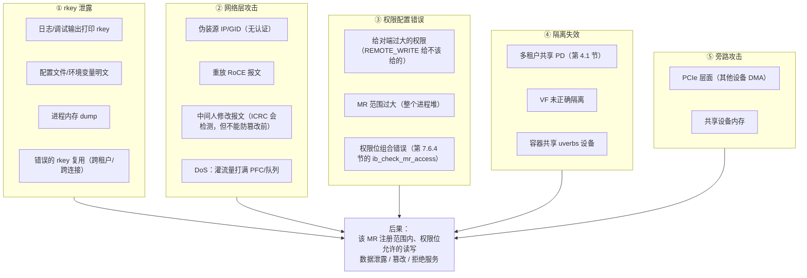
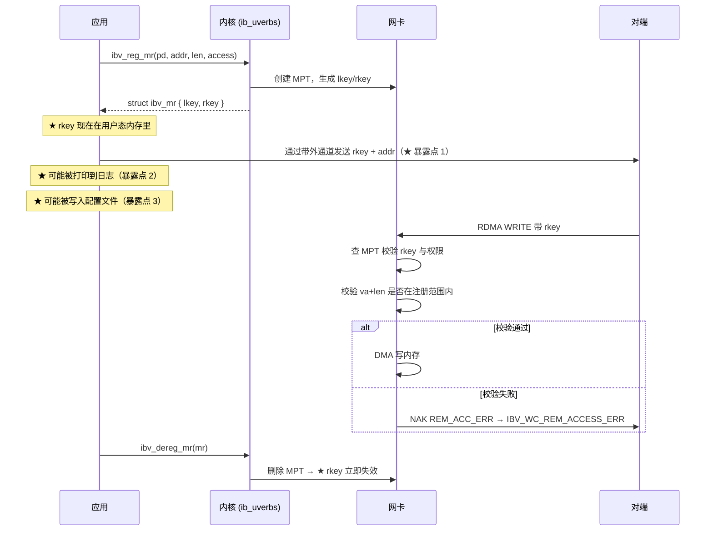

# 第 14 章　RoCE 安全模型

> **本章目标**：建立正确的 RoCE 威胁模型。**这是被绝大多数 RoCE 教程忽略的一章，但在生产环境里极其重要。**
>
> **核心认知**：RDMA 是一种**可以把内存读写权授予远端**的技术。它的安全模型与以太网/TCP 完全不同 —— 不能用「网络隔离就够了」的思路对待它。
>
> **配套实验**：[`labs/lab05-security-and-observability.md`](labs/lab05-security-and-observability.md)（亲手验证 PD 隔离、权限强制、`rkey` 生命周期，并跑一遍安全审计脚本）

---

## 14.1 威胁模型：RDMA 为什么特殊

### 14.1.1 三个根本差异

| 维度 | 传统 TCP/IP | **RDMA / RoCE** |
|---|---|---|
| **访问控制粒度** | 连接级别（能不能连上） | **内存区域级别（`rkey` + 权限位）** |
| **对端能力** | 只能发数据给应用 | **可以直接读写你的内存**（只要你给了 `rkey`） |
| **协议栈校验** | 内核协议栈做安全检查 | **网卡硬件做检查，内核不参与数据平面** |

> **【必会】RDMA 的安全边界是 `rkey`，不是「网络能不能通」。**
> 只要攻击者拿到了一个有效的 `rkey` 与你的 GID/IP，**他就能直接读写你注册的那块内存** —— 不需要你在对端运行任何代码，不需要你 post 任何 RECV，**你的 CPU 完全不知道**。
>
> **但威胁模型有两个必须写清的前提**（本教程其余地方都按这个口径）：
> ① 泄露的 `rkey` 只授予**该 MR 注册范围内、按注册时权限位允许的**访问（范围由注册时的 `addr`/`length` 限定，读/写/原子分别受 `REMOTE_READ`/`REMOTE_WRITE`/`REMOTE_ATOMIC` 约束）——它不是「任意内存读写」；
> ② 攻击者还必须拥有一条**属于同一 PD 的合法 QP**，并且网络可达目标的 GID/IP。
> 这两条把「拿到 `rkey`」与「读写任意内存」区分开，也是最小权限 + 最小范围注册（14.2.3、14.2.4）真正的作用。

### 14.1.2 威胁清单



---

## 14.2 `rkey` 管理：最重要的安全实践

### 14.2.1 `rkey` 的生命周期与暴露面



### 14.2.2 【行业重点】`rkey` 管理十条规则

| # | 规则 | 原因 |
|---|---|---|
| 1 | **永远不要把 `rkey` 写进日志** | 日志的访问控制通常比业务数据弱得多 |
| 2 | **不要把 `rkey` 放进配置文件或环境变量** | 明文、易被读取、可能进备份 |
| 3 | **`rkey` 只在需要的连接上传递**，用完即弃 | 最小暴露原则 |
| 4 | **用完立即 `ibv_dereg_mr`**（或换 `rkey`） | 使泄露的 `rkey` 失效 |
| 5 | **按最小权限注册**：只给真正需要的 access flags | 见 14.2.3 |
| 6 | **按最小范围注册**：只注册需要的那个区域，不要注册整个堆 | 泄露 `rkey` 的损失最小化 |
| 7 | **不要把同一个 `rkey` 给多个对端** | 一个对端失陷不应影响其他对端 |
| 8 | **定期轮换**：长连接场景定期重注册 | 缩小泄露窗口 |
| 9 | **传递 `rkey` 的通道要加密**（TLS/gRPC over TLS） | 带外通道也是攻击面 |
| 10 | **审计 `rkey` 的使用**：记录谁在什么时候拿到了哪个 `rkey` | 事后取证 |

> **【实践建议】把 `rkey` 当成「一次性的、有权限的、指向特定内存的令牌」**，而不是「一个普通的 ID」。
> 一个泄露的 `rkey` + `REMOTE_WRITE` 权限 = **攻击者可以在该 MR 的注册范围内改写你进程的内存**（前提是他还有一条同 PD 的合法 QP） —— 这比 SQL 注入严重得多。

### 14.2.3 最小权限原则（access flags 对照）

**这是最容易做、收益最大的安全措施。** 回到第 4.3.3 节的表，这里给出**安全视角**的建议：

| 场景 | ❌ 常见做法（危险） | ✅ 推荐做法 |
|---|---|---|
| 只做 SEND/RECV 的发送缓冲 | `LOCAL_WRITE \| REMOTE_WRITE \| REMOTE_READ \| REMOTE_ATOMIC` | **`LOCAL_WRITE`** |
| 接收缓冲（SEND 对端） | 全套权限 | **`LOCAL_WRITE`** |
| 只让对端 WRITE（存储写入） | 全套权限 | **`LOCAL_WRITE \| REMOTE_WRITE`** |
| 只让对端 READ（数据拉取） | 全套权限 | **`LOCAL_WRITE \| REMOTE_READ`** |
| 需要原子操作 | `REMOTE_ATOMIC` 但不给 `REMOTE_WRITE` | **`LOCAL_WRITE \| REMOTE_WRITE \| REMOTE_ATOMIC`**（内核强制要求，见 `ib_check_mr_access()`） |
| 只想测试性能 | —— | perftest **按操作给权限**（不是无脑全套）：WRITE/WRITE_IMM → `LOCAL_WRITE \| REMOTE_WRITE`，READ → `LOCAL_WRITE \| REMOTE_READ`，ATOMIC → `LOCAL_WRITE \| REMOTE_ATOMIC`；只有 `--data_validation` 才额外加 `REMOTE_READ \| REMOTE_ATOMIC`（`perftest:src/perftest_resources.c:2100`–`:2122`）。**但生产代码仍应按最小权限自己声明** |

> **【必会】内核会强制这一条规则**（第 7.6.4 节）：
> ```c
> if ((flags & (IB_ACCESS_REMOTE_ATOMIC | IB_ACCESS_REMOTE_WRITE)) &&
>     !(flags & IB_ACCESS_LOCAL_WRITE))
>         return -EINVAL;
> ```
> 但**内核不会阻止你多给权限**。这就是为什么「最小权限」必须由开发者自觉执行。

### 14.2.4 安全的内存区域设计

```c
/* ❌ 危险：注册整个堆，权限给全 */
void *heap = malloc(1 << 30);                        /* 1GB */
mr = ibv_reg_mr(pd, heap, 1 << 30,
                IBV_ACCESS_LOCAL_WRITE | IBV_ACCESS_REMOTE_WRITE |
                IBV_ACCESS_REMOTE_READ  | IBV_ACCESS_REMOTE_ATOMIC);
/* 一旦 rkey 泄露 → 攻击者可以读写这 1GB 里的任何位置 */

/* ✅ 推荐：按用途分区注册，各自最小权限 */
struct {
    struct ibv_mr *ctrl_mr;    /* 控制信息：只给 REMOTE_READ */
    struct ibv_mr *data_mr;    /* 数据区：给 REMOTE_WRITE|READ */
    struct ibv_mr *local_mr;   /* 纯本地：只给 LOCAL_WRITE */
} mrs;

mrs.ctrl_mr  = ibv_reg_mr(pd, ctrl_region,  ctrl_len,
                          IBV_ACCESS_LOCAL_WRITE | IBV_ACCESS_REMOTE_READ);
mrs.data_mr  = ibv_reg_mr(pd, data_region,  data_len,
                          IBV_ACCESS_LOCAL_WRITE | IBV_ACCESS_REMOTE_WRITE |
                          IBV_ACCESS_REMOTE_READ);
mrs.local_mr = ibv_reg_mr(pd, local_region, local_len,
                          IBV_ACCESS_LOCAL_WRITE);   /* ★ 不给任何远端权限 */
```

> **【进阶】按连接划分区域**：在 C/S 架构里，**每一个客户端连接用独立的 MR**，这样一个客户端失陷不会泄露其他客户端的数据。这正是 NVMe-oF 规范要求「每连接协商 `rkey`」的原因。
>
> 代价是 MR 数量变多（受 `max_mr` 限制）。可以用 `IBV_ACCESS_ZERO_BASED` + MR 分区来平衡。

### 14.2.5 用 Memory Window 实现「按需授权」（进阶）

**问题**：如果每次请求都要变权限/变范围，重新 `ibv_reg_mr` 太贵。

**方案**：`ibv_alloc_mw`（Memory Window）+ `IBV_WR_BIND_MW`：

```c
/* ① 注册一大块基础 MR（权限最小化：只 LOCAL_WRITE） */
base_mr = ibv_reg_mr(pd, base, base_len, IBV_ACCESS_LOCAL_WRITE | IBV_ACCESS_MW_BIND);

/* ② 申请 Memory Window */
mw = ibv_alloc_mw(pd, IBV_MW_TYPE_2);   /* Type 2 只产生 rkey */

/* ③ 在需要时把 MW 绑定到基础 MR 的一个子区间，并指定这一刻的权限 */
struct ibv_mw_bind_info bind_info = {
    .mr     = base_mr,
    .addr   = base + offset,
    .length = len,
    .mw_access_flags = IBV_ACCESS_REMOTE_WRITE,   /* ★ 只在这一刻给 WRITE */
};
struct ibv_mw_bind bind = {
    .wr_id      = 1,
    .bind_info  = bind_info,
    .send_flags = IBV_SEND_SIGNALED,
};
ibv_bind_mw(qp, mw, &bind);

/* ④ 把 mw->rkey 给对端（范围受限、权限受限） */

/* ⑤ 用完重新绑定（换范围/换权限）或失效 */
```

**Memory Window 的安全价值**：

| 优势 | 说明 |
|---|---|
| **范围可动态变化** | 不需要重注册 MR（快） |
| **权限可动态变化** | 只在需要的一刻给 WRITE |
| **`rkey` 可轮换** | 每次重绑定可以换新的 rkey |
| **粒度更细** | 把「大 MR 的访问权」拆成「小窗口的临时授权」 |

> **【适用场景】这是「多客户端共享一块内存但各自只能访问自己的区域」的标准解法**，也是很多存储/数据库产品的做法。

---

## 14.3 网络层安全

### 14.3.1 RoCE 没有内置认证（必须知道的事实）

| 问题 | 现状 |
|---|---|
| 能否伪装源 GID/IP 发 RoCE 包？ | **能**。RoCE 没有源认证机制（ICRC 只防意外损坏，不防伪造，因为攻击者可以算出正确的 ICRC） |
| 能否重放报文？ | **PSN 机制能检测部分重放**（序列号不匹配会报错），但不能完全防止 |
| 能否中间人篡改？ | **ICRC 会检测到**（第 2.4 节），但攻击者如果知道算法就能重新计算 ICRC |
| 能否 DoS？ | **能**。灌 PFC/ECN 触发流量、打满队列、制造 PFC 风暴 |

> **【结论】RoCE 的安全性依赖「网络层隔离」，不依赖协议自身的密码学保护。**
> 这不是缺陷，而是设计取舍：RoCE 追求极致性能，把安全交给了部署层面。

### 14.3.2 网络层防护措施

| 措施 | 作用 | 实现 |
|---|---|---|
| **物理/逻辑隔离** | 把 RoCE 流量放在独立 VLAN/VRF，不允许跨域 | 交换机 VLAN 划分 |
| **VLAN 隔离** | 不同租户不同 VLAN；GID 绑定 VLAN | 第 2.5 节的 VLAN GID |
| **ACL 限制** | 只允许特定 IP/MAC 对之间发 UDP 4791 | 交换机 ACL |
| **禁用不必要端口** | 减少攻击面 | 交换机 |
| **MACsec（802.1AE）** | **链路层加密与完整性** | **mlx5 支持 RoCE + MACsec**：`kernel:drivers/infiniband/hw/mlx5/macsec.c` |
| **IPsec** | 网络层加密 | `CONFIG_MLX5_EN_IPSEC`（`lib/ipsec_fs_roce.o`） |
| **源 IP 校验（uRPF）** | 防 IP 伪装 | 交换机/主机 |
| **PFC 看门狗（pfcwd）** | 防 PFC 风暴 DoS | 交换机 |

> **【行业重点】MACsec 是 RoCE 唯一实用的链路加密方案。** 它在以太网层加密，对 RDMA 透明（不影响 verbs 语义）。
> 源码位置：`kernel:drivers/infiniband/hw/mlx5/macsec.c`，注意里面有大量 `"RoCE MACsec not supported due to capabilities"` 的检查（`:152/164/177/209/234/313`）—— **说明 MACsec + RoCE 有硬件能力要求，选型时要确认。**

### 14.3.3 PFC 相关的 DoS（安全视角）

第 11.8 节从「故障」角度讲过 PFC 风暴。从**安全**角度：

| 攻击 | 手段 | 后果 | 防护 |
|---|---|---|---|
| **PFC 风暴** | 恶意流量触发大量 PFC → 传播至全网 | **整网瘫痪**（这是最严重的 RoCE 攻击） | pfcwd（交换机自动 bypass 该队列） |
| **PFC 优先级耗尽** | 恶意流量占用 RoCE 优先级 | 正常 RoCE 流量受阻 | 严格 ACL 限制谁能发该优先级 |
| **ECN 滥用** | 伪造 CE 标记触发 DCQCN 降速 | 正常流量被降速 | 交换机端做标记，端侧不是信任来源 |
| **队列打满** | 灌满某个队列 | 丢包/延迟 | 队列限速、per-flow QoS |

> **【实践】在多租户环境里，必须限制「谁能使用 RoCE 优先级」**。
> 一个租户如果能用 RoCE 的 PFC 优先级，就能通过制造 PFC 影响其他租户 —— **这是云平台必须处理的隔离问题**（靠 VF + DR 流表 + 交换机 ACL 三层配合）。

---

## 14.4 隔离：多租户与容器

### 14.4.1 PD 是硬件级的安全域（第 4.1 节重申）

**`ibv_pd` 是 RDMA 的硬件级隔离单位**：一个 PD 里的 QP 不能访问其他 PD 的 MR。

```c
/* ❌ 多租户共享 PD：任何权限配置失误都会跨租户泄露 */
pd_shared = ibv_alloc_pd(ctx);
/* 租户 A 和 B 都用 pd_shared */

/* ✅ 每租户独立 PD */
pd_tenant_a = ibv_alloc_pd(ctx);
pd_tenant_b = ibv_alloc_pd(ctx);
```

**PD 的隔离边界**（务必理解）：

| 隔离 | 是否由 PD 保证 |
|---|---|
| QP 访问其他 PD 的 MR | ✅ **硬件拒绝**（`IBV_WC_LOC_PROT_ERR`） |
| 读其他 PD 的内存 | ✅ 硬件拒绝 |
| 发起其他 PD 的 QP 操作 | ✅ 需要对象句柄，不同 PD 的对象不通用 |
| 同进程内绕过 PD 直接读内存 | ❌ PD 不防这个（进程内本来就共享地址空间） |
| 跨进程 | ✅ 不同进程的 PD 天然隔离 |

### 14.4.2 容器场景的安全要点

```bash
# ❌ 危险做法：把所有 uverbs 设备给容器
docker run --device=/dev/infiniband/ ...

# ✅ 推荐：只给分配的 VF 对应的 uverbs 节点
docker run --device=/dev/infiniband/uverbs3 \
           --device=/dev/infiniband/rdma_cm \
           --cap-add=IPC_LOCK ...
```

| 风险 | 说明 | 防护 |
|---|---|---|
| **共享 uverbs 设备** | 多个容器挂同一个 `uverbsN` 共享的是**设备节点**，**并不共享 PD**（PD 按 ucontext 隔离，见 14.4.1）；真实风险是**没有硬件级资源/性能隔离**、资源可被耗尽（由 RDMA cgroup 缓解）、以及 restrack/计数器信息互相可见 | 每容器独立 VF（独立 uverbs 节点），并按租户设 RDMA cgroup 配额 |
| **`CAP_IPC_LOCK`** | 注册大内存需要它 | 用 `ulimit -l` 替代（更细粒度）；或用 cgroup 限制 |
| **RDMA cgroup 缺失** | 容器能注册无限内存 → 耗尽主机内存 | 启用 **RDMA cgroup**（`CONFIG_CGROUP_RDMA`；第 7.1 节的 `cgroup.c` 只是 shim，解析与限额实现在 `kernel:kernel/cgroup/rdma.c`） |
| **不限制 MR/QP 数** | 一个容器耗尽硬件资源 | RDMA cgroup 的 `rdma.max` 限制 |
| **共享 rdma_cm** | CM 是全局的，可能被用来探测 | 可以接受（CM 只做连接管理），但要审计 |

```bash
# RDMA cgroup 限制示例（v1）
mkdir /sys/fs/cgroup/rdma/tenant_a
# 只有两种资源 token：hca_handle（每 ucontext 一个 handle）、hca_object（每 uobject 一个 object）
echo "mlx5_0 hca_handle=1000 hca_object=1000" > /sys/fs/cgroup/rdma/tenant_a/rdma.max
echo $PID > /sys/fs/cgroup/rdma/tenant_a/cgroup.procs
# 回滚：两项都恢复为 max（不限额）
echo "mlx5_0 hca_handle=max hca_object=max" > /sys/fs/cgroup/rdma/tenant_a/rdma.max
```

> **【必会】RDMA cgroup 是容器安全的关键机制**（源码 `kernel:drivers/infiniband/core/cgroup.c` —— 注意它只是 **53 行的 shim**，`rdma.max` 的解析与限额实现都在 `kernel:kernel/cgroup/rdma.c`）。
> 没有它，一个容器可以通过注册海量 MR 耗尽主机的 RDMA 资源。**在生产 K8s 环境里必须启用。**

### 14.4.3 SR-IOV 的安全边界

第 8.12 节与第 10.4.3 节讲过 SR-IOV。**安全视角的关注点**：

| 关注点 | 说明 |
|---|---|
| **VF 之间是否互通** | 默认 VF 之间可能可以互相发 RoCE 包 → 需要 E-Switch 规则隔离 |
| **VF 能否访问 PF 的 GID** | 需要正确配置，否则 VF 可能用 PF 的身份发流量 |
| **representor 的权限** | 宿主通过 representor 管理 VF，要防止被滥用 |
| **`enable_roce` 开关** | 可以按 VF 关闭 RoCE（`devlink port function roce`） |
| **VF 的 GID 表独立** | 每个 VF 有自己的 GID 表，注意不要在 VF 上配出主机的 IP |

```bash
# 检查 VF 的 RoCE 状态（云平台运维常用）
devlink port show
devlink port function show pci/<PCI>/<port>
# 关闭某个 VF 的 RoCE
devlink port function set pci/<PCI>/<port> roce disable
```

---

## 14.5 完整性：数据正确性也是安全

### 14.5.1 ICRC 的能力与局限

| 能力 | 局限 |
|---|---|
| 检测传输过程中的**意外位翻转** | 不防**故意篡改**（攻击者能重算 ICRC） |
| 覆盖 IP+UDP+BTH+扩展头+Payload（不含以太网头） | 不覆盖以太网头（所以 MAC 可被改） |
| 端到端（不因交换机的合法修改而失效） | 不提供抗重放的完整性 |

### 14.5.2 端到端数据校验（第 6 章的应用）

`perftest --data_validation` 的校验机制（第 6 章讲过）在生产代码里同样应该实现：

```c
/* 生产代码的正确性保障三层 */
/* ① 协议层：CRC/校验和（放在 payload 里，你自己算） */
/* ② 语义层：长度校验（wc.byte_len 是否等于预期） */
/* ③ 业务层：关键字段的独立校验（如消息 ID 与序号） */

void on_completion(struct ibv_wc *wc)
{
    if (wc->status != IBV_WC_SUCCESS) { handle_error(wc); return; }

    /* ② 长度校验 */
    struct my_header *h = (struct my_header *)buf;
    if (wc->byte_len != sizeof(*h) + h->payload_len) {
        log_error("length mismatch: got %u, expected %u",
                  wc->byte_len, sizeof(*h) + h->payload_len);
        return;
    }

    /* ③ 业务层校验：序号必须连续 */
    if (h->seq != expected_seq) {
        log_error("sequence gap: got %u, expected %u", h->seq, expected_seq);
        return;
    }

    /* ① 校验和 */
    if (h->crc32 != crc32(h->payload, h->payload_len)) {
        log_error("payload corrupted");
        return;
    }
    expected_seq++;
}
```

> **【重要观念】RDMA 的可靠性（RC）保证「送达且有序」，但不保证「内容在应用看来是正确的」。**
> RC 保证的是网卡层面的可靠（PSN、ACK/NAK、重传），它**不能发现**：
> - 你的代码填错了 WQE 字段（如远端地址写错）；
> - 对端写到了预期的内存但内容不对（应用层 bug）；
> - 你读到的内存被你的另一段代码改了。
>
> **所以「传输可靠」≠「业务正确」，应用层校验不可省略。**

---

## 14.6 【行业重点】合规与审计要求

### 14.6.1 常见合规要求对 RoCE 的影响

| 要求 | 对 RoCE 的影响 |
|---|---|
| **数据加密（传输中）** | RoCE 本身不加密 → 需要 **MACsec**（链路层）或应用层加密 |
| **数据加密（静态）** | 与 RoCE 无关（磁盘加密），但注意 **MR 注册的内存不加密** |
| **访问审计** | 需要记录「谁在什么时候访问了哪块内存」→ 超出 RoCE 能力，需应用层实现 |
| **租户隔离** | **PD + VF + DR 流表 + VLAN** 四层配合 |
| **最小权限** | access flags + MR 范围 + Memory Window |
| **日志中不得含敏感信息** | **绝对不能打印 `rkey`** |

### 14.6.2 审计与可观测性

```bash
# 谁在用 RDMA 资源（内核 restrack 提供）
rdma res show                    # 所有 RDMA 资源
rdma res show qp                 # 所有 QP（含归属进程）
rdma res show mr                 # 所有 MR（★ 可以审计内存注册情况）
rdma res show mr -d mlx5_0       # 指定设备
rdma res show ctx                # 所有 ucontext

# 示例输出解读：
# link mlx5_0/1 lqpn 0x51 type RC state RTS ... pid 12345 comm myapp
#  → 可以追溯每个 QP 属于哪个进程
```

**restrack 的安全价值**（源码 `kernel:drivers/infiniband/core/restrack.c`）：
- 能看到「哪个进程注册了多少 MR、多少内存」→ 发现异常；
- 能看到「哪些 QP 处于异常状态」；
- 是排查「资源泄漏」和「资源滥用」的主要工具。

```bash
# 审计建议：定期采集并对比
rdma res show mr | wc -l                    # MR 总数趋势
rdma res show mr | awk '{print $NF}' | sort | uniq -c | sort -rn   # 按进程统计
```

---

## 14.7 RoCE 安全实践清单

### 14.7.1 开发阶段

```
□ 1. 按最小权限注册 MR（不要图省事给全套）
□ 2. 按最小范围注册（不要注册整个堆）
□ 3. rkey 绝不进日志/配置/环境变量
□ 4. 用完即 dereg（或换 rkey）
□ 5. 传递 rkey 的通道加密（TLS）
□ 6. 每连接独立 MR 或使用 Memory Window
□ 7. 应用层做长度/序号/校验和验证
□ 8. 处理所有 WC 错误码（不要忽略 status）
□ 9. 处理异步事件（尤其是 GID_CHANGE / DEVICE_FATAL）
□ 10. 实现资源上限（MR 数、内存量），防止自身泄漏
```

### 14.7.2 部署阶段

```
□ 11. RoCE 流量放在独立 VLAN，与业务网隔离
□ 12. 交换机 ACL 限制 UDP 4791 的源/目的
□ 13. 启用 uRPF 防源 IP 伪装
□ 14. 启用 pfcwd 防 PFC 风暴
□ 15. 多租户：每租户独立 PD + 独立 VF
□ 16. 启用 RDMA cgroup 限制容器资源
□ 17. 确认 SR-IOV VF 之间的隔离规则
□ 18. 按需启用 MACsec（注意硬件能力要求）
□ 19. 容器只挂载分配的 uverbs 节点（不要 `--device=/dev/infiniband/`）
□ 20. 用 `rdma res` 做资源审计与基线
```

### 14.7.3 运维阶段

```
□ 21. 监控 MR/QP 数量趋势（发现泄漏或滥用）
□ 22. 监控异常 WC 错误码（可能是攻击尝试）
□ 23. 监控 PFC/ECN 异常（可能是 DoS）
□ 24. 定期轮换长连接的 rkey
□ 25. 审计谁在使用 RDMA 资源（rdma res 对比）
□ 26. 固件升级时检查安全公告
□ 27. 定期验证隔离（尝试跨租户访问应当失败）
□ 28. 应急演练：模拟 rkey 泄露/租户失陷的处置
```

---

## 14.8 【重要】安全误区纠正

| 误区 | 事实 |
|---|---|
| 「RDMA 是内网技术，不需要考虑安全」 | **内网横向移动是主要攻击路径**。RoCE 的 `rkey` 泄露后果是**该 MR 注册范围内、按注册权限位允许的读写**（前提是攻击者已有一条同 PD 的合法 QP 且网络可达） |
| 「有 ICRC 就等于有完整性保护」 | ICRC 防意外损坏，**不防故意篡改**（攻击者可重算） |
| 「RC 是可靠传输，所以数据一定对」 | RC 保证网卡层面的可靠，**不保证应用层语义正确** |
| 「PD 隔离就够了」 | PD 只隔离 RDMA 对象；**进程内、PCIe、容器层面还有别的风险面** |
| 「网络隔离了就不用管权限」 | 网络隔离是**第一道**防线；**最小权限是第二道**，两者都需要 |
| 「`rkey` 只是内部 ID，不敏感」 | **`rkey` + `REMOTE_WRITE` = 该 MR 注册范围内的写入权**（受注册范围与权限位约束，且需一条同 PD 的合法 QP） |
| 「容器里能跑 RDMA 就行了」 | 还必须限制资源（RDMA cgroup）与设备隔离（独立 VF） |

---

## 14.9 本章自检

1. RDMA 与 TCP/IP 的三个根本安全差异是什么？
2. 为什么说「安全边界是 `rkey` 而不是网络能否通」？
3. 列出 `rkey` 管理的十条规则中的五条，并说明理由。
4. 最小权限原则在 RDMA 里具体怎么落地？给出三个场景的推荐 access flags。
5. Memory Window 解决什么安全问题？它的三个优势是什么？
6. RoCE 有没有内置认证？这对部署意味着什么？
7. MACsec 在 RoCE 里的作用是什么？有什么前提条件？
8. 为什么 PFC 风暴既是「故障」也是「安全攻击」？怎么防？
9. PD 能隔离哪些东西、不能隔离哪些东西？
10. RDMA cgroup 解决什么问题？不启用会怎样？
11. 为什么「RC 可靠」不等于「业务正确」？应用层该做哪三层校验？
12. 列出五个关于 RoCE 安全的常见误区，并给出正确认知。

**下一章**：工具链 —— 把散落在各章的运维命令系统化。
