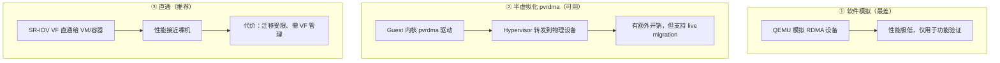
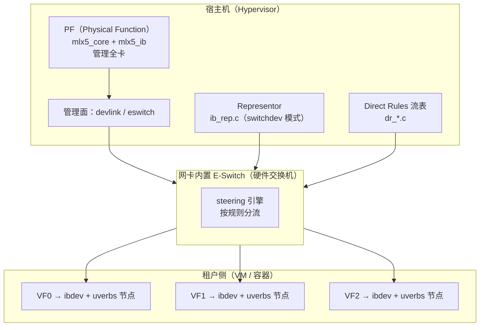
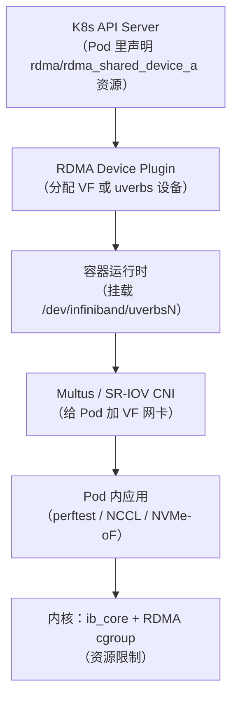

# 第 15 章　虚拟化、容器与多租户 RoCE

> **本章目标**：理解 RoCE 在虚拟化/云/容器环境下的完整软件栈，掌握 SR-IOV、VFIO、representor、多平面等机制。
>
> **配套源码**：`kernel:drivers/infiniband/hw/mlx5/ib_rep.c`、`ib_virt.c`、`kernel:drivers/net/ethernet/mellanox/mlx5/core/{sriov,eswitch,eswitch_offloads}.c`、`esw/devlink_port.c`、`rdma-core:providers/mlx5/mlx5_vfio.c`、`kernel:drivers/infiniband/core/cgroup.c`
>
> **前置阅读**：第 8.12 节（mlx5 侧机制）、第 10.4.3 节（云形态）、第 14.4 节（安全隔离）

---

## 15.1 为什么需要虚拟化 RoCE

```
物理场景：一台服务器 = 一个操作系统 = 直接访问网卡
         ↓ 虚拟化/容器化后
云场景：  一台服务器 = 多个租户（VM 或容器）
         每个租户都需要：独立的 RDMA 设备、独立的资源配额、互不可见
```

**三个核心需求**：

| 需求 | 为什么 | 靠什么实现 |
|---|---|---|
| **性能隔离** | 租户 A 不能拖慢租户 B | SR-IOV VF（硬件队列隔离）+ QoS |
| **资源配额** | 租户 A 不能耗尽网卡的 QP/MR | RDMA cgroup + VF 级限制 |
| **安全隔离** | 租户 A 不能读写租户 B 的内存 | PD + VF + E-Switch 流表（第 14 章的三层） |

---

## 15.2 三种虚拟化方案对比



| 方案 | 代表 | 性能 | 迁移 | 适用 |
|---|---|---|---|---|
| **软件模拟** | QEMU 模拟 | <10% | 容易 | 功能测试 |
| **半虚拟化** | `vmw_pvrdma`（`kernel:drivers/infiniband/hw/vmw_pvrdma/`） | 50–80% | 支持 | 需要迁移且能接受开销 |
| **SR-IOV 直通** | mlx5 VF | **95–100%** | 受限 | **生产首选** |
| **VFIO** | `mlx5_vfio`（用户态驱动） | 接近直通 | 受限 | VM 内无内核驱动或需完全隔离 |

> **【行业重点】生产环境的标准答案是 SR-IOV VF。** 本教程后续都以它为主线。

---

## 15.3 SR-IOV 完整架构

### 15.3.1 组件全景



### 15.3.2 关键概念

| 概念 | 说明 | 源码位置 |
|---|---|---|
| **PF（Physical Function）** | 完整功能的 PCIe 设备，管理员用它管理全卡 | `kernel:drivers/net/ethernet/mellanox/mlx5/core/sriov.c` |
| **VF（Virtual Function）** | 轻量 PCIe 设备，分配给租户；**每个 VF 有自己的 ibdev 与 uverbs 节点** | VF 侧驱动复用 mlx5_ib |
| **E-Switch** | 网卡内置硬件交换机，连接 PF 与所有 VF | `eswitch.c`、`eswitch_offloads.c` |
| **Representor** | 宿主侧代表某个 VF 的网络接口，用于管理和下发规则 | `kernel:drivers/infiniband/hw/mlx5/ib_rep.c` |
| **switchdev 模式** | 把 E-Switch 的转发规则交给宿主软件（如 OVS）控制 | `dev->is_rep` 相关分支 |
| **Direct Rules** | 用户态直接下发流表到 E-Switch | `rdma-core:providers/mlx5/dr_*.c` |

### 15.3.3 【重要】VF 的 RoCE 开关

**默认情况下 VF 可能没有 RoCE 能力**，需要显式开启。这是云平台部署的第一个卡点。

```bash
# ① 查看 PF 与 VF 的端口信息
devlink port show
# 输出示例：
# pci/0000:01:00.0/0: type eth netdev enp1s0f0 flavour physical
# pci/0000:01:00.0/1: type eth netdev enp1s0f0v0 flavour pcivf controller 0 pfnum 0 vfnum 0
# ...

# ② 查看某个 VF 的 RoCE 状态
devlink port function show pci/0000:01:00.0/1
# 关注 roce_enable 字段

# ③ 开启该 VF 的 RoCE
devlink port function set pci/0000:01:00.0/1 roce enable

# ④ 验证：在 VF 里应该能看到 ibdev
# （VF 通常绑定到 vfio-pci 或由 VM 使用；在宿主上可通过对应 uverbs 节点观察）
ls /sys/class/infiniband/
```

**内核实现**（第 8.12 节讲过）：

| 函数 | 位置 | 作用 |
|---|---|---|
| `mlx5_devlink_port_fn_roce_get/set` | `kernel:drivers/net/ethernet/mellanox/mlx5/core/eswitch_offloads.c:5201/5219` | devlink 的 RoCE 开关实现 |
| set 路径 | `eswitch_offloads.c:5256` | `MLX5_SET(cmd_hca_cap, hca_caps, roce, enable)` |
| 状态维护 | `eswitch_offloads.c:5214/5265` | `vport->info.roce_enabled` |
| 初始化 | `kernel:drivers/net/ethernet/mellanox/mlx5/core/eswitch.c:815` | `vport->info.roce_enabled = MLX5_GET(cmd_hca_cap, hca_caps, roce)` |

**挂载点**：`esw/devlink_port.c:135-136, 188-189`。

> **【排障要点】「VF 里看不到 RDMA 设备」的排查顺序**：
> 1. `devlink port function show` 看 `roce_enable` 是否为 true；
> 2. PF 上 `devlink dev param show name enable_roce` 确认全局 RoCE 开着；
> 3. 确认 VF 的 PCI 设备已正确绑定（`lspci -k`）；
> 4. **双端口 RoCE 模式下匹配 source vport 可能失败**（`eswitch_offloads.c:137` 有注释说明这个已知限制）；
> 5. VF 内 `dmesg | grep mlx5` 看驱动加载情况。

### 15.3.4 representor 与 switchdev

```bash
# 查看是否处于 switchdev 模式
devlink dev eswitch show pci/0000:01:00.0
# mode: switchdev 或 legacy

# 切换模式（需要重启网络或重载驱动）
devlink dev eswitch set pci/0000:01:00.0 mode switchdev

# 查看 representor 接口
ip -br link | grep -i rep
# 输出示例：enp1s0f0v0  → 代表 VF0 的 representor
```

**IB 侧的 representor 支持**（`kernel:drivers/infiniband/hw/mlx5/ib_rep.c`）：

- `dev->is_rep` 为真时**跳过** `mlx5_nic_vport_enable_roce()`（`kernel:drivers/infiniband/hw/mlx5/main.c:3826`）；
- **「RDMA 设备在 switchdev 模式」就是这条路径**（`main.c:183-185`）；
- 相关函数：`mlx5_ib_get_rep_uplink_netdev()`（`main.c:190`）、`mlx5_get_rep_roce()`（`main.c:269-270`）。

> **【行业重点】为什么要 switchdev 模式？**
> 因为它让 **宿主软件（OVS、DPDK、自定义控制器）能够编程 E-Switch 的转发规则**，实现：
> - 租户之间的精细隔离（按 VLAN/MAC/IP 分流）；
> - 与传统网络的统一管理（OVS 流表）；
> - 硬件卸载（把 OVS 流表卸载到网卡）。
>
> **代价**：复杂度显著上升，且需要网卡/固件支持。

### 15.3.5 Direct Rules：把规则下发到 E-Switch

第 9.5 节介绍了 DR 的 API。**在 SR-IOV 场景里，DR 的主要用途**：

| 用途 | 说明 |
|---|---|
| **租户流量的接收分流** | 按源 GID/VLAN 把流量导向对应租户的 QP/TIR |
| **FDB（Forwarding Database）规则** | 控制 VF 之间的转发（默认可能互通，需要显式隔离） |
| **计数与采样** | 每个租户的流量统计（`mlx5dv_dr_action_create_flow_counter`、`..._flow_sampler`） |
| **流量整形** | `mlx5dv_dr_action_create_flow_meter` |

```c
/* DR 的典型骨架（第 9.5 节详述） */
domain  = mlx5dv_dr_domain_create(ctx, MLX5DV_DR_DOMAIN_TYPE_FDB);
table   = mlx5dv_dr_table_create(domain, level);
matcher = mlx5dv_dr_matcher_create(table, priority, ...);
/* 匹配租户 A 的流量 */
mlx5dv_dr_matcher_set_layout(matcher, &layout);
action  = mlx5dv_dr_action_create_dest_vport(domain, vport_num);
rule    = mlx5dv_dr_rule_create(matcher, match_params, num, action);
```

---

## 15.4 VFIO：无内核驱动的直通

### 15.4.1 为什么需要 VFIO 路径

标准 SR-IOV 直通需要 **VM 内安装 mlx5 内核驱动**。但有些场景不行：

| 场景 | 原因 |
|---|---|
| 云厂商不允许租户装内核模块 | 安全与合规 |
| 定制内核/精简内核 | 没有 mlx5 驱动 |
| DPDK/SPDK 完全用户态 | 不想加载内核驱动 |
| 需要更强的隔离 | 内核驱动是攻击面 |

**VFIO 方案**：把 VF 通过 `vfio-pci` 直通，**RDMA 由用户态驱动完全接管**。

### 15.4.2 `mlx5_vfio` 用户态驱动

`rdma-core:providers/mlx5/mlx5_vfio.c`（**93KB**）实现了这条路：

| 项 | 内容 |
|---|---|
| 设备 ops | `mlx5_vfio_dev_ops`（`.name = "mlx5_vfio"`，**无 `match_table`**，只实现 `alloc_context`/`uninit_device`） |
| DevX 对象创建 | `vfio_devx_obj_create()` |
| ops 挂载 | `.devx_obj_create = vfio_devx_obj_create` |
| 后备路径 | `mlx5_vfio.c` 自己实现 PCI 资源映射、命令队列等（不依赖内核 mlx5_core） |

**关键洞察**：`mlx5_vfio` **没有 match_table** —— 它不是通过 PCI ID 匹配的，而是通过 VFIO 设备节点打开。而且它只实现 `alloc_context`/`uninit_device`，**所有具体的资源创建都通过 DevX 走固件命令**。

> **【源码启示】`mlx5_vfio.c` 是理解「用户态驱动能做什么」的最佳材料。** 它几乎把内核 `mlx5_core` + `mlx5_ib` 的功能在用户态重新实现了一遍（PCI 映射、命令队列、UAR 分配、DevX 对象管理）。
>
> 读懂它，你就理解了「内核驱动到底提供了什么不可替代的东西」：**只有 DMA/IOMMU 映射与中断需要内核**，其余几乎都能搬到用户态。

---

## 15.5 容器场景（K8s）

### 15.5.1 完整的部署栈



### 15.5.2 三种容器接入模式

| 模式 | 说明 | 隔离性 | 性能 |
|---|---|---|---|
| **共享 uverbs 节点** | 多个 Pod 挂同一个 `/dev/infiniband/uverbsN` | ❌ 差（共享的是设备节点，**不共享 PD**；无资源/性能隔离，资源耗尽风险靠 RDMA cgroup 缓解，restrack 信息互见） | 最好 |
| **每 Pod 独立 VF** | 每个 Pod 拿到独占 VF | ✅ 好 | 好（略低于共享） |
| **每 Pod 独立 VF + 独立 RDMA namespace** | 更彻底的隔离 | ✅ 最好 | 好 |

> **【推荐】** 生产多租户用**每 Pod 独立 VF**。共享 uverbs 只适合「同信任域的多个 Pod」（如同一团队的训练任务）。

### 15.5.3 容器部署的完整检查清单

```bash
# ① 容器能看到设备
docker run --rm -it \
  --device=/dev/infiniband/uverbs3 \
  --device=/dev/infiniband/rdma_cm \
  ubuntu:24.04 bash -c "ls -l /dev/infiniband/"

# ② 容器内能枚举设备
# （需装 ibverbs-utils；前面已给完整示例）

# ③ memlock 限额（第 7.6.2 节的第 ⑧ 步检查）
docker run --rm -it \
  --ulimit memlock=-1:-1 \
  ...
# 或 --cap-add=IPC_LOCK（更简单但权限更大）

# ④ RDMA cgroup 限制（关键！）
ls /sys/fs/cgroup/rdma/           # 存在说明内核启用了 CONFIG_CGROUP_RDMA
# 为某个 cgroup 设置限制（只有 hca_handle / hca_object 两种 token）
echo "mlx5_3 hca_handle=500 hca_object=500" > /sys/fs/cgroup/rdma/<path>/rdma.max

# ⑤ 验证限制生效
cat /sys/fs/cgroup/rdma/<path>/rdma.current

# ⑥ 回滚：两项都恢复成 max（不限额）
echo "mlx5_3 hca_handle=max hca_object=max" > /sys/fs/cgroup/rdma/<path>/rdma.max
```

**`rdma.max` 的语法**：

```
<device> <resource>=<num> [<resource>=<num> ...]
```

可限制的资源类型**只有两种**（`kernel:include/linux/cgroup_rdma.h` 的 `enum rdmacg_resource_type`：`RDMACG_RESOURCE_HCA_HANDLE`、`RDMACG_RESOURCE_HCA_OBJECT`；`include/rdma/rdma_cgroup.h` 这个头文件**并不存在**）：

| token | 记账粒度 |
|---|---|
| `hca_handle=<n>` / `hca_handle=max` | **每 ucontext（handle）** 一个，即每个打开的 `uverbsN` 会话 |
| `hca_object=<n>` / `hca_object=max` | **每 uobject（object）** 一个，即 PD/MR/CQ/QP 等内核侧用户对象各算一个 |

> 内核**没有**按 `qp=` / `mr=` / `ctx=` 细分的 token —— 这类写法会被 `default` 分支直接返回 `-EINVAL`（`kernel:kernel/cgroup/rdma.c:514`–`:543`）；相关的「按对象类型细分限额」接口早已从内核移除。

```bash
# 查看当前限额（rdma.max）与用量（rdma.current）
cat /sys/fs/cgroup/rdma/<path>/rdma.max      # 形如 hca_handle=500 hca_object=500
cat /sys/fs/cgroup/rdma/<path>/rdma.current
# 写入不支持的 token 会直接 -EINVAL（内核不会回显合法值）
```

> **【必会】RDMA cgroup 是容器 RoCE 的安全底线。**
> 没有它，一个 Pod 可以：
> - 注册无限内存（耗尽主机内存 —— 因为 MR 是 pin 住的！）；
> - 创建无限 QP（耗尽网卡资源，影响其他租户）；
> - 创建无限 CQ/MR 对象。
>
> **源码**：`kernel:drivers/infiniband/core/cgroup.c`（**只是 53 行的 shim**，`rdma.max` 的解析与限额实现在 `kernel:kernel/cgroup/rdma.c`），接口在 `core_priv.h` 的 `ib_rdmacg_try_charge/uncharge`。ucontext 记账 `RDMACG_RESOURCE_HCA_HANDLE`（`uverbs_main.c:972-973`），uobject 记账 `RDMACG_RESOURCE_HCA_OBJECT`（`rdma_core.c:476-477`）。

### 15.5.4 K8s 资源声明的写法

```yaml
# Pod 声明 RDMA 资源
apiVersion: v1
kind: Pod
metadata:
  name: roce-test
spec:
  containers:
  - name: app
    image: my-roce-app
    resources:
      limits:
        # 由 RDMA device plugin 提供的资源名
        rdma/rdma_shared_device_a: 1        # 共享模式
        # 或（SR-IOV device plugin）
        mellanox.com/mlnx_rdma: 1           # 独占 VF 模式
    securityContext:
      capabilities:
        add: ["IPC_LOCK"]
    volumeMounts: []
  # 共享模式下通常还需挂载 /dev/infiniband
```

---

## 15.6 多平面与 Multi-Host（进阶）

### 15.6.1 Multi-Plane（多平面）

**问题**：单张网卡的带宽受 PCIe 限制（如 400G 网卡需要 PCIe Gen5 x16），且单点故障。

**方案**：一张物理卡对宿主机暴露多个「平面」，每个平面有独立的 PCIe 接口与 RDMA 设备。

```bash
# 查看平面数
# 注意：本内核未通过 sysfs 暴露 /sys/class/infiniband/*/device/num_plane，
#       `ibv_devinfo -v` 也没有 plane 字段（num_plane 只是固件字段：
#       kernel:drivers/net/ethernet/mellanox/mlx5/core/vport.c:885 读 hca_vport_context.num_port_plane）
# 可用 `devlink dev show`，或直接忽略这项检查

# 相关代码
# kernel:drivers/infiniband/hw/mlx5/main.c:3254 mlx5_ib_get_plane_num()
#   读 vport_ctx.num_plane（:3267）
# main.c:5263 plane_profile
# main.c:3568-3571 core_cap_flags 中的平面分支
```

**特点**：
- 每个平面是独立的 ibdev（如 `mlx5_0`、`mlx5_1`），有独立的 GID 表与端口；
- 对应用来说就像两张网卡（可以多路径聚合或负载分担）；
- 代价：应用要自己处理多平面（多 QP 分配到不同平面）。

### 15.6.2 Multi-Host

**问题**：多台主机共享一张网卡（如刀片服务器、多主机 GPU 系统）。

**方案**：通过 **SMI 设备类型**暴露多个主机视角。

```c
/* kernel:drivers/infiniband/hw/mlx5/main.c:5348 */
mlx5r_mp_probe()         /* "multiport" auxiliary driver 的 probe */
    ... RDMA_DEVICE_TYPE_SMI ...
```

```bash
# 观察：不同主机看到的 ibdev 不同
# 注册时的名字在 main.c:4973-4975：
#   "mlx5_%d"        普通
#   "mlx5_bond_%d"   LAG 激活时
#   sub_dev_name     multi-host/多平面时的子设备名
```

### 15.6.3 RoCE LAG（链路聚合）

**问题**：双口网卡希望做冗余与聚合。

```bash
# 查看 LAG 状态
cat /sys/class/net/<bond>/bonding/mode
devlink dev show

# LAG 相关的内核实现（第 8.12 节）
# kernel:drivers/net/ethernet/mellanox/mlx5/core/lag/lag.c
#   mlx5_lag_is_roce()      :2449
#   mlx5_lag_is_roce_lag()  :1381（要求非 SRIOV 且 legacy 模式）
# IB 侧
# kernel:drivers/infiniband/hw/mlx5/main.c:3655 lag_event()
#   → roce_del_all_netdev_gids() + rdma_roce_rescan_port()（:3689-3691）
# main.c:3716 mlx5_eth_lag_init() → mlx5_cmd_create_vport_lag() + mlx5_lag_demux_init()
```

**RoCE LAG 的关键点**：

| 点 | 说明 |
|---|---|
| **ibdev 名字变化** | LAG 激活时注册为 `mlx5_bond_%d`（`main.c:4975`）—— **应用要能适应名字变化** |
| **GID 表重建** | LAG 状态变化会触发 `roce_del_all_netdev_gids()` + `rdma_roce_rescan_port()` → **`IBV_EVENT_GID_CHANGE`** |
| **AH 的 slave 选择** | `ah->xmit_port = mlx5_lag_get_slave_port(...)`（`ah.c:77-80`） |
| **TX 端口亲和** | `atomic_add_return(1, &dev->port[port].roce.tx_port_affinity)`（`main.c:2315-2321`） |
| **限制** | `mlx5_lag_is_roce_lag()` 要求**非 SRIOV 且 legacy 模式**——**SR-IOV 与 RoCE LAG 不能同时用** |

> **【重要限制】SR-IOV 与 RoCE LAG 互斥。** 这是云平台设计时的硬约束：要 LAG 冗余就得放弃 VF 隔离，反之亦然。

---

## 15.7 【行业重点】多租户 RoCE 的完整隔离设计

把第 14 章的安全要求与本章的虚拟化机制合起来，**一张完整的设计表**：

| 隔离层 | 机制 | 隔离粒度 | 实现位置 |
|---|---|---|---|
| **L1 物理** | 独立网卡/独立端口 | 最高（成本高） | 硬件 |
| **L2 PCIe** | SR-IOV VF | 每租户独立 VF | `sriov.c`、VF 驱动 |
| **L3 硬件队列** | VF 的独立 QP/CQ 队列 | 队列级 | 网卡硬件 |
| **L4 RDMA 对象** | 每租户独立 PD | **硬件强制**（第 14.4.1 节） | `ib_core` |
| **L5 转发规则** | E-Switch + Direct Rules | 流级 | `dr_*.c`、`eswitch_offloads.c` |
| **L6 网络** | VLAN / VRF | 网段级 | 交换机 |
| **L7 资源配额** | RDMA cgroup + VF 限速 | 资源数级 | `cgroup.c` |
| **L8 QoS** | PFC 优先级 + QP rate limit + flow meter | 流级 | `mlx5_qos`、`ibv_modify_qp_rate_limit` |
| **L9 审计** | restrack（`rdma res show`） | 对象级 | `restrack.c` |

**设计原则**：

1. **至少做到 L2+L4+L7 三层**（VF 隔离 + PD 隔离 + cgroup 配额）—— 这是「基本可接受」的多租户；
2. **金融/医疗等强合规场景要再加 L5+L6+L8**（流表 + VLAN + QoS）；
3. **L9 审计是必须的** —— 出事后要能定位到租户。

---

## 15.8 本章自检

1. 三种虚拟化方案的性能与迁移性对比？生产首选哪个？
2. SR-IOV 里 PF、VF、representor、E-Switch 各是什么？
3. 「VF 里看不到 RDMA 设备」的排查顺序？对应哪几条 devlink 命令？
4. switchdev 模式的意义是什么？IB 侧如何标识（`is_rep`）？
5. VFIO 路径（`mlx5_vfio`）解决什么问题？为什么它不需要内核 mlx5 驱动？
6. `mlx5_vfio.c` 的存在说明了「内核驱动不可替代的功能」是什么？
7. 容器里用 RoCE 需要挂载哪两个节点？为什么还需要 `IPC_LOCK` 或 `--ulimit memlock`？
8. RDMA cgroup 限制哪些资源？不启用会有什么后果？
9. RoCE LAG 与 SR-IOV 为什么互斥？
10. 多平面（Multi-Plane）解决什么问题？对应用有什么影响？
11. 多租户 RoCE 的九层隔离设计分别是什么？「基本可接受」要满足哪三层？
12. 为什么「共享 uverbs 节点给多个 Pod」是危险的？

**下一章**：工具链与自动化运维。
