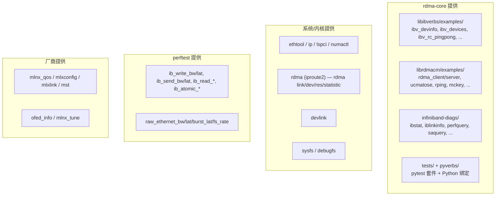
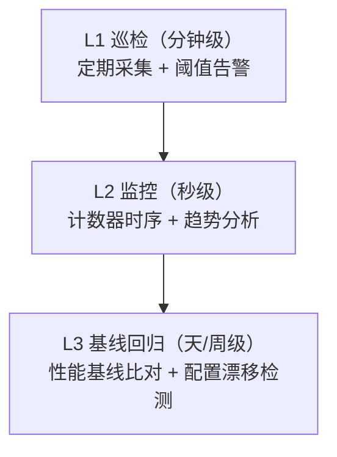

# 第 16 章　工具链与自动化运维

> **本章目标**：把散落在各章的命令系统化成「一套可用的工具链」，并给出自动化运维（巡检、监控、CI）的落地方案。
>
> **配套源码**：`rdma-core:infiniband-diags/`、`rdma-core:libibverbs/examples/`、`rdma-core:librdmacm/examples/`、`rdma-core:tests/`、`rdma-core:pyverbs/`、`kernel:drivers/infiniband/core/restrack.c`
>
> **前置阅读**：[`labs/lab03-tuning-and-troubleshooting.md`](labs/lab03-tuning-and-troubleshooting.md)（统一的 `roce-healthcheck.sh`）

---

## 16.1 工具全景：按来源分类



### 16.1.1 工具与源码的对应（【源码】可追溯）

| 二进制 | 源码位置 | 安装到 |
|---|---|---|
| **`ibv_devinfo`** | `rdma-core:libibverbs/examples/devinfo.c` | `bindir` |
| `ibv_devices` | `rdma-core:libibverbs/examples/device_list.c` | `bindir` |
| `ibv_asyncwatch` | `rdma-core:libibverbs/examples/asyncwatch.c` | `bindir` |
| `ibv_rc_pingpong` / `ibv_uc_pingpong` / `ibv_ud_pingpong` | `rdma-core:libibverbs/examples/{rc,uc,ud}_pingpong.c` | `bindir` |
| `ibv_srq_pingpong` / `ibv_xsrq_pingpong` | `rdma-core:libibverbs/examples/srq_pingpong.c`、`xsrq_pingpong.c` | `bindir` |
| **`ibstat`** | `rdma-core:infiniband-diags/ibstat.c` | **`sbindir`** |
| `iblinkinfo` / `ibnetdiscover` / `ibqueryerrors` | `rdma-core:infiniband-diags/`（同名 `.c`） | `sbindir` |
| `perfquery` / `saquery` / `sminfo` / `smpquery` / `vendstat` | `rdma-core:infiniband-diags/`（同名 `.c`） | `sbindir` |
| `ibping` / `ibtracert` / `ibroute` / `ibaddr` / `ibportstate` | 同上 | `sbindir` |
| `rdma_client` / `rdma_server` | `rdma-core:librdmacm/examples/rdma_client.c`、`rdma_server.c` | `bindir` |
| `ucmatose` / `udaddy` / `rping` / `mckey` / `rcopy` / `cmtime` | `rdma-core:librdmacm/examples/` | `bindir` |
| `rstream` / `riostream` / `rdma_xclient` / `rdma_xserver` | 同上 | `bindir` |

> **【重要区别】`ibv_devinfo` 与 `ibstat` 是两个不同的工具**：
> - `ibv_devinfo`（**纯 libibverbs**）：输出完整的设备能力位、每个端口的 **GID 表及 GID 类型**（RoCE 排查的核心）；
> - `ibstat`（**混用 libibumad + libibverbs**）：输出更接近传统 IB 运维习惯的格式（CA 状态、端口物理状态、速率）。
>
> **RoCE 场景推荐组合**：`ibv_devinfo -v`（看 GID 表与能力）+ `ibstat`（看速率与状态）。

---

## 16.2 按任务分类的工具矩阵

### 16.2.1 「我要知道设备是什么、能不能用」

```bash
# 最可靠的一条：ibdev ↔ netdev 绑定
rdma link show

# 设备与端口总览
ibv_devinfo -l                            # 只列设备名
ibv_devinfo -d <dev>                      # 基本属性
ibv_devinfo -d <dev> -v                   # ★ 完整能力 + GID 表 + GID 类型
ibstat                                    # 所有 CA 的状态
ibstat <dev>                              # 指定 CA

# 底层信息
cat /sys/class/infiniband/<dev>/fw_ver
cat /sys/class/infiniband/<dev>/node_guid
cat /sys/class/infiniband/<dev>/ports/1/{state,phys_state,link_layer,rate}
cat /sys/class/infiniband_verbs/abi_version
cat /sys/class/infiniband_verbs/uverbs<N>/abi_version
```

### 16.2.2 「GID 该怎么选」（RoCE 特有）

```bash
# ① 最直观：show_gids —— 注意这是 **OFED 附带的脚本**，rdma-core 仓库并不包含它
show_gids
# 输出列：DEV / PORT / INDEX / GID / IPv4 / VER / DEV

# ② 用 ibv_devinfo 交叉验证（本仓库环境下的推荐替代）
ibv_devinfo -d <dev> -v | grep -E 'GID\['
# 输出形如 "GID[  3]:  fe80:...:192.168.100.1, RoCE v2"

# ③ 直接读 sysfs（最底层）
for i in /sys/class/infiniband/<dev>/ports/1/gids/*; do
    idx=$(basename $i)
    echo "gid[$idx] = $(cat $i)"
done
for i in /sys/class/infiniband/<dev>/ports/1/gid_attrs/types/*; do
    idx=$(basename $i)
    echo "type[$idx] = $(cat $i)"      # 输出如 "RoCE v2" / "IB/RoCE v1"
done
for i in /sys/class/infiniband/<dev>/ports/1/gid_attrs/ndevs/*; do
    idx=$(basename $i)
    echo "ndev[$idx] = $(cat $i)"      # 对应的 netdev
done
```

**在一行里看清「index / type / ndev」的脚本**：

```bash
#!/bin/bash
# gid_table.sh <ibdev> <port> —— 比 OFED 的 show_gids 更详细（含 ndev）
DEV=${1:-mlx5_0}; PORT=${2:-1}
BASE=/sys/class/infiniband/$DEV/ports/$PORT
printf "%-6s %-12s %-10s %-40s\n" INDEX TYPE NDEV GID
for i in $BASE/gids/*; do
    idx=$(basename $i)
    printf "%-6s %-12s %-10s %-40s\n" \
        "$idx" \
        "$(cat $BASE/gid_attrs/types/$idx 2>/dev/null)" \
        "$(cat $BASE/gid_attrs/ndevs/$idx 2>/dev/null)" \
        "$(cat $i)"
done
```

### 16.2.3 「链路与 QoS」

```bash
# 链路速率/状态
ethtool <netdev>
ethtool -S <netdev> | grep -Ei 'prio[0-9]_pause|pause_ctrl|pfc'
# ★ 这里只能拿到 PFC（rx_prioN_pause / tx_prioN_pause）与链路级 pause；
#   ECN/CNP/重传（np_ecn_marked_roce_packets、roce_adp_retrans 等）不在 ethtool -S，
#   必须读 /sys/class/infiniband/<dev>/ports/1/hw_counters/（见 16.2.4）

# PCIe（第 13.3.3 节）
lspci -vv -s $(basename $(readlink /sys/class/infiniband/<dev>/device)) | grep -E 'LnkCap|LnkSta'

# QoS / PFC（厂商工具）
mlnx_qos -i <netdev>                      # ★ PFC / trust / DSCP 映射总览
lldptool -t -i <netdev> -V PFC            # LLDP 协商结果

# 固件与驱动信息
ethtool -i <netdev>
cat /sys/class/infiniband/<dev>/fw_ver          # 固件版本（sysfs.c 的 fw_ver_show）
cat /sys/class/infiniband_verbs/abi_version     # 核心 uverbs ABI 版本
cat /sys/class/infiniband_verbs/uverbs0/abi_version  # 驱动的 uverbs ABI 版本
modinfo mlx5_ib | grep -E '^filename|srcversion|vermagic'
# ★ 注意：mlx5_ib 未定义 MODULE_VERSION，所以没有 `version` 字段；
#   srcversion/vermagic 只标识内核源码快照，不能判断 OFED 版本
ofed_info -s                                     # OFED 栈版本（若装了 OFED）
```

### 16.2.4 「拥塞控制参数」

```bash
# DCQCN 参数（唯一入口，第 8.10 节）
ls /sys/kernel/debug/mlx5/<PCI>/cc_params/
for f in /sys/kernel/debug/mlx5/<PCI>/cc_params/*; do
    printf "%-42s %s\n" "$(basename $f)" "$(cat $f)"
done

# 相关计数器（注意来源不同：ECN/CNP/重传在 sysfs hw_counters，PFC 在 ethtool -S）
for c in np_ecn_marked_roce_packets np_cnp_sent roce_adp_retrans \
         roce_adp_retrans_to roce_slow_restart roce_slow_restart_cnps; do
    echo "$c = $(cat /sys/class/infiniband/<dev>/ports/1/hw_counters/$c 2>/dev/null)"
done
# ★ 这几个（np_ecn_marked_roce_packets / roce_adp_retrans / roce_slow_restart* 等）
#   只在 sysfs 的 ports/<n>/hw_counters/ 下（kernel:drivers/infiniband/hw/mlx5/counters.c:85/103-106），
#   **ethtool -S 不输出它们**，用 `ethtool -S | grep ...` 会永远空手而归。
#   PFC 计数器才走 ethtool -S（见 16.5.3 的 rx_prioN_pause / tx_prioN_pause）。
```

### 16.2.5 「资源与审计」

```bash
# ★ 内核 restrack：谁在用 RDMA 资源
rdma res show                    # 全部
rdma res show qp                 # QP
rdma res show mr                 # MR
rdma res show cq                 # CQ
rdma res show ctx                # ucontext
rdma res show cm_id              # CM ID
rdma res show srq                # SRQ
rdma res show qp dev <dev>       # ★ 指定设备用 `dev <name>` 过滤；`-d` 是 details，不是 device
# 注：`rdma` 子命令的选项随 iproute2 版本演进，用 `man rdma-res` 核对本机写法
rdma res show -j                 # JSON 输出（便于自动化）

# 计数器
rdma statistic show link
rdma statistic show link -j

# 设备参数（如 RoCE 开关）
devlink dev param show pci/<PCI>
devlink dev param show pci/<PCI> name enable_roce
devlink health show pci/<PCI>
devlink port show
```

> **`rdma res show -j` 输出的 JSON 是自动化运维的关键** —— 可以解析出「哪个进程用了多少 MR/QP」，做趋势监控与异常告警。

### 16.2.6 「协议层调试」

```bash
# 异步事件（第 4.3.9 节）
ibv_asyncwatch -d <dev>           # 在一个终端跑，另一个终端压测

# netlink 层的 RDMA 事件
rdma monitor                       # 实时看 RDMA netlink 事件

# 抓包（第 2.9 节）
tcpdump -i <netdev> -nn -s 0 -w /tmp/roce.pcap 'udp port 4791'
tcpdump -i <netdev> -nn -c 10 -v -X 'udp port 4791'   # 直接看十六进制

# 内核 trace（调试内核路径）
ls /sys/kernel/debug/tracing/events/rdma_core/     # 核心 verbs/PD/CQ/QP tracepoint
ls /sys/kernel/debug/tracing/events/rdma_cma/      # RDMA CM 事件
ls /sys/kernel/debug/tracing/events/ib_cma/        # CM 协议层
ls /sys/kernel/debug/tracing/events/mlx5/          # mlx5 驱动（由 net 驱动注册）
# ★ 注意：**没有** rdma/ 这个 trace 组（/sys/kernel/debug/tracing/events/rdma/ 不存在），
#   也**没有** mlx5_ib 组。真实 TRACE_SYSTEM 名是：
#   rdma_core（kernel:include/trace/events/rdma_core.h:11）、
#   rdma_cma（kernel:drivers/infiniband/core/cma_trace.h:11）、
#   ib_cma（kernel:drivers/infiniband/core/cm_trace.h:11）、
#   mlx5（kernel:drivers/net/ethernet/mellanox/mlx5/core/diag/*_tracepoint.h）
echo 1 > /sys/kernel/debug/tracing/events/rdma_cma/enable
cat /sys/kernel/debug/tracing/trace_pipe
```

### 16.2.7 「性能与正确性」

```bash
# 基线（第 13.6 节）
ib_write_bw -d <dev> -i 1 -x <gid> --report_gbits -F -a -N
ib_write_lat -d <dev> -i 1 -x <gid> -F --pin_cores=2,3

# 正确性
ib_write_bw ... --data_validation -t 128
ib_send_bw  ... --data_validation -t 128
ib_read_bw  ... --data_validation -t 128 -q 4

# JSON 输出（自动化）
ib_write_bw ... --out_json --out_json_file=/tmp/w.json
# 提取关键字段（需要 jq）：顶层是单个对象，字段在 .results 下
jq -r '.results | select(.MsgSize==65536) | .BW_average' /tmp/w.json
# 注意：--out_json 每次都以 O_TRUNC 重开文件，-a 跑完只剩最后一个尺寸的结果
```

---

## 16.3 `infiniband-diags` 工具逐个说明（含 RoCE 适用性）

第 16.1.1 节给出了源码位置。这里给出**每个工具的用途与 RoCE 适用性**（重要：很多工具是为 IB 设计的，对 RoCE 不适用）：

| 工具 | 用途 | **RoCE 适用性** |
|---|---|---|
| **`ibstat`** | CA/端口状态、速率、物理状态 | ✅ **适用**（混用 umad + verbs） |
| **`ibv_devinfo`** | 设备能力 + GID 表 + GID 类型 | ✅ **必须用** |
| `ibv_devices` | 设备名 + GUID 列表 | ✅ 适用 |
| **`perfquery`** | 端口性能计数器（`PortCounters` 等） | ⚠️ **部分适用**：基于 SMP/MAD，纯 RoCE 环境可能拿不到数据；**RoCE 应优先用 `ethtool -S` 与 sysfs counters** |
| `iblinkinfo` | 链路宽度/速度拓扑 | ❌ **不适用**（基于 SMP，RoCE 无 SM） |
| `saquery` | 查询 SA（path record / service record） | ❌ **不适用**（RoCE 无 SA；等价功能由 `ibacm` 在用户态完成） |
| `sminfo` / `smpquery` / `smpdump` / `ibroute` / `ibtracert` | SM 与路由相关 | ❌ **不适用**（RoCE 无 SM） |
| `ibnetdiscover` | fabric 拓扑发现 | ❌ 不适用 |
| `ibqueryerrors` | 批量查询错误计数 | ⚠️ 基于 `perfquery`，见上 |
| `ibping` / `ibsysstat` | IB 层 ping | ❌ 不适用 |
| `vendstat` | 厂商特定统计 | ⚠️ 视厂商支持 |
| `ibccquery` / `ibccconfig` | Congestion Control（IB 的 CC） | ⚠️ **这是 IB 的 CC，不是 RoCE 的 DCQCN**；RoCE 用 `/sys/kernel/debug/mlx5/<PCI>/cc_params/` |
| `ibcacheedit` | 编辑 GID/PKey 缓存 | ⚠️ 调试用 |

> **【行业重点】这是 RoCE 新手最容易踩的工具链陷阱。**
> 网上大量 IB 教程推荐 `iblinkinfo` / `saquery` / `sminfo` —— **这些工具在纯 RoCE 环境里全都没用**，因为 RoCE 没有子网管理器（SM）与子网管理包（SMP）。
>
> **RoCE 的工具链核心是**：
> 1. **rdma-core**：`ibv_devinfo`、`ibstat`、`rdma link`（`show_gids` 属 OFED 脚本集，rdma-core 不含）
> 2. **内核/系统**：`rdma res`、`ethtool -S`、`sysfs counters`（`ports/<n>/hw_counters/`）、`/sys/kernel/debug/mlx5/*/cc_params/`
> 3. **厂商**：`mlnx_qos`、`mlxconfig`、`mlxlink`
> 4. **交换机侧**：PFC/ECN 计数器与配置查看

---

## 16.4 pyverbs：用 Python 做实验

第 9 章提过 pyverbs。**对运维与自动化来说，它是「写小工具最快的方式」。**

### 16.4.1 模块清单（`rdma-core:pyverbs/`，已核对）

| 模块 | 内容 |
|---|---|
| `device.pyx` | `Device`、`Context`、`DeviceAttr`、`DeviceAttrEx`、`PortAttr`、`GIDEntry`、`AsyncEvent`、`DM`、`FdArr` |
| `pd.pyx` / `mr.pyx` / `cq.pyx` / `qp.pyx` / `srq.pyx` / `wq.pyx` / `wr.pyx` / `xrcd.pyx` | 对应对象的 Python 封装 |
| `cmid.pyx` / `addr.pyx` / `librdmacm.pyx` | RDMA CM（`CMID`、`ConnParam`、事件） |
| `flow.pyx` / `spec.pyx` | flow steering（`Flow`、`FlowAttr`、各类 spec） |
| `comp_cntr.pyx` | 完成计数器 |
| `mem_alloc.pyx` / `dmabuf.pyx` / `dma_util.pyx` | 内存分配 / dma-buf |
| `libibverbs.pyx` / `libibverbs_enums.pyx` | 常量的 Python 枚举 |
| `librdmacm.pyx` / `librdmacm_enums.pyx` | CM 相关 |
| `fork.pyx` | fork 支持 |
| `utils.py` / `pyverbs_error.py` | 工具与异常 |

**import 形式**（每个 `.pyx` 是一个独立模块）：

```python
from pyverbs.device import Context
from pyverbs.pd import PD
from pyverbs.cq import CQ
from pyverbs.qp import QP, QPInitAttr, QPAttr
from pyverbs.mr import MR
from pyverbs.libibverbs_enums import ibv_qp_type, ibv_qp_state, ibv_access_flags
import pyverbs.device as d
```

### 16.4.2 实用的运维小工具示例

```python
# gid_report.py —— 用 pyverbs 打印 GID 表（比 shell 脚本更结构化）
# 用法：python3 gid_report.py mlx5_0
import sys
from pyverbs.device import Context
from pyverbs.pyverbs_error import PyverbsError

def main(dev_name):
    ctx = Context(name=dev_name)
    try:
        port_attr = ctx.query_port(1)
        print(f"device={dev_name} port=1 gid_tbl_len={port_attr.gid_tbl_len} "
              f"link_layer={port_attr.link_layer} state={port_attr.state}")
        for i in range(port_attr.gid_tbl_len):
            try:
                gid = ctx.query_gid(1, i)
                if gid is None:
                    continue
                # 只打印非全零 GID
                if any(gid.raw):
                    try:
                        gtype = ctx.query_gid_type(1, i)
                    except PyverbsError:
                        gtype = "?"
                    print(f"  gid[{i:2d}] type={gtype:<12} {gid}")
            except PyverbsError:
                continue
    finally:
        ctx.close()

if __name__ == '__main__':
    main(sys.argv[1] if len(sys.argv) > 1 else 'mlx5_0')
```

> **【注意】** pyverbs 的 API 细节随版本演进。上面的函数名（`query_port`、`query_gid`、`query_gid_type`、`gid_tbl_len`）来自 `pyverbs/device.pyx` 的类定义。**实际使用时请以你安装版本的 `pyverbs/device.pyx` 为准**（或用 `python3 -c "from pyverbs.device import Context; help(Context)"` 查看）。

---

## 16.5 自动化运维

### 16.5.1 三层自动化



### 16.5.2 L1：巡检脚本（[`labs/lab03-tuning-and-troubleshooting.md`](labs/lab03-tuning-and-troubleshooting.md) 的 Section F）

见 [`labs/lab03-tuning-and-troubleshooting.md`](labs/lab03-tuning-and-troubleshooting.md) 的 Section F —— 那里给出了完整的六层检查脚本。**把它放进 cron 或 systemd timer**：

```ini
# /etc/systemd/system/roce-healthcheck.service
[Unit]
Description=RoCE health check
[Service]
Type=oneshot
ExecStart=/usr/local/sbin/roce-healthcheck.sh

# /etc/systemd/system/roce-healthcheck.timer
[Unit]
Description=Run RoCE health check every 5 minutes
[Timer]
OnBootSec=2min
OnUnitActiveSec=5min
[Install]
WantedBy=timers.target
```

### 16.5.3 L2：监控指标采集

**建议采集的指标清单**：

| 类别 | 指标 | 来源 | 告警阈值 |
|---|---|---|---|
| **链路** | 速率、`LnkSta` vs `LnkCap` | `ethtool`、`lspci` | 不一致即告警 |
| **端口** | `state`、`phys_state` | sysfs | 非 ACTIVE 告警 |
| **错误** | `port_rcv_errors`、`port_xmit_discards` | sysfs counters | > 0 告警 |
| **缓冲** | `out_of_buffer` | hw_counters | > 0 告警 |
| **重传** | `roce_adp_retrans`、`roce_adp_retrans_to` | hw_counters | **> 0 立即告警**（第 12.6.3 节） |
| **拥塞** | `np_ecn_marked_roce_packets`、`roce_slow_restart_cnps` | hw_counters | 增长率异常告警 |
| **PFC** | `rx_prioN_pause` / `tx_prioN_pause` | `ethtool -S` | 增长率超阈值告警 |
| **资源** | QP/MR/CTX 数量（按进程） | `rdma res show -j` | 接近上限告警 |
| **配置** | DCQCN 参数、PFC 配置 | debugfs、`mlnx_qos` | **与基线不一致告警**（配置漂移） |
| **性能** | `ib_write_bw` 基线 | perftest | 低于基线 90% 告警 |

**Prometheus 采集示例**（用 `node_exporter` 的 textfile collector）：

```bash
#!/bin/bash
# roce_metrics.sh —— 输出 Prometheus 格式，由 node_exporter textfile collector 采集
OUT=/var/lib/node_exporter/textfile/roce.prom
TMP=$(mktemp)

DEV=mlx5_0
NETDEV=enp1s0f0
PORT_DIR=/sys/class/infiniband/$DEV/ports/1

emit() { echo "$1 $2" >> $TMP; }

# 端口状态（sysfs 的 state 输出形如 "4: ACTIVE"，必须取第一个字段才是数字）
#            （kernel:drivers/infiniband/core/sysfs.c:223-224）
_state=$(awk '{print $1}' $PORT_DIR/state 2>/dev/null)
emit "roce_port_state{dev=\"$DEV\"}" "${_state:-0}"

# 标准计数器
for c in port_rcv_errors port_xmit_discards port_rcv_data port_xmit_data; do
    v=$(cat $PORT_DIR/counters/$c 2>/dev/null || echo 0)
    emit "roce_$c{dev=\"$DEV\"}" "$v"
done

# 驱动计数器（关键：重传与拥塞）
for c in out_of_buffer roce_adp_retrans roce_adp_retrans_to \
         roce_slow_restart_cnps np_ecn_marked_roce_packets; do
    v=$(cat $PORT_DIR/hw_counters/$c 2>/dev/null || echo 0)
    emit "roce_$c{dev=\"$DEV\"}" "$v"
done

# PFC 计数（mlx5 的真实计数器名是 rx_prioN_pause / tx_prioN_pause）
for p in 0 1 2 3 4 5 6 7; do
    for d in rx tx; do
        v=$(ethtool -S $NETDEV 2>/dev/null | awk -F: "/${d}_prio${p}_pause:/{gsub(/ /,\"\",\$2); print \$2}")
        [ -n "$v" ] && emit "roce_pfc_pause_${d}{dev=\"$DEV\",prio=\"$p\"}" "$v"
    done
done

# 资源数量（restrack）
if command -v rdma >/dev/null && command -v jq >/dev/null; then
    qps=$(rdma res show qp -j 2>/dev/null | jq 'length' 2>/dev/null || echo 0)
    mrs=$(rdma res show mr -j 2>/dev/null | jq 'length' 2>/dev/null || echo 0)
    emit "roce_qp_total{dev=\"$DEV\"}" "$qps"
    emit "roce_mr_total{dev=\"$DEV\"}" "$mrs"
fi

mv $TMP $OUT
```

**告警规则示例（Prometheus）**：

```yaml
groups:
- name: roce
  rules:
  - alert: RoCERetransmission
    expr: increase(roce_roce_adp_retrans[5m]) > 0
    annotations:
      summary: "RoCE 出现重传（dev {{ $labels.dev }}）—— 网络在丢包，请检查 PFC/ECN"
  - alert: RoCEOutOfBuffer
    expr: increase(roce_out_of_buffer[5m]) > 0
    annotations:
      summary: "RoCE 网卡缓冲不足 —— PFC/ECN 配置或带宽规划有问题"
  - alert: RoCEPortNotActive
    expr: roce_port_state != 4
    annotations:
      summary: "RoCE 端口非 ACTIVE"
  - alert: RoCEPFCPauseStorm
    expr: rate(roce_pfc_pause_rx[1m]) > 1000
    annotations:
      summary: "PFC PAUSE 速率异常 —— 可能的 PFC 风暴或过度拥塞"
```

### 16.5.4 L3：配置漂移检测

**这是最容易被忽略但价值最高的一环。** 第 11.7.2 节讲过 DCQCN 参数不持久化的问题 —— 配置漂移是 RoCE 集群「性能逐渐变差」的主因之一。

```bash
#!/bin/bash
# roce_config_snapshot.sh —— 采集全部 RoCE 相关配置，用于漂移对比
DEV=${1:-mlx5_0}
NETDEV=${2:-enp1s0f0}
PCI=$(basename $(readlink /sys/class/infiniband/$DEV/device))
OUT=${3:-/var/lib/roce/config-$(date +%F).txt}

{
    echo "### date";            date -Is
    echo "### kernel";          uname -r
    echo "### fw";              cat /sys/class/infiniband/$DEV/fw_ver
    echo "### mlnx_qos";        mlnx_qos -i $NETDEV 2>/dev/null
    echo "### netdev mtu";      cat /sys/class/net/$NETDEV/mtu
    echo "### ib mtu";          ibv_devinfo -d $DEV -v 2>/dev/null | grep -E 'active_mtu|max_mtu'
    echo "### dcqcn"; \
        for f in /sys/kernel/debug/mlx5/$PCI/cc_params/*; do
            [ -f "$f" ] && echo "$(basename $f)=$(cat $f)"
        done
    echo "### gid 表（本机自采，不依赖 show_gids）"
    for i in /sys/class/infiniband/$DEV/ports/1/gids/*; do
        idx=$(basename $i)
        echo "gid[$idx]=$(cat $i) type=$(cat /sys/class/infiniband/$DEV/ports/1/gid_attrs/types/$idx 2>/dev/null)"
    done
    echo "### devlink params";  devlink dev param show pci/$PCI 2>/dev/null
    echo "### cpu governor";    cat /sys/devices/system/cpu/cpu0/cpufreq/scaling_governor 2>/dev/null
    echo "### memlock";         ulimit -l
} > $OUT 2>&1

echo "snapshot written to $OUT"
```

```bash
# 与上次快照对比（配置漂移检测）
diff <(grep -v '^### date' /var/lib/roce/config-2025-01-01.txt) \
     <(grep -v '^### date' /var/lib/roce/config-2025-02-01.txt)
# 有任何差异都应该审查：是有人改的？还是重启后丢了？
```

### 16.5.5 CI 集成：把性能基线纳入流水线

```yaml
# .gitlab-ci.yml 或 GitHub Actions 片段（概念性）
roce-regression:
  stage: test
  tags: [roce-runner]          # 有 RoCE 硬件的 runner
  script:
    - make -C perftest
    # 1. 正确性（先确保对）
    - ./ib_write_bw -d mlx5_0 -i 1 -x 3 --data_validation -t 128 &
    - sleep 2
    - ./ib_write_bw -d mlx5_0 -i 1 -x 3 --data_validation -t 128 <peer> || exit 1
    - wait
    # 2. 性能（与基线对比）
    - ./ib_write_bw -d mlx5_0 -i 1 -x 3 --report_gbits -F -s 65536 -n 5000 \
        --out_json --out_json_file=bw.json <peer>
    - |
      BW=$(jq -r '.results | select(.MsgSize==65536) | .BW_average' bw.json)
      BASE=190
      THRESH=$(echo "$BASE * 0.9" | bc)
      if (( $(echo "$BW < $THRESH" | bc -l) )); then
        echo "FAIL: BW $BW < 90% of baseline $BASE"; exit 1
      fi
  rules:
    - if: '$CI_PIPELINE_SOURCE == "schedule"'    # 只在定时任务跑
```

> **【实践建议】性能回归测试要「定时跑」而不是「每次提交跑」**：性能受环境影响大，频繁跑会产生大量误报。**建议每日一次，且记录环境状态**（温度、其他负载、并发任务）。

---

## 16.6 应急工具箱（出故障时先跑这些）

```bash
#!/bin/bash
# roce-emergency.sh —— 故障时一键采集现场信息（不修改任何配置）
DEV=${1:-mlx5_0}
NETDEV=${2:-$(ls /sys/class/infiniband/$DEV/device/net/ 2>/dev/null | head -1)}
PCI=$(basename $(readlink /sys/class/infiniband/$DEV/device))
DIR=/tmp/roce-diag-$(date +%Y%m%d-%H%M%S)
mkdir -p $DIR

echo "Collecting to $DIR ..."

{
    echo "=== 时间与负载 ==="; date -Is; uptime
    echo "=== 内核与版本 ==="; uname -a; ofed_info -s 2>/dev/null
    echo "=== 设备 ==="; rdma link show
    echo "=== GID 表 ==="; show_gids 2>/dev/null || \
        for i in /sys/class/infiniband/$DEV/ports/*/gids/*; do echo "$i: $(cat $i)"; done
    echo "=== 端口状态 ==="; ibstat $DEV 2>/dev/null; \
        cat /sys/class/infiniband/$DEV/ports/*/state 2>/dev/null
    echo "=== MTU ==="; cat /sys/class/net/$NETDEV/mtu; \
        ibv_devinfo -d $DEV -v 2>/dev/null | grep -E 'mtu'
    echo "=== ethtool ==="; ethtool $NETDEV; ethtool -i $NETDEV
    echo "=== PCIe ==="; lspci -vv -s $PCI | grep -E 'LnkCap|LnkSta'
    echo "=== QoS/PFC ==="; mlnx_qos -i $NETDEV 2>/dev/null
    echo "=== DCQCN ==="; for f in /sys/kernel/debug/mlx5/$PCI/cc_params/*; do
        [ -f "$f" ] && echo "$(basename $f)=$(cat $f)"; done
    echo "=== 计数器（标准） ==="; for f in /sys/class/infiniband/$DEV/ports/*/counters/*; do
        echo "$(basename $f)=$(cat $f)"; done
    echo "=== 计数器（hw） ==="; for f in /sys/class/infiniband/$DEV/ports/*/hw_counters/*; do
        echo "$(basename $f)=$(cat $f)"; done
    echo "=== ethtool -S ==="; ethtool -S $NETDEV
    echo "=== 资源 ==="; rdma res show; rdma statistic show link
    echo "=== 资源（JSON） ==="; rdma res show -j 2>/dev/null
    echo "=== dmesg ==="; dmesg -T | grep -iE 'mlx5|rdma|infiniband|roce' | tail -200
    echo "=== devlink ==="; devlink health show pci/$PCI 2>/dev/null
    echo "=== 中断 ==="; grep -E 'mlx5|infiniband' /proc/interrupts
    echo "=== 计划任务 ==="; systemctl list-timers --no-pager 2>/dev/null | head -20
} > $DIR/report.txt 2>&1

# 打包
tar czf $DIR.tar.gz -C $(dirname $DIR) $(basename $DIR)
echo "Done: $DIR.tar.gz"
echo
echo "接下来："
echo "  1. 用第 12 章的分层法定位"
echo "  2. 用第 11.6.3 节的判读矩阵分析 PFC/ECN"
echo "  3. 与基线快照对比（第 16.5.4 节）"
```

> **【重要】应急脚本的第一原则是「不修改任何配置」。**
> 故障现场一旦被改变，根因分析就失败了。**先采集，再动手。**

---

## 16.7 本章自检

1. `ibv_devinfo` 与 `ibstat` 有什么区别？RoCE 场景推荐怎么用组合？
2. 列出三个在纯 RoCE 环境里**不适用**的 `infiniband-diags` 工具，并说明原因。
3. 怎么用一行命令看清「GID index / type / ndev」的对应关系？
4. `rdma res show` 输出中的哪些信息对安全审计最有价值？
5. DCQCN 参数的查看路径是什么？为什么必须做配置漂移检测？
6. 写出至少五个「应该立即告警」的计数器及其含义。
7. 为什么性能回归测试建议「定时跑」而不是「每次提交跑」？
8. 应急采集脚本的第一原则是什么？为什么？
9. `rdma res show -j` 在自动化里的价值是什么？
10. 用 pyverbs 写一个小工具相比写 C 有什么优劣？

**下一章**：专家成长路线 —— 你还需要学什么、怎么学。
