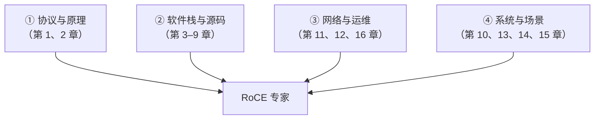

# 第 17 章　成为 RoCE 专家：能力模型与成长路线

> **本章目标**：给你一张「可自我评估的能力地图」和一个「有明确产出的学习计划」。读完你能回答：我现在在哪一级、下一步该学什么、怎么证明我学到了。
>
> **配套源码**：本章是路线图，引用散落各章。建议先通读第 1.7 节的 L1–L5 能力分层，再读本章。

---

## 17.1 能力模型：五级 + 四个维度

### 17.1.1 纵向：五级能力（第 1.7 节的展开）

| 级别 | 名称 | 核心标志 | 对应章节 | 自测问题 |
|---|---|---|---|---|
| **L1** | 会用 | 能独立跑通 perftest 并看懂输出 | 1、6、实验 1 | 能在一台新机器上 30 分钟内跑通 `ib_write_bw` 吗？ |
| **L2** | 会调 | 能解释数字、能做 A/B 实验、会定位常见故障 | 11、12、13 | 带宽只有一半时，你能在 10 分钟内给出三个可能原因并验证吗？ |
| **L3** | 会写 | 能写正确的 verbs 程序（含错误处理与异步事件） | 4、5、14 | 能不看资料写出 RC + RDMA WRITE + 异步事件线程吗？ |
| **L4** | 懂内部 | 能追踪从 API 到硬件的完整链路，能读驱动源码改行为 | 7、8、9、15 | 能画出 `ibv_post_send` 到门铃写的完整路径吗？ |
| **L5** | 懂体系 | 能设计 RoCE 网络与多租户方案，能做容量规划 | 10、11、15、16 | 能为一套 500 节点的 AI 集群设计 RoCE 方案吗？ |

**重要的非对称性**：

> **L1→L2 靠实践（3–6 个月），L2→L3 靠写代码（3–6 个月），L3→L4 靠读源码（6–18 个月），L4→L5 靠「负责一个真实系统」（1–3 年）。**
>
> **大多数人卡在 L2→L3**：会跑测试但不敢写程序。**突破方法只有一个：写一个真实项目。**

### 17.1.2 横向：四个能力维度

只在一个维度强不构成专家。**真正的专家在四个维度上都有足够深度**：



| 维度 | 必须掌握 | 常见短板 |
|---|---|---|
| **协议与原理** | 报文格式、传输类型语义、可靠性与拥塞机制 | 「只知道 `ib_write_bw`」 |
| **软件栈与源码** | 四层架构、uverbs ABI、WQE/CQE、provider 机制 | 「只会调 API，不知道底下发生了什么」 |
| **网络与运维** | PFC/ECN/DCQCN 配置与排障、计数器解读、基线管理 | 「出了网络问题就推给网络团队」 |
| **系统与场景** | 各生态位的要求、性能工程、安全隔离、虚拟化 | 「只会在裸机上测性能」 |

> **【行业重点】面试时的区分度主要来自后两个维度。**
> 「会写 verbs 程序」的候选人很多；**「能解释 PFC 频繁触发时带宽为什么上不去，并给出调整方案」的人很少**。

---

## 17.2 学习计划：12 个月路线图

### 阶段一：建立正确认知（第 1–4 周）

| 周 | 目标 | 产出 | 验收 |
|---|---|---|---|
| 1 | 通读第 1–3 章；搭起实验环境（实验 1） | 能跑通 `ib_write_bw`/`ib_write_lat` | 有一段自己的带宽/延迟数字 |
| 2 | 通读第 2 章 + 实验 4（抓包分析） | **能逐字节解释一个 RoCEv2 报文** | 交出标注过的 pcap 分析 |
| 3 | 通读第 4 章；精读 `rdma-core:libibverbs/examples/rc_pingpong.c` | 能画出 verbs 对象树与 QP 状态机 | 手绘两张图（不看资料） |
| 4 | 通读第 5 章；跑通 RDMA_CM 客户端/服务端 | **两个能跑的程序** | 编译运行成功并打印收发的数据 |

**阶段一的常见错误**：跳过第 2 章直接学编程。**不抓一次包、不逐字节看一个报文，后面所有「为什么」都会是黑盒。**

### 阶段二：动手写代码（第 2–4 个月）

| 月 | 目标 | 产出 | 验收 |
|---|---|---|---|
| 2 | 完成第 5 章的 10 个练习 | RDMA WRITE / WRITE_WITH_IMM / READ / UD 全部跑通 | 每个练习都能解释 WC 状态码 |
| 3 | 给练习加上生产级设施：异步事件线程、错误恢复、MR 池 | 一个「像样」的小库 | 制造端口抖动与 QP 错误，程序能恢复 |
| 4 | 选一个真实场景做端到端：简易 KV 存储 / 文件传输 / 消息队列 | **一个真实的 RDMA 应用** | 有正确性校验，能长时间稳定运行 |

**阶段二的关键**：**必须有一个「真实项目」**。跑 pingpong 不算。你的项目要解决一个自己的真实需求（哪怕很小），这样才会遇到真实问题。

**推荐的项目难度梯度**：
1. 用 RDMA WRITE 实现一个「远端内存读写库」（最简单）；
2. 加上 RDMA READ 与原子操作；
3. 加上多线程多 QP；
4. 加上断线重连与优雅关闭；
5. 加上正确性校验与性能统计。

### 阶段三：读懂源码（第 5–9 个月）

| 月 | 目标 | 产出 |
|---|---|---|
| 5 | 第 7 章：内核 ib_core / uverbs | 能追踪一次 `ibv_reg_mr` 的完整内核链路（含 `ib_umem_get_*` 与固件命令） |
| 6 | 第 8 章：mlx5_ib 数据路径 | 能解释 `mlx5r_ring_db()` 的每一步与 BlueFlame 触发条件 |
| 7 | 第 9 章：libibverbs / libmlx5 用户态 | 能写一个最小的第三方 provider（哪怕只支持一个操作） |
| 8 | 第 7 章的 RoCE 专章 + `rdma-core:librdmacm/cma.c` | 能解释 RDMA CM 的完整地址/路由解析（含 GID 四层选择） |
| 9 | 再读一个 provider（`erdma` 或 `rxe`）对比 | 一份「两个 provider 的实现对比」笔记 |

**阶段三的方法**：**用「问题驱动」读源码**，不要从第一行读到最后一行。例如：

> 问题：「我改了 IP，为什么程序连不上了？」
> → 追 `IBV_EVENT_GID_CHANGE` → `roce_gid_mgmt.c` → `cache.c` → `mlx5_ib` 的 `set_roce_addr` → 固件 `SET_ROCE_ADDRESS`
> **追完这一条链，你就掌握了 RoCE GID 的完整机制。**

### 阶段四：掌握网络与体系（第 10–12 个月）

| 月 | 目标 | 产出 |
|---|---|---|
| 10 | 第 11 章：PFC/ECN/DCQCN 完整配置 | 在测试环境搭一套无损网络并验证（含故障注入） |
| 11 | 第 12 章 + 第 16 章：排障方法论与自动化 | 一套巡检脚本 + 监控指标 + 基线体系 |
| 12 | 第 13–15 章：性能工程、安全、虚拟化 | 一份完整的「RoCE 部署方案」文档（含容量规划、隔离设计、运维方案） |

---

## 17.3 关键技能清单（可勾选自评）

### 17.3.1 协议层（L1–L2 必会）

```
□ 能画出 RoCEv2 报文的完整分层（Eth | IP | UDP(4791) | BTH | 扩展头 | Payload | ICRC）
□ 能说出 BTH 每个字段的含义（含 FECN/BECN、SE、pad、Tver）
□ 能说出 RETH/DETH/AETH 各自的字段与使用场景
□ 能解释 ICRC 覆盖哪些字段、屏蔽哪些字段，以及为什么
□ 能计算 RoCE MTU 与 netdev MTU 的关系（帧开销 58/62/78：v2+IPv4 / +VLAN / +IPv6；
   netdev MTU 需按内核 96 字节口径 >= 4192，实践设 4200）
□ 能说出 RC/UC/UD/XRC/DC 的能力差异（含"哪些能做 READ"）
□ 能解释"RDMA WRITE 与 SEND 的本质区别"
□ 能说出 UDP 源端口熵的算法（`rdma_flow_label_to_udp_sport` / `rdma_calc_flow_label`）
□ 能解释为什么 C1（`lqpn × rqpn`）是对称的
```

### 17.3.2 编程层（L3 必会）

```
□ 能不看资料写出 RC 的完整建连序列（INIT→RTR→RTS 的所有掩码与字段）
□ 能解释 RoCE 下 is_global / sgid_index / dgid 的作用
□ 能正确区分 WRITE 与 READ 的 SGE 方向
□ 能处理所有关键 WC 状态码（并知道各自的原因与处理）
□ 能实现异步事件线程并处理 GID_CHANGE / PORT_ERR / QP_FATAL
□ 能设计 MR 注册策略（最小权限、最小范围、复用、大页）
□ 能实现稀疏 SIGNALED 与批量投递
□ 能正确销毁资源（逆序、处理 destroy_cq 阻塞问题）
□ 知道 imm_data 的字节序问题
□ 知道 UD 收到的数据含 40 字节 GRH
```

### 17.3.3 源码层（L4 必会）

```
□ 能画出四层架构（应用 / API / 内核 / 硬件）及每层的产物
□ 能说出 `/dev/infiniband/uverbsN` 的两条 syscall 路径与它们的差异
□ 能解释 ib_uobject 的两套计数（kref ref / atomic_t usecnt）与销毁的三种 reason
□ 能追踪一次 ibv_create_qp 从用户态到固件命令的完整链路
□ 能解释 `mlx5r_ring_db()` 的三个步骤与两个 `wmb()` 的作用
□ 能说出 UAR / BlueFlame / doorbell record 三者的区别与联系
□ 能解释 CQE 的 owner 位如何让用户态无锁轮询
□ 能解释 RoCE 的 GID 表如何从 netdev 的 IP/VLAN 自动生成
□ 能解释为什么 `ib_get_net_dev_by_params()` 对 RoCE 返回 NULL
□ 能说出 provider 插件机制（PABI 版本、命名、加载、匹配）
□ 能解释"为什么数据路径零内核参与"
```

### 17.3.4 网络与运维层（L5 必会）

```
□ 能设计 DSCP → PCP → TC → 队列的完整映射并逐跳核对
□ 能独立配置网卡与交换机的 PFC/ECN
□ 能通过 /sys/kernel/debug/mlx5/<PCI>/cc_params/ 调 DCQCN 参数
□ 能解读 PFC/ECN/CNP/重传计数器并给出诊断结论
□ 能用第 12 章的分层法在 30 分钟内定位大部分问题
□ 能识别并处理 PFC 风暴（含应急顺序）
□ 能建立性能基线并做漂移检测
□ 能写出巡检与监控脚本
□ 能解释"单 QP 带宽 ÷ ECMP 路径数"这条经验公式
□ 能判断 PCIe / NUMA 是否成为瓶颈
```

### 17.3.5 体系与安全层（L5 必会）

```
□ 能说出存储/AI/HPC/云四类场景对 RoCE 的不同要求
□ 能解释 GPUDirect RDMA 为什么走 dma-buf
□ 能设计多租户 RoCE 的九层隔离（至少做到 PD + VF + cgroup）
□ 能说明 rkey 的威胁模型与十条管理规则
□ 能解释 PD 的隔离边界（能隔离什么、不能隔离什么）
□ 能配置 RDMA cgroup 限制容器资源
□ 能解释 SR-IOV / VFIO / representor / switchdev / Direct Rules 的关系
□ 能说明 RoCE LAG 与 SR-IOV 为什么互斥
```

---

## 17.4 学习资源指南

### 17.4.1 本仓源码（最好的资源，且已被你拥有）

| 优先级 | 资源 | 为什么读 | 建议读法 |
|---|---|---|---|
| ★★★★★ | `rdma-core:libibverbs/examples/rc_pingpong.c` | 官方 RC 参考实现，1276 行覆盖全部细节 | 逐行读，对照第 4 章 |
| ★★★★★ | `rdma-core:librdmacm/examples/rdma_client.c` + `rdma_server.c` | 最简 CM 用法（166 / 187 行） | **先读这个建立直觉** |
| ★★★★★ | `kernel:drivers/infiniband/sw/rxe/` | Soft-RoCE：逐字节构造 RoCEv2 报文 | 配合实验 4 |
| ★★★★☆ | `kernel:drivers/infiniband/hw/mlx5/{wr.c,qp.c,ah.c}` | 真实硬件驱动的数据路径 | 先读 `wr.c:1027 mlx5r_ring_db()` |
| ★★★★☆ | `rdma-core:providers/mlx5/{mlx5dv.h,qp.c}` | DV API 与用户态快速路径 | 看 `post_send_db()` 的 BlueFlame 判断 |
| ★★★★☆ | `kernel:drivers/infiniband/core/{verbs.c,cache.c,roce_gid_mgmt.c}` | 内核核心逻辑 | 用"问题驱动"读（见 17.2 阶段三） |
| ★★★☆☆ | `kernel:drivers/infiniband/hw/erdma/` | 更简洁的现代 provider | 与 mlx5 对比读 |
| ★★★☆☆ | `perftest:src/perftest_resources.c` | 一个完整应用的资源管理 | 看 `ctx_init()` 的错误回滚链 |
| ★★★☆☆ | `rdma-core:librdmacm/rsocket.c` | 如何用 RDMA 模拟字节流 | 理解"为什么不该这么做" |
| ★★☆☆☆ | `kernel:drivers/infiniband/ulp/rtrs/` | RDMA 存储传输 | 存储方向必读 |

### 17.4.2 官方规范与文档

| 资源 | 内容 | 获取方式 |
|---|---|---|
| **IBTA 规范**（InfiniBand Architecture Specification） | RoCEv2 的权威定义（报文、语义、拥塞控制） | IBTA 官网注册下载 |
| **Linux 内核 Documentation** | `kernel:Documentation/infiniband/`（`sysfs.rst`、`ucaps.rst`、`core_locking.rst`、`user_verbs.rst`） | 本仓已有 |
| **rdma-core Documentation** | `rdma-core:Documentation/`（`libibverbs.md`、`librdmacm.md`、`pyverbs.md`、`rxe.md`、`versioning.md`） | 本仓已有 |
| **mlx5 PRM**（Programmer's Reference Manual） | WQE/CQE/固件命令的权威定义 | NVIDIA 官网（需注册） |
| **DCQCN 论文** | "Congestion Control for Large-Scale RDMA Deployments"（SIGCOMM 2015） | ACM DL |
| **RFC 3168** | ECN 的定义 | IETF |
| **IEEE 802.1Qbb** | PFC 的定义 | IEEE |

> **【学习建议】规范的读法**：不要通读（几千页）。**用问题驱动**：例如「AETH 的 syndrome 取值有哪些」→ 查规范的 AETH 章节。上面的论文/规范表格是「字典」，不是「教材」。

### 17.4.3 社区与生态

| 资源 | 用途 |
|---|---|
| `linux-rdma@vger.kernel.org` | RDMA 内核开发邮件列表（**读邮件列表是提升最快的隐藏路径**） |
| `linux-rdma/rdma-core`（GitHub） | 提 issue/PR，看别人的讨论 |
| `linux-rdma/perftest`（GitHub） | 同上 |
| OFA（OpenFabrics Alliance） | 工作组的幻灯片与会议材料 |
| NVIDIA DOCA / MLNX_OFED 文档 | 厂商实践 |
| 各厂商的 tuning guide（NVIDIA/Intel/Broadcom） | 具体硬件的调优细节 |

> **【强烈推荐】订阅 `linux-rdma` 邮件列表并读三个月。**
> 你会看到真实世界的 bug 是怎么被发现的、维护者关注什么、哪些"常识"其实是错的。
> **这是从 L4 到 L5 最有效的加速器之一。**

---

## 17.5 【行业重点】职业方向与面试准备

### 17.5.1 五条职业路径

| 方向 | 典型岗位 | 核心能力 | 本教程重点章节 |
|---|---|---|---|
| **RDMA 应用开发** | 存储/AI 框架工程师 | L3+L4（写代码 + 懂内部） | 4、5、9、10、13 |
| **网络/基础设施** | 数据中心网络工程师 | L2+L5（调优 + 体系） | 11、12、15、16 |
| **驱动/固件开发** | 网卡厂商驱动工程师 | L4（深度源码） | 7、8、9、15 |
| **云平台** | 虚拟化/多租户工程师 | L4+L5（隔离 + 安全） | 14、15、16 |
| **解决方案/售前** | 方案架构师 | L1–L3 + L5 广度 | 全书（尤其 10、13） |

### 17.5.2 高频面试题与考察点

**基础层（L1–L2）**：

| 问题 | 考察点 | 好答案的特征 |
|---|---|---|
| RDMA 比 TCP 快在哪？ | 是否理解本质 | 说出「零拷贝 + 无中断 + 硬件解析」三层，而不只是「绕过内核」 |
| RC/UC/UD 怎么选？ | 语义理解 | 说出能力差异（UC 无 READ/ATOMIC，UD 上限 MTU）+ 场景 |
| `lkey` 与 `rkey` 的区别？ | 权限模型 | 说出「本地校验 vs 远端凭证」 |
| RoCEv1 与 v2 的区别？ | 协议 | 说出 EtherType 0x8915 vs UDP 4791 + 可路由性 |
| QP 状态机为什么必须 INIT→RTR→RTS？ | 机制 | 说出每步需要的信息（本地/对端）与对应固件命令 |

**进阶层（L3–L4）**：

| 问题 | 考察点 | 好答案的特征 |
|---|---|---|
| `ibv_post_send` 进内核吗？ | 是否知道真相 | 明确说「不进」，并说出 static inline + 函数指针 + 门铃的路径 |
| BlueFlame 是什么？ | 硬件理解 | 说出「8 字节门铃 vs 带上 WQE 前部」+ 触发条件 + 奇偶双缓冲 |
| 单 QP 为什么跑不满带宽？ | 实战经验 | 立刻说 ECMP，并给出 `-q N` 的验证方法 |
| `ibv_reg_mr` 为什么慢？ | 内核理解 | 说出 pin_user_pages（FOLL_LONGTERM）+ memlock 检查 + 固件命令 + 大页优化 |
| 改了 IP 为什么连不上？ | RoCE 特性 | 说出 GID 表重建 + `IBV_EVENT_GID_CHANGE` |
| 描述一次 `ibv_create_qp` 的完整路径 | 源码深度 | 能说出 5 层以上并给出函数名 |

**专家层（L5）**：

| 问题 | 考察点 | 好答案的特征 |
|---|---|---|
| 带宽上不去但没丢包，怎么排查？ | 系统化方法 | 给出分层顺序 + 具体命令 + 判读矩阵 |
| PFC 频繁触发说明什么？怎么处理？ | 拥塞控制深度 | 区分「只开 PFC 没开 ECN」与「ECN 阈值太大」+ 处理方向 |
| 设计一套 1000 节点多租户 RoCE 方案 | 体系设计 | 提到 PFC/ECN 规划、ECMP、DR 流表、VF 隔离、cgroup、监控 |
| `rkey` 泄露的后果？怎么防？ | 安全意识 | 说出「**该 MR 范围内、按注册权限的读写**（不是任意内存）」+ 十条规则中的关键几条 |
| 如何证明你的 RoCE 部署是健康的？ | 工程化 | 说出基线 + 计数器 + 监控 + 漂移检测 |

### 17.5.3 【重要】如何在面试中展现「真懂」

| 弱表现 | 强表现 |
|---|---|
| 「我会用 perftest」 | 「我建立了基线体系，并做过 A/B 实验找到 MTU 与 QP 数的最优组合」 |
| 「我知道 RDMA 不走内核」 | 「数据平面不走内核，但控制平面必须走；我读过 `uverbs_ioctl.c` 的完整分发链」 |
| 「PFC 用来做无损」 | 「PFC 是安全气囊，ECN/DCQCN 是主动油门；**PFC 是持续反压（只要队列不缓解就一直发 PAUSE）而非一次性装置**，只开 PFC 会导致链路空转」 |
| 「我调过 DCQCN 参数」 | 「我先调交换机 ECN 阈值再动网卡参数，因为多数『调 DCQCN 没用』的根因在阈值」 |
| 「我读过内核源码」 | 「我追过『改 IP 后连不上』这条链，从 `IBV_EVENT_GID_CHANGE` 到固件 `SET_ROCE_ADDRESS`」 |

**核心差异**：**用具体的问题、命令、数字和因果链说话，而不是用术语堆砌。**

---

## 17.6 持续学习机制（避免学完就忘）

| 机制 | 具体做法 | 频率 |
|---|---|---|
| **维护排查笔记** | 每解决一个问题，记下「现象 / 分层定位过程 / 根因 / 修复 / 经验」，积累成自己的手册 | 每次排障 |
| **维护基线库** | 每套硬件/配置的基线数字，长期积累 | 每次变更 |
| **读邮件列表** | `linux-rdma` 邮件列表 + GitHub PR 讨论 | 每周 |
| **读一个 provider** | 每半年读一个没读过的 provider，做对比笔记 | 每半年 |
| **写「教别人」的材料** | 把学到的写下来（**这是检验理解的最强方式**） | 每月 |
| **跟进规范演进** | IBTA 规范版本、内核新特性（如 DC、OOO、新拥塞算法） | 每季度 |
| **参与社区** | 提 issue、报 bug、发 patch（从文档/测试改起最容易入门） | 持续 |

> **【最有价值的一条】写「教别人」的材料。**
> 当你能把一个机制讲清楚（包括「为什么这样设计」「不这样会怎样」），你才算真正掌握。
> **本教程的编写过程本身就是这个方法的示范** —— 每一章都要求给出精确的源码引用，这个约束逼迫作者去核实每一个说法。

---

## 17.7 常见学习陷阱

| 陷阱 | 表现 | 纠正 |
|---|---|---|
| **只学 API 不学原理** | 会调 `ibv_*` 但解释不了为什么 | 抓一次包、读一次 `rxe` |
| **只看教程不读源码** | 记住很多「结论」但无法验证 | 源码是唯一权威（本教程全程强调） |
| **只玩 perftest 不写代码** | 卡在 L2→L3 | 写一个真实项目（哪怕很小） |
| **只关注性能不懂网络** | 遇到 PFC/ECN 问题束手无策 | 第 11 章 + 自己搭一套测试网 |
| **只关注功能不懂安全** | 生产环境埋雷 | 第 14 章 + 安全审计脚本 |
| **跳过第 0–2 层排障** | 一上来就怀疑硬件/调参数 | 第 12 章的分层法 |
| **迷信单一来源** | 相信过时资料（如 `__ibv_post_send` 弱符号、`ib_umem_get`） | **核对版本 + 核对源码** |
| **不做记录** | 同一个问题反复查 | 维护排查笔记 |

> **【本教程反复演示的一条元技能】核实。**
> 本教程在编写过程中纠正了大量「业界广为流传但已经过时」的说法（`UVERBS_IOCTL_VERSION` 不存在、`ib_umem_get` 已被重构、`ibv_post_send` 不是弱符号、`ibv_ah_attr` 没有 `dmac` 成员、`mlx5_core_create_qp` 不存在……）。
> **这些纠正全部来自「打开源码看」这一步。** 这是你作为专家最核心的能力。

---

## 17.8 本章自检

1. L1–L5 五级能力各自的标志是什么？大多数人卡在哪一级？怎么突破？
2. 四个能力维度是什么？面试时区分度主要来自哪两个？
3. 12 个月路线图的四个阶段各是什么？每个阶段的「产出」应该是什么？
4. 为什么阶段一必须先学协议与抓包，而不能直接学编程？
5. 阶段三「用问题驱动读源码」是什么意思？举一个例子。
6. 列出五个「L4 懂内部」必须能回答的问题。
7. 为什么说「订阅 linux-rdma 邮件列表」是 L4→L5 的加速器？
8. 面试中「弱表现」与「强表现」的核心差异是什么？
9. 长期学习中「最有价值的一条机制」是什么？为什么？
10. 列出三个常见学习陷阱，以及本教程给出的纠正方法。

---

## 结语

**你已经走完了这本教程的全部章节。** 回顾一下你获得了什么：

| 你现在拥有的 | 位置 |
|---|---|
| 一套可运行的环境与实验方法 | [`labs/`](labs/)、第 3 章 |
| RoCEv2 协议的逐字节理解 | 第 2 章 + 实验 4 |
| verbs 对象模型与编程能力 | 第 4、5 章 + 实验 2 |
| perftest 的完整使用与解读能力 | 第 6 章 |
| 内核 uverbs / ib_core / mlx5 的源码地图 | 第 7、8 章（+ [`reference/repo-map.md`](reference/repo-map.md)） |
| 用户态驱动与插件机制的理解 | 第 9 章 |
| 无损网络的配置与调优能力 | 第 11 章 + 实验 3 |
| 系统化的排障方法论 | 第 12 章 + 实验 3 |
| 性能工程、安全、虚拟化的体系知识 | 第 13、14、15 章 |
| 工具链与自动化运维方案 | 第 16 章 + 实验 5 |
| 一个可持续的成长路线 | 本章 |

**下一步的行动建议（今天就做）**：

1. **打开 `rdma-core:libibverbs/examples/rc_pingpong.c`**，对照第 4 章读一遍；
2. **在你的环境里跑一次 `ib_write_bw` 并抓包**，对照第 2 章逐字段核对；
3. **写下你今天学到的第一个「为什么」** —— 开始你的排查笔记。

**RoCE 领域很大，但它的核心只有几句话**：

> **控制平面走内核，数据平面在用户态。**
> **可靠性靠硬件，性能靠网络。**
> **安全边界是 `rkey`，运维关键是 PFC/ECN。**
> **而这一切的权威，永远是源码与规范，不是任何二手资料。**
