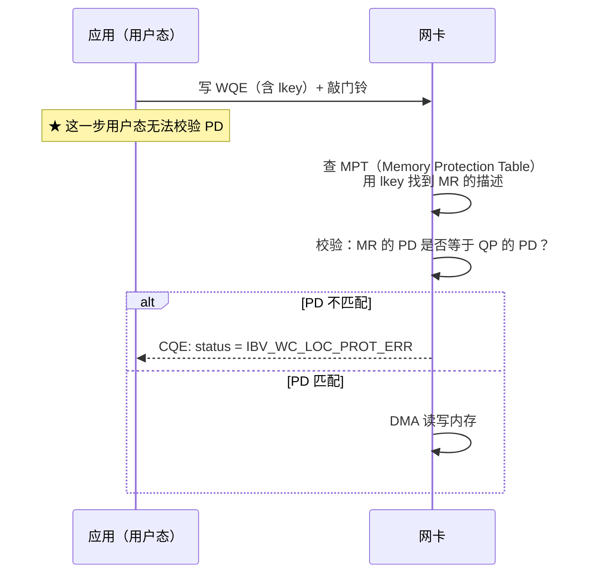

# 实验 5：安全与可观测性

> **目标**：**亲手证明** RoCE 的安全边界在哪里 —— 不是读文档，而是自己制造失败、观察错误码、理解内核在哪里拦住了你。
>
> **前置**：[实验 2](lab02-verbs-programming.md)（会写 verbs 程序）。
> **耗时**：2–3 小时。
> **需要**：一台有 RDMA 设备（真卡或 `rxe0`）的机器 + root。
>
> **配套章节**：[第 14 章](../14-security.md)（安全模型）、[第 7 章](../07-kernel-rdma-core.md)（内核强制点）

---

## 实验 A：看清谁在用 RDMA 资源（15 分钟）

内核的 **restrack** 子系统会追踪所有 RDMA 资源。这是安全审计的基础工具。

```bash
# ① 全量资源
rdma res show
# 输出示例（每行一个资源）：
# link mlx5_0/1 lqpn 0x51 type RC state RTS ... pid 12345 comm ib_write_bw

# ② 分类型查看
rdma res show qp        # 所有 QP
rdma res show mr        # 所有 MR  ← ★ 审计内存注册情况
rdma res show cq        # 所有 CQ
rdma res show ctx       # 所有 ucontext（每个打开的 uverbs 设备）
rdma res show cm_id     # 所有 RDMA CM 连接
rdma res show srq       # 所有 SRQ

# ③ 指定设备（iproute2 的 `rdma res` 用 `dev <name>` 过滤；`-d` 是 details，不是 device）
rdma res show qp dev mlx5_0
# 注：`rdma` 子命令的选项随 iproute2 版本演进，可用 `man rdma-res` 核对本机写法

# ④ JSON 输出（自动化用）
rdma res show mr -j | head -40
```

**观察练习**：

```bash
# 在一个终端里跑一个长测试
ib_write_bw -d rxe0 -i 1 -x <INDEX> --report_gbits -F -D 60 &

# 在另一个终端里观察资源
rdma res show qp | head -5
rdma res show mr | head -5
rdma res show ctx

# 关键问题（写下来）：
#   1) 这个 QP 属于哪个 pid / comm？
#   2) MR 的数量是多少？内存量大概多少？
#   3) 测试结束后资源是否被释放？
wait
rdma res show qp | tail -n +2 | wc -l      # tail -n +2 去掉表头行
rdma res show mr | tail -n +2 | wc -l
```

**填空表**：

| 项 | 测试运行中 | 测试结束后 |
|---|---|---|
| QP 数量 | | |
| MR 数量 | | |
| ucontext 数量 | | |
| 归属进程（pid/comm） | | |

> **【审计价值】`rdma res show mr` 是发现「资源泄漏」和「资源滥用」的主要手段。**
> 如果一个容器/Pod 的 MR 数量持续增长，说明它在泄漏或超用 —— 这正是 RDMA cgroup 要限制的东西（实验 E）。

> **【注意】** restrack 的可见性受权限与 namespace 影响。在容器里可能看不到宿主机的资源 —— 这本身也是一个安全边界（好事）。

---

## 实验 B：亲手证明 PD 隔离（30 分钟）

**PD（Protection Domain）是 RDMA 的硬件级安全域。** 这个实验让你亲眼看到越界被拒绝。

### B1. 实验设计

```
PD-A ── MR-A（lkey_A, rkey_A）
PD-B ── QP-B

尝试：用 QP-B 去访问 MR-A（把 lkey_A 填进 QP-B 的 SGE）
期望：★ 失败，且错误码是 IBV_WC_LOC_PROT_ERR
```

### B2. 完整代码

```c
/* pd_isolation.c —— 验证 PD 隔离
 * 编译：gcc pd_isolation.c -o pd_isolation -libverbs
 */
#include <stdio.h>
#include <stdlib.h>
#include <string.h>
#include <errno.h>
#include <infiniband/verbs.h>

#define BUF_SIZE 4096

static void die(const char *m) { fprintf(stderr, "%s: %s\n", m, strerror(errno)); exit(1); }

int main(void)
{
    struct ibv_device **list = ibv_get_device_list(NULL);
    if (!list || !list[0]) { fprintf(stderr, "no RDMA device\n"); return 1; }

    struct ibv_context *ctx = ibv_open_device(list[0]);
    if (!ctx) die("ibv_open_device");
    printf("device: %s\n", ibv_get_device_name(list[0]));

    /* ★ 两个独立的 PD */
    struct ibv_pd *pd_a = ibv_alloc_pd(ctx);
    struct ibv_pd *pd_b = ibv_alloc_pd(ctx);
    if (!pd_a || !pd_b) die("ibv_alloc_pd");

    /* PD-A 里的 MR */
    char *buf = aligned_alloc(4096, BUF_SIZE);
    memset(buf, 0xAA, BUF_SIZE);
    struct ibv_mr *mr_a = ibv_reg_mr(pd_a, buf, BUF_SIZE,
                                     IBV_ACCESS_LOCAL_WRITE | IBV_ACCESS_REMOTE_WRITE);
    if (!mr_a) die("ibv_reg_mr on pd_a");
    printf("MR-A: lkey=0x%08x rkey=0x%08x (in PD-A)\n", mr_a->lkey, mr_a->rkey);

    /* ===== 测试 1：用 PD-A 的 QP 访问 PD-A 的 MR → 应该成功 ===== */
    struct ibv_cq *cq = ibv_create_cq(ctx, 16, NULL, NULL, 0);
    if (!cq) die("ibv_create_cq");

    struct ibv_qp_init_attr qia = {
        .send_cq = cq, .recv_cq = cq,
        .cap = { .max_send_wr = 8, .max_recv_wr = 8,
                 .max_send_sge = 1, .max_recv_sge = 1 },
        .qp_type = IBV_QPT_UD,        /* 用 UD 以便本地回环测试；也可用 RC */
    };
    struct ibv_qp *qp_a = ibv_create_qp(pd_a, &qia);
    if (!qp_a) die("ibv_create_qp on pd_a");

    struct ibv_qp_attr attr = { .qp_state = IBV_QPS_INIT, .pkey_index = 0,
                                .port_num = 1, .qkey = 0x11111111 };
    if (ibv_modify_qp(qp_a, &attr,
                      IBV_QP_STATE | IBV_QP_PKEY_INDEX | IBV_QP_PORT | IBV_QP_QKEY))
        die("modify_qp INIT");

    /* 本地 WRITE 到自己的 MR（用 lkey）—— 同 PD，应成功进入 SQ */
    struct ibv_sge sge = { .addr = (uintptr_t)buf, .length = 64, .lkey = mr_a->lkey };
    struct ibv_send_wr wr = { .wr_id = 1, .sg_list = &sge, .num_sge = 1,
                              .opcode = IBV_WR_SEND, .send_flags = IBV_SEND_SIGNALED };
    struct ibv_send_wr *bad;
    int rc = ibv_post_send(qp_a, &wr, &bad);
    printf("\n[测试 1] PD-A 的 QP 用 PD-A 的 lkey 投递: rc=%d (%s)\n",
           rc, rc ? strerror(rc) : "OK，已入队");
    /* 注意：QP 还没到 RTS，不会真正发出；我们只验证 post 阶段是否被拒 */

    /* ===== 测试 2：用 PD-B 的 QP + PD-A 的 lkey → 应该失败 ===== */
    struct ibv_qp *qp_b = ibv_create_qp(pd_b, &qia);
    if (!qp_b) die("ibv_create_qp on pd_b");
    if (ibv_modify_qp(qp_b, &attr,
                      IBV_QP_STATE | IBV_QP_PKEY_INDEX | IBV_QP_PORT | IBV_QP_QKEY))
        die("modify_qp INIT on qp_b");

    rc = ibv_post_send(qp_b, &wr, &bad);   /* ★ wr 里仍是 mr_a->lkey */
    printf("[测试 2] PD-B 的 QP 用 PD-A 的 lkey 投递: rc=%d (%s)\n",
           rc, rc ? strerror(rc) : "被接受了（意外！）");
    if (rc == 0) {
        printf("  → 注意：post_send 阶段可能不校验 lkey 所属 PD。\n");
        printf("     真正的保护发生在【网卡读内存时】—— 见下面的说明。\n");
    }

    /* ===== 测试 3：把 PD-A 的 lkey 用于 PD-B 的 MR 查询（内核侧查询） ===== */
    printf("\n[测试 3] MR-A 归属: pd=%p (PD-A=%p, PD-B=%p)\n",
           (void *)mr_a->pd, (void *)pd_a, (void *)pd_b);
    printf("  → MR 的 pd 字段与 PD-A 匹配：%s\n",
           mr_a->pd == pd_a ? "是" : "否");

    /* 清理 */
    ibv_destroy_qp(qp_a);
    ibv_destroy_qp(qp_b);
    ibv_destroy_cq(cq);
    ibv_dereg_mr(mr_a);
    free(buf);
    ibv_dealloc_pd(pd_a);
    ibv_dealloc_pd(pd_b);
    ibv_close_device(ctx);
    ibv_free_device_list(list);
    return 0;
}
```

### B3. 关键理解（**比代码更重要**）

运行后你会发现一个**重要事实**：**`ibv_post_send` 阶段可能不校验 `lkey` 所属的 PD**。

**为什么？** 回到第 9.3 节：`ibv_post_send` 是**用户态**操作，它只是把 WQE 写进 SQ 并敲门铃。**用户态库不做完整校验**（它无法访问 MPT）。

**真正的保护发生在哪？**



**结论（写进你的笔记）**：

| 阶段 | 谁校验 PD | 能发现越界吗 |
|---|---|---|
| `ibv_post_send` | 用户态库（不完整） | **可能不能** |
| 网卡处理 WQE | **硬件查 MPT** | **能** → `IBV_WC_LOC_PROT_ERR` |
| 内核 `ibv_reg_mr` | 内核 | 校验 access flags 合法性（第 7.6.4 节） |

> **【安全启示】PD 隔离是「硬件强制」的，但不表现在 `post_send` 的返回值上。**
> 这意味着：**你不能靠检查 `post_send` 返回码来判断权限问题** —— 必须**检查 CQE 的 status**。
> 这也是第 4 章反复强调「WC 状态码必须处理」的安全层面原因。

> **【想看到 `LOC_PROT_ERR`？】** 需要让 QP 真正到 RTS 并发出去。用 `rxe` + 本机回环最容易复现：
> 建两个 PD、两个 QP（一个在 PD-A、一个在 PD-B），把 PD-A 的 `rkey` 交给 PD-B 的 QP 做 RDMA WRITE，
> 然后 `ibv_poll_cq` 观察 status。**用实验 2 的完整程序改造即可**（把 `rkey` 换成另一个 PD 的 MR 的 `rkey`）。

---

## 实验 C：验证 access flag 强制（30 分钟）

### C1. 内核强制的规则（第 7.6.4 节）

```c
/* kernel:include/rdma/ib_verbs.h —— ib_check_mr_access() 的逻辑 */
if ((flags & (IB_ACCESS_REMOTE_ATOMIC | IB_ACCESS_REMOTE_WRITE)) &&
    !(flags & IB_ACCESS_LOCAL_WRITE))
        return -EINVAL;
```

**验证这个规则：**

```c
/* flag_test.c —— 编译：gcc flag_test.c -o flag_test -libverbs */
#include <stdio.h>
#include <string.h>
#include <errno.h>
#include <stdlib.h>
#include <infiniband/verbs.h>

int main(void)
{
    struct ibv_device **list = ibv_get_device_list(NULL);
    struct ibv_context *ctx = ibv_open_device(list[0]);
    struct ibv_pd *pd = ibv_alloc_pd(ctx);
    char *buf = aligned_alloc(4096, 4096);

    struct {
        const char *name;
        int flags;
        int expect_fail;
    } tests[] = {
        /* ★ REMOTE_WRITE 而没有 LOCAL_WRITE → 内核应拒绝 */
        { "REMOTE_WRITE 无 LOCAL_WRITE", IBV_ACCESS_REMOTE_WRITE, 1 },
        /* ★ REMOTE_ATOMIC 而没有 LOCAL_WRITE → 内核应拒绝 */
        { "REMOTE_ATOMIC 无 LOCAL_WRITE", IBV_ACCESS_REMOTE_ATOMIC, 1 },
        /* 合法组合 */
        { "LOCAL_WRITE 单独", IBV_ACCESS_LOCAL_WRITE, 0 },
        { "LOCAL_WRITE + REMOTE_WRITE", IBV_ACCESS_LOCAL_WRITE | IBV_ACCESS_REMOTE_WRITE, 0 },
        { "LOCAL_WRITE + REMOTE_READ", IBV_ACCESS_LOCAL_WRITE | IBV_ACCESS_REMOTE_READ, 0 },
        { "原子操作标准组合",
          IBV_ACCESS_LOCAL_WRITE | IBV_ACCESS_REMOTE_WRITE | IBV_ACCESS_REMOTE_ATOMIC, 0 },
        /* 内核不接受与 LOCAL_WRITE 一起的 ZERO_BASED（视实现） */
        { "LOCAL_WRITE + ZERO_BASED", IBV_ACCESS_LOCAL_WRITE | IBV_ACCESS_ZERO_BASED, 0 },
        /* 只读场景：REMOTE_READ 不需要 LOCAL_WRITE？—— 测一下 */
        { "仅 REMOTE_READ", IBV_ACCESS_REMOTE_READ, 0 },
    };

    printf("%-42s %-8s %s\n", "access flags 组合", "结果", "说明");
    printf("%-42s %-8s %s\n", "------------------------------------------",
           "--------", "-----------------------------");
    for (unsigned i = 0; i < sizeof(tests)/sizeof(tests[0]); i++) {
        errno = 0;
        struct ibv_mr *mr = ibv_reg_mr(pd, buf, 4096, tests[i].flags);
        int failed = (mr == NULL);
        printf("%-42s %-8s %s\n", tests[i].name,
               failed ? "拒绝" : "接受",
               failed ? strerror(errno) :
                        (tests[i].expect_fail ? "★ 与预期不符（本应拒绝）" : "符合预期"));
        if (mr) ibv_dereg_mr(mr);
    }

    free(buf); ibv_dealloc_pd(pd); ibv_close_device(ctx); ibv_free_device_list(list);
    return 0;
}
```

**运行并填空**：

| access flags 组合 | 内核返回 | 是否符合 `ib_check_mr_access()` 的规则 |
|---|---|---|
| `REMOTE_WRITE`（无 LOCAL_WRITE） | | |
| `REMOTE_ATOMIC`（无 LOCAL_WRITE） | | |
| `LOCAL_WRITE` | | |
| `LOCAL_WRITE \| REMOTE_WRITE` | | |
| `LOCAL_WRITE \| REMOTE_READ` | | |
| `REMOTE_READ`（无 LOCAL_WRITE） | | |

> **【重要结论】内核只强制「`REMOTE_WRITE`/`REMOTE_ATOMIC` 需要 `LOCAL_WRITE`」这一条。**
> **它不会阻止你多给权限。** 所以「最小权限」必须由**开发者自觉执行**（第 14.2.3 节）。
> 上面的表格就是你的「合法/非法组合清单」。

### C2. 验证「少给权限」会被对端发现

```bash
# ① server 端注册一个【没有 REMOTE_WRITE】的 MR
#    举例：把 perftest 的 --mr_per_qp 之类改掉不方便，
#    最简单的做法是用实验 2 的 RDMA WRITE 程序，把注册改成只有 LOCAL_WRITE：
#      mr = ibv_reg_mr(pd, buf, SIZE, IBV_ACCESS_LOCAL_WRITE);   // ★ 无 REMOTE_WRITE
#    然后让 client 对它做 RDMA WRITE。

# ② 期望结果：
#    client 收到 CQE，status = IBV_WC_REM_ACCESS_ERR
#    server 端不会有任何完成（WRITE 不消耗 RECV）
```

**填空**：

| 项 | 你的记录 |
|---|---|
| server 的 access flags | |
| client 的 WC status | |
| 对应的 AETH syndrome（若抓包） | `0x62` = `AETH_NAK_REM_ACC_ERR`（`rxe_hdr.h`） |
| server 端有没有 CQE | |

> **【源码印证】这个错误码链路是**：
> 对端网卡查 MPT 发现权限不足 → 回 NAK，AETH syndrome = `AETH_NAK_REM_ACC_ERR`（`0x62`，见 `kernel:drivers/infiniband/sw/rxe/rxe_hdr.h` 的 `enum aeth_syndrome`）
> → 本端网卡把 NAK 转成 CQE → `ibv_wc.status = IBV_WC_REM_ACCESS_ERR`
> **这正好把第 2 章（AETH）、第 4 章（WC 状态）、第 14 章（权限）串起来了。**

---

## 实验 D：`rkey` 的生命周期（30 分钟）

### D1. `dereg` 之后 `rkey` 立即失效

```c
/* rkey_lifetime.c —— 验证 dereg 后 rkey 失效
 * 思路：注册 → 打印 rkey → dereg → 再注册一个同地址的 MR → 观察 rkey 是否变化
 *       并把旧 rkey 交给对端（在对端程序里）尝试使用
 *
 * 本文件只做「本地可观测」的部分：rkey 的变化与 MR 的 pd 归属。
 * 跨机的部分请配合实验 2 的 RDMA WRITE 程序改造。
 */
#include <stdio.h>
#include <stdlib.h>
#include <string.h>
#include <errno.h>
#include <infiniband/verbs.h>

int main(void)
{
    struct ibv_device **list = ibv_get_device_list(NULL);
    struct ibv_context *ctx = ibv_open_device(list[0]);
    struct ibv_pd *pd = ibv_alloc_pd(ctx);
    char *buf = aligned_alloc(4096, 4096);

    printf("=== rkey 生命周期观察 ===\n\n");

    /* 注册 3 次（同样的大小），看 rkey 是否复用 */
    for (int i = 1; i <= 3; i++) {
        struct ibv_mr *mr = ibv_reg_mr(pd, buf, 4096,
                                       IBV_ACCESS_LOCAL_WRITE | IBV_ACCESS_REMOTE_WRITE);
        if (!mr) { fprintf(stderr, "reg_mr failed: %s\n", strerror(errno)); return 1; }
        printf("第 %d 次注册: lkey=0x%08x  rkey=0x%08x  addr=%p\n",
               i, mr->lkey, mr->rkey, mr->addr);

        if (i == 1) {
            printf("  → 假设这个 rkey 已通过带外通道发给了对端...\n");
            printf("  → 现在 dereg（模拟「用完即弃」）\n");
        }
        ibv_dereg_mr(mr);
        printf("  dereg 完成：该 rkey 立即失效（硬件 MPT 条目被删除）\n\n");
    }

    printf("=== 结论 ===\n");
    printf("1) 每次注册得到的 rkey 可能不同（也可能复用，取决于内核/硬件分配策略）\n");
    printf("2) dereg 之后旧 rkey 立即失效 —— 对端的 RDMA WRITE 会收到 REM_ACCESS_ERR\n");
    printf("3) 所以：★ 用完立即 dereg 是缩小 rkey 泄露窗口的最简单手段\n");

    free(buf); ibv_dealloc_pd(pd); ibv_close_device(ctx); ibv_free_device_list(list);
    return 0;
}
```

**运行并观察**：

| 项 | 你的观察 |
|---|---|
| 第 1 次注册的 rkey | |
| 第 2 次注册的 rkey | |
| 第 3 次注册的 rkey | |
| rkey 是否复用 | |
| 每次的 lkey 是否相同 | |

> **【重要】不要依赖「rkey 每次都会变」。** 上面的实验可能显示 rkey 被复用（内核可能用 MR 池）。
> **安全上的正确做法不是「靠 rkey 变化」，而是「用完立即 dereg」** —— 让旧 rkey 无条件失效。

### D2. 跨机验证（配合实验 2 的程序）

```
步骤：
  1) server 端：注册 MR，把 (rkey, vaddr) 通过 TCP 发给 client
  2) client 端：用该 (rkey, vaddr) 做一次 RDMA WRITE → 应该成功
  3) server 端：ibv_dereg_mr()
  4) client 端：再用同一个 (rkey, vaddr) 做 RDMA WRITE
     → ★ 期望：client 收到 IBV_WC_REM_ACCESS_ERR
```

**填空**：

| 步骤 | client 的 WC status | 说明 |
|---|---|---|
| dereg 之前 WRITE | | 成功 |
| dereg 之后 WRITE | | **应为 `IBV_WC_REM_ACCESS_ERR`** |

> **【安全结论】这就是「`rkey` 生命周期必须与业务需求精确对齐」的原因**：
> - 给得太久 → 泄露窗口大；
> - 给得太短 → 业务会失败；
> - **没有「自动过期」机制** —— 必须由应用显式 `ibv_dereg_mr`。

---

## 实验 E：配额与审计（RDMA cgroup）（30 分钟）

### E1. 检查内核是否支持

```bash
# ① RDMA cgroup 是否存在
ls /sys/fs/cgroup/rdma/ 2>/dev/null && echo "RDMA cgroup 可用" || echo "RDMA cgroup 不可用"
# 不存在 → 内核未开启 CONFIG_CGROUP_RDMA

# ② 检查内核配置
zgrep CONFIG_CGROUP_RDMA /proc/config.gz 2>/dev/null || \
    grep CONFIG_CGROUP_RDMA /boot/config-$(uname -r) 2>/dev/null || \
    echo "无法读取内核配置"

# ③ 如果用的是 cgroup v2，看控制器列表
cat /sys/fs/cgroup/cgroup.controllers 2>/dev/null
```

### E2. 设置某进程的 RDMA 资源上限

```bash
# 前提：cgroup v1 + CONFIG_CGROUP_RDMA
# ★ 下面所有对 /sys/fs/cgroup/... 的写入都需要 root；上限用完记得按第 ⑥ 步回滚

# ① 建一个 cgroup
mkdir -p /sys/fs/cgroup/rdma/testapp

# ② 查看当前使用
cat /sys/fs/cgroup/rdma/testapp/rdma.current 2>/dev/null

# ③ 设置上限      ★ 需 root
#    语法: <device> hca_handle=<num>|max  hca_object=<num>|max
#    只有这两个 token（kernel:kernel/cgroup/rdma.c:29-35 的 rdmacg_limit_tokens）；
#    写 `qp=` / `mr=` / `ctx=` 会直接 -EINVAL。
#    粒度是「每 ucontext 的句柄数」与「每 uobject 的对象数」两级 —— 按 qp/mr 细分的接口早已从内核移除。
echo "rxe0 hca_handle=10 hca_object=20" > /sys/fs/cgroup/rdma/testapp/rdma.max

# ④ 把某个进程放进去
sleep 1000 &
PID=$!
echo $PID > /sys/fs/cgroup/rdma/testapp/cgroup.procs
cat /sys/fs/cgroup/rdma/testapp/cgroup.procs

# ⑤ 在这个 cgroup 里跑测试，观察是否被限制
#    （需要在同一个 cgroup 里启动，用 cgexec 或先写 PID）

# ⑥ 回滚上限（把两类限制都恢复成"无上限"）
echo "rxe0 hca_handle=max hca_object=max" > /sys/fs/cgroup/rdma/testapp/rdma.max

# ⑦ 清理
kill $PID 2>/dev/null
rmdir /sys/fs/cgroup/rdma/testapp 2>/dev/null
```

**可限制的资源类型**（内核 7.2.8；写入不支持的 token 会直接 `-EINVAL`，**内核不会提示合法值**）：

| 资源 token | 含义 |
|---|---|
| `hca_handle` | **每 ucontext** 的句柄数（一个打开的 uverbs 设备 = 一个 ucontext） |
| `hca_object` | **每 uobject** 的对象数（QP / MR / CQ / PD / AH / SRQ … 都算 uobject） |
| `hca_handle=max` / `hca_object=max` | 显式表示"不限制"（回滚用） |

> **【口径提醒】** 枚举只有三项：`enum rdmacg_resource_type { RDMACG_RESOURCE_HCA_HANDLE, RDMACG_RESOURCE_HCA_OBJECT, RDMACG_RESOURCE_MAX }`（`kernel:include/linux/cgroup_rdma.h:11-15`），可读名字表见 `kernel:kernel/cgroup/rdma.c:55-58`。**按 `qp` / `mr` / `ctx` 逐类限制是更早内核的接口，7.2.8 已移除** —— 不要再照抄旧资料里的 `qp=1000 mr=1000`。
>
> **【源码位置别找错】** `kernel:drivers/infiniband/core/cgroup.c` 只有 **53 行**，是个 shim —— 它只做两件事：把 `ib_device_register_rdmacg()/unregister` 转给 `rdmacg_register_device()`，以及把 `ib_rdmacg_try_charge/uncharge()` 转给 cgroup 子系统（`kernel:drivers/infiniband/core/cgroup.c:17-53`）。`rdma.max` 的 token 解析、限额表与 `rdma.current` 都在 **`kernel:kernel/cgroup/rdma.c`**（token 表 `:29-35`、解析 `:506-544`、`print_rpool_values()` `:586-597`）。要读实现请读后者。

**填空**：

| 项 | 你的记录 |
|---|---|
| RDMA cgroup 是否可用 | |
| 支持哪些资源类型 | |
| 设置上限后跑测试的结果 | |
| `rdma.current` 显示什么 | |

> **【必会】没有 RDMA cgroup 会怎样？**
> 一个容器/Pod 可以：
> - 注册**无限内存**（MR 是 pin 住的，**直接吃光主机内存**）；
> - 创建无限 QP（**耗尽网卡硬件资源，影响其他租户**）；
> - 创建无限 CQ/MR 对象。
>
> **生产多租户环境里 RDMA cgroup 是必须的**（第 15.5.3 节）。

### E3. 用 restrack 做持续审计

```bash
#!/bin/bash
# roce_res_audit.sh —— 定期采集 RDMA 资源快照，用于趋势分析与异常告警
OUT=${1:-/var/log/roce-res-audit.log}

# ★ 守卫：没有 rdma 命令时直接退出，避免只写出一个"空快照"而看不出原因
command -v rdma >/dev/null 2>&1 || { echo "roce_res_audit: 找不到 rdma 命令（装 iproute2 的 rdma 子命令）" >&2; exit 1; }

{
    echo "=== $(date -Is) ==="
    echo "-- MR 总数: $(rdma res show mr 2>/dev/null | tail -n +2 | wc -l)"
    echo "-- QP 总数: $(rdma res show qp 2>/dev/null | tail -n +2 | wc -l)"
    echo "-- CTX 总数: $(rdma res show ctx 2>/dev/null | tail -n +2 | wc -l)"
    echo "-- 各进程的 MR 数（Top 10）:"
    rdma res show mr 2>/dev/null \
      | grep -oP 'comm \K\S+' | sort | uniq -c | sort -rn | head -10 | sed 's/^/     /'
    echo "-- 各进程的 QP 数（Top 10）:"
    rdma res show qp 2>/dev/null \
      | grep -oP 'comm \K\S+' | sort | uniq -c | sort -rn | head -10 | sed 's/^/     /'
} >> $OUT

# 与上次快照对比（异常增长告警）
# ★ 首次运行时 $OUT 还不存在，tail 会报 stderr 噪声 —— 用 2>/dev/null || true 兜住
TAIL=$(tail -40 "$OUT" 2>/dev/null || true)
echo "$TAIL" | tail -20
```

```bash
chmod +x roce_res_audit.sh
./roce_res_audit.sh /tmp/roce-res.log
sleep 5
./roce_res_audit.sh /tmp/roce-res.log
cat /tmp/roce-res.log
```

> **【注意】`rdma res show` 的输出格式随 rdma-core 版本略有差异**，脚本里的 `grep -oP 'comm \K\S+'` 可能需要按你环境的实际输出调整。**先手工跑一次 `rdma res show mr` 看清格式再改脚本。**

---

## 实验 F：可观测性工具包（20 分钟）

### F1. 「看什么」的完整清单

```bash
#!/bin/bash
# roce_observe.sh —— 一站式可观测性快照（只读，不修改任何配置）
DEV=${1:-rxe0}
NETDEV=${2:-$(ls /sys/class/infiniband/$DEV/device/net/ 2>/dev/null | head -1)}
PCI=$(basename $(readlink /sys/class/infiniband/$DEV/device) 2>/dev/null)
PD=/sys/class/infiniband/$DEV/ports/1

echo "########## 1. 设备与链路 ##########"
rdma link show 2>/dev/null | grep -E "$DEV|netdev"
cat $PD/state $PD/phys_state $PD/link_layer 2>/dev/null | tr '\n' ' '; echo
[ -n "$NETDEV" ] && ethtool $NETDEV 2>/dev/null | grep -E 'Speed|Link detected'

echo; echo "########## 2. GID 表 ##########"
for i in $PD/gids/*; do
    idx=$(basename $i)
    printf "  [%s] type=%-12s ndev=%-10s gid=%s\n" \
        "$idx" \
        "$(cat $PD/gid_attrs/types/$idx 2>/dev/null)" \
        "$(cat $PD/gid_attrs/ndevs/$idx 2>/dev/null)" \
        "$(cat $i 2>/dev/null)"
done

echo; echo "########## 3. 标准计数器（错误类） ##########"
for c in port_rcv_errors port_xmit_discards port_rcv_remote_physical_errors \
         port_rcv_constraint_errors local_link_integrity_errors; do
    V=$(cat $PD/counters/$c 2>/dev/null)
    [ -n "$V" ] && printf "  %-42s %s\n" "$c" "$V"
done

echo; echo "########## 4. 驱动私有计数器（RoCE 关键） ##########"
for c in out_of_buffer roce_adp_retrans roce_adp_retrans_to \
         roce_slow_restart roce_slow_restart_cnps roce_slow_restart_trans \
         np_ecn_marked_roce_packets rp_cnp_handled; do
    V=$(cat $PD/hw_counters/$c 2>/dev/null)
    [ -n "$V" ] && printf "  %-42s %s\n" "$c" "$V"
done

echo; echo "########## 5. PFC / PAUSE ##########"
# mlx5 的真实计数器名是 rx_prioN_pause / tx_prioN_pause
# （kernel:drivers/net/ethernet/mellanox/mlx5/core/en_stats.c:1992-1995
#   的 "rx_%s_pause"/"tx_%s_pause"，%s 由 :2058 填成 prioN）
[ -n "$NETDEV" ] && ethtool -S $NETDEV 2>/dev/null \
  | grep -E '(rx|tx)_prio[0-9]_pause:|pause_ctrl' | head -20

echo; echo "########## 6. DCQCN 参数 ##########"
if [ -n "$PCI" ] && [ -d /sys/kernel/debug/mlx5/$PCI/cc_params ]; then
    for f in /sys/kernel/debug/mlx5/$PCI/cc_params/*; do
        printf "  %-42s %s\n" "$(basename $f)" "$(cat $f)"
    done
else
    echo "  （不可用：需要 debugfs 挂载 + 固件 cc_query_allowed 能力）"
fi

echo; echo "########## 7. 资源与审计（restrack） ##########"
if command -v rdma >/dev/null 2>&1; then
    echo "  MR=$(rdma res show mr 2>/dev/null | tail -n +2 | wc -l)  QP=$(rdma res show qp 2>/dev/null | tail -n +2 | wc -l)  CTX=$(rdma res show ctx 2>/dev/null | tail -n +2 | wc -l)"
    echo "  按进程统计 MR 数："
    rdma res show mr 2>/dev/null | grep -oP 'comm \K\S+' | sort | uniq -c | sort -rn | head -5 | sed 's/^/    /'
fi

echo; echo "########## 8. 配额（RDMA cgroup） ##########"
[ -d /sys/fs/cgroup/rdma ] && echo "  RDMA cgroup 已启用" || echo "  RDMA cgroup 不可用（多租户场景有风险）"

echo; echo "########## 9. 版本 ##########"
echo "  kernel   : $(uname -r)"
echo "  fw_ver   : $(cat /sys/class/infiniband/$DEV/fw_ver 2>/dev/null)"
echo "  uverbs   : $(cat /sys/class/infiniband_verbs/abi_version 2>/dev/null) / $(cat /sys/class/infiniband_verbs/uverbs0/abi_version 2>/dev/null)"

echo; echo "########## 10. 健康与错误 ##########"
[ -n "$PCI" ] && devlink health show pci/$PCI 2>/dev/null | head -20
echo "  最近的 RDMA 相关内核日志："
dmesg -T 2>/dev/null | grep -iE 'mlx5|rdma|infiniband|rxe' | tail -10 | sed 's/^/    /'
```

```bash
chmod +x roce_observe.sh
./roce_observe.sh rxe0
```

**练习**：跑一遍，**对照第 16.5.3 节的监控指标清单**，确认每一项都能在你的环境里取到。取不到的记下原因（能力不支持 / 未装工具 / 权限不足）。

### F2. 异步事件观察

```bash
# 终端 1：观察异步事件（★ 第 4.3.9 节强调必须处理的事件）
ibv_asyncwatch -d rxe0
# 注意：ibv_asyncwatch 只支持 -d 和 -h（见 rdma-core:libibverbs/examples/asyncwatch.c）

# 终端 2：制造一个事件
# 方式一：删掉 rxe 设备
rdma link delete rxe0
# → 终端 1 应显示事件（如 IBV_EVENT_DEVICE_FATAL 或类似）

# 方式二：改 IP 触发 GID_CHANGE（★ RoCE 特有，第 7.8 节）
rdma link add rxe0 type rxe netdev <netdev>
# 在另一个终端改 netdev 的 IP
ip addr del <ip>/24 dev <netdev>
ip addr add <new_ip>/24 dev <netdev>
# → 终端 1 应显示 IBV_EVENT_GID_CHANGE
```

**填空**：

| 操作 | 观察到的事件 |
|---|---|
| `rdma link delete` | |
| netdev IP 变化 | |
| netdev down | |

> **【RoCE 工程师必须处理的三个事件】**（第 4.3.9 节）：
> `IBV_EVENT_GID_CHANGE`（**RoCE 特有**，改 IP/VLAN 时触发）、`IBV_EVENT_PORT_ERR`、`IBV_EVENT_QP_FATAL`。

---

## 实验 G：一键安全自检脚本（20 分钟）

```bash
#!/bin/bash
# roce-security-audit.sh —— RoCE 安全自检（自动化第 14 章的清单）
DEV=${1:-mlx5_0}
NETDEV=${2:-$(ls /sys/class/infiniband/$DEV/device/net/ 2>/dev/null | head -1)}
PCI=$(basename $(readlink /sys/class/infiniband/$DEV/device) 2>/dev/null)
PASS=0; WARN=0; FAIL=0
ok(){ echo "  [PASS] $1"; PASS=$((PASS+1)); }
warn(){ echo "  [WARN] $1"; WARN=$((WARN+1)); }
bad(){ echo "  [FAIL] $1"; FAIL=$((FAIL+1)); }

echo "=== RoCE 安全自检 ==="
echo

echo "【设备可见性】"
ls -l /dev/infiniband/ 2>/dev/null | sed 's/^/  /'
for n in /dev/infiniband/uverbs*; do
    [ -e "$n" ] || continue
    PERM=$(stat -c '%a' $n)
    case "$PERM" in
      660|600) ok "$n 权限 $PERM（受限）";;
      666)     warn "$n 权限 $PERM（所有用户可读写 —— 若在多用户主机上应收紧）";;
      *)       echo "  [INFO] $n 权限 $PERM";;
    esac
done
[ -e /dev/infiniband/rdma_cm ] && ok "/dev/infiniband/rdma_cm 存在" || warn "rdma_cm 节点不存在"

echo; echo "【内存与权限】"
ML=$(ulimit -l)
[ "$ML" = "unlimited" ] && warn "memlock=unlimited（方便但放宽了内存 pin 的限制；容器场景用 cgroup 限制更好）" \
                        || ok "memlock=$ML（有上限）"

echo; echo "【RDMA 资源配额】"
if [ -d /sys/fs/cgroup/rdma ]; then
    ok "RDMA cgroup 已启用"
    CNT=$(ls /sys/fs/cgroup/rdma/ 2>/dev/null | wc -l)
    echo "  [INFO] cgroup 子目录数：$CNT"
    for d in /sys/fs/cgroup/rdma/*/; do
        [ -f "$d/rdma.max" ] && {
            M=$(cat $d/rdma.max 2>/dev/null)
            [ -n "$M" ] && echo "  [INFO] $(basename $d): rdma.max = $M"
        }
    done
else
    bad "RDMA cgroup 不可用 —— 容器无法限制 RDMA 资源（CONFIG_CGROUP_RDMA 未开）"
fi

echo; echo "【资源使用审计】"
if command -v rdma >/dev/null 2>&1; then
    MR=$(rdma res show mr 2>/dev/null | tail -n +2 | wc -l)
    QP=$(rdma res show qp 2>/dev/null | tail -n +2 | wc -l)
    echo "  [INFO] MR=$MR QP=$QP（已去掉表头行）"
    [ "$MR" -gt 10000 ] && warn "MR 数量 $MR 偏多（可能泄漏或滥用）" || ok "MR 数量 $MR 在合理范围"
    echo "  [INFO] 持有 MR 最多的进程："
    rdma res show mr 2>/dev/null | grep -oP 'comm \K\S+' | sort | uniq -c | sort -rn | head -3 | sed 's/^/    /'
else
    warn "rdma 工具不可用（装 iproute2 的 rdma 子命令）"
fi

echo; echo "【RoCE 使能状态】"
if [ -n "$PCI" ] && command -v devlink >/dev/null 2>&1; then
    V=$(devlink dev param show pci/$PCI name enable_roce 2>/dev/null | grep -i 'cmode\|value' | head -2)
    [ -n "$V" ] && echo "  [INFO] enable_roce: $(echo $V | tr '\n' ' ')" || echo "  [INFO] enable_roce 参数不可读"
else
    echo "  [INFO] devlink 不可用"
fi

echo; echo "【加密能力】"
if [ -n "$PCI" ]; then
    devlink dev 2>/dev/null | grep -q "$PCI" && echo "  [INFO] devlink 可见该设备"
fi
# MACsec 由 mlx5 的 MACsec 卸载基础设施启用（kernel:drivers/infiniband/hw/mlx5/macsec.c 存在）
# ★ mlx5_ib 没有任何模块参数（module_param/MODULE_PARM_DESC 全零），因此
#   `modinfo mlx5_ib | grep macsec` 永远为空；macsec.c 里也没有 debugfs_create，
#   所以 /sys/kernel/debug/mlx5/$PCI/ 下不会出现 macsec 条目。不要用这两个检查。
echo "  [INFO] MACsec 没有模块参数或 debugfs 开关；是否可用取决于固件/硬件能力"
echo "         源码：kernel:drivers/infiniband/hw/mlx5/macsec.c"

echo; echo "【容器暴露面】"
if command -v docker >/dev/null 2>&1; then
    N=$(docker ps -q 2>/dev/null | wc -l)
    # ★ 注意：`docker inspect --format` 的 Go 模板语法依赖 docker 版本；
    #   若 `docker ps` 无输出（没装守护进程/没权限/没有运行中的容器），下面的循环体一次都不执行，
    #   但仍会打印"未发现直接暴露 /dev/infiniband 的容器" —— 那是假阴性，不要据此下结论。
    [ "$N" -eq 0 ] && echo "  [INFO] 没有正在运行的容器（或 docker 不可用）—— 本项无法判断"
    [ "$N" -gt 0 ] && {
        echo "  [INFO] 运行中的容器数：$N"
        docker ps -q 2>/dev/null | while read c; do
            docker inspect --format '{{.Name}} devices={{range .HostConfig.Devices}}{{.PathOnHost}} {{end}}' $c 2>/dev/null
        done | grep -i infiniband | sed 's/^/    /' || echo "    （未发现直接暴露 /dev/infiniband 的容器）"
    }
    echo "  [提示] 若看到暴露了 /dev/infiniband（整个目录）或全部 uverbs 节点，"
    echo "         应改为只暴露分配的单一 uverbs 节点（第 15.5.3 节）"
else
    echo "  [INFO] docker 不可用，跳过"
fi

echo
echo "=== 汇总: PASS=$PASS  WARN=$WARN  FAIL=$FAIL ==="
[ $FAIL -eq 0 ] && echo "结论：未发现必须修复项。" || echo "结论：存在 FAIL 项，请按第 14 章整改。"
exit $([ $FAIL -eq 0 ] && echo 0 || echo 1)
```

```bash
chmod +x roce-security-audit.sh
./roce-security-audit.sh mlx5_0 <netdev>
```

**练习**：跑一遍，对每个 WARN/FAIL 判断：

| 告警项 | 是否是问题 | 整改方式 | 依据章节 |
|---|---|---|---|
| | | | |
| | | | |

> **【注意】这个脚本只能覆盖「可自动化检查」的子集。**
> 第 14.7 节列的 28 项清单里，**「`rkey` 不进日志」「按最小权限注册 MR」「传递 rkey 的通道加密」这些必须靠代码审查**，脚本查不出来。

---

## 故障速查（本实验最可能遇到的问题）

| 症状 | 最可能原因 | 处理 |
|---|---|---|
| `rdma res show` 无输出 | 没有活跃的 RDMA 资源 / 权限不足 | 先跑一个测试制造资源；用 root |
| `ibv_reg_mr` 对合法组合也失败 | `ulimit -l` 太小 | `ulimit -l unlimited` |
| `pd_isolation` 里测试 2 被接受 | **预期现象** —— `post_send` 不校验 PD；真正校验在网卡 | 让 QP 到 RTS 并 poll CQ 看 `LOC_PROT_ERR` |
| 看不到 `LOC_PROT_ERR` | QP 没到 RTS / 用 UD 不好复现 | 用 RC + 跨 PD 的 `rkey` 做 RDMA WRITE |
| `/sys/fs/cgroup/rdma` 不存在 | 内核未开 `CONFIG_CGROUP_RDMA`；或用的是 cgroup v2 | 换内核；cgroup v2 的 RDMA 控制器支持有限 |
| 写 `rdma.max` 报 `Invalid argument` | 资源 token 不对（内核 7.2.8 只认 `hca_handle` / `hca_object`，没有 `qp`/`mr`/`ctx`） | 按实验 E2 的表格改。注意：`cat rdma.max` 只打印**当前**的 `hca_handle=… hca_object=…`（`kernel:kernel/cgroup/rdma.c:586-597`），**写入失败时内核不会提示合法值** |
| `ibv_asyncwatch` 报非法选项 | 它只支持 `-d` 与 `-h` | 不要传别的参数 |
| 改 IP 没看到 `GID_CHANGE` | 改的是非 RoCE 的 netdev / rxe 未绑定该 netdev | 确认 `rdma link show` 里的 netdev |
| `devlink` 命令不存在 | 未装 iproute2 的 devlink 子命令 | 装新版 iproute2 |
| 脚本报 `bad interpreter` | 在 Windows 上编辑过（CRLF） | `dos2unix roce-security-audit.sh` |

---

## 本实验的「完成标准」

- [ ] 能用 `rdma res show` 列出 QP/MR/CTX，并说出资源归属哪个进程
- [ ] 完成 PD 隔离实验，能解释「为什么 `post_send` 可能不报错，但 CQE 会报 `LOC_PROT_ERR`」
- [ ] 完成 access flag 实验，填完**合法/非法组合清单**表格
- [ ] 能说出内核强制的那一条规则（`REMOTE_WRITE`/`REMOTE_ATOMIC` 需要 `LOCAL_WRITE`）及其源码位置
- [ ] 完成 `rkey` 生命周期实验，能解释「为什么用完必须立即 dereg」
- [ ] 能把 `REM_ACCESS_ERR` 与 AETH syndrome `0x62` 对应起来
- [ ] 检查了 RDMA cgroup 是否可用，并实际设置了 `rdma.max`
- [ ] `roce_observe.sh` 能跑通，第 16.5.3 节的指标大部分可采集
- [ ] 用 `ibv_asyncwatch` 观察到至少一个异步事件（最好是 `GID_CHANGE`）
- [ ] `roce-security-audit.sh` 能跑通，并对每个告警给出了整改判断

> **【最重要的收获】你应该带走这个认知**：
> **RoCE 的安全不是「网络通不通」的问题，而是「`rkey` 给了谁、给了多大范围、给了多久、什么权限」的问题。**
> 而这四件事**全部由你的应用代码决定**，内核和网卡只能在你配置错误时拒绝执行 —— 它们不会替你做出正确的选择。

---

## 下一步

- 深入安全模型与威胁分析 → [第 14 章](../14-security.md)
- 多租户与容器隔离的完整设计 → [第 15 章](../15-virtualization.md)
- 可观测性与自动化运维 → [第 16 章](../16-tools.md)
- 回到能力模型，规划下一步学习 → [第 17 章](../17-expert-roadmap.md)
