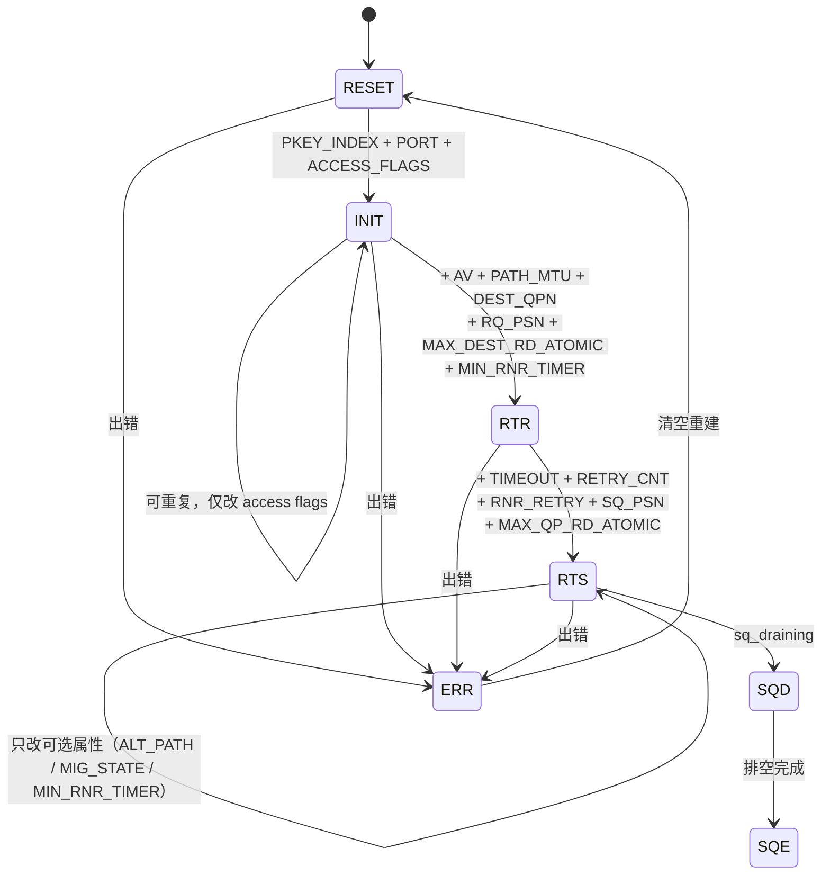

# RoCE / RDMA 术语与概念速查（按主题整理）

> **文件沿革**：本文件原名 `glossary-from-images.md`。早期版本曾是另一份外部讲义的逐图转录稿；现已**整篇改写**为按本教程锁定的三个源码快照重写的原创速查表，**不再保留任何逐字复现的内容**（外部文档的字面表述、表格版式与图片均已去除，只保留术语与知识点），因此改名为 `glossary-quickref.md`。**外部若仍以旧名链接到本文件，请更新为新名。**

本文件是这套教程的**主题速查表**：把 RoCE / RDMA 学习中那些「必须能随口答出来、但又记不住精确取值」的东西——QP 状态迁移需要哪些属性、异步事件有哪几类、WC 状态码怎么定位故障、opcode 的低 5 位是多少、AETH syndrome 怎么读、CM 事件有哪些、MTU 与报文开销怎么换算——按主题整理成可以直接查的表。

它与同目录的 [`glossary.md`](glossary.md) 分工不同：

| | 本文件 | [`glossary.md`](glossary.md) |
|---|---|---|
| 组织方式 | **按主题 / 按表**：状态机、位域、常量、错误码、算式 | **按字母序术语条目**：一条术语一段解释 |
| 主要用途 | 写代码、排障、对抓包时**快速查一个具体取值** | 建立概念、查「某个词到底什么意思」 |
| 每个条目的形态 | 表格行 / 位域图 / 短算式 + 一句结论 | 完整定义句 + `→ 见第 N 章` |
| 覆盖范围 | 只覆盖「有确定取值或确定集合」的内容 | 覆盖全部核心术语，含无固定取值的概念词 |

两者不冲突：需要「这个常量的精确值」来查本文件，需要「这个概念怎么解释」去查 [`glossary.md`](glossary.md)。

## 引用约定与可验证性声明

**代码位置**一律写成 `<项目>:<相对路径>:<行号>`（约定见 [`00-conventions.md`](00-conventions.md) 第 2 节）：

| 前缀 | 本地快照 | 版本 |
|---|---|---|
| `kernel:` | `linux-7.2.8/linux-7.2.8` | Linux **7.2.8** |
| `rdma-core:` | `rdma-core-master` | rdma-core **66.0** |
| `perftest:` | `perftest-master/perftest-master` | perftest **6.30** |

**本文件的所有取值、集合成员与算式都逐条在上述三个快照里核对过**，行号以本地快照为准（上游 master 可能有 ±几行漂移，请以符号名为主锚点）。

明确**无法**从这三个仓验证的内容，本文件会就地标注「**规范/固件层面，本仓无法验证**」，不会写成事实。典型的三类：**① IBTA 规范条文本身**（如 Path MTU 与 IB 报文净荷上限的对应关系、RD 服务类型的完整语义）；**② 厂商固件行为**（如网卡内部 buffer 水位、PFC 死锁恢复、DCQCN 参数默认值）；**③ 工具归属**——某个命令由哪个包提供，必须在该仓里真的找得到才算数。

---

## 1. 技术族与传输服务类型

### 1.1 三种以太网 RDMA 的分工

| 维度 | InfiniBand（IB） | **RoCEv2** | iWARP |
|---|---|---|---|
| 链路/网络层 | 专用 IB 链路（LRH/GRH） | **以太网 + IPv4/IPv6 + UDP** | 以太网 + TCP |
| RoCE 专用常量 | —— | 目的 UDP 端口 **`4791`**（`kernel:include/rdma/ib_verbs.h:151` 的 `ROCE_V2_UDP_DPORT`） | —— |
| RoCEv1 封装 | —— | EtherType `0x8915` 二层封装（**三仓无该常量**，属链路层约定/规范） | —— |
| 可靠性来源 | 网卡硬件（ACK/NAK/重传） | **网卡硬件**（同 IB） | TCP |

> 本教程后续若不特别说明，「RoCE」指 **RoCEv2**。详细分层结构见 [第 2.1 节](../02-rocev2-protocol.md)。

### 1.2 传输服务类型对应的 QP 类型

`enum ibv_qp_type`（`rdma-core:libibverbs/verbs.h:932-940`）只暴露这几种，注意**取值不连续**：

| 常量 | 值 | 说明 |
|---|---|---|
| `IBV_QPT_RC` | **2** | 可靠连接 |
| `IBV_QPT_UC` | 3 | 不可靠连接 |
| `IBV_QPT_UD` | 4 | 不可靠数据报（**唯一支持组播**的服务类型） |
| `IBV_QPT_RAW_PACKET` | **8** | 原始以太网包 QP（RoCE 抓包/自定义协议用） |
| `IBV_QPT_XRC_SEND` / `IBV_QPT_XRC_RECV` | 9 / 10 | eXtended Reliable Connection |
| `IBV_QPT_DRIVER` | `0xff` | 厂商自定义 |

> **注意**：`1` 不是任何 QP 类型（历史保留）。`IBV_QPT_RC = 2` 这个「从 2 开始」的取值在对照抓包/日志里的数字时很容易看错。

### 1.3 四种服务类型的能力边界

| 能力 | UD | UC | RC | RD |
|---|---|---|---|---|
| Send / Send with Immediate | ✅ | ✅ | ✅ | ✅ |
| Receive | ✅ | ✅ | ✅ | ✅ |
| RDMA Write（含 with Immediate） | ❌ | ✅ | ✅ | ✅ |
| RDMA Read | ❌ | ❌ | ✅ | ✅ |
| Atomic（Compare&Swap / Fetch&Add） | ❌ | ❌ | ✅ | ✅ |
| 单条消息长度上限 | 一个 **Path MTU** | 1 GB 级 | 1 GB 级 | 1 GB 级 |
| 组播 | ✅（仅此一种） | ❌ | ❌ | ❌ |

**本仓可验证的判断依据**：UD 段只列出 `IB_OPCODE(UD, SEND_ONLY)` 与 `IB_OPCODE(UD, SEND_ONLY_WITH_IMMEDIATE)`，**没有任何 UD 的 RDMA_WRITE / RDMA_READ / ATOMIC opcode**（`kernel:include/rdma/ib_pack.h:158-160`）；UC 段有全套 `RDMA_WRITE_*` 但**没有** `RDMA_READ_REQUEST` 与 `COMPARE_SWAP`/`FETCH_ADD`（对比 `:121-132` 与 `:94-118`）。

> 「1 GB 上限」出自 IBTA 对 IB 传输层的定义，三仓只以 `max_msg_sz` 之类的能力字段间接体现，**规范层面本仓无法验证**；工程中真正要记的是「UD 只能一个 MTU，其余服务类型远大于一个 MTU」。

### 1.4 RoCE 无法用 LID，只能用 GID

- `struct ibv_ah_attr`（`rdma-core:libibverbs/verbs.h:793-801`）同时有 `dlid`（16 位，给 IB 链路层）和 `grh`（`struct ibv_global_route`，`rdma-core:libibverbs/verbs.h:722-728`，内含 128 位 `dgid`）；
- **`struct ibv_ah_attr` 没有 `dmac` 成员**。RoCE 的目的 MAC **不由用户态填**：内核在 `rdma_create_user_ah()` 里对 RoCE 类型的 AH 调用 `ib_resolve_eth_dmac()` 解析（`kernel:drivers/infiniband/core/verbs.c:657` 函数入口、`:669-670` RoCE 分支的调用、`:1798` `ib_resolve_eth_dmac()` 定义）；
- 因此 RoCE 场景下用户态只负责给出 `grh.dgid` + `sgid_index`，目的 MAC 由内核按邻居表解析。

---

## 2. 对比表汇总

> 本节的编号（2.1…2.11）在本次重写中**刻意保留**，因为教程其他文件按这些编号交叉引用本文件（[第 4 章](../04-verbs-model.md)、[`faq.md`](faq.md)、[`glossary.md`](glossary.md)、[`versions-and-abi.md`](versions-and-abi.md)）。内容已全部按三个源码快照重写。

### 2.1 传输服务类型能力对比

见 [1.3 节](#13-四种服务类型的能力边界)（同一张表，此处不重复）。

### 2.2 QP 状态迁移所需属性：**内核权威表**（迁移边视角）

内核在 `kernel:drivers/infiniband/core/verbs.c` 里有一张 `qp_state_table[IB_QPS_ERR + 1][IB_QPS_ERR + 1]`（定义起点 `:1458-1462`），逐条列出每个 `当前状态 → 目标状态` 边的 `req_param`（必给）与 `opt_param`（可给）。`ibv_modify_qp` 落到内核后就是按这张表校验的（使用点 `:1773-1777`）。

下表是 **RC 类型**的实际取值：

| from → to | req_param（必给） | opt_param（可给） | 行号 |
|---|---|---|---|
| `RESET → INIT` | `IB_QP_PKEY_INDEX`、`IB_QP_PORT`、`IB_QP_ACCESS_FLAGS` | 同左三项 | `:1465-1477`、`:1503-1505` |
| `INIT → INIT` | （无） | `IB_QP_PKEY_INDEX`、`IB_QP_PORT`、`IB_QP_ACCESS_FLAGS` | `:1488-1517` |
| `INIT → RTR` | `IB_QP_AV`、`IB_QP_PATH_MTU`、`IB_QP_DEST_QPN`、`IB_QP_RQ_PSN`、`IB_QP_MAX_DEST_RD_ATOMIC`、`IB_QP_MIN_RNR_TIMER` | `IB_QP_PKEY_INDEX`、`IB_QP_PORT`、`IB_QP_ACCESS_FLAGS` | `:1518-1530`、`:1594-1598` |
| `RTR → RTS` | `IB_QP_TIMEOUT`、`IB_QP_RETRY_CNT`、`IB_QP_RNR_RETRY`、`IB_QP_SQ_PSN`、`IB_QP_MAX_QP_RD_ATOMIC` | `IB_QP_CUR_STATE`、`IB_QP_ALT_PATH`、`IB_QP_ACCESS_FLAGS`、`IB_QP_MIN_RNR_TIMER`、`IB_QP_PATH_MIG_STATE` | `:1567-1576`、`:1594-1598` |
| `RTS → RTS` | （无） | `IB_QP_CUR_STATE`、`IB_QP_ACCESS_FLAGS`、`IB_QP_ALT_PATH`、`IB_QP_PATH_MIG_STATE`、`IB_QP_MIN_RNR_TIMER` | `:1618-1631` |
| `任意 → RESET` | （无） | （无） | `:1565`、`:1616` |
| `任意 → ERR` | （无） | （无） | `:1566`、`:1617` |

> **【易错】三处必须纠正的旧说法**
>
> 1. **`RESET → INIT` 没有 `IBV_QP_DC_KEY` 这个成员。** `enum ibv_qp_attr_mask`（`rdma-core:libibverbs/verbs.h:1040-1070`）里根本没有 `DC_KEY`；DC（Dynamic Connection）相关的键在 DC 专用结构里，不在 `ibv_qp_attr`。
> 2. **进入 RTR 必须显式给 `IBV_QP_DEST_QPN` 与 `IBV_QP_RQ_PSN`，进入 RTS 必须显式给 `IBV_QP_SQ_PSN`。** 有些旧表把它们略去，但内核 `req_param` 里它们是必给项。
> 3. **`min_rnr_timer` 不是「RTR 必给、RTS 可选」这么简单**：RC 的 `INIT → RTR` 边必给，`RTR → RTS` 与 `RTS → RTS` 边可给（用于运行中调整）。

`enum ibv_qp_attr_mask` 的完整取值（`rdma-core:libibverbs/verbs.h:1040-1070`）：

| 位 | 常量 | 位 | 常量 |
|---|---|---|---|
| `1<<0` | `IBV_QP_STATE` | `1<<11` | `IBV_QP_RNR_RETRY` |
| `1<<1` | `IBV_QP_CUR_STATE` | `1<<12` | `IBV_QP_RQ_PSN` |
| `1<<2` | `IBV_QP_EN_SQD_ASYNC_NOTIFY` | `1<<13` | `IBV_QP_MAX_QP_RD_ATOMIC` |
| `1<<3` | `IBV_QP_ACCESS_FLAGS` | `1<<14` | `IBV_QP_ALT_PATH` |
| `1<<4` | `IBV_QP_PKEY_INDEX` | `1<<15` | `IBV_QP_MIN_RNR_TIMER` |
| `1<<5` | `IBV_QP_PORT` | `1<<16` | `IBV_QP_SQ_PSN` |
| `1<<6` | `IBV_QP_QKEY` | `1<<17` | `IBV_QP_MAX_DEST_RD_ATOMIC` |
| `1<<7` | `IBV_QP_AV` | `1<<18` | `IBV_QP_PATH_MIG_STATE` |
| `1<<8` | `IBV_QP_PATH_MTU` | `1<<19` | `IBV_QP_CAP` |
| `1<<9` | `IBV_QP_TIMEOUT` | `1<<20` | `IBV_QP_DEST_QPN` |
| `1<<10` | `IBV_QP_RETRY_CNT` | `1<<25` | `IBV_QP_RATE_LIMIT` |

> `1<<21 … 1<<24`（`_IBV_QP_SMAC` / `_IBV_QP_ALT_SMAC` / `_IBV_QP_VID` / `_IBV_QP_ALT_VID`）在源码里被**注释掉**了（`rdma-core:libibverbs/verbs.h:1062-1068`，常量名在 `:1064-1067`），libibverbs 从不暴露——写代码时不能用这四个。

### 2.3 QP 状态所需属性：目标状态视角

| 目标状态 | 最小必给 mask（RC） | 说明 |
|---|---|---|
| `IBV_QPS_INIT` | `IBV_QP_STATE` + `IBV_QP_PKEY_INDEX` + `IBV_QP_PORT` + `IBV_QP_ACCESS_FLAGS` | `IBV_QP_STATE` 由 `attr.qp_state` 隐式提供 |
| `IBV_QPS_RTR` | 上一组 + `IBV_QP_AV` + `IBV_QP_PATH_MTU` + `IBV_QP_DEST_QPN` + `IBV_QP_RQ_PSN` + `IBV_QP_MAX_DEST_RD_ATOMIC` + `IBV_QP_MIN_RNR_TIMER` | —— |
| `IBV_QPS_RTS` | 上一组 + `IBV_QP_TIMEOUT` + `IBV_QP_RETRY_CNT` + `IBV_QP_RNR_RETRY` + `IBV_QP_SQ_PSN` + `IBV_QP_MAX_QP_RD_ATOMIC` | —— |

> **`IBV_QP_STATE` 的语义**：它是 mask 里的一个位，表示「本次 modify 要给 `qp_state`」。因为**每次 `ibv_modify_qp` 都要给 `IBV_QP_STATE`**，所以「最小 mask」里永远含它——这也是很多旧表把它漏掉却仍能工作的原因（示例代码通常无脑带上）。

### 2.4 QP 状态 → 可投递/可处理的操作

| 状态 | 可以做什么 | 依据 |
|---|---|---|
| `IBV_QPS_RESET` | 什么都不行（刚创建；SQ/RQ 的逻辑起点） | 内核表 `RESET` 行的 `valid` 标记 |
| `IBV_QPS_INIT` | RR 可 post、CQE 可产生（本地操作）；**不能发到对端**（没有 AV） | `INIT → INIT` 边 req 为空 |
| `IBV_QPS_RTR` | 可**收**（RR 会被处理）；未给 `SQ_PSN`/重传参数，**不能发** | `RTR → RTS` 必给 `IB_QP_SQ_PSN` |
| `IBV_QPS_RTS` | 可**发**（SR 会被处理）+ 可收 | `RTS → RTS` 边只允许改可选属性 |
| `IBV_QPS_SQD` / `IBV_QPS_SQE` | 发送队列排空中 / 排空完成；`IBV_QP_EN_SQD_ASYNC_NOTIFY` 控制是否在排空完成时发事件 | `rdma-core:libibverbs/verbs.h:1043`、`:1087-1088` |
| `IBV_QPS_ERR` | 全部操作立即以错误完成；**必须 modify 回 `RESET` 才能复用** | `任意 → RESET`/`任意 → ERR` 都是空边（`kernel:.../core/verbs.c:1565-1566`、`:1616-1617`） |



### 2.5 两种数据通路对比：内存直通 vs 消息传递

| 维度 | RDMA（内存直通 / kernel bypass） | 传统消息或经内核协议栈 |
|---|---|---|
| 数据端点 | 本端用户缓冲区 ⇄ 对端用户缓冲区 | 本端缓冲区 → 内核协议栈 → 网卡 → … → 对端内核协议栈 → 缓冲区 |
| 是否经内核数据面 | 否（硬件 verbs 设备）；**Soft-RoCE `rxe` 例外** | 是 |
| 对端 CPU 参与 | 不参与数据搬运（只参与建连） | 参与接收中断、协议处理、拷贝 |
| 前置条件 | 内存注册（`ibv_reg_mr`）拿到 `lkey`/`rkey`；QP 建到 RTS | 只是 socket / `send` |
| 本仓可验证的「例外」 | `rxe` 的数据面走内核网络栈：`kernel:drivers/infiniband/sw/rxe/rxe_net.c` | —— |

### 2.6 内存访问模式与远端地址映射

| 模式 | 本质 | 对应的 verbs 概念 |
|---|---|---|
| 连续访问 | 一段连续地址 | 单个 `struct ibv_sge`（`rdma-core:libibverbs/verbs.h:1177`） |
| 步长 / strided | 跨行为固定步长地取若干元素 | 多个 `ibv_sge` |
| Scatter / Gather | 多段不连续缓冲区**聚合成一条消息流**发出；或把一条消息流**散开写进多段缓冲区** | `struct ibv_send_wr.sg_list` / `num_sge`（`rdma-core:libibverbs/verbs.h:1188` 起） |

> **【易错】多个独立 MR 不能在远端拼成一段连续区间。** `rkey` 是**每个 MR 一个**的校验键（`rdma-core:libibverbs/verbs.h:678` 的 `struct ibv_mr` 同时持 `lkey` 与 `rkey`），一次 RDMA Read/Write 的 `remote_addr` **必须落在同一个 `rkey` 覆盖的区间内**，跨 MR 就是 `IBV_WC_REM_ACCESS_ERR`。本教程早期稿件的一张插图在这点上画错了。

### 2.7 异步事件类型总表

`enum ibv_event_type`（`rdma-core:libibverbs/verbs.h:454-476`），内核上报入口是 `ib_dispatch_event()`（`kernel:include/rdma/ib_verbs.h:3259`）。按事件「挂在哪个对象上」分组：

| 分组 | 常量 | 含义 | `element` 成员 |
|---|---|---|---|
| CQ | `IBV_EVENT_CQ_ERR` | CQ 进入错误状态（典型原因：CQ overrun） | `element.cq` |
| QP | `IBV_EVENT_QP_FATAL` | QP 出错并迁移到 error 状态 | `element.qp` |
| QP | `IBV_EVENT_QP_REQ_ERR` | 本地工作队列上出现非法请求 | `element.qp` |
| QP | `IBV_EVENT_QP_ACCESS_ERR` | 本地访问违例（权限/lkey 问题） | `element.qp` |
| QP | `IBV_EVENT_COMM_EST` | QP 上通信已建立 | `element.qp` |
| QP | `IBV_EVENT_SQ_DRAINED` | 发送队列中在途消息已排空 | `element.qp` |
| QP | `IBV_EVENT_PATH_MIG` / `_ERR` | 已迁移到备用路径 / 迁移失败 | `element.qp` |
| QP | `IBV_EVENT_QP_LAST_WQE_REACHED` | 与 SRQ 关联的 QP 上最后一个 WQE 已被处理（**该补 SRQ 的 WQE 了**） | `element.qp` |
| CA | `IBV_EVENT_DEVICE_FATAL` | 设备进入 FATAL | `element.qp`（事件源 QP） |
| CA | `IBV_EVENT_DEVICE_SPEED_CHANGE` | 设备端口速率变化 | `element.port_num` |
| Port | `IBV_EVENT_PORT_ACTIVE` / `_ERR` | 端口链路变为 active / 不可用 | `element.port_num` |
| Port | `IBV_EVENT_LID_CHANGE` / `_PKEY_CHANGE` / `_SM_CHANGE` | 端口 LID / P_Key 表 / SM 变化（IB） | `element.port_num` |
| Port | `IBV_EVENT_CLIENT_REREGISTER` | SM 向端口发 CLIENT_REREGISTER，客户端需重新注册 | `element.port_num` |
| Port | `IBV_EVENT_GID_CHANGE` | 端口 GID 表变化（**RoCE 上「-x 索引失效」最常见的根因**） | `element.port_num` |
| SRQ | `IBV_EVENT_SRQ_ERR` / `_LIMIT_REACHED` | SRQ 出错 / limit 水位被触发 | `element.srq` |
| WQ | `IBV_EVENT_WQ_FATAL` | WQ 进入 FATAL（`ibv_wq` / 间接表场景） | `element.wq` |

**取值与用法**：

- `struct ibv_async_event` 的 `element` 是一个 `union`（`cq`/`qp`/`srq`/`wq`/`port_num`），**必须先看 `event_type` 再决定读哪个成员**（`rdma-core:libibverbs/verbs.h:478-487`）；
- 读取 `ibv_get_async_event()`（`:2478`）；**拿到的每个事件都必须 `ibv_ack_async_event()`**（`:2491`，源码注释 `:2472-2485`）；打印用 `ibv_event_type_str()`（`:3733`）。

### 2.8 示例程序的结构体与 QP 属性速查

**对象句柄与属性结构体（权威定义处）**

| 结构体 | 位置 | 用途 |
|---|---|---|
| `struct ibv_device_attr` | `rdma-core:libibverbs/verbs.h:183` | 设备能力：`max_qp`、`max_mr`、`max_qp_wr`… |
| `struct ibv_port_attr` | `rdma-core:libibverbs/verbs.h:428` | 端口：`state`、`active_mtu`（**建 QP 前必须读**）、`gid_tbl_len` |
| `struct ibv_pd` | `rdma-core:libibverbs/verbs.h:642` | 保护域句柄（`ibv_alloc_pd`，`:2585`） |
| `struct ibv_mr` | `rdma-core:libibverbs/verbs.h:678` | 内存区域句柄：同时持 `lkey` 与 `rkey` |
| `struct ibv_srq` / `ibv_srq_init_attr` | `rdma-core:libibverbs/verbs.h:814` | 共享接收队列 |
| `struct ibv_mw` / `enum ibv_mw_type` | `rdma-core:libibverbs/verbs.h:709-720` | 内存窗口：`IBV_MW_TYPE_1 = 1`、`IBV_MW_TYPE_2 = 2`，带 `rkey` |
| `struct ibv_ah_attr` | `rdma-core:libibverbs/verbs.h:793` | **UD 专用**：每个 send 都要显式给目的地址 |
| `struct ibv_global_route` | `rdma-core:libibverbs/verbs.h:722` | `dgid`/`flow_label`/`sgid_index`/`hop_limit`/`traffic_class` |
| `struct ibv_cq` / `struct ibv_qp` | `ibv_create_cq` `:2960` / `ibv_create_qp` `:3244` | 完成队列 / 队列对句柄 |

**`struct ibv_qp_init_attr`（创建）vs `struct ibv_qp_attr`（modify）——最容易搞混的一对**

| 字段 | `ibv_qp_init_attr`（`:950-958`） | `ibv_qp_attr`（`:1099-1126`） |
|---|---|---|
| `qp_context` / `send_cq` / `recv_cq` / `srq` / `qp_type` | ✅ | ❌ |
| `cap`（`ibv_qp_cap`） | ✅ | ✅ |
| **`sq_sig_all`** | ✅（**`:957`**） | **❌ 不存在** |
| `qp_state` / `cur_qp_state` / `path_mtu` / `path_mig_state` | ❌ | ✅ |
| `qkey` / `rq_psn` / `sq_psn` / `dest_qp_num` / `qp_access_flags` | ❌ | ✅ |
| `ah_attr` / `alt_ah_attr` | ❌ | ✅ |
| `pkey_index` / `port_num` / `timeout` / `retry_cnt` / `rnr_retry` | ❌ | ✅ |
| `max_rd_atomic` / `max_dest_rd_atomic` / `min_rnr_timer` | ❌ | ✅ |
| `en_sqd_async_notify` / `sq_draining` | ❌ | ✅ |

> **【必记】`sq_sig_all` 只在 `ibv_qp_init_attr`（创建时决定）**，表示「每条 post 到 SQ 的 WR 都产生 CQE」。创建后**不能**通过 `ibv_modify_qp` 改（`ibv_qp_attr` 里没有这个成员）。若建 QP 时 `sq_sig_all = 0`，就必须在每条想收完成的 WR 上带 `IBV_SEND_SIGNALED`（`rdma-core:libibverbs/verbs.h:1156`）。

**典型调用点的局部变量**

| 调用点 | 需要的变量组合 | 依据 |
|---|---|---|
| `ibv_post_send` | `struct ibv_send_wr wr;` + `struct ibv_sge sge;` + `struct ibv_send_wr *bad_wr;` | `rdma-core:libibverbs/verbs.h:1188`、`:1177`、`:3630` |
| `ibv_post_recv` | `struct ibv_recv_wr rr;` + `struct ibv_sge sge;` + `struct ibv_recv_wr *bad_wr;` | `rdma-core:libibverbs/verbs.h:1238`、`:3639` |
| `ibv_modify_qp` | `struct ibv_qp_attr attr;` + `int flags;` | `rdma-core:libibverbs/verbs.h:3435` |
| `ibv_poll_cq` | `struct ibv_wc wc;` + `int poll_result;` | `rdma-core:libibverbs/verbs.h:3038`、`:593` |

> **`bad_wr` 的语义**：`ibv_post_send` / `ibv_post_recv` 成功返回 0；失败返回错误码，并把 `*bad_wr` 指向**第一条没能 post 成功的 WR**。于是「失败点之前那些 WR 已经进了硬件」——不要重试整条链，要用 `bad_wr` 分清边界。

### 2.9 命令行参数速查（perftest 6.30 实测）

**RoCE 最常用的四项**（全部以 `perftest:src/perftest_parameters.c` 的 `static const struct option long_options[]` 为准，表起点 `:3139`）：

| 长选项 | 需要参数 | 短选项 | 含义 | 行号 |
|---|---|---|---|---|
| `--ib-dev` | 是 | `-d` | 选网卡（RoCE 必给） | `:3141` |
| `--ib-port` | 是 | `-i` | 选端口号（通常 `1`） | `:3142` |
| `--gid-index` | 是 | **`-x`** | 选 GID 表条目（RoCE 必给，且**两端要一致**） | `:3149` |
| `--port` | 是 | `-p` | TCP 带外交换端口（与 `-x` 完全无关） | `:3140` |

**四个「旧资料常写错」的参数**：

| 参数 | 正确事实 | 依据 |
|---|---|---|
| **不存在 `--cpu_freq`** | 真正的选项是 **`-F` / `--CPU-freq`**，`has_arg = 0`（**不带参数**），作用只是「即使 cpufreq_ondemand 已加载也不打印警告」——**它不设置、也不能设置 CPU 频率** | `perftest:src/perftest_parameters.c:3151`（定义）、`:427-428`（帮助文本）、`:3446`（`case 'F'` 只做 `cpu_freq_f = ON`） |
| `--report-both` | 含义是「在双向 BW 测试里**把 RX 与 TX 结果分开报告**」，**不是**「换报告单位」 | `perftest:src/perftest_parameters.c:709-710` |
| 报告单位 | 想换单位用 **`--report_gbits`**（注意是下划线）；帮助文本给了换算：`Factor = 10^9/(2^20*8) = 119.2` | `perftest:src/perftest_parameters.c:712-715` |
| `-a` / `--all` | 就是 `test_method = RUN_ALL`，**每个 size 用同一个 `iters`**，没有「小包多跑、大包少跑」的自适应 | `perftest:src/perftest_parameters.c:3150`、`:3445`；循环体 `perftest:src/write_bw.c:348-352` |

**`-a`（RUN_ALL）到底怎么跑**：

```c
/* perftest:src/write_bw.c:348-352 */
if (user_param.test_method == RUN_ALL) {
    for (i = 1; i < 24; ++i) {
        user_param.size = (uint64_t)1 << i;   /* 2^1 … 2^23 字节 */
```

- size 是 `2^1` 到 `2^23`（2 B 到 8 MiB），共 23 个点；
- `user_param->iters` 在参数解析阶段就定了（`perftest:src/perftest_parameters.c:1024`），循环体内**不再改动**——23 个 size 用的是**同一个迭代次数**；
- 循环体里唯一按 size 变化的是握手同步（`write_bw.c:376-381`）与 `ctx_set_send_wqes()`（`:355`）。

> **`-g` 与 `-x` 别再搞混**：`--mcg`（`-g`）是**不带参数**的组播开关（`perftest:src/perftest_parameters.c:3158`，`has_arg = 0`），组播地址要用 `-M/--MGID`（`:3164`，`has_arg = 1`）。GID 索引永远是 `-x`。

### 2.10 关键 CM 函数与结构体速查（要点）

Verbs 层的权威入口（全在 `rdma-core:libibverbs/verbs.h`）：`ibv_get_device_list` `:2337` / `ibv_free_device_list` `:2404`、`ibv_query_device` `:2496`、**`ibv_query_gid_ex` `:2547`（公开头的 GID 查询正道，一次拿到 `gid` + `gid_type` + `ndev`）**、`ibv_reg_mr` `:2690`、`ibv_create_cq` `:2960`、`ibv_poll_cq` `:3038`、`ibv_create_qp` `:3244`、`ibv_modify_qp` `:3435`、`ibv_post_send` `:3630`、`ibv_post_recv` `:3639`、`ibv_alloc_mw` `:2766`。

RDMA_CM（全在 `rdma-core:librdmacm/rdma_cma.h`）：

| 符号 | 行号 | 要点 |
|---|---|---|
| `enum rdma_cm_event_type` | `:50-71` | 见 [8.1](#81-cm-事件类型总表) |
| `struct rdma_conn_param` | `:149-160` | `private_data` / `private_data_len` / `responder_resources` / `initiator_depth` / `flow_control` / `retry_count` / `rnr_retry_count` / `srq` / `qp_num` |
| `struct rdma_ud_param` | `:162-168` | `private_data` / `private_data_len` / **`ah_attr`** / `qp_num` / `qkey`——UD 的对端寻址信息 |
| `struct rdma_cm_event` | `:170-180` | `id` / `listen_id` / `event` / `status` / `param`（`conn` 或 `ud` 的 union） |
| `struct rdma_addrinfo` | `:189-205` | 见 [8.4](#84-struct-rdma_addrinfoaiconnect--airoute-是干什么的) |
| `rdma_resolve_addr` / `rdma_create_qp` | `:375` / `:415` | 地址解析 / 在 `rdma_cm_id` 上建 QP（**可以只给 PD 让 CM 代建**） |
| `rdma_connect` / `rdma_accept` | `:449` / `:513` | 建连 |
| `rdma_ack_cm_event` | `:666` | **必须调用**，否则事件不释放 |
| `rdma_event_str` | `:714` | 事件转字符串 |

### 2.11 版本相关的 ABI 常量与工具归属

**三条 ABI 各有一个版本常量；不要把它们混为一谈**

| 常量 | 值 | 位置 | 管哪条通道 |
|---|---|---|---|
| `IB_USER_VERBS_ABI_VERSION` | **6** | `kernel:include/uapi/rdma/ib_user_verbs.h:46` | 传统 `write()` 通道 `/dev/infiniband/uverbsN` |
| `RDMA_USER_CM_ABI_VERSION` | **4** | `kernel:include/uapi/rdma/rdma_user_cm.h:43` | `/dev/infiniband/rdma_cm` |
| `MLX5_IB_UVERBS_ABI_VERSION` | **1** | `kernel:include/uapi/rdma/mlx5-abi.h:68` | mlx5 厂商扩展 |

> **口径很重要**：`IB_USER_VERBS_ABI_VERSION` 是**传统 uverbs `write()` 通道**唯一的 ABI 版本常量——**但不能说「整个内核只有一个 ABI 版本常量」**，因为上表后两个同样存在。混淆这一点的后果是排障时拿错版本号去比对（详见 [`versions-and-abi.md`](versions-and-abi.md)）。

**新式 ioctl 通道不用版本常量，用「对象 + 方法」枚举**：`UVERBS_OBJECT_*`（`kernel:include/uapi/rdma/ib_user_ioctl_cmds.h:41-59`：`PD`/`CQ`/`QP`/`SRQ`/`AH`/`MR`/`MW`/`DM`/`DMABUF`…）与 `UVERBS_METHOD_*`（`:70-77`、`:173-174`、`:205-206`、`:297` 等）。RDMA CM 的用户态请求号 `RDMA_USER_CM_CMD_*` 在 `kernel:include/uapi/rdma/rdma_user_cm.h:48-72`。

**工具归属：必须按仓核实，不能凭印象**

| 工具 | 归属 | 核实方式 |
|---|---|---|
| `ibv_devinfo`、`ibv_rc_pingpong` 等 | **rdma-core 66.0** | `rdma-core:libibverbs/examples/`、`debian/ibverbs-utils.install` |
| `ibstat`、`iblinkinfo`、`perfquery`、`saquery` 等 | **rdma-core 66.0** | `rdma-core:debian/infiniband-diags.install`（64 行清单，逐列 31 个 `/usr/sbin` 工具） |
| **`show_gids`** | **不属于 rdma-core** | 在 `rdma-core-master` 全树搜索 `show_gids` **零命中**，`debian/infiniband-diags.install` 清单里也没有——**`show_gids` 随 NVIDIA/Mellanox OFED 发布** |

---

## 3. 队列对（QP）：状态机、能力与参数

### 3.1 QP 的结构与 SRQ

- **SQ（Send Queue）** 存放用户 post 的 SR；**RQ（Receive Queue）** 存放用户 post 的 RR；两者打包成一个对象，用 `qp_num` 在 fabric 内标识；
- **SRQ（Shared Receive Queue）**：多个 QP 共享一条 RQ 的 WQE 池以省内存——但**必须靠 `IBV_EVENT_QP_LAST_WQE_REACHED` 事件及时补 WQE**，否则 QP 会因为「SRQ 空了」而卡住。

### 3.2 建 QP 的三条工程规则

状态迁移所需属性见 [2.2](#22-qp-状态迁移所需属性内核权威表迁移边视角) / [2.3](#23-qp-状态所需属性目标状态视角)。这里强调三条：

1. **代码几乎永远是同一个四步序列**：`RESET → INIT → RTR → RTS`，每一步一个 `ibv_modify_qp`；
2. **两端的 PSN 必须配对**：本端 `sq_psn` 发给对端当 `rq_psn`，反之亦然（带外交换时容易写反 → 现象是「连接建立成功但第一个包就超时」）；
3. **`path_mtu` 不能超过 `port_attr.active_mtu`**（`rdma-core:libibverbs/verbs.h:430-431`），且两端必须一致。

### 3.3 `min_rnr_timer`：单位是**毫秒**，编码是「档位」

**【重点纠正】** `enum ib_rnr_timeout` 的**枚举名里的数字是毫秒**，不是微秒。定义在 `kernel:include/rdma/ib_verbs.h:1238-1271`（32 档）。

内核 `rxe` 把每个档位换算成**微秒**具体值，这就是最权威的对照表——`kernel:drivers/infiniband/sw/rxe/rxe_comp.c:50-83`：

| 索引（= `min_rnr_timer` 取值） | 枚举名 | 实际 RNR NAK 定时 |
|---|---|---|
| **0** | `IB_RNR_TIMER_655_36` | 655360 µs = **655.36 ms**（`:51`） |
| 1 | `IB_RNR_TIMER_000_01` | 10 µs（= 0.01 ms） |
| **12** | `IB_RNR_TIMER_000_64` | 640 µs = **0.64 ms**（`:63`） |
| 13 | `IB_RNR_TIMER_000_96` | 960 µs |
| **14** | `IB_RNR_TIMER_001_28` | 1280 µs = **1.28 ms**（`:65`） |
| 15 | `IB_RNR_TIMER_001_92` | 1920 µs |
| **16** | `IB_RNR_TIMER_002_56` | 2560 µs = **2.56 ms**（`:67`） |
| 30 | `IB_RNR_TIMER_327_68` | 327680 µs = 327.68 ms |
| **31** | `IB_RNR_TIMER_491_52` | 491520 µs = **491.52 ms**（`:82`） |

换算函数 `rnrnak_jiffies()` 在 `:85-89`。

> **工程含义**：**索引 0 = 655.36 ms 是最大值**（不是「0 = 立即重试」）——把它当成最小值是经典误读，会直接把 RNR 恢复时间放大 1000 倍。想「快速失败」选**小索引**（如 12 → 0.64 ms）；想「容忍对端慢启动」才选大索引。API 里 `min_rnr_timer` 只是一个 `uint8_t`（`rdma-core:libibverbs/verbs.h:1118`），含义完全由这张表定义。

### 3.4 RNR 与重传：Go-Back-N，不是选择重传

**【重点纠正】** IB RC 的重传是 **Go-Back-N**：一旦某个包被判定丢失，**从最早的未确认 PSN 开始整段重发**，而不是只补发丢失的那一个。

本仓最直接的证据在 `rxe` 的 requester 重试路径：

1. 完成侧发现重试定时器超时，判定需要重传，把请求侧标记为 `need_retry`——`kernel:drivers/infiniband/sw/rxe/rxe_comp.c:782-792`（比较 `qp->req.psn` 与 `qp->comp.psn`，`req.psn > comp.psn` 时置 `qp->req.need_retry = 1`）；
2. 请求侧在 `kernel:drivers/infiniband/sw/rxe/rxe_req.c:695-698` 消费该标记并调用 `req_retry(qp)`；
3. **`req_retry()` 的关键两行**（函数起点 `:37`，关键赋值 `:51-52`）：

   ```c
   qp->req.wqe_index	= cons;		/* 回到 SQ 的 consumer 位置 */
   qp->req.psn		= qp->comp.psn;	/* PSN 回退到最早未确认的那个 */
   ```

   即：**WQE 索引与 PSN 都被拉回到「最早的未确认点」**，从那里开始重发整段——这就是 Go-Back-N。

**推论（排障时很有用）**：丢一个包 → 后面已发但未确认的包全部重发 → **带宽瞬间塌陷 + 尾延迟尖刺**。这正是「RoCE 必须无损/近无损」的根本原因。所以 `timeout`、`retry_cnt`、`rnr_retry`（`rdma-core:libibverbs/verbs.h:1120-1122`）的调法，本质是在「快速恢复」与「避免无谓重传」之间取舍。**IB RC 没有选择重传**，别用 TCP SACK 的直觉去推。

### 3.5 QP 能力与创建属性

| 字段 | 位置 | 含义 |
|---|---|---|
| `max_send_wr` / `max_recv_wr` | `rdma-core:libibverbs/verbs.h:943-944` | SQ/RQ 深度（WQE 数量） |
| `max_send_sge` / `max_recv_sge` | `:945-946` | 每个 WR 允许的 S/G 元素数 |
| `max_inline_data` | `:947` | 内联数据上限（小消息直接塞进 WQE，省一次 DMA 读） |
| `sq_sig_all` | `:957` | 见 [2.8](#28-示例程序的结构体与-qp-属性速查) |
| `enum ibv_qp_init_attr_mask` | `:960-968` | `_PD` / `_XRCD` / `_CREATE_FLAGS` / `_MAX_TSO_HEADER` / `_IND_TABLE` / `_RX_HASH` / `_SEND_OPS_FLAGS` |
| `enum ibv_qp_create_flags` | `:970-976` | 如 `IBV_QP_CREATE_BLOCK_SELF_MCAST_LB`、`IBV_QP_CREATE_SCATTER_FCS` |
| `enum ibv_qp_create_send_ops_flags` | `:978-992` | **`ibv_qp_ex`（扩展 verbs）用**：创建时声明「我会用哪些 opcode」 |

> **【进阶】`ibv_qp_ex` 是与经典 `ibv_post_send` 并行的快路径**：创建时用 `IBV_QP_INIT_ATTR_SEND_OPS_FLAGS` 声明能力，之后用 `ibv_wr_*()` 系列直接构造 WQE，省掉 `ibv_send_wr` 的中转。声明与实际使用的 opcode 不一致会直接失败。

### 3.6 与 QP 相关的异步事件速查

| 事件 | 什么时候来 | 该做什么 |
|---|---|---|
| `IBV_EVENT_QP_FATAL` | QP 进 error | `ibv_query_qp` 看最后状态，检查对端是否掉线/`retry_cnt` 是否用尽 |
| `IBV_EVENT_QP_REQ_ERR` | 本地 WQE 非法（S/G 数超限、opcode 与 QP 类型不匹配） | 是**编码 bug**，不是网络问题 |
| `IBV_EVENT_QP_ACCESS_ERR` | 本地权限违例（lkey 失效、越界） | 检查 access flags 与 buffer 边界 |
| `IBV_EVENT_COMM_EST` | 首个包到达、通信建立 | 「连接真的通了」的硬件级判据 |
| `IBV_EVENT_SQ_DRAINED` | SQ 排空完成 | 配合 `IBV_QP_EN_SQD_ASYNC_NOTIFY` 使用 |
| `IBV_EVENT_QP_LAST_WQE_REACHED` | SRQ 关联 QP 的最后一个 WQE 被消耗 | **立刻补 post 到 SRQ** |
| `IBV_EVENT_PATH_MIG` / `_ERR` | 备用路径迁移成功/失败 | 需要 `IBV_QP_ALT_PATH` + `IBV_QP_PATH_MIG_STATE` 才可能发生 |

---

## 4. 工作请求、完成队列与完成状态

### 4.1 WR / WQE / CQE 的关系

```
用户态                              硬件                          用户态
ibv_post_send(sr 链)  ──►  SQ 里的 WQE  ──►  网卡执行  ──►  CQE 进 CQ  ──►  ibv_poll_cq 取回 ibv_wc
ibv_post_recv(rr 链)  ──►  RQ 里的 WQE  ──┘
```

**WR** 是软件侧描述（`struct ibv_send_wr` / `ibv_recv_wr`）；**WQE** 是硬件侧元素（WR 被驱动翻译后的形态）；**CQE** 是完成通知，用户看到的是 **`struct ibv_wc`**（`rdma-core:libibverbs/verbs.h:593`）——CQE 的软件视图。

### 4.2 `struct ibv_wc` 字段表

定义：`rdma-core:libibverbs/verbs.h:593-613`。

| 字段 | 类型 | 含义 |
|---|---|---|
| `wr_id` | `uint64_t` | **唯一能关联回「是哪个 WR 完成了」的字段**——必须自己填 |
| `status` | `enum ibv_wc_status` | 完成状态，见 [4.4](#44-wc-状态码enum-ibv_wc_status) |
| `opcode` | `enum ibv_wc_opcode` | 完成的是哪种操作；**收侧要判 `opcode & IBV_WC_RECV`** |
| `vendor_err` | `uint32_t` | 厂商错误码（配合 provider 文档读） |
| `byte_len` | `uint32_t` | 本次传输的字节数（收侧用它确定有效数据长度） |
| `imm_data` / `invalidated_rkey` | `__be32` / `uint32_t`（union） | 看 `wc_flags`：`IBV_WC_WITH_IMM` 时是 imm（**网络字节序**）；`IBV_WC_WITH_INV` 时是被 invalidate 的 rkey |
| `qp_num` | `uint32_t` | 完成所在的 QP |
| `src_qp` | `uint32_t` | **UD 专有**：发包方的 QPN |
| `wc_flags` | `unsigned int` | 位标志，见下 |
| `pkey_index` / `slid` / `sl` / `dlid_path_bits` | —— | pkey 索引 / 源 LID / Service Level / 目的 LID 的 path bits |

**`enum ibv_wc_flags`**（`rdma-core:libibverbs/verbs.h:583-591`）：`IBV_WC_GRH = 1<<0`、`IBV_WC_WITH_IMM = 1<<1`、`IBV_WC_WITH_INV = 1<<3`、`IBV_WC_TM_SYNC_REQ = 1<<4`、`IBV_WC_TM_MATCH = 1<<5`、`IBV_WC_TM_DATA_VALID = 1<<6`。

**`enum ibv_wc_opcode` 的取值特点**：`IBV_WC_RECV = 1 << 7`（`rdma-core:libibverbs/verbs.h:532`），`IBV_WC_RECV_RDMA_WITH_IMM` 紧随其后（`:533`）。判断「是不是收侧完成」的标准写法是 `wc.opcode & IBV_WC_RECV`，不是逐个枚举比较。

### 4.3 内核侧的对应物

| 结构 | 位置 | 说明 |
|---|---|---|
| `struct ib_wc` | `kernel:include/rdma/ib_verbs.h:1051-1075` | 比用户态多 `port_num`、`smac[ETH_ALEN]`、`vlan_id`、`network_hdr_type` |
| `enum ib_wc_status` | `kernel:include/rdma/ib_verbs.h:992-1015` | 与 `ibv_wc_status` 一一对应 |
| `enum ib_wc_opcode` | `kernel:include/rdma/ib_verbs.h:1019-1039` | 取值直接来自 UAPI `IB_UVERBS_WC_*`（`kernel:include/uapi/rdma/ib_user_verbs.h:489-498`）：`SEND=0`、`RDMA_WRITE=1`、`RDMA_READ=2`、`COMP_SWAP=3`、`FETCH_ADD=4`、`BIND_MW=5`、`LOCAL_INV=6`、`TSO=7`、`FLUSH=8`、`ATOMIC_WRITE=9` |
| `enum ib_wc_flags` | `kernel:include/rdma/ib_verbs.h:1041-1044` | `IB_WC_GRH`、`IB_WC_WITH_IMM`、`IB_WC_WITH_INVALIDATE`… |

> **为什么用户态与内核的 opcode 值必须一致**：它们是 UAPI 常量（`IB_UVERBS_WC_*`）的别名，跨 ABI 直接传递。**所以用户态看到的 `wc.opcode` 数值就是内核数值**——对照 `rxe` 日志与用户态 CQE 时非常有用。

### 4.4 WC 状态码（`enum ibv_wc_status`）

定义：`rdma-core:libibverbs/verbs.h:489-514`。转字符串用 `ibv_wc_status_str()`（`:515`）。

| 常量 | 典型根因 | 先查什么 |
|---|---|---|
| `IBV_WC_SUCCESS` | —— | —— |
| `IBV_WC_LOC_LEN_ERR` | 本地长度非法 | `max_send_sge` / 消息长度 |
| `IBV_WC_LOC_QP_OP_ERR` | opcode 与 QP 类型不匹配 | 是不是给 UD QP 发了 RDMA Read |
| `IBV_WC_LOC_EEC_OP_ERR` | EEC（RD）操作错误 | 只用 RD 时才出现 |
| `IBV_WC_LOC_PROT_ERR` | 本地保护错误（lkey 无效/跨 PD） | `ibv_reg_mr` 与 PD 的绑定关系 |
| `IBV_WC_WR_FLUSH_ERR` | **WR 被冲刷**：QP 进 error 后剩余 WR 全部以此状态完成 | **「QP 已经出事了」的信号，真正原因在更早的一个 CQE** |
| `IBV_WC_MW_BIND_ERR` | 内存窗口绑定失败 | MW Type / `mw_access_flags` |
| `IBV_WC_BAD_RESP_ERR` | 对端响应不合法 | 两端 QP 类型/MTU 是否一致 |
| `IBV_WC_LOC_ACCESS_ERR` | 本地访问违例 | MR 权限（没开 `IBV_ACCESS_LOCAL_WRITE` 却收数据） |
| `IBV_WC_REM_INV_REQ_ERR` | 对端认为请求非法 | opcode 与对端 QP 类型不匹配 |
| `IBV_WC_REM_ACCESS_ERR` | **对端访问违例**：rkey 错、越界、或对端没开 `IBV_ACCESS_REMOTE_READ/WRITE` | `rkey` 是否串了；access flags |
| `IBV_WC_REM_OP_ERR` | 对端操作错误 | 同上 |
| `IBV_WC_RETRY_EXC_ERR` | **重传次数用尽**（`retry_cnt` 到顶） | 网络丢包 / PFC 反压 / 对端是否活着 |
| `IBV_WC_RNR_RETRY_EXC_ERR` | **RNR 重试次数用尽**（对端长期没 post RR） | 对端接收侧是否 post 了足够的 RR |
| `IBV_WC_LOC_RDD_VIOL_ERR` / `IBV_WC_REM_INV_RD_REQ_ERR` | RD 相关违规 | 只用 RD 时 |
| `IBV_WC_REM_ABORT_ERR` | 对端中止 | 对端主动 abort |
| `IBV_WC_INV_EECN_ERR` / `IBV_WC_INV_EEC_STATE_ERR` | EEC 号/状态无效 | 只用 RD 时 |
| `IBV_WC_FATAL_ERR` | 致命错误 | 一般伴随 `IBV_EVENT_DEVICE_FATAL` |
| `IBV_WC_RESP_TIMEOUT_ERR` | 响应超时 | 与 `RETRY_EXC_ERR` 类似但更早阶段 |
| `IBV_WC_GENERAL_ERR` | 兜底一般错误 | 看 `vendor_err` |
| `IBV_WC_TM_ERR` / `IBV_WC_TM_RNDV_INCOMPLETE` | Tag Matching 相关 | 只用 TM 时 |

> **【必会】排障第一原则：不要看第一条 `IBV_WC_WR_FLUSH_ERR`。** QP 进 error 后所有在途 WR 都会被冲刷成 `WR_FLUSH_ERR`，**真正的原因在它之前那条非 `WR_FLUSH_ERR` 的 CQE**。刷屏的 flush 是结果，不是原因。

---

## 5. 内存注册、权限与内存窗口

### 5.1 `ibv_reg_mr`、lkey 与 rkey

`struct ibv_mr`（`rdma-core:libibverbs/verbs.h:678`）同时持两个键：**`lkey`（local key）** 只在本端 WQE 里使用、做**本地**校验；**`rkey`（remote key）** 交给对端，用于**入向** RDMA 操作（Read/Write/Atomic）的权限校验。

### 5.2 `enum ibv_access_flags`（`rdma-core:libibverbs/verbs.h:615-627`）

| 位 | 常量 | 作用 | 不设它会怎样 |
|---|---|---|---|
| `1<<0` | `IBV_ACCESS_LOCAL_WRITE` | 允许网卡**写本端内存** | 收数据 / RDMA Read 落地失败 → `LOC_ACCESS_ERR` |
| `1<<1` | `IBV_ACCESS_REMOTE_WRITE` | 允许对端 RDMA Write | 对端写进来 → `REM_ACCESS_ERR` |
| `1<<2` | `IBV_ACCESS_REMOTE_READ` | 允许对端 RDMA Read | 对端读走 → `REM_ACCESS_ERR` |
| `1<<3` | `IBV_ACCESS_REMOTE_ATOMIC` | 允许对端 Atomic | 原子操作失败 |
| `1<<4` | `IBV_ACCESS_MW_BIND` | 允许把 MR 绑定到 MW | MW 绑定失败 |
| `1<<5` | `IBV_ACCESS_ZERO_BASED` | 地址以 0 为基（忽略 `addr` 低位） | 配合 `IBV_ACCESS_ON_DEMAND` 用 |
| `1<<6` | `IBV_ACCESS_ON_DEMAND` | 按需分页（ODP） | ODP 特性不可用 |
| `1<<7` | `IBV_ACCESS_HUGETLB` | 提示底层是 HugeTLB 页 | 性能/兼容性 |

内核侧的同一组常量在 `kernel:include/rdma/ib_verbs.h:1499-1505`，取值直接来自 `IB_UVERBS_ACCESS_*`，因此**用户态与内核的标志位数值完全一致**。

**内核强制的硬规则**（`kernel:include/rdma/ib_verbs.h:4645-4646`）：开了 `IB_ACCESS_REMOTE_ATOMIC` 或 `IB_ACCESS_REMOTE_WRITE`，**必须同时开 `IB_ACCESS_LOCAL_WRITE`**，否则注册直接被拒；合法组合的掩码集合在 `:4675-4676`。

> **一句话记法**：远端能对你做什么，由你给的 **access flags** 决定；这是唯一的权限模型（没有 ACL、没有租户隔离，只有 PD + flags + rkey）。

### 5.3 内存窗口（MW）

| 概念 | 位置 | 说明 |
|---|---|---|
| `enum ibv_mw_type` | `rdma-core:libibverbs/verbs.h:709-712` | `IBV_MW_TYPE_1 = 1`、`IBV_MW_TYPE_2 = 2` |
| `struct ibv_mw` | `rdma-core:libibverbs/verbs.h:714-720` | 持 `rkey`、`handle`、`type`、所属 `pd` |
| `ibv_alloc_mw` | `rdma-core:libibverbs/verbs.h:2766` | 分配 MW |
| `struct ibv_mw_bind_info` | `rdma-core:libibverbs/verbs.h:629-634` | `mr` + `addr` + `length` + `mw_access_flags` |
| 内核 `enum ib_mw_type` / `struct ib_mw` | `kernel:include/rdma/ib_verbs.h:1320` / `:2012` | 对应物 |
| 设备能力位 | `kernel:include/rdma/ib_verbs.h:241`（`IB_DEVICE_MEM_WINDOW`）、`:262-263`（`IB_DEVICE_MEM_WINDOW_TYPE_2A` / `_2B`） | **MW 不是所有设备都支持，用前必须查能力位** |

> **MW 存在的意义**：把「MR 的一段」临时授权给远端，而**不用重新注册内存**。Type 1 只能绑定一次（用完要重新 alloc），Type 2 可以反复 rebind——这是把 rkey 轮换做成低成本操作的关键。

### 5.4 内存注册相关的其他要点

- **`IBV_ACCESS_ON_DEMAND`（ODP）与 `IBV_ACCESS_ZERO_BASED` 配合使用**；内核侧对 ODP 的额外校验在 `kernel:include/rdma/ib_verbs.h:4652`；
- **`struct rdma_user_mmap_entry` 在 `kernel:include/rdma/ib_verbs.h:2455`**——驱动把设备内存（doorbell、UAR、DMA-BUF）映射进用户态时的核心结构。
  > **【纠正】本仓没有 `rdma_user_mmap.h` 这个头文件。** 该结构定义在 `include/rdma/ib_verbs.h`（`:2455-2462`），不要引用一个不存在的头文件名。

---

## 6. 操作与 opcode

### 6.1 `enum ibv_wr_opcode`（`rdma-core:libibverbs/verbs.h:1135-1150`）

| 常量 | 值 | 说明 |
|---|---|---|
| `IBV_WR_RDMA_WRITE` | 0 | 单边写 |
| `IBV_WR_RDMA_WRITE_WITH_IMM` | 1 | 单边写 + 4 字节立即数（**会消耗对端一个 RR**） |
| `IBV_WR_SEND` / `IBV_WR_SEND_WITH_IMM` | 2 / 3 | 双边发送（+ 立即数） |
| `IBV_WR_RDMA_READ` | 4 | 单边读 |
| `IBV_WR_ATOMIC_CMP_AND_SWP` / `_FETCH_AND_ADD` | 5 / 6 | 原子操作 |
| `IBV_WR_LOCAL_INV` / `IBV_WR_BIND_MW` / `IBV_WR_SEND_WITH_INV` | 7 / 8 / 9 | 本地 invalidate / 绑定 MW / 发送并 invalidate |
| `IBV_WR_TSO` / `IBV_WR_DRIVER1` | 10 / 11 | TSO（RAW_PACKET 卸载）/ 厂商自定义 |
| **`IBV_WR_FLUSH`** | **14** | FLUSH 操作（**显式跳号**） |
| **`IBV_WR_ATOMIC_WRITE`** | **15** | 原子写（**显式跳号**） |

> `FLUSH = 14` 与 `ATOMIC_WRITE = 15` 是**显式赋值**（`rdma-core:libibverbs/verbs.h:1148-1149`），中间跳过 12、13。用 `ibv_wr_opcode_str()`（`:1152`）打印比硬编码数字安全。

### 6.2 `enum ibv_send_flags`（`rdma-core:libibverbs/verbs.h:1154-1160`）

| 位 | 常量 | 作用 |
|---|---|---|
| `1<<0` | `IBV_SEND_FENCE` | 栅栏：保证此 WR 之前的 RDMA Read/Atomic 已全局可见再执行本 WR |
| `1<<1` | `IBV_SEND_SIGNALED` | **本 WR 产生 CQE**（`sq_sig_all = 0` 时必备） |
| `1<<2` | `IBV_SEND_SOLICITED` | 请求对端收到本消息时立即产生一个 ACK——把「消息已到」尽快反馈回来 |
| `1<<3` | `IBV_SEND_INLINE` | 数据内联进 WQE，不做 DMA 读 |
| `1<<4` | `IBV_SEND_IP_CSUM` | 要求硬件计算 IP 校验和（需能力位 `IB_DEVICE_UD_IP_CSUM`，`kernel:include/rdma/ib_verbs.h:249`） |

### 6.3 IB opcode 的低 5 位（`kernel:include/rdma/ib_pack.h`）

BTH 的 opcode 字段是 **8 位 = 高 3 位传输类型 + 低 5 位操作**。内核用宏组合（宏定义 `:47-49`）：

```
IB_OPCODE(transport, op) = IB_OPCODE_<transport> + IB_OPCODE_<op>
```

**传输类型基址**（`:53-60`）：`0x00` RC、`0x20` UC、`0x40` RD、**`0x60` UD**、`0x80` CNP（Congestion Notification Packet）、`0xe0` MSP（厂商自定义）。

**操作偏移**（`:63-83`）：`SEND_FIRST = 0x00`、`SEND_MIDDLE = 0x01`、`SEND_LAST = 0x02`、`SEND_LAST_WITH_IMMEDIATE = 0x03`、**`SEND_ONLY = 0x04`**、**`SEND_ONLY_WITH_IMMEDIATE = 0x05`**、`RDMA_WRITE_FIRST = 0x06` … `RDMA_WRITE_ONLY_WITH_IMMEDIATE = 0x0b`、`RDMA_READ_REQUEST = 0x0c`、`RDMA_READ_RESPONSE_FIRST…ONLY = 0x0d…0x10`、`ACKNOWLEDGE = 0x11`、`ATOMIC_ACKNOWLEDGE = 0x12`、`COMPARE_SWAP = 0x13`、`FETCH_ADD = 0x14`（**`0x15` 保留**，源码注释明确写了 reserved）。`SEND_LAST_WITH_INVALIDATE`、`FLUSH`、`ATOMIC_WRITE` 等在 RC/RD 段（`:115-118`）。

**由此得到的常用 opcode 字节值**（对照抓包最有用）：

| 完整 opcode | 值 | 行号 |
|---|---|---|
| `IB_OPCODE(RC, SEND_ONLY)` | `0x00 + 0x04` = **0x04** | `:98` |
| `IB_OPCODE(RC, RDMA_WRITE_ONLY)` | `0x00 + 0x0a` = **0x0a** | `:104` |
| `IB_OPCODE(RC, RDMA_READ_REQUEST)` | `0x00 + 0x0c` = **0x0c** | `:106` |
| `IB_OPCODE(RC, ACKNOWLEDGE)` | `0x00 + 0x11` = **0x11** | `:111` |
| `IB_OPCODE(UC, SEND_ONLY)` | `0x20 + 0x04` = **0x24** | `:125` |
| `IB_OPCODE(RD, SEND_ONLY)` | `0x40 + 0x04` = **0x44** | RD 段 |
| **`IB_OPCODE(UD, SEND_ONLY)`** | `0x60 + 0x04` = **0x64** | **`:159`** |
| **`IB_OPCODE(UD, SEND_ONLY_WITH_IMMEDIATE)`** | `0x60 + 0x05` = **0x65** | **`:160`** |
| `IB_OPCODE_UD`（基址本身） | **0x60** | **`:56`** |
| `IB_OPCODE_CNP` | **0x80** | **`:58`** |

> **【重点纠正】UD 的 opcode 别再记错**
>
> - **`0x64` = UD SEND_ONLY**（`:159`，由 `:56` 的 `0x60` 与 `:67` 的 `SEND_ONLY = 0x04` 相加）；
> - **`0x65` = UD SEND_ONLY_WITH_IMMEDIATE**（`:160`，由 `:56` 的 `0x60` 与 `:68` 的 `0x05` 相加）；
> - **`0x60` 不是「UD SEND_ONLY」，而是 UD 传输类型的基址本身**，并且**恰好也是 UD `SEND_FIRST` 的值**（`0x60 + 0x00`）。但 UD 段（`:158-160`）里**根本没有列出 `SEND_FIRST`**——UD 消息永远单包，不存在 First/Middle/Last 分片。看到 `0x60` 时要说「UD 基址 / 保留」，不要读成「UD SEND_ONLY」。
>
> **判定技巧**：`opcode & 0xe0` 得到传输类型（`0x00` RC、`0x20` UC、`0x40` RD、`0x60` UD、`0x80` CNP），`opcode & 0x1f` 得到具体操作。

### 6.4 `CNP`：RoCEv2 拥塞通知报文

`IB_OPCODE_CNP = 0x80`（`kernel:include/rdma/ib_pack.h:58`，注释写明「per IBTA 1.3 vol 1 Table 38, A10.3.2」）。CNP 是 ECN 拥塞标记的**反馈报文**：交换机拥塞时给数据包打 CE，接收端网卡据此生成 CNP 发回发送端，发送端据此降速（DCQCN）。

> CNP 的**取值**本仓可验证；DCQCN 的**具体调速算法与参数**属规范/固件层面，本仓无法验证。

---

## 7. 报文格式：位域、扩展头与开销算术

### 7.1 BTH 的 FECN / BECN 是 IB 原生遗留位

`struct rxe_bth` 的相关位在 `kernel:drivers/infiniband/sw/rxe/rxe_hdr.h`：

| 常量 | 位置 | 含义 |
|---|---|---|
| `BTH_SE_MASK` | `:72`（`0x80`，作用在 `flags` 字节） | Solicited Event |
| `BTH_FECN_MASK` | `:76`（`0x80000000`，作用在 `qpn` 字段最高位） | **F**orward **ECN** |
| `BTH_BECN_MASK` | `:77`（`0x40000000`） | **B**ackward **ECN** |

访问器：`bth_fecn()` `:350`、`bth_becn()` `:360`、`bth_se()` `:290`。

> **【重点纠正】RoCEv2 的 ECN CE 标记不在 BTH 里。** `FECN`/`BECN` 是 **IB 原生链路层的遗留位**，在 RoCEv2 上不是拥塞控制的主通道。RoCEv2 的拥塞标记做在**外层 IP 头的 ECN 位**（IPv4 TOS 低 2 位 / IPv6 Traffic Class 低 2 位）：
>
> - 驱动侧证据：mlx5 接收路径对 IP 包直接调用 `IP_ECN_set_ce()`——`kernel:drivers/net/ethernet/mellanox/mlx5/core/en_rx.c:1276`（`proto == htons(ETH_P_IP)` 时对 `struct iphdr` 打 CE）；
> - 所以「在 RoCEv2 抓包里找 FECN 位」是错误方向，应该看 **IP.ECN**；PFC 则看 **VLAN 标签里的 PCP(3 bit)**。

### 7.2 扩展头与 `FETH` 的真实身份

| 扩展头 | 字节 | 何时出现 | 本仓位置 |
|---|---|---|---|
| `BTH` | 12 | 所有包 | `kernel:include/rdma/ib_pack.h:19`（`IB_BTH_BYTES`） |
| `RETH` / `DETH` / `AETH` | 16 / 8 / 4 | RDMA 请求 / UD / ACK-NAK | 见 [第 2.3 节](../02-rocev2-protocol.md) 与 [7.3](#73-aeth-syndrome-怎么读) |
| `ATMETH` | 28 | 原子操作请求 | `kernel:include/rdma/ib_pack.h:21`（`IB_EXT_ATOMICETH_BYTES`） |
| `IETH` | 4 | SEND with Invalidate | —— |
| **`FETH`** | **4** | **FLUSH 操作** | **`kernel:drivers/infiniband/sw/rxe/rxe_hdr.h:611`（注释 `FLUSH Extended Transport Header`）、结构体 `:614-616`** |
| `RDETH` | 4 | 可靠数据报（RD） | `kernel:include/rdma/ib_pack.h:22`（`IB_EXT_XRC_BYTES`） |
| `ICRC` | 4 | 所有包末尾 | `kernel:include/rdma/ib_pack.h:23`（`IB_ICRC_BYTES`） |
| `GRH` / `UDP` | 40 / 8 | IB 跨子网 / RoCEv2 UDP 封装 | `kernel:include/rdma/ib_pack.h:16` / `:18` |

> **【重点纠正】`FETH` 是 FLUSH 扩展传输头，不是流控头。** `rxe_hdr.h:610-616` 的注释写得很明确：`FLUSH Extended Transport Header`。它的两个位域是 `FETH_PLT_MASK`（bits 3-0，`:618`）与 `FETH_SEL_MASK`（bits 5-4，`:619`），访问器 `feth_plt()` `:636`、`feth_sel()` `:641`，初始化 `feth_init()` `:646`。名字里的 F 是 **FLUSH** 不是 **Flow**——不要望文生义把它归到 PFC/流控那一类。

### 7.3 AETH syndrome 怎么读

`struct rxe_aeth`（`kernel:drivers/infiniband/sw/rxe/rxe_hdr.h:773-775`）与 syndrome 枚举（`enum aeth_syndrome`，`:780-791`）：

| 常量 | 值 | 含义 |
|---|---|---|
| `AETH_SYN_MASK` / `AETH_MSN_MASK` | `0xff000000` / `0x00ffffff` | syndrome 在 `smsn` 高 8 位、MSN 在低 24 位（`:777-778`） |
| `AETH_TYPE_MASK` | `0xe0` | 用高 3 位区分 ACK / RNR NAK / NAK（`:781`） |
| `AETH_ACK` | `0x00` | ACK（`:782`） |
| `AETH_RNR_NAK` | `0x20` | **RNR NAK**：对端没 post RR（`:783`） |
| `AETH_RSVD` | `0x40` | 保留（`:784`） |
| `AETH_NAK` | `0x60` | NAK 类（`:785`） |
| `AETH_ACK_UNLIMITED` | `0x1f` | **「我没有信用限制」**——`rxe` 不想反压时的默认 ACK syndrome（`:786`） |
| `AETH_NAK_PSN_SEQ_ERROR` | `0x60` | PSN 序号错误（`:787`） |
| `AETH_NAK_INVALID_REQ` | `0x61` | 非法请求（`:788`） |
| `AETH_NAK_REM_ACC_ERR` | `0x62` | 远端访问错误（`:789`） |
| `AETH_NAK_REM_OP_ERR` | `0x63` | 远端操作错误（`:790`） |

**读法（三步）**：① `syn & AETH_TYPE_MASK`（`& 0xe0`）判断大类：`0x00` ACK、`0x20` RNR NAK、`0x60` NAK；② ACK 大类里 `0x1f` 是「无限信用」；③ NAK 大类里低 5 位细分原因。

**AETH syndrome ↔ WC 状态码（实现侧对应）**：

| AETH syndrome | 发送端最终看到的 WC status |
|---|---|
| `AETH_RNR_NAK`（`0x20`）且 `rnr_retry` 未耗尽 | 不发 CQE，等 `min_rnr_timer` 后重试 |
| `AETH_RNR_NAK` 且 `rnr_retry` 耗尽 | `IBV_WC_RNR_RETRY_EXC_ERR` |
| `AETH_NAK_PSN_SEQ_ERROR`（`0x60`） | 触发 Go-Back-N 重传；`retry_cnt` 耗尽后 `IBV_WC_RETRY_EXC_ERR` |
| `AETH_NAK_REM_ACC_ERR`（`0x62`） | `IBV_WC_REM_ACCESS_ERR` |
| `AETH_NAK_REM_OP_ERR`（`0x63`） | `IBV_WC_REM_OP_ERR` |
| `AETH_NAK_INVALID_REQ`（`0x61`） | `IBV_WC_REM_INV_REQ_ERR` |

> `rxe` 里 syndrome 的存放与使用：`qp->resp.aeth_syndrome`（`kernel:drivers/infiniband/sw/rxe/rxe_verbs.h:210`），设置点 `rxe_resp.c:1460`、复位点 `:1591`，发送点 `:1295-1302`。**完整规范映射表属 IBTA 层面，本仓只能给出实现侧的对应关系（上表），规范条文本身无法验证。**

### 7.4 MTU 与开销算术

**【重点纠正】「RoCE MTU ↔ netdev MTU」的差值是 96 字节，不是 58 字节。**

内核 `iboe_get_mtu()`（`kernel:include/rdma/ib_addr.h:174-194`）从 netdev MTU 反推 IB MTU 时，**减掉的是 6 个头**（`:179-181`）：

```c
mtu = mtu - (IB_GRH_BYTES + IB_UDP_BYTES + IB_BTH_BYTES +
             IB_EXT_XRC_BYTES + IB_EXT_ATOMICETH_BYTES +
             IB_ICRC_BYTES);
```

逐项数值（`kernel:include/rdma/ib_pack.h:16-23`）：

| 头 | 字节 | 头 | 字节 |
|---|---|---|---|
| `IB_GRH_BYTES` | 40 | `IB_EXT_XRC_BYTES` | 4 |
| `IB_UDP_BYTES` | 8 | `IB_EXT_ATOMICETH_BYTES` | 28 |
| `IB_BTH_BYTES` | 12 | `IB_ICRC_BYTES` | 4 |
| **合计** | | **`96 = 40 + 8 + 12 + 4 + 28 + 4`** | |

**工程结论**：

| RoCE（IB）MTU | 256 | 512 | 1024 | 2048 | **4096** |
|---|---|---|---|---|---|
| 需要的 netdev MTU ≥ | 352 | 608 | 1120 | 2144 | **4192** |

> **58 字节是另一个数，别混用**：`14 (Eth) + 20 (IPv4) + 8 (UDP) + 12 (BTH) + 4 (ICRC) = 58` 是**单个 IPv4、无 VLAN 的 RoCEv2 数据帧在线路上的实际开销**，用于算「线速 / 有效带宽」。它**不是** `iboe_get_mtu()` 折算 MTU 用的那个差值——后者要为最坏情况的扩展头（原子操作 28 B、XRC 4 B、GRH 40 B）留余量，所以是 **96**。两者都常用，但用途完全不同：**算 MTU 配置用 96，算带宽效率/开销比用 58**。IPv6 是 `14 + 40 + 8 + 12 + 4 = 78`，带一层 VLAN 再加 4。

**`enum ibv_mtu` 是枚举不是字节数**（`rdma-core:libibverbs/verbs.h:367-373`）：`IBV_MTU_256 = 1`、`IBV_MTU_512 = 2`、`IBV_MTU_1024 = 3`、`IBV_MTU_2048 = 4`、`IBV_MTU_4096 = 5`。

> **注意**：`path_mtu` 字段（`rdma-core:libibverbs/verbs.h:1102`）填的是**枚举值**（如 `IBV_MTU_1024` = 3），不是 1024——把 MTU 写进日志/配置文件时最容易在这里出错。另外 `port_attr.active_mtu`（`:431`）受对端/交换机约束，**可能小于 `max_mtu`**，建 QP 前先读 `active_mtu`。

### 7.5 流标签与 UDP 源端口熵

RoCEv2 的一个关键设计：**UDP 源端口不是随机的，而是从 GRH 的 flow label 推导出来的**，这样交换机就能用五元组做 ECMP 哈希，而应用只需控制 flow label。

| 常量 / 函数 | 位置 | 说明 |
|---|---|---|
| `IB_GRH_FLOWLABEL_MASK` | `kernel:include/rdma/ib_verbs.h:5066`（`0x000FFFFF`，20 位） | flow label 位宽 |
| `rdma_flow_label_to_udp_sport()` | `kernel:include/rdma/ib_verbs.h:5077`（注释 `:5069-5077`） | **内核侧算法** |
| `ibv_flow_label_to_udp_sport()` | `rdma-core:libibverbs/verbs.h:3801-3806` | **用户态同款算法** |
| `IB_ROCE_UDP_ENCAP_VALID_PORT_MIN` / `_MAX` | `rdma-core:libibverbs/verbs.h:3797` / `:3798`（`0xC000` / `0xFFFF`） | 源端口区间 |

**内核与用户态的分工（最容易搞反的一对）**：

| 函数 | 在哪一侧 | 位置 | 作用 |
|---|---|---|---|
| **`mlx5_ah_get_udp_sport()`** | **内核侧** | **`kernel:drivers/infiniband/hw/mlx5/ah.c:35`** | 建 AH 时**读取/决定** UDP 源端口：flow label 非 0 时由它推导（`:44-45`），否则用 `mlx5_get_roce_udp_sport_min()`（`:47-48`） |
| **`mlx5_ah_set_udp_sport()`** | **用户态（rdma-core）** | **`rdma-core:providers/mlx5/verbs.c:3473`** | 用户态建 AH 时设置源端口：flow label 非 0 用 `ibv_flow_label_to_udp_sport()`（`:3481`），否则在合法区间取随机值（`:3483-3485`），写进 `ah->av.rlid`（`:3487`） |

> **【重点纠正】不要在用户态代码里调 `mlx5_ah_get_udp_sport()`**——它是**内核驱动里的 `static` 函数**（`ah.c:35`，`static __be16`），用户态根本链接不到。用户态要用 `mlx5_ah_set_udp_sport()`（`rdma-core:providers/mlx5/verbs.c:3473`）。这对命名（`get` 在内核、`set` 在用户态）极易记反。

---

## 8. 连接管理（CM）：事件与建连

### 8.1 CM 事件类型总表

`enum rdma_cm_event_type`（`rdma-core:librdmacm/rdma_cma.h:50-71`），内核侧对应 `kernel:include/rdma/rdma_cm.h:20-42`：

| 常量 | 触发时机 | 客户端 | 服务端 | 该做什么 |
|---|---|---|---|---|
| `RDMA_CM_EVENT_ADDR_RESOLVED` / `_ADDR_ERROR` | 地址解析成功 / 失败 | ✅ | —— | 继续 `rdma_resolve_route` / 检查 IP·接口·路由 |
| `RDMA_CM_EVENT_ROUTE_RESOLVED` / `_ROUTE_ERROR` | 路由解析成功 / 失败 | ✅ | —— | 可以 `rdma_create_qp` + `rdma_connect`；失败通常是 GID 不匹配 |
| `RDMA_CM_EVENT_CONNECT_REQUEST` | 收到对端连接请求 | —— | ✅ | `rdma_create_qp` + `rdma_accept`（或 `rdma_reject`） |
| `RDMA_CM_EVENT_CONNECT_RESPONSE` | 收到连接响应 | ✅ | —— | 等待 `ESTABLISHED` |
| `RDMA_CM_EVENT_CONNECT_ERROR` / `_UNREACHABLE` / `_REJECTED` | 建连失败 / 对端不可达 / 对端拒绝 | ✅ | ✅ | 看 `event->status`；网络·防火墙·对端未 listen |
| `RDMA_CM_EVENT_ESTABLISHED` | **连接建立完成** | ✅ | ✅ | **此时 QP 已到 RTS，可以开始 post** |
| `RDMA_CM_EVENT_DISCONNECTED` | 对端断开 | ✅ | ✅ | 清理资源 |
| `RDMA_CM_EVENT_DEVICE_REMOVAL` | 设备被移除 | ✅ | ✅ | 进程应尽快退出并重连 |
| `RDMA_CM_EVENT_MULTICAST_JOIN` / `_MULTICAST_ERROR` | 组播加入成功 / 失败 | ✅ | ✅ | UD 组播场景 |
| `RDMA_CM_EVENT_ADDR_CHANGE` | 本地地址变更（**RoCE 上级 GID 变化时会出现**） | ✅ | ✅ | 需要重建连接 |
| `RDMA_CM_EVENT_TIMEWAIT_EXIT` | TIME_WAIT 结束 | ✅ | ✅ | 可以安全复用四元组 |
| `RDMA_CM_EVENT_ADDRINFO_RESOLVED` / `_ERROR` | `rdma_getaddrinfo` 的异步结果 | ✅ | ✅ | 较新接口 |
| `RDMA_CM_EVENT_USER` / `_INTERNAL` | 用户自定义 / 内部 | ✅ | ✅ | —— |

> **判据差异（很重要）**：`RDMA_CM_EVENT_ESTABLISHED` 表示「CM 握手完成、QP 已可用」；而 `IBV_EVENT_COMM_EST`（verbs 层异步事件）表示「对端第一个包到了」。**两者不是同一件事**，排障时不要互相替代。

### 8.2 两种建连方式

| | `rdma_cm`（推荐） | 手写 verbs + TCP 带外交换 |
|---|---|---|
| 地址/路由解析 | CM 做（`rdma_resolve_addr` → `rdma_resolve_route`） | 自己做（要自己算 GID、自己选 `sgid_index`） |
| QP 状态迁移 | CM 做（`rdma_create_qp` + `rdma_connect` 后自动到 RTS） | 自己做（手工三次 `ibv_modify_qp`） |
| 需要交换什么 | 一个 `rdma_conn_param`（含 `private_data`） | `addr` / `rkey` / `qp_num` / `gid`（或 `lid`）等**全部**参数 |
| 出问题的定位难度 | 低（有事件和 `status`） | 高（错一个字段就是 RNR/重传超时） |
| 典型用途 | 生产程序 | 教学、perftest 的部分模式 |
| 本教程对应章节 | [第 5 章](../05-hands-on-code.md) | [第 5 章](../05-hands-on-code.md)、[第 6.3 节](../06-perftest.md) |

### 8.3 `private_data` 的生命周期陷阱

`struct rdma_conn_param.private_data` / `private_data_len`（`rdma-core:librdmacm/rdma_cma.h:150-151`）与 `struct rdma_ud_param` 的同名字段（`:163-164`）：

- **CM 事件里的 `private_data` 缓冲区，在 `rdma_ack_cm_event()` 之后失效**（`rdma-core:librdmacm/rdma_cma.h:666`）；
- 因此：**要留存私有数据，必须在 ack 之前自己 memcpy 出来**；
- 反之，`rdma_connect` / `rdma_accept` 时传入的 `private_data` 只需在该调用期间有效（CM 会自己拷一份，`rdma-core:librdmacm/cma.c:1983-1984` 可见拷贝动作）。

> 这是 RDMA_CM 程序里最常见的 use-after-free 来源。

### 8.4 `struct rdma_addrinfo`：`ai_connect` / `ai_route` 是干什么的

定义 `rdma-core:librdmacm/rdma_cma.h:189-205`，尾部三对「长度 + 指针」最容易忘：

| 成员 | 位置 | 含义 |
|---|---|---|
| `ai_src_addr` / `ai_src_len` | `:196` / `:194` | 本地地址 |
| `ai_dst_addr` / `ai_dst_len` | `:197` / `:195` | 目的地址 |
| `ai_src_canonname` / `ai_dst_canonname` | `:198-199` | 规范名（日志/调试用） |
| `ai_route` / `ai_route_len` | `:201` / `:200` | **路由信息**：RoCE 场景下是路径记录（`ib_route`），可跨多跳 |
| `ai_connect` / `ai_connect_len` | `:203` / `:202` | **连接信息**：SIDR（Service ID Resolution）请求携带的私有连接数据 |
| `ai_next` | `:204` | 链表下一项 |

---

## 9. 诊断与错误定位

### 9.1 「症状 → 该看哪个常量/事件 → 依据」

| 症状 | 先看 | 依据 |
|---|---|---|
| QP 一建就失败 | `port_attr.active_mtu`、`path_mtu` 是否超过它 | `rdma-core:libibverbs/verbs.h:430-431` |
| 连接建立成功但第一个包就超时 | 两端 `sq_psn` / `rq_psn` 是否配对 | 内核表 `RTR→RTS` 必给 `IB_QP_SQ_PSN`（`kernel:.../core/verbs.c:1572-1576`） |
| 大量 `IBV_WC_WR_FLUSH_ERR` | **往前翻**，找第一条非 flush 的 CQE | `rdma-core:libibverbs/verbs.h:495` |
| `IBV_WC_RETRY_EXC_ERR` | `timeout` / `retry_cnt` / 网络是否丢包 | `:502`、`:1120-1121` |
| `IBV_WC_RNR_RETRY_EXC_ERR` | 对端 RQ 有没有 post 够 | `:503`、`:1122` |
| `IBV_WC_REM_ACCESS_ERR` | `rkey` 是否串、access flags 是否够 | `:500`、`:615-627` |
| `-x` 索引突然失效 | `IBV_EVENT_GID_CHANGE` / 上级网络地址变化 | `:473`、`RDMA_CM_EVENT_ADDR_CHANGE`（`rdma_cma.h:65`） |
| RNR 恢复特别慢 | `min_rnr_timer` 是不是被设成了 0（= 655.36 ms） | `kernel:.../rxe/rxe_comp.c:51` |
| 带宽远低于线速 | 净荷/开销比：IPv4 用 **58 B** 开销算 | 见 [7.4](#74-mtu-与开销算术) |
| MTU 配了 4096 但连不上 | netdev MTU 是否 ≥ **4192**（差 96 B） | `kernel:include/rdma/ib_addr.h:179-181` |

### 9.2 三张「别记错」速查卡

**MTU 卡**

| 记住 | 值 | 别记成 |
|---|---|---|
| RoCE MTU ↔ netdev MTU 差值 | **96 B** | 58 B（那是单帧实际开销） |
| RoCE MTU 4096 需要 netdev MTU | **≥ 4192** | 4154 / 4096 |
| IPv4 无 VLAN 单帧开销 | **58 B** | 96 B |
| IPv6 单帧开销 | **78 B** | —— |
| RoCEv2 目的 UDP 端口 | **4791** | —— |
| RoCEv2 UDP 源端口区间 | **0xC000–0xFFFF** | 随机全区间 |

**事件卡**

| 记住 | 值 |
|---|---|
| QP 级事件（`IBV_EVENT_QP_*`） | 8 个：`FATAL`/`REQ_ERR`/`ACCESS_ERR`/`COMM_EST`/`SQ_DRAINED`/`PATH_MIG`/`PATH_MIG_ERR`/`LAST_WQE_REACHED` |
| Port 级事件 | 7 个：`PORT_ACTIVE`/`PORT_ERR`/`LID_CHANGE`/`PKEY_CHANGE`/`SM_CHANGE`/`CLIENT_REREGISTER`/`GID_CHANGE` |
| CM 事件 | 20 个（`rdma_cma.h:50-71`） |
| 事件必须 ack 吗 | **必须**（`ibv_ack_async_event`） |

**opcode 卡**

| opcode | 值 |
|---|---|
| RC SEND_ONLY / RDMA_WRITE_ONLY / RDMA_READ_REQUEST / ACKNOWLEDGE | `0x04` / `0x0a` / `0x0c` / `0x11` |
| **UD SEND_ONLY / UD SEND_ONLY_WITH_IMMEDIATE** | **`0x64` / `0x65`** |
| UD 传输类型基址 | **`0x60`**（**不是** UD SEND_ONLY） |
| CNP | `0x80` |
| 拆分方法 | `& 0xe0` 取传输类型，`& 0x1f` 取操作 |

---

## 10. 附录

### 10.1 本文件的图示约定

沿用全书约定（[`00-conventions.md`](00-conventions.md) 第 4 节）：**流程 / 状态机** → Mermaid（如 [2.4 节](#24-qp-状态--可投递可处理的操作) 的 QP 状态图）；**位域 / 字节布局** → ASCII 位域表或字段表（如 [6.3](#63-ib-opcode-的低-5-位kernelincluderdmaib_packh) 的 opcode 拆分、[7.3](#73-aeth-syndrome-怎么读) 的 AETH 掩码）；**任何可列表化的东西** → Markdown 表格并带 `kernel:` / `rdma-core:` / `perftest:` 位置；中文叙述，**英文标识符、常量名、命令行选项一律保留原样**。

### 10.2 本文件的取材边界

**能验证的（本文所有 `kernel:` / `rdma-core:` / `perftest:` 引用）**：常量取值、枚举成员与顺序、结构体字段（与偏移）、函数是否存在及所在文件、内核实现的行为（如 `qp_state_table` 的必给/可给属性、`req_retry()` 的 Go-Back-N 语义、`iboe_get_mtu()` 的 96 B 差值）。

**不能验证、本文已就地标注的**：

| 主题 | 为什么不能验证 | 本文的处理 |
|---|---|---|
| IB 单条消息 1 GB 上限、RD 服务类型完整语义 | 属 IBTA 规范条文，三仓只有零散实现痕迹 | 标注「规范/固件层面，本仓无法验证」 |
| PFC 死锁恢复、DCQCN 参数默认值 | 厂商固件行为 | 标注同上 |
| AETH syndrome ↔ WC status 的**完整**规范映射表 | 规范条文；本文只给 `rxe` 实现侧的对应关系 | 已注明口径 |
| `show_gids` 的具体行为与输出格式 | **不在 rdma-core 66.0 内**（全树零命中，`debian/infiniband-diags.install` 无此项） | 只写「随 OFED 发布」，不写其行为细节 |
| RoCEv1 的 EtherType `0x8915` | 三仓无该常量（属链路层约定/规范） | 在 [1.1](#11-三种以太网-rdma-的分工) 明确标注「三仓无该常量」 |

### 10.3 本次重写修正的错误清单

本文件早期版本存在以下问题，**均已在本次重写中修正**（每条都给出正确依据）：

| # | 旧说法 | 正确事实 | 依据 |
|---|---|---|---|
| 1 | `min_rnr_timer` 枚举名里的数字是微秒 | 是**毫秒**：索引 0 = 655.36 ms、12 = 0.64 ms、14 = 1.28 ms、16 = 2.56 ms、31 = 491.52 ms | `kernel:include/rdma/ib_verbs.h:1238-1271`；`kernel:drivers/infiniband/sw/rxe/rxe_comp.c:50-83`（微秒值） |
| 2 | `struct ibv_wc` 在 `verbs.h:458`；`enum ibv_wc_status` 在 `:432` | `struct ibv_wc` 在 **`:593`**；`enum ibv_wc_status` 在 **`:489`** | `rdma-core:libibverbs/verbs.h:593` / `:489` |
| 3 | `mlx5_set_port_stall_watermark()` 用 `MLX5_REG_PPTB` | 用的是 **`MLX5_REG_PFCC`**；`MLX5_REG_PPTB` 的真实用途是**优先级→端口 buffer 映射** | `kernel:drivers/net/ethernet/mellanox/mlx5/core/port.c:541`（`pfcc_reg`）、`:550-552`、`:555`（`MLX5_REG_PFCC`）；`kernel:.../mlx5/core/en/port.c:249-282`（`mlx5e_port_set_priority2buffer()` 用 `pptb_reg`/`MLX5_REG_PPTB`） |
| 4 | 存在函数 `gid_table_setup` | 函数名是 **`gid_table_setup_one`**（`kernel:drivers/infiniband/core/cache.c:911`）；`add_netdev_ips` 在 `kernel:drivers/infiniband/core/roce_gid_mgmt.c:429` | 同左 |
| 5 | `mlx5_ah_get_udp_sport()` 是用户态函数 | 它是**内核侧** `static` 函数；用户态对应物是 `mlx5_ah_set_udp_sport()` | `kernel:drivers/infiniband/hw/mlx5/ah.c:35`；`rdma-core:providers/mlx5/verbs.c:3473` |
| 6 | FETH 是流控（flow control）头 | FETH 是 **FLUSH Extended Transport Header** | `kernel:drivers/infiniband/sw/rxe/rxe_hdr.h:611`（注释）、`:614-616`（结构体） |
| 7 | 存在头文件 `rdma_user_mmap.h` | **该头文件不存在**；`struct rdma_user_mmap_entry` 在 `ib_verbs.h` 里 | `kernel:include/rdma/ib_verbs.h:2455` |
| 8 | ECN CE 标记在 BTH 的 FECN/BECN 位 | RoCEv2 的 CE 标记在**外层 IP 头 ECN 位**（驱动调 `IP_ECN_set_ce`）；BTH 的 FECN/BECN 是 **IB 原生遗留位** | `kernel:drivers/net/ethernet/mellanox/mlx5/core/en_rx.c:1276`；`kernel:.../rxe/rxe_hdr.h:76-77` |
| 9 | IB RC 是选择性重传 | 是 **Go-Back-N**：`req_retry()` 把 WQE 索引与 PSN 都拉回最早的未确认点 | `kernel:drivers/infiniband/sw/rxe/rxe_comp.c:782-792`；`kernel:drivers/infiniband/sw/rxe/rxe_req.c:37`、`:51-52` |
| 10 | 传统 uverbs `write()` 通道的 ABI 版本常量是内核唯一的 ABI 常量 | `IB_USER_VERBS_ABI_VERSION = 6` 是**该通道**唯一的常量；但 `RDMA_USER_CM_ABI_VERSION = 4`、`MLX5_IB_UVERBS_ABI_VERSION = 1` 同样存在 | `kernel:include/uapi/rdma/ib_user_verbs.h:46`；`rdma_user_cm.h:43`；`mlx5-abi.h:68` |
| 11 | `MLX5DV_OBJ_RWQ` / `MLX5DV_OBJ_DM` 的值不明或写错 | `MLX5DV_OBJ_RWQ = 1<<3`、`MLX5DV_OBJ_DM = 1<<4` | `rdma-core:providers/mlx5/mlx5dv.h:1012-1017` |
| 12 | UD opcode 取值不明；混淆 `0x60` 与 UD SEND_ONLY | `IB_OPCODE(UD, SEND_ONLY)` = **`0x64`**；`..._WITH_IMMEDIATE` = **`0x65`**；**`0x60` 是 UD 传输类型基址**（UD 段没有 `SEND_FIRST`） | `kernel:include/rdma/ib_pack.h:56`、`:67-68`、`:158-160` |
| 13 | RoCE MTU 与 netdev MTU 差 **58 字节** | 内核折算用 **96 字节**（`40+8+12+4+28+4`）→ RoCE MTU 4096 需要 netdev MTU **≥ 4192**；**58 B 是 IPv4 无 VLAN 的单帧实际开销**，用途不同 | `kernel:include/rdma/ib_addr.h:179-181`；`kernel:include/rdma/ib_pack.h:16-23` |
| 14 | `struct ibv_ah_attr` 有 `dmac` 成员 | **没有**；目的 MAC 由内核在 `rdma_create_user_ah()` 里调 `ib_resolve_eth_dmac()` 解析 | `rdma-core:libibverbs/verbs.h:793-801`；`kernel:drivers/infiniband/core/verbs.c:657`、`:669-670` |
| 15 | `ibv_query_gid_type()` 不存在 / 只能靠 `ibv_query_gid_ex()` | `ibv_query_gid_type()` **确实存在**（定义 `rdma-core:libibverbs/verbs.c:998`，导出 `libibverbs.map.in:291`，用例 `libibverbs/examples/devinfo.c:220`），但**只在 `driver.h:848` 声明，不在公开的 `verbs.h` 里**——公开头的正道是 `ibv_query_gid_ex()`（`verbs.h:2547`） | 同左 |
| 16 | `sq_sig_all` 在 `struct ibv_qp_attr` 里 | 它在 **`struct ibv_qp_init_attr`**（`verbs.h:957`），`ibv_qp_attr` 里**没有**这个成员 | `rdma-core:libibverbs/verbs.h:957` vs `:1099-1126` |
| 17 | perftest 有 `--cpu_freq` 选项 | **没有这个选项**；真正的 flag 是 `-F` / `--CPU-freq`，**不带参数**，只抑制 cpufreq 警告 | `perftest:src/perftest_parameters.c:3151`、`:427-428`、`:3446` |
| 18 | `--report-both` 是「换报告单位」 | 它是「在双向 BW 测试里把 RX / TX 分开报告」；换单位用 `--report_gbits` | `perftest:src/perftest_parameters.c:709-710`、`:712-715` |
| 19 | `-a`（RUN_ALL）会按 size 调整迭代次数 | **每个 size 用同一个 `iters`**，无按 size 缩放 | `perftest:src/write_bw.c:348-352`；`perftest:src/perftest_parameters.c:1024` |
| 20 | `show_gids` 是 rdma-core 的工具 | **不属于 rdma-core 66.0**（全树零命中，`debian/infiniband-diags.install` 无此项），随 OFED 发布 | `rdma-core-master` 全树搜索 `show_gids` 无结果；`rdma-core:debian/infiniband-diags.install`（64 行清单无此项） |
| 21 | 多个独立 MR 可在远端拼成一段连续区间 | **不行**：`rkey` 是每 MR 一个，一次 RDMA 操作的 `remote_addr` 必须落在同一个 `rkey` 覆盖区间内 | `rdma-core:libibverbs/verbs.h:678`（`struct ibv_mr` 同时持 `lkey`/`rkey`） |

### 10.4 相关文件与章节交叉引用

**相关文件**：精选术语表 [`glossary.md`](glossary.md)；代码导航地图 [`repo-map.md`](repo-map.md)；写作与引用约定、锁定的三个版本 [`00-conventions.md`](00-conventions.md)；版本与 ABI 兼容性矩阵 [`versions-and-abi.md`](versions-and-abi.md)；高频问题 [`faq.md`](faq.md)。

**章节交叉引用**：

| 主题 | 章节 | 主题 | 章节 |
|---|---|---|---|
| RDMA 本质、三种技术对比 | [第 1 章](../01-rdma-basics.md) | mlx5 provider（含 `mlx5dv_*`） | [第 8 章](../08-mlx5-provider.md) |
| RoCEv2 报文分层、BTH/扩展头、GID、PFC/ECN | [第 2 章](../02-rocev2-protocol.md) | libibverbs 内部实现、uverbs 通道 | [第 9 章](../09-libibverbs-internals.md) |
| 软件栈全景、`rxe`/`siw`/`mlx5_ib` 分工 | [第 3 章](../03-software-stack.md) | 生态与工具链 | [第 10 章](../10-ecosystem.md) |
| Verbs 对象模型、QP 状态迁移代码 | [第 4 章](../04-verbs-model.md) | 无损网络调优（PFC/ECN/DCQCN） | [第 11 章](../11-lossless-tuning.md) |
| 可编译的完整示例（含 `ibv_wc` 处理） | [第 5 章](../05-hands-on-code.md) | 排障手册 | [第 12 章](../12-troubleshooting.md) |
| perftest 参数全解、测量方法学 | [第 6 章](../06-perftest.md) | 性能分析与调优 | [第 13 章](../13-performance.md) |
| 内核 RDMA 子系统与 rdma-core 的关系 | [第 7 章](../07-kernel-rdma-core.md) | 安全 / 虚拟化 / 工具速查 | [第 14 章](../14-security.md) · [第 15 章](../15-virtualization.md) · [第 16 章](../16-tools.md) |
