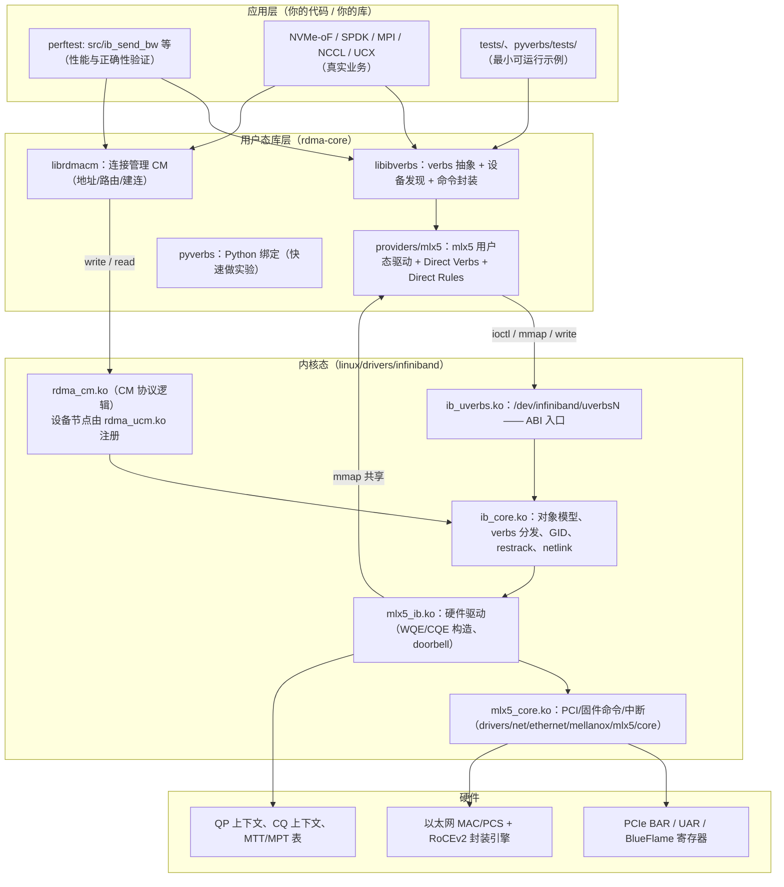

# 代码导航总图（三个仓库的「地图」）

这份文件的作用是：**当你听到一个概念时，能立刻知道该去哪个仓库、哪个目录、哪个文件里找答案。**

阅读方式建议：先看第 1 节的四层全景，再按需跳到对应仓库的目录表。所有路径都相对各自项目根目录（见 [`00-conventions.md`](00-conventions.md)）。

---

## 1. 四层全景：一次 RoCE 读写要穿过什么

> 关键直觉：**数据平面几乎不经过内核**（用户态直接写 UAR doorbell、直接轮询 CQ），**控制平面才走内核**（建 QP、注册 MR、建连）。第 4、7、8 章会反复回到这张图。

---

## 2. 内核仓库：`linux-7.2.8/linux-7.2.8`

### 2.1 模块划分（依据 `drivers/infiniband/core/Makefile` 与 `drivers/infiniband/hw/mlx5/Makefile`）

| 模块（.ko） | 对应设备节点 | 源码组成 |
|---|---|---|
| `ib_core.ko` | — | `core/` 下绝大部分文件（见 2.2），外加 **`core/ib_core_uverbs.c`**（`ib_core-$(CONFIG_INFINIBAND_USER_ACCESS_CORE) += ib_core_uverbs.o`，`Makefile:23`） |
| `ib_uverbs.ko` | **`/dev/infiniband/uverbsN`** | `core/uverbs_main.c`、`uverbs_cmd.c`、`uverbs_marshall.c`、`uverbs_std_types.c`、`uverbs_ioctl.c`、`uverbs_std_types_cq.c`、`uverbs_std_types_dmabuf.c`、`uverbs_std_types_dmah.c`、`uverbs_std_types_flow_action.c`、`uverbs_std_types_dm.c`、`uverbs_std_types_mr.c`、`uverbs_std_types_counters.c`、`uverbs_uapi.c`、`uverbs_std_types_device.c`、`uverbs_std_types_async_fd.c`、`uverbs_std_types_srq.c`、`uverbs_std_types_wq.c`、`uverbs_std_types_qp.c`（`Makefile:38-49`） |
| `ib_uverbs_support.ko` | — | `core/rdma_core.o`、`ucaps.o`、`uverbs_flow.o`（`Makefile:51-53`；**uobject 生命周期核心 `rdma_core.c` 在这里**，被 `ib_uverbs` 依赖） |
| `rdma_cm.ko` | —（**不注册**设备节点） | `core/cma.c`、`cma_trace.c`、`cma_configfs.c`（只提供 CM 协议逻辑） |
| `rdma_ucm.ko` | **`/dev/infiniband/rdma_cm`** | `core/ucma.c`（`:1948`–`:1954` 的 `struct miscdevice ucma_misc`，`.nodename = "infiniband/rdma_cm"`） |
| `ib_cm.ko` | — | `core/cm.c`、`cm_trace.c`（IB 原生 CM，RoCE 上用不到） |
| `iw_cm.ko` | — | `core/iwcm.c`、`iwpm_util.c`、`iwpm_msg.c`（iWARP 专用） |
| `ib_umad.ko` | `/dev/infiniband/umadN` | `core/user_mad.c` |

> **两个易错的模块归属**：① `ib_core_uverbs.c`（mmap entry 管理、`uverbs_get_flags64`/`uverbs_get_flags32`、`uverbs_copy_to`、`uverbs_get_buffer_desc`、udata 前后兼容辅助）**属于 `ib_core.ko`**，不是 `ib_uverbs.ko`；② uobject 生命周期核心 `rdma_core.c` 也不在 `ib_uverbs.ko` 里，而在 **`ib_uverbs_support.ko`**，通过符号命名空间 `"rdma_core"` 向 `ib_uverbs` 导出（`rdma_core.c:459`：`EXPORT_SYMBOL_NS_GPL(rdma_lookup_get_uobject, "rdma_core")`），由 `uverbs_main.c:64` 的 `MODULE_IMPORT_NS("rdma_core")` 引入。

### 2.2 `drivers/infiniband/core/` 文件角色

**对象模型与设备**

| 文件 | 角色 |
|---|---|
| `device.c` | 设备注册/注销、`ib_register_device`、端口属性、设备生命周期。**按名字查设备只有 static 的 `__ib_device_get_by_name()`（`:354`）**，它不对模块外导出 |
| `verbs.c` | `ib_device_ops` 的默认实现与分发入口。**注意 `ib_create_qp`/`ib_post_send` 不在这里**——它们是 `include/rdma/ib_verbs.h` 的 `static inline`（`:3987`/`:4088`，只做一次 ops 跳转）；verbs.c 里是 `ib_create_qp_user`（`:1354`）、`ib_create_qp_kernel`（`:1409`）、`ib_modify_qp`（`:2084`）、`ib_alloc_mr`（`:2362`）、`ib_map_mr_sg`（`:2779`）等 |
| `sysfs.c` | `ib_device`/`ib_port` 的 sysfs 属性（`/sys/class/infiniband/*`） |
| `cache.c` | GID/端口缓存的读写与失效（`ib_cache_update`、`ib_cache_gid_add`/`ib_cache_gid_del`、`gid_table_setup_one`）——**本树中没有 `ib_get_cached_gid`，也没有 `gid_table_setup`** |
| **`roce_gid_mgmt.c`** | **RoCE 专有：GID 表管理** —— 依据 netdev 的 IP/VLAN 增删 RoCEv1/v2 GID（`roce_gid_type`、`add_netdev_ips`，`:429`） |
| `lag.c` | LAG（链路聚合）支持 |
| `netlink.c` | RDMA netlink 基础设施（`rdma_nl_register`、`RDMA_NL_*` 族） |
| `nldev.c` | `rdma` netlink 设备查询接口（`rdma link show` 等工具的底座） |
| `restrack.c` | 资源追踪（可看到 QP/MR/CQ 的内核归属），`rdma res show` 的数据源 |
| `counters.c` | 标准 RDMA 计数器（`RDMA_COUNTER_*`，如 `port_xmit_data`） |
| `security.c` | 安全策略挂钩（`ib_security_*`） |
| `cgroup.c` | RDMA cgroup 资源限制（**本文件只是 53 行的 shim**：把 `ib_rdmacg_try_charge`/`ib_device_register_rdmacg` 转发给 `kernel:kernel/cgroup/rdma.c`，`rdma.max` 的解析与限额实现在那里） |
| `rdma_core.c` | **uobject 生命周期核心**（`rdma_lookup_get_uobject`、`uverbs_destroy_uobject` 等）—— **属于 `ib_uverbs_support.ko`**，经符号命名空间 `"rdma_core"` 导出 |
| `ucaps.c` | user capabilities（`UVERBS_...` 能力协商） |
| `iter.c` | 辅助迭代器 |

**内存注册（MR / umem）**

| 文件 | 角色 |
|---|---|
| `umem.c` | `ib_umem_get_desc()`/`ib_umem_get_attr()`/`ib_umem_get_attr_or_va()`/`ib_umem_get_cq_buf()`/`ib_umem_get_cq_buf_or_va()`（另有内联 `ib_umem_get_va()`）/`ib_umem_release()`：把用户虚拟地址或 dma-buf pin 成物理页并映射为 DMA 地址。**本内核已无 `ib_umem_get()`**，入参核心类型是 `struct ib_uverbs_buffer_desc` |
| `umem_dmabuf.c` | dma-buf 类型的 umem（GPU/加速器显存注册） |
| `umem_odp.c` | On-Demand Paging（按需缺页）支持 |
| `mr_pool.c` / `frmr_pools.c` | MR/FRMR 池化复用 |
| `dm.c`（在 hw 层） | Device Memory（设备内存） |

**QP/CQ 语义与工作请求**

| 文件 | 角色 |
|---|---|
| `cq.c` | CQ 的分配/释放与池化：`__ib_alloc_cq`（`:212`）、`__ib_alloc_cq_any`（`:300`）、`ib_free_cq`（`:321`）、`ib_cq_pool_get`（`:439`）。`ib_create_cq`/`ib_destroy_cq` 这两个对外名字在 `include/rdma/ib_verbs.h` |
| `rw.c` | **RDMA RW 框架**（`rdma_rw_ctx_init`/`rdma_rw_ctx_post` 等，为 ulp 提供「把 sg 列表变成 RDMA 读写 WQE」的通用层）。**`ib_alloc_mr`/`ib_map_mr_sg` 不在这里**，在 `verbs.c:2362`/`:2779` |
| `packer.c` | 直接构造 IB/RoCE 报头（内核内 UD 收发用） |
| `ud_header.c` | UD 报头解析/组装工具 |
| `multicast.c` | 组播组成员管理 |
| `addr.c` | 地址/GID 与 netdev 的解析（`rdma_addr_*`、`rdma_resolve_ip`、ARP/neigh 交互） |
| `agent.c` / `smi.c` / `mad.c` / `mad_rmpp.c` / `sa_query.c` | MAD/SMI/SA 子系统（IB 管理面；RoCE 中主要用于 `ibstat`/`saquery` 类工具） |

**用户态 ABI 入口（uverbs）**

| 文件 | 角色 |
|---|---|
| `uverbs_main.c` | `/dev/infiniband/uverbsN` 字符设备：`open`/`close`/`write`/`ioctl`/`mmap`/`poll` 的实现入口 |
| `uverbs_cmd.c` | 传统 `write()` 风格命令的实现（`ib_uverbs_create_qp` 等 `ib_uverbs_*`） |
| `uverbs_ioctl.c` | 新式 ioctl 命令的分发引擎：`ib_uverbs_ioctl`、`ib_uverbs_cmd_verbs`、`ib_uverbs_run_method`、`uverbs_process_attr`、`uverbs_fill_udata`（解析 `uverbs_attr`、调用方法表）。**注意 `uverbs_get_flags64/32` 不在这里** |
| `ib_core_uverbs.c` | 基于 uverbs 的通用支持（mmap entry 管理、`uverbs_get_flags64/32`、`uverbs_copy_to`、`uverbs_get_buffer_desc`、udata 前后兼容辅助），**属于 `ib_core.ko`** |
| `uverbs_uapi.c` | 用户态 ABI 描述注册（把方法表挂到对象树上） |
| `uverbs_std_types*.c` | 每类对象的「标准方法表」：`_qp.c`、`_cq.c`、`_mr.c`、`_srq.c`、`_wq.c`、`_dm.c`、`_dmabuf.c`、`_dmah.c`、`_counters.c`、`_flow_action.c`、`_async_fd.c`、`_device.c`、`uverbs_std_types.c`（总表） |
| `uverbs_marshall.c` | 结构体在「用户态布局 ↔ 内核布局」间的搬运 |
| `uverbs_flow.c` | flow steering（`ib_uverbs_create_flow`）相关的内核支持 |
| `uverbs.h` / `core_priv.h` / `cma_priv.h` / `mad_priv.h` | 内核内部头文件 |

### 2.3 关键头文件

| 路径 | 内容 |
|---|---|
| `include/rdma/ib_verbs.h` | **最重要的头**：`ib_device`、`ib_device_ops`、`ib_qp`、`ib_cq`、`ib_mr`、`ib_ah`、`ib_wc`、`ib_qp_type`（`IB_QPT_RC/UC/UD/RAW_PACKET/XRC/DC`）、`ib_gid`、`ib_gid_type`、`rdma_protocol_roce()` |
| `include/rdma/uverbs_ioctl.h` | uverbs ioctl 框架：`uverbs_attr`、`uverbs_method_spec`、`UVERBS_METHOD/OBJECT/ATTR` 宏、`UVERBS_ATTR_STRUCT`（`zero_trailing` 检查）、`UVERBS_ATTR_UMEM()` |
| `include/rdma/uverbs_types.h` | `uverbs_uobject` 类型定义与生命周期 |
| `include/rdma/uverbs_named_ioctl.h` | 命名 ioctl 定义的辅助宏 |
| `include/rdma/ib_addr.h` | 地址解析（`rdma_addr_size`、`rdma_addr_gid_offset`（`:104`）等） |
| `include/rdma/rdma_cm.h` | 内核侧 CM API（`rdma_create_id`、`rdma_resolve_route`…） |
| `include/rdma/rdma_netlink.h` | netlink 属性与操作码 |
| `include/rdma/ib_user_ioctl_cmds.h` 等 uAPI | 见 2.4 |

### 2.4 用户态可见的 ABI（uAPI，`include/uapi/rdma/`）

| 文件 | 内容 |
|---|---|
| `ib_user_verbs.h` | 传统 ABI：**`IB_USER_VERBS_ABI_VERSION 6`**（**传统 `write()` uverbs 通道**的 ABI 版本常量，**不是全树唯一**——见下方注）、`IB_USER_VERBS_CMD_*` 命令号、`ib_uverbs_create_qp`/`ib_uverbs_post_send` 等结构 |
| `ib_user_ioctl_cmds.h` | 新式 ioctl ABI：`UVERBS_OBJECT_*`、`UVERBS_METHOD_*`、各方法属性 |
| `ib_user_ioctl_verbs.h` | 新式 ABI 的选项/能力枚举，以及 UMEM 属性载荷 `struct ib_uverbs_buffer_desc`（`IB_UVERBS_BUFFER_TYPE_DMABUF`/`IB_UVERBS_BUFFER_TYPE_VA`） |
| `rdma_user_ioctl.h` / `rdma_user_ioctl_cmds.h` | ioctl 命令封装：`RDMA_VERBS_IOCTL`、`struct ib_uverbs_ioctl_hdr`（`object_id`/`method_id`/`num_attrs`/`reserved1`/`driver_id`/`reserved2`）、`struct ib_uverbs_attr`（`:54`–`:74`）。**本内核中不存在 `UVERBS_IOCTL_VERSION`** |
| `rdma_user_cm.h` | RDMA CM 的用户态 ABI（事件结构 `rdma_ucm_event_resp` 等） |
| `mlx5-abi.h` | **mlx5 供应商 ABI**：`mlx5_ib_alloc_ucontext_resp`（含 `bf_reg_size`、`tot_bfregs`、`num_uars_per_page`、`num_dyn_bfregs`；**没有 `bf_regs_per_page`**——那是 mlx4 的字段）、`mlx5_ib_create_qp`、`mlx5_ib_create_cq`、`MLX5_IB_MMAP_*` 偏移，是理解「用户态直接敲门铃」的钥匙 |
| `mlx5_user_ioctl_cmds.h` / `mlx5_user_ioctl_verbs.h` | mlx5 的 ioctl 扩展（DevX 等） |

> **ABI 版本号的真身（常见错误）**：本内核中**不存在 `UVERBS_IOCTL_VERSION`** —— 在 `include/rdma/`、`include/uapi/rdma/`、`drivers/infiniband/core/` 全树检索均无匹配。**传统 `write()` uverbs 通道**的版本常量是 `IB_USER_VERBS_ABI_VERSION 6`（`include/uapi/rdma/ib_user_verbs.h:46`）——它不是全树唯一（CM ABI 另有 `RDMA_USER_CM_ABI_VERSION 4`，`rdma_user_cm.h:43`；mlx5 厂商 ABI 另有 `MLX5_IB_UVERBS_ABI_VERSION 1`，`mlx5-abi.h:68`）。它经两条 sysfs 路径暴露：
> - **全局**：`/sys/class/infiniband_verbs/abi_version`，由 `CLASS_ATTR_STRING(abi_version, ...)` 定义、值为常量 `6`（`uverbs_main.c:1132`，在 `uverbs_main.c:1314` 挂到 `infiniband_verbs` 类上）；
> - **每设备**：`/sys/class/infiniband_verbs/uverbsN/abi_version`，由 `abi_version_show()`（`uverbs_main.c:1103`）返回该设备的 `ib_dev->ops.uverbs_abi_ver`，因此**逐设备可能不同**。
>
> ioctl 路径自身没有「版本号」，它的兼容机制是三条头部校验：`hdr.reserved1`、`hdr.reserved2` 必须为 0（否则 `-EPROTONOSUPPORT`，`uverbs_ioctl.c:551`），且 `hdr.driver_id` 必须等于 `uapi->driver_id`（否则 `-EINVAL`，`uverbs_ioctl.c:476`）。

### 2.5 `drivers/infiniband/hw/mlx5/` —— 你要学的真实硬件驱动

模块由 `mlx5_ib.o` 聚合而成，文件清单（`Makefile`）：

| 文件 | 角色 |
|---|---|
| `main.c` | **驱动骨架**：`mlx5r_probe`/`remove`、`ib_device_ops` 注册（`ib_register_device`）、`alloc_ucontext`（UAR/BF 池）、端口属性、`query_device`、`set_roce_addr`（GID → 固件）、GID 回调 `mlx5_ib_add_gid`/`del_gid`、netdev 事件 `mlx5_netdev_event`、RoCE 初始化 `mlx5_ib_roce_init`、mmap `mlx5_ib_mmap` |
| `qp.c` | **QP 全生命周期**：`mlx5_ib_create_qp` → `create_qp` → `create_user_qp`/`create_kernel_qp`；`mlx5_ib_modify_qp`（**两层状态校验的第二层**：用本文件的 `opt_mask[][][]`，`qp.c:3668`，裁剪该状态迁移允许的 optpar）、`mlx5_set_path`（RoCE 路径字段）、`mlx5_set_path_udp_sport`（源端口熵）、`to_mlx5_st`（QP 类型映射）、`create_raw_packet_qp` |
| `qpc.c` | **QP 固件命令封装**：`mlx5_qpc_create_qp`（发 `MLX5_CMD_OP_CREATE_QP`）、`mlx5_core_destroy_qp`、DCT 相关 |
| `wr.c` | **数据路径**：`mlx5_ib_post_send` / `mlx5_ib_post_recv`、WQE 组装（`begin_wqe`、`handle_qpt_ud`）、**门铃 `mlx5r_ring_db`** |
| `cq.c` | CQ 创建/销毁、`mlx5_ib_poll_cq`、`mlx5_ib_arm_cq`、CQ 完成回调 `mlx5_ib_cq_comp`、`get_sw_cqe`（owner 位判定） |
| `doorbell.c` | Doorbell record（DBR）页映射：`mlx5_ib_db_map_user_desc` |
| `mr.c` | MR/MW/FRWR/UMR 注册与失效、`reg_user_mr`、`map_mr_sg`、调用 `mlx5_core_create_mkey` |
| `mem.c` | `mlx5_ib_populate_pas`（umem → PAS 数组） |
| `umr.c` | User MR（内存键重映射） |
| `ah.c` | **Address Handle（RoCE 下就是 MAC/VLAN/GRH 的封装）**：`mlx5_ib_create_ah`、`create_ib_ah`（填 `mlx5_av`）、`mlx5_ah_get_udp_sport`、`MLX5_ECN_ENABLED` |
| `gsi.c` | GSI（QP1）代理 QP，承载 MAD 管理报文 |
| `mad.c` | MAD 处理 |
| `srq.c` / `srq_cmd.c` | SRQ（共享接收队列）与 SRQ 固件命令 |
| `odp.c` | On-Demand Paging（`CONFIG_INFINIBAND_ON_DEMAND_PAGING`） |
| `dm.c` / `dmah.c` | Device Memory（设备内存当 MR）与 DM AH |
| `cong.c` | **拥塞控制：仅 debugfs 旋钮**（`mlx5_ib_get_cc_params`/`mlx5_ib_set_cc_params`，经 `MLX5_CMD_OP_MODIFY_CONG_PARAMS` 改 DCQCN 的 RP/NP 参数）。**本驱动没有 verbs 级 DCQCN 配置接口** |
| `counters.c` | 端口计数器（含 RoCE 拥塞相关：`np_ecn_marked_roce_packets`、`roce_adp_retrans`、`roce_slow_restart_cnps`） |
| `fs.c` | flow steering（内核侧流表，`mlx5_ib_create_flow`） |
| `ib_virt.c` | 虚拟化（SR-IOV/VF 的 ib 侧支持） |
| `ib_rep.c` | 交换机 representor 的 IB 设备（`CONFIG_MLX5_ESWITCH`） |
| `devx.c` | **DevX：把固件对象直接暴露给用户态**（`MLX5_IB_METHOD_DEVX_*`，`CONFIG_INFINIBAND_USER_ACCESS`） |
| `std_types.c` / `qos.c` | mlx5 的 uverbs 扩展方法表 / QoS |
| `macsec.c` | RoCE + MACsec 卸载 |
| `data_direct.c` | Data Direct（DDP）放置 |
| `restrack.c` | 驱动侧资源追踪命名 |
| `mlx5_ib.h` | 驱动内部结构总集（`mlx5_ib_dev`、`mlx5_roce`、`mlx5_bfreg_info`、`mlx5_ib_qp`、`mlx5_ib_ah`、mmap 类型枚举） |
| `cmd.h` / `qp.h` / `srq.h` / `umr.h` / `wr.h` / `counters.h` / `devx.h` / `dm.h` / `dmah.h` / `ib_rep.h` / `macsec.h` / `fs.h` | 各模块内部接口 |

> 其他易错点：本目录**没有** `roce.c`（RoCE 胶水代码全在 `main.c`）、**没有** `cm.c`（连接管理在 `ib_core`/`rdma_cm`）、**没有** `mlx5_ib_get_netdev`（用 ib_core 的 `ib_device_get_netdev`）、**没有** `mlx5_ib_gid_table`（GID 表由 `ib_core` 的 `cache.c` 持有，mlx5 只注册 `.add_gid`/`.del_gid` 回调）。

### 2.6 `drivers/net/ethernet/mellanox/mlx5/core/`

| 路径 | 角色 |
|---|---|
| `main.c` | **`mlx5_core` 模块入口**：PCI probe、设备初始化（auxiliary bus 派生"rdma"/"multiport" 子设备走 **`dev.c:276` 的 `mlx5_adev_init()`**，由 `main.c:1855` 调用）、`mlx5_is_roce_on`、`handle_hca_cap_roce`（协商 `sw_r_roce_src_udp_port`） |
| `cmd.c` | 固件命令队列（mailbox）实现：`mlx5_cmd_exec`、`mlx5_cmd_do`、`mlx5_cmd_exec_polling` |
| `cq.c` | 固件层 CQ 命令：`mlx5_create_cq`、`mlx5_core_create_cq`、`mlx5_cq_tasklet_cb`、`mlx5_add_cq_to_tasklet`（中断 → tasklet 两级完成模型） |
| `eq.c` | 事件队列（EQ）与中断：`mlx5_eq_comp_int`、`mlx5_eq_add_cq`（CQ 以 cqn 为键挂在 EQ 上）、`mlx5_comp_eqn_get` |
| `pci_irq.c` | MSI-X 中断分配与亲和 |
| `uar.c` | **UAR / BlueFlame 寄存器页**：`mlx5_alloc_bfreg`/`mlx5_free_bfreg`、UAR 页分配与 bfreg 位图（用户态直接敲门铃的物理基础）。**本树中该文件已无 `mp_offset` 成员**（相关结构已重构，只剩 `uar.c:248` 的局部 `map_offset()`） |
| `port.c` | **PFC / PAUSE / 停顿水位**：`mlx5_set_port_pfc`、`mlx5_set_port_pause`（走 **`MLX5_REG_PFCC`**）、`mlx5_set_port_stall_watermark`（`:537`，同样走 `MLX5_REG_PFCC`；`MLX5_REG_PPTB` 只用于 `en/port.c:249` 的优先级→端口缓冲映射 `mlx5e_port_set_priority2buffer`） |
| `vport.c` | `mlx5_nic_vport_enable_roce` / `disable_roce`（NIC vport 上下文的 roce_en 位） |
| `rdma.c` | `mlx5_rdma_enable_roce` / `disable_roce`、RoCE 地址写入与 allow flow rule |
| `lib/gid.c` | **GID → 固件**：`mlx5_core_roce_gid_set`（发 `MLX5_CMD_OP_SET_ROCE_ADDRESS = 0x761`）、保留 GID |
| `fs_cmd.c` / `fs_core.c` | flow steering 底层（注意：**不在 mlx5_ib 目录**） |
| `en_main.c`、`en_common.c`、`en_tx.c`、`en_rx.c`、`en_fs.c`、`en_ethtool.c`、`en_dcbnl.c`、`en_dim.c` 等 `en_*` | **以太网 netdev 驱动**：RoCE 依赖它拿到 MAC/VLAN/IP 与链路状态；PFC/DCB 配置走 `en_dcbnl.c`（`CONFIG_MLX5_CORE_EN_DCB`） |
| `devlink.c` | `ENABLE_ROCE` 泛型参数（运行时开关 RoCE） |
| `eswitch*.c`、`esw/` | SR-IOV / switchdev / representor（VF 的 RoCE 开关：`port_fn_roce_set`） |
| `lag/lag.c` | RoCE LAG / 多端口绑定 |
| `fw.c` | 固件加载/复位；`MLX5_CAP_GEN(dev, roce)` 时读取 `MLX5_CAP_ROCE` 能力组 |
| `diag/` | 诊断（`devlink health` 的数据源之一） |

> 学习路径提示：**先 `mlx5_ib`，再 `mlx5_core`**。`mlx5_ib` 负责「verbs 语义 → WQE/命令」，`mlx5_core` 负责「命令 → 固件/硬件」。
>
> **一个容易搞错的事实（很多人被二手资料误导）**：QP 的固件命令**不在** `mlx5_core`，而在 **`drivers/infiniband/hw/mlx5/qpc.c`**（`mlx5_qpc_create_qp`、`mlx5_core_destroy_qp`）。`mlx5_core` 只提供命令通道与 CQ/PD/MR/UAR/EQ 等共享资源。本内核树中**不存在** `drivers/net/ethernet/mellanox/mlx5/core/qp.c`，也**不存在** `mlx5_core_create_qp()`。

### 2.7 其他值得一读的实现

| 路径 | 为什么值得看 |
|---|---|
| `drivers/infiniband/sw/rxe/` | **软件 RoCE**：无需硬件即可学 verbs，`rdma_rxe` 逐字节构造 RoCEv2 包，是理解报文格式的最佳读物 |
| `drivers/infiniband/sw/siw/` | 软件 iWARP（对比 RoCE 的另一种封装） |
| `drivers/infiniband/ulp/ipoib/` | IPoIB（在 IB 上跑 IP） |
| `drivers/infiniband/ulp/rtrs/` | RNBD/RTRS：RDMA 上的块设备传输 |
| `drivers/infiniband/ulp/isert/`、`srpt/` | iSER / SRP：RDMA 存储目标端 |
| `drivers/infiniband/hw/erdma/` | 国产云厂商（阿里）RDMA 网卡驱动，RoCE 架构清晰、代码量适中 |
| `drivers/infiniband/hw/hns/` | 华为 hns RoCE 驱动 |
| `drivers/infiniband/hw/bnxt_re/`、`ionic`、`mana`、`irdma`、`qedr` | 各家 RoCE 实现，横向对比能看出「哪些是协议要求、哪些是厂商选择」 |
| `Documentation/infiniband/` | `core_locking.rst`（锁规则）、`sysfs.rst`（sysfs 布局）、`ucaps.rst`（能力）、`user_verbs.rst`、`user_mad.rst` |

---

## 3. 用户态仓库：`rdma-core-master`（v66.0）

### 3.1 顶层目录

| 目录 | 产出 |
|---|---|
| `libibverbs/` | `libibverbs.so`（verbs 核心库） |
| `librdmacm/` | `librdmacm.so`（连接管理）+ `librspreload.so`（rsocket 预加载） |
| `providers/` | 各厂商用户态驱动 `.so`（`libmlx5.so` 等），由 libibverbs 动态加载 |
| `libibumad/` | `libibumad.so`（MAD 用户态） |
| `libibmad/` | `libibmad.so`（MAD 报文构造，诊断工具用） |
| `libibnetdisc/` | IB 网络拓扑发现 |
| `infiniband-diags/` | 命令行诊断工具（`ibstat`、`iblinkinfo`、`perfquery`、`saquery`…） |
| `ibacm/` | IB ACM 守护进程：加速地址/路由解析（RoCE 场景下与 CM 配合） |
| `iwpmd/` | iWARP 端口映射守护进程 |
| `srp_daemon/` | SRP 目标发现 |
| `rdma-ndd/` | 节点描述守护进程（`ibstat` 里显示的 node description） |
| `pyverbs/` | Python 绑定（学习/自动化实验的利器） |
| `tests/` | 独立测试程序（最好的 API 示例） |
| `util/` | 公共工具库（日志、sysfs 读写） |
| `ccan/` | 内嵌的 CCAN 工具集 |
| `kernel-headers/` | 从内核同步的 uAPI 头（**用户态 ABI 的权威定义**） |
| `buildlib/`、`debian/`、`redhat/`、`suse/` | 构建与打包 |
| `Documentation/` | `libibverbs.md`、`librdmacm.md`、`pyverbs.md`、`udev.md`、`versioning.md`、`rxe.md`、`ibacm.md`、`testing.md`、`tag_matching.md` |

### 3.2 `libibverbs/` 文件角色

| 文件 | 角色 |
|---|---|
| `verbs.h`（102KB） | **用户态 verbs API 权威定义**：`ibv_device`、`ibv_context`、`ibv_pd`、`ibv_mr`、`ibv_cq`、`ibv_qp`、`ibv_srq`、`ibv_ah`、`ibv_wc`、`ibv_send_wr`、`ibv_qp_attr`…（对外头文件，安装为 `<infiniband/verbs.h>`） |
| `verbs_api.h` | 新版 API 声明拆分（与 `verbs.h` 配合） |
| `verbs.c`（34KB） | 通用 verbs 实现：`ibv_reg_mr_iova2`（`:311`）/`ibv_reg_mr_iova`（`:348`）、`ibv_query_gid_type`（`:998`，ABI 仍导出但原型只在 `driver.h`）、`ibv_resolve_eth_l2_from_gid`（`:1274`）、`ibv_query_port` 等。**`ibv_post_send`/`ibv_post_recv`/`ibv_poll_cq` 不在本文件里**（全文件 grep 0 匹配）——唯一实现是 `verbs.h:3630` 的 `static inline`，经 `qp->context->ops.post_send` 转发，**没有弱符号** |
| `device.c`、`sysfs.c`、`init.c`、`enum_strs.c` | 设备发现与打开：扫 `/sys/class/infiniband`、开 `/dev/infiniband/uverbsN`、`ibv_get_device_list`、`ibv_open_device` |
| `cmd.c`（36KB）+ `cmd_*.c` | **`ibv_cmd_*` 命令封装层**：把 verbs 调用翻译成 uverbs 的 write/ioctl。按对象拆分：`cmd_qp.c`、`cmd_cq.c`、`cmd_mr.c`、`cmd_pd.c`、`cmd_device.c`、`cmd_srq.c`、`cmd_wq.c`、`cmd_flow.c`、`cmd_dm.c`、`cmd_dmabuf.c`、`cmd_dmah.c`、`cmd_counters.c`、`cmd_comp_cntr.c`、`cmd_rwq_ind.c`、`cmd_xrcd.c`、`cmd_ah.c`、`cmd_mw.c`、`cmd_ioctl.c`（新式 ioctl）、`cmd_ioctl.h`、`cmd_write.h` |
| `cmd_fallback.c` | 新式/旧式 ABI 的回退逻辑 |
| `memory.c` | `ibv_reg_mr` 等内存注册的用户态部分、`ibv_alloc_dm` |
| `marshall.c` / `marshall.h` | 用户态结构体打包到 uverbs 命令缓冲区 |
| `driver.h`（33KB） | **provider 内部 ABI**：`ibv_driver_init_func`、`ibv_driver_ops`、`ibv_context_ops`……写第三方 provider 的必读 |
| `all_providers.c`、`static_driver.c`、`dynamic_driver.c` | provider 注册与动态加载（`dlopen` 厂商 `.so`） |
| `dummy_ops.c` | 各 ops 的默认空实现（新 provider 不必填满所有函数指针） |
| `compat-1_0.c` | 与 1.0 版 ABI 的兼容 |
| `kern-abi.h`、`sa-kern-abi.h` | 内核 ABI 的内核态布局视图 |
| `ibdev_nl.c` | 通过 netlink 查询设备（`rdma` netlink） |
| `neigh.c`（19KB） | **通过 netlink 解析邻居（ARP/ND）**，得到目的 MAC/VLAN —— RoCE 建 `AH` 时要用 |
| `opcode.h` | 内核命令 opcode 定义 |
| `libibverbs.map.in` | 导出符号版本表 |
| `dmabuf_heap.c` | dma-buf 堆（GPU 显存注册） |
| `tm_types.h` | Tag Matching 类型 |
| `arch.h`、`ibverbs.h` | 架构相关与内部公共头 |

### 3.3 `librdmacm/` 文件角色

| 文件 | 角色 |
|---|---|
| `rdma_cma.h`（28KB） | **CM 对外 API**：`rdma_cm_id`、`rdma_event_channel`、`RDMA_CM_EVENT_*`、`rdma_create_id`、`rdma_resolve_addr`、`rdma_resolve_route`、`rdma_connect`、`rdma_accept`… |
| `rdma_verbs.h` | CM 之上的 verbs 便捷封装（`rdma_post_send`、`rdma_reg_msgs` 等） |
| `cma.c`（80KB） | CM 核心实现：事件通道、`/dev/infiniband/rdma_cm` 交互、地址/路由解析、GID 选择 |
| `acm.c`、`acm.h` | 与 `ibacm` 守护进程通信（加速解析） |
| `addrinfo.c` | `rdma_getaddrinfo`/`rdma_getaddrinfo` 的名字解析 |
| `indexer.c`、`indexer.h` | CM ID 索引（把内核返回的句柄映射回 `rdma_cm_id`） |
| `rsocket.c`（122KB） | **RSocket：把 RDMA 伪装成 socket API**（`librspreload.so`，可 `LD_PRELOAD` 加速现有 TCP 程序） |
| `rdma_cma_abi.h` | CM 的内核 ABI 布局 |
| `librdmacm.map`、`librspreload.map` | 符号版本脚本 |
| `CMakeLists.txt` | 构建定义（`librdmacm.so`、`librspreload.so`、`rdma-ndd` 等） |

### 3.4 `providers/mlx5/` 文件角色（用户态 mlx5）

| 文件 | 角色 |
|---|---|
| `verbs.c`（217KB） | **mlx5 用户态驱动主体**：所有 `mlx5_*` verbs 实现（open/alloc/create/post/poll/query），以及 `mlx5dv_*`（Direct Verbs）API 的绝大部分 |
| `qp.c`（112KB） | 用户态 QP：`mlx5dv_create_qp`、`mlx5dv_init_obj`、DV QP 初始化、`mlx5_post_send` 快速路径 |
| `cq.c`（54KB） | 用户态 CQ：`mlx5dv_create_cq`、`mlx5dv_cq_init_attr`、CQE 解析 |
| `wqe.h`（5KB） | **WQE 布局定义**（用户态构造 WQE 的字段定义） |
| `dbrec.c` | Doorbell record（`dbrec`）管理 |
| `buf.c` | UAR/缓冲区分配与 mmap 辅助 |
| `mlx5.h`（49KB）/ `mlx5_api.h` | 驱动内部结构与 API |
| `mlx5dv.h`（64KB） | **Direct Verbs 对外头文件**：`mlx5dv_qp`（含 `bf`、`dbrec`、`sq`、`rq`、`cq` 指针）、`mlx5dv_cq`、`mlx5dv_ucontext`、`mlx5dv_context` |
| `mlx5dv_dr.h`（55KB）+ `dr_*.c` | **Direct Rules**：用户态流表（steering）卸载。`dr_domain.c`、`dr_matcher.c`、`dr_rule.c`、`dr_action.c`、`dr_table.c`、`dr_ste*.c`（Steiner 表项编码）、`dr_icm_pool.c`、`dr_devx.c`、`dr_send.c`、`dr_arg.c`、`dr_buddy.c`、`dr_crc32.c`、`dr_dbg.c`、`dr_ptrn.c`、`dr_vports.c` |
| `mlx5_ifc.h`（134KB） | **固件接口位域定义**（所有 PRM 结构体的位域），读 WQE/CQE 编码的字典 |
| `mlx5_vfio.c`（93KB）/ `mlx5_vfio.h` | VFIO 场景（虚拟机直通）支持 |
| `mlx5-abi.h` | 与内核共享的 mlx5 ABI（`mlx5_ib_alloc_ucontext_resp` 等） |
| `srq.c` | SRQ 用户态实现 |
| `mlx5_trace.c`/`.h` | tracepoint（`MLX5_...`） |
| `libmlx5.map` | 导出符号表 |
| `CMakeLists.txt` | 生成 `libmlx5-rdmav65.so` 与 `/usr/lib64/libibverbs/libmlx5.so` 符号链 |

### 3.5 `kernel-headers/` —— 用户态 ABI 的权威定义

| 子目录/文件 | 内容 |
|---|---|
| `rdma/rdma_user_ioctl.h`、`rdma_user_ioctl_cmds.h` | ioctl 框架与命令号 |
| `rdma/ib_user_verbs.h` | 传统 uverbs ABI |
| `rdma/ib_user_ioctl_cmds.h`、`ib_user_ioctl_verbs.h` | 新式 uverbs ABI |
| `rdma/rdma_user_cm.h` | RDMA CM ABI（`RDMA_USER_CM_CMD_*`、`RDMA_USER_CM_ABI_VERSION 4`） |
| `rdma/rdma_netlink.h` | netlink 属性 |
| `rdma/mlx5-abi.h`、`mlx5_user_ioctl_cmds.h`、`mlx5_user_ioctl_verbs.h` | mlx5 供应商 ABI |
| `rdma/erdma-abi.h`、`hns-abi.h`、`bnxt_re-abi.h`、`efa-abi.h`、`ionic-abi.h`、`irdma-abi.h`、`mana-abi.h`、`mlx4-abi.h`、`mthca-abi.h`、`ocrdma-abi.h`、`qedr-abi.h`、`siw-abi.h`、`rvt-abi.h`、`vmw_pvrdma-abi.h` | 各厂商 ABI |
| `rdma/hfi/` | Intel HFI 专用 |

> **学习建议**：想知道「用户态到底给内核发了什么」，就看 `kernel-headers/rdma/` + `libibverbs/cmd_*.c`；想知道「内核怎么处理」，就看 `drivers/infiniband/core/uverbs_*.c`。这三处是对着读的。

### 3.6 `tests/` 与 `pyverbs/`：最好的入门示例

- `tests/` 目录下的独立程序（编译后随 rdma-core 安装）是**可直接运行的 API 范例**：想学某类操作，找对应名字的程序读 `main()` 即可。
- `pyverbs/tests/` 下的 pytest 用例（`test_*.py`）是**最快建立直觉**的方式：几十行 Python 就能建 QP、注册 MR、跑一次 send/recv。

---

## 4. 应用仓库：`perftest-master/perftest-master`（v6.30）

| 文件 | 角色 |
|---|---|
| `src/perftest_parameters.h`（27KB） | **全部参数的结构化定义**：`struct perftest_parameters`、`struct perftest_comm`、各枚举（`rx_depth`/`tx_depth`/`verb`/`TestType`…） |
| `src/perftest_parameters.c`（184KB） | **命令行解析与语义实现**：`--xxx` 选项表、参数校验与推导、输出格式 |
| `src/perftest_communication.c`（95KB） | **连接建立**：TCP 握手 / `-R` RDMA-CM 握手、参数交换、组播 |
| `src/perftest_resources.c`（226KB） | **资源生命周期**：建 ctx/PD/CQ/QP/MR、`ibv_modify_qp` 状态迁移、AH 构造、收发循环 |
| `src/perftest_negotiation.c` | 双方能力/参数协商 |
| `src/get_clock.c` / `.h` | 计时（`cycles_t`、TSC、`-F/--CPU-freq`（无参开关，只抑制未满频警告）、cycles→usec） |
| `src/perftest_counters.c` / `.h` | 运行前后读取硬件计数器 |
| `src/host_validation.c` / `validation_common.h` / `host_validation.h` | **正确性校验**（数据模式/CRC），证明「不只是快，还对」 |
| `src/memory.h` / `allocated_mem` | 内存后端抽象 |
| `src/host_memory.c`、`mmap_memory.c`、`hl_memory.c`、`dm_memory.c` | CPU 内存 / mmap / hugepage / 设备内存 |
| `src/cuda_memory.c`、`cuda_loader.c`、`rocm_memory.c`、`neuron_memory.c`、`mlu_memory.c`、`musa_memory.c`、`opencl_memory.c`、`numa_loader.c` | GPU/加速器内存（GPUDirect RDMA、dma-buf）与 NUMA 绑定 |
| `src/send_bw.c`、`send_lat.c` | `ib_send_bw` / `ib_send_lat`：**双边 SEND/RECV** 带宽与时延 |
| `src/write_bw.c`、`write_lat.c` | `ib_write_bw` / `ib_write_lat`：**单边 RDMA WRITE** |
| `src/read_bw.c`、`read_lat.c` | `ib_read_bw` / `ib_read_lat`：**单边 RDMA READ** |
| `src/atomic_bw.c`、`atomic_lat.c` | 原子操作带宽与时延 |
| `src/raw_ethernet_resources.c`、`raw_ethernet_send_bw.c`、`raw_ethernet_send_lat.c`、`raw_ethernet_send_burst_lat.c`、`raw_ethernet_fs_rate.c` | **RAW_PACKET QP**：自己构造以太网/UDP/IP 头，理解 RoCEv2 封装的最佳实验台 |
| `src/multicast_resources.c` / `.h` | 组播（UD QP）实验 |
| `src/mlx5_devx.h` | 与 mlx5 DevX 的交互声明 |
| `man/` | 各命令的手册页 |
| `README` | 全部选项与用法的权威说明（30KB，**建议通读**） |
| `runme`、`run_perftest_loopback`、`run_perftest_multi_devices` | 现成的批量实验脚本 |

---

## 5. 一页速查：按问题找位置

| 我想知道… | 去看 |
|---|---|
| QP 状态机有哪些状态、迁移要设哪些字段 | **两层校验**：`kernel:drivers/infiniband/core/verbs.c` 的 `qp_state_table[][]`（`verbs.c:1462`）与 `ib_modify_qp_is_ok()`（`verbs.c:1763`）；`kernel:drivers/infiniband/hw/mlx5/qp.c` 的 `opt_mask[][][]`（`qp.c:3668`）与 `mlx5_ib_modify_qp`；`perftest:src/perftest_resources.c` 的 `ibv_modify_qp` 序列；`rdma-core:libibverbs/verbs.h` 的 `ibv_qp_state` |
| `ibv_post_send` 到底做了什么 | `rdma-core:libibverbs/verbs.h` 的 `ibv_post_send`（`:3630`，`static inline`，非弱符号）→ `providers/mlx5/qp.c` 的 `mlx5_post_send` → `providers/mlx5/wqe.h` + `mlx5_ifc.h` |
| 用户态如何直接敲门铃（BlueFlame） | `rdma-core:providers/mlx5/dbrec.c`、`buf.c`、`mlx5dv.h` 的 `mlx5dv_qp.bf`；内核侧 `kernel:drivers/infiniband/hw/mlx5/doorbell.c` |
| RoCE 的 GID 从哪来、怎么选 | `kernel:drivers/infiniband/core/roce_gid_mgmt.c`、`cache.c`；`rdma-core:librdmacm/cma.c`；`rdma-core:libibverbs/neigh.c` |
| RoCEv2 包长什么样 | `kernel:drivers/infiniband/sw/rxe/`（软件实现逐字节构造）；本教程第 2 章 |
| DCQCN/ECN/PFC 在哪配 | `kernel:drivers/infiniband/hw/mlx5/cong.c`；本教程第 11 章 |
| 从应用调用到固件命令的完整链路 | 本教程第 8 章（含 CREATE_QP 全链路） |
| 性能测出来不达标怎么查 | 本教程第 12 章 |
| 用户态 ABI 结构体长什么样 | `rdma-core:kernel-headers/rdma/*.h`（权威）；`libibverbs/cmd_*.c`（怎么用） |

---

## 6. 使用本图的两个练习

1. **反向定位练习**：随便打开 `perftest:src/perftest_resources.c`，找到一个 `ibv_*` 调用，沿着「应用 → libibverbs → `cmd_*.c` → `uverbs_*.c` → `mlx5_ib` → `mlx5_core`」把链路写到纸上。做 5 次，你就有架构直觉了。
2. **正向定位练习**：给定需求「让两台机器的 RoCE 网卡用 RoCEv2 通信，源 UDP 端口随机以利 ECMP」，找出涉及的每一个文件（提示：GID 类型选择、AH 构造、UDP sport 生成分别在不同层）。
