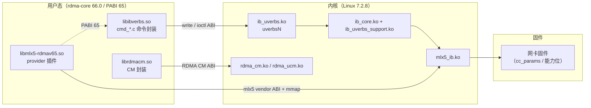

# 版本、ABI 与兼容性矩阵

RDMA 是少数「用户态库、内核模块、固件」三者必须协同演进的子系统之一。绝大多数「昨天还好、今天报 `EINVAL`」的故障，根因都不是配置写错，而是**版本漂移**：升级了其中一层、另外两层没跟上。

本文件给出四件事：

1. 本教程锁定的**三个版本基线**（精确字符串，可逐字核对）；
2. **每一条 ABI 的边界**：内核与用户态之间到底存在哪几条契约、各自的命令号/版本常量/校验点在哪；
3. 一张**兼容性矩阵**：常见升级/不匹配场景下「会发生什么 / 如何检测 / 如何处理」；
4. **如何查看每个版本**的可粘贴命令，以及**版本漂移导致的 6 类经典故障**。

版本基线与代码引用格式遵循 [`00-conventions.md`](00-conventions.md)；本文出现的所有路径都可在 [`repo-map.md`](repo-map.md) 中反查；术语解释见 [`glossary.md`](glossary.md)。

---

## 1. 本教程锁定的三个版本

| 组件 | 本地目录 | 版本 | 判定依据（精确到行） |
|---|---|---|---|
| Linux 内核 | `linux-7.2.8/linux-7.2.8` | **7.2.8** | `kernel:Makefile` 前几行：`VERSION = 7` / `PATCHLEVEL = 2` / `SUBLEVEL = 8`（`EXTRAVERSION` 为空，`NAME = Baby Opossum Posse`） |
| rdma-core | `rdma-core-master` | **66.0**，且 **`IBVERBS_PABI_VERSION = "65"`** | `rdma-core:CMakeLists.txt:87` `set(PACKAGE_VERSION "66.0")`；`:91` `set(IBVERBS_PABI_VERSION "65")`；`:92` `set(IBVERBS_PROVIDER_SUFFIX "-rdmav${IBVERBS_PABI_VERSION}.so")` |
| perftest | `perftest-master/perftest-master` | **6.30** | `perftest:configure.ac:32` `AC_INIT([perftest],[6.30],[linux-rdma@vger.kernel.org])` |

另外两个**派生**出来的版本号，看到它们时要知道从哪来：

| 派生版本 | 值（本快照） | 定义位置 | 作用 |
|---|---|---|---|
| `IB_USER_VERBS_ABI_VERSION` | **6** | `kernel:include/uapi/rdma/ib_user_verbs.h:46` | 传统 uverbs write ABI 的版本号，经 sysfs 暴露 |
| `MLX5_IB_UVERBS_ABI_VERSION` | **1** | `kernel:include/uapi/rdma/mlx5-abi.h:68` | mlx5 厂商 uAPI 的版本号 |

### 1.1 三个版本各管什么



**三条独立演进的契约**，各自有各自的版本号与探测方式，任何一条错位都会出问题：

1. **libibverbs ↔ provider**：由 `IBVERBS_PABI_VERSION` 约束（`.so` 文件名后缀），**加载期就失败**，最容易发现。
2. **用户态库 ↔ 内核 uverbs**：由传统 write ABI（`IB_USER_VERBS_ABI_VERSION 6`）与新式 ioctl ABI 共同构成，**运行期失败**，最难定位。
3. **mlx5_ib ↔ 网卡固件**：由固件能力位（`MLX5_CAP_GEN` / `MLX5_CAP_ROCE` 等）协商，**行为差异型失败**（命令成功但语义变了）。

---

## 2. 每条 ABI 的边界

系统里有**五条**用户态可见的 ABI 通道。它们不是「旧的要被淘汰、新的取代旧的」，而是**同时存在、按能力协商**。

### 2.1 `/dev/infiniband/uverbsN` 的 write ABI（传统通道）

**边界定义**：`kernel:include/uapi/rdma/ib_user_verbs.h`

| 项 | 值 / 位置 | 说明 |
|---|---|---|
| ABI 版本 | `IB_USER_VERBS_ABI_VERSION 6`（`:46`） | **传统 `write()` uverbs 通道**的 ABI 版本常量。注意它不是全树唯一：CM ABI 有 `RDMA_USER_CM_ABI_VERSION 4`（`rdma_user_cm.h:43`）、mlx5 厂商 ABI 有 `MLX5_IB_UVERBS_ABI_VERSION 1`（`mlx5-abi.h:68`） |
| 扩展命令起点 | `IB_USER_VERBS_CMD_THRESHOLD 50`（`:47`） | 小于 50 的是传统命令；50 起为扩展命令（如 `IB_USER_VERBS_EX_CMD_CREATE_FLOW = IB_USER_VERBS_CMD_THRESHOLD`，`:98`） |
| 扩展命令标志 | `IB_USER_VERBS_CMD_FLAG_EXTENDED 0x80000000u`（`:156`） | 与命令号按位或，用于在**同一条 write 通道**上承载扩展命令 |
| 命令号掩码 | `IB_USER_VERBS_CMD_COMMAND_MASK 0xff`（`:155`） | 低 8 位是命令号 |
| 传统命令号 | `IB_USER_VERBS_CMD_GET_CONTEXT`、`QUERY_DEVICE`、`QUERY_PORT`、`ALLOC_PD`、`CREATE_AH`、`REG_MR`、`CREATE_CQ`、`CREATE_QP`、`MODIFY_QP`、`POST_SEND`、`POST_RECV`…（`:50`–`:90`） | 与 verbs 对象一一对应 |
| 内核实现 | `kernel:drivers/infiniband/core/uverbs_cmd.c`（`ib_uverbs_create_qp` 等 `ib_uverbs_*`），入口在 `uverbs_main.c` 的 `write` 实现 | — |
| 用户态实现 | `rdma-core:libibverbs/cmd.c` + `cmd_*.c`，出口是 `_execute_cmd_write()`（`cmd_fallback.c:233`）里的 `write(ctx->cmd_fd, vreq, req_size)`（`:251`） | — |

**边界在哪**：write ABI 只能表达「定长结构体 + 定长响应」。它**无法表达可选属性、无法表达复杂嵌套参数**，因此新特性只能塞进「扩展命令」的私有尾部（`uhw_in`/`uhw_out`），而且**老内核遇到不认识的扩展命令会直接失败**。

**版本号怎么暴露**（两条 sysfs 路径，注意它们的语义不同）：

| 路径 | 值 | 实现 | 语义 |
|---|---|---|---|
| `/sys/class/infiniband_verbs/abi_version` | 常量 **6** | `kernel:drivers/infiniband/core/uverbs_main.c:1132` `CLASS_ATTR_STRING(abi_version, ...)`，`:1314` 挂到类上 | **全局**：内核 uverbs 框架支持的 ABI 版本 |
| `/sys/class/infiniband_verbs/uverbsN/abi_version` | 逐设备可变 | `uverbs_main.c:1103` `abi_version_show()`，返回该设备的 `ib_dev->ops.uverbs_abi_ver` | **每设备**：这个设备自己声明的版本，**可能不等于全局值** |

> 【易错】本内核树中**不存在 `UVERBS_IOCTL_VERSION`**（在 `include/rdma/`、`include/uapi/rdma/`、`drivers/infiniband/core/` 全树检索均无匹配）。ioctl 路径**自身没有版本号**，它的兼容机制是下面 2.2 节的三条头部校验。

### 2.2 ioctl ABI（新式通道）

**边界定义**：`kernel:include/uapi/rdma/rdma_user_ioctl.h`、`rdma_user_ioctl_cmds.h`、`ib_user_ioctl_cmds.h`、`ib_user_ioctl_verbs.h`

```c
#define RDMA_IOCTL_MAGIC        0x1b
#define RDMA_VERBS_IOCTL \
        _IOWR(RDMA_IOCTL_MAGIC, 1, struct ib_uverbs_ioctl_hdr)

struct ib_uverbs_ioctl_hdr {
        __u16 length;
        __u16 object_id;
        __u16 method_id;
        __u16 num_attrs;
        __aligned_u64 reserved1;
        __u32 driver_id;
        __u32 reserved2;
        struct ib_uverbs_attr  attrs[];
};
```

（`kernel:include/uapi/rdma/rdma_user_ioctl_cmds.h:40`–`:42` 与 `:76`–`:85`。`repo-map.md` 列出的正是这组字段。）

| 项 | 位置 | 说明 |
|---|---|---|
| 命令封装 | `RDMA_VERBS_IOCTL = _IOWR(0x1b, 1, struct ib_uverbs_ioctl_hdr)` | 所有 uverbs ioctl 都走这一个号 |
| 请求头 | `struct ib_uverbs_ioctl_hdr` | `object_id` + `method_id` + 属性数组 |
| 属性结构 | `struct ib_uverbs_attr`（`rdma_user_ioctl_cmds.h:54`–`:74`，**不在 `ib_user_ioctl_cmds.h` 里**） | `attr_id` / `len` / `flags`（`UVERBS_ATTR_F_MANDATORY`、`UVERBS_ATTR_F_VALID_OUTPUT`） |
| 对象/方法名 | `UVERBS_OBJECT_*` / `UVERBS_METHOD_*`（`ib_user_ioctl_cmds.h`） | 例如 `UVERBS_METHOD_QP_CREATE` |
| 内核实现 | `kernel:drivers/infiniband/core/uverbs_ioctl.c`：`ib_uverbs_ioctl`、`ib_uverbs_cmd_verbs`、`ib_uverbs_run_method`、`uverbs_process_attr`、`uverbs_fill_udata` | 方法表由 `uverbs_uapi.c` 注册、`uverbs_std_types*.c` 提供 |
| 用户态实现 | `rdma-core:libibverbs/cmd_ioctl.c`（`execute_ioctl`），决策逻辑在 `cmd_fallback.c` | — |

**三条「没有版本号却做到兼容」的校验**（这是本 ABI 最精妙的地方）：

| 校验 | 违反时返回 | 位置 |
|---|---|---|
| `hdr.reserved1 == 0` 且 `hdr.reserved2 == 0` | `-EPROTONOSUPPORT` | `kernel:drivers/infiniband/core/uverbs_ioctl.c:551` |
| `hdr.driver_id == uapi->driver_id` | `-EINVAL` | `uverbs_ioctl.c:476` |
| 未知/不支持的 `method_id`、缺 mandatory 属性 | `-EPROTONOSUPPORT` | 由方法表与属性校验决定 |

**用户态如何决定走哪条路**（判据只有两个 errno，务必记住）：

| 内核返回 | 含义 | 用户态动作 | 位置 |
|---|---|---|---|
| `ENOTTY` | **ioctl 框架完全不存在**（老内核） | 把**全部** op 标记为不支持，走 write ABI | `rdma-core:libibverbs/cmd_fallback.c:98`–`:102` |
| `EPROTONOSUPPORT` | ioctl 框架在，但**这个方法或缺的 mandatory 属性不支持** | 只把**这一个** op 标记为不支持，走 write ABI | `cmd_fallback.c:104`–`:111` |
| `EOPNOTSUPP` | 该调用带的东西**根本无法用 write ABI 表达** | 直接失败 | `cmd_fallback.c:73`–`:76`（`_check_legacy`） |

**主动探测**：`has_ioctl_write()`（`rdma-core:libibverbs/device.c:200`）会故意发一个「请求长度太小」的 `UVERBS_METHOD_INVOKE_WRITE`，**预期得到 `ENOSPC`**；若得到 `EPROTONOSUPPORT` 或 `ENOTTY`，就判定内核没有 ioctl-write 能力，结果缓存进 `priv->use_ioctl_write`。编译期还可用 `VERBS_IOCTL_ONLY` / `VERBS_WRITE_ONLY` 强制只走一条路（`device.c:206`–`:209`）。

> 这就是为什么「内核升级、用户态不变」通常**不会**立刻坏：用户态会自动发现新能力并按需使用；而「用户态升级、内核不变」通常也**不会**立刻坏，因为每条新命令都有 write ABI 回退。真正会坏的是**「新用户态 + 太老的内核」且该功能没有回退路径**。

### 2.3 RDMA CM ABI（`/dev/infiniband/rdma_cm`）

**边界定义**：`kernel:include/uapi/rdma/rdma_user_cm.h`（用户态权威定义在 `rdma-core:kernel-headers/rdma/rdma_user_cm.h`）

| 项 | 位置 | 说明 |
|---|---|---|
| 设备节点 | `/dev/infiniband/rdma_cm` | 由 **`rdma_ucm.ko`** 注册（`kernel:drivers/infiniband/core/ucma.c:1948`–`:1954` 的 `struct miscdevice ucma_misc`，`.nodename = "infiniband/rdma_cm"`）；`rdma_cm.ko`（`cma.c`）只提供 CM 协议逻辑，**不注册该节点** |
| 写通道实现 | `kernel:drivers/infiniband/core/ucma.c`（`rdma_ucm.ko`），命令分发表 `ucma_cmd_table[]`（`ucma.c:1810`） | 顶部有 `hdr.cmd >= ARRAY_SIZE(ucma_cmd_table)` 的越界检查（`ucma.c:1859`）与 `array_index_nospec`（`:1861`） |
| 命令号 | `RDMA_USER_CM_CMD_*`（`rdma_user_cm.h:48`–`:72`，共 25 个） | `CREATE_ID`、`DESTROY_ID`、`BIND_IP`、`RESOLVE_IP`、`RESOLVE_ROUTE`、`QUERY_ROUTE`、`CONNECT`、`LISTEN`、`ACCEPT`、`REJECT`、`DISCONNECT`、`INIT_QP_ATTR`、`GET_EVENT`、`GET_OPTION`、`SET_OPTION`、`NOTIFY`、`JOIN_IP_MCAST`、`LEAVE_MCAST`、`MIGRATE_ID`、`QUERY`、`BIND`、`RESOLVE_ADDR`、`JOIN_MCAST`、`RESOLVE_IB_SERVICE`、`WRITE_CM_EVENT` |
| 用户态实现 | `rdma-core:librdmacm/cma.c`（80 KB 核心实现）、`indexer.c`（把内核句柄映射回 `rdma_cm_id`）、ABI 布局头 `rdma_cma_abi.h` | — |
| 事件结构 | `struct rdma_ucm_event_resp`（内核侧）→ `struct rdma_cm_event`（用户态，`rdma_cma.h`） | 事件枚举见 `RDMA_CM_EVENT_*`（`rdma_cma.h:51` 起 20 个） |

**关于「`UCMA_CMD_*` 镜像」的准确说法**：内核侧**没有** `UCMA_CMD_*` 这组命令号常量。实际情况是——命令号只有一套（`RDMA_USER_CM_CMD_*`），内核用**同名的 `ucma_*()` 处理函数**去镜像它们：

```c
static ssize_t (*ucma_cmd_table[])(struct ucma_file *file, ...) = {
        [RDMA_USER_CM_CMD_CREATE_ID]      = ucma_create_id,
        [RDMA_USER_CM_CMD_DESTROY_ID]     = ucma_destroy_id,
        [RDMA_USER_CM_CMD_RESOLVE_ADDR]   = ucma_resolve_addr,
        [RDMA_USER_CM_CMD_RESOLVE_ROUTE]  = ucma_resolve_route,
        [RDMA_USER_CM_CMD_JOIN_MCAST]     = ucma_join_multicast,
        ...
};
```

（`kernel:drivers/infiniband/core/ucma.c:1810`–`:1837`。）所以「`UCMA_CMD_*`」应当理解为**「`ucma_*()` 处理函数对 `RDMA_USER_CM_CMD_*` 命令号的逐项镜像」**，而不是另一组常量。

**边界在哪**：CM ABI 是**纯 write/read 通道**（无 ioctl），命令号为定长结构体。它的兼容策略靠**响应结构体尾部可扩展 + `in`/`out` 长度**，而不是版本号。对应地，CM 相关的新特性（如新的 `rdma_ucm_*` 事件属性）在老内核上会**直接返回错误**，没有回退路径。

### 2.4 `/dev/infiniband/umadX`（MAD 用户态通道）

| 项 | 位置 | 说明 |
|---|---|---|
| 设备节点 | `/dev/infiniband/umadN` | 每个端口一个；`ib_umad.ko` |
| 实现 | `kernel:drivers/infiniband/core/user_mad.c` | 主设备号 `IB_UMAD_MAJOR = 231`（`:72`），`IB_UMAD_NUM_FIXED_MINOR = 64`（`:74`），每设备最多 `IB_UMAD_MAX_AGENTS = 32` 个 agent（`:70`） |
| uAPI | `kernel:include/uapi/rdma/ib_user_mad.h`；ioctl 号 `IB_USER_MAD_REGISTER_AGENT`、`UNREGISTER_AGENT`、`ENABLE_PKEY`、`REGISTER_AGENT2`（`rdma_user_ioctl.h:52`–`:55`，均以 `RDMA_IOCTL_MAGIC = 0x1b` 为 magic） | — |
| 用户态 | `rdma-core:libibumad/`（`libibumad.so`）、`libibmad/`（报文构造）、`infiniband-diags/` | — |
| RoCE 适用性 | **有限**。RoCE 上没有 SM/SA/LID 体系，`ibstat` 一类工具仍可用，`saquery`/`iblinkinfo` 依赖 SA 的功能在 RoCE 上基本无用 | — |

**边界在哪**：这条 ABI 与 verbs 完全独立，**升级 rdma-core 不影响它，升级内核可能改变它**（agent 数量、pkey 语义）。RoCE 数据面程序几乎不经过它。

### 2.5 mlx5 vendor ABI（`mlx5-abi.h`）

**边界定义**：`kernel:include/uapi/rdma/mlx5-abi.h`（用户态副本 `rdma-core:kernel-headers/rdma/mlx5-abi.h`，provider 侧共享 `rdma-core:providers/mlx5/mlx5-abi.h`）

| 项 | 值 / 位置 | 说明 |
|---|---|---|
| ABI 版本 | `MLX5_IB_UVERBS_ABI_VERSION 1`（`:68`） | 厂商 ABI 版本 |
| ucontext 响应 | `struct mlx5_ib_alloc_ucontext_resp` | **含 `bf_reg_size`、`tot_bfregs`、`num_uars_per_page`、`num_dyn_bfregs`**（`mlx5-abi.h:137`/`:138`/`:155`/`:156`）—— 用户态据此知道 BlueFlame 寄存器有多大、一共几个、一页几个，这是「用户态直接敲门铃」的前提。**`bf_regs_per_page` 是 mlx4 的字段**（`rdma-core:kernel-headers/rdma/mlx4-abi.h:59`），mlx5 的 ucontext 响应里没有它 |
| QP/CQ 创建 | `mlx5_ib_create_qp`、`mlx5_ib_create_cq` | 承载厂商私有参数（如 CQE 版本、压缩 CQE 等） |
| mmap 命令 | `enum mlx5_ib_mmap_cmd`（`:487`–`:497`） | `MLX5_IB_MMAP_REGULAR_PAGE = 0`、`GET_CONTIGUOUS_PAGES = 1`、`WC_PAGE = 2`、`NC_PAGE = 3`、`CORE_CLOCK = 5`、`ALLOC_WC = 6`、`CLOCK_INFO = 7`、`DEVICE_MEM = 8`。注释明确写着 **5 是「为了与老版本 libmlx5 兼容」而跳过的**（`:492`）——这正是厂商 ABI 演进留下疤痕的地方 |
| 内核 mmap 分派 | `kernel:drivers/infiniband/hw/mlx5/main.c` 的 `mlx5_ib_mmap`；偏移编码常量 `MLX5_IB_MMAP_OFFSET_START = 9`、`MLX5_IB_MMAP_CMD_SHIFT = 8`、`MLX5_IB_MMAP_CMD_MASK = 0xff`、`MLX5_IB_MMAP_TYPE_*`（`hw/mlx5/mlx5_ib.h:108`–`:165`） | 用户态把「命令 + 页类型」编进 `mmap` 偏移 |
| ioctl 扩展 | `mlx5_user_ioctl_cmds.h` / `mlx5_user_ioctl_verbs.h`（DevX 等，`MLX5_IB_METHOD_DEVX_*`） | 新式 ioctl 通道上的厂商方法 |
| 用户态 | `rdma-core:providers/mlx5/verbs.c`（217 KB 主体）、`qp.c`、`cq.c`、`mlx5dv.h`、`mlx5_ifc.h` | — |

**边界在哪**：厂商 ABI **不受 `IB_USER_VERBS_ABI_VERSION` 保护**。libmlx5 与 mlx5_ib 是一对一的：`libmlx5-rdmav65.so` 假设内核侧的 `mlx5_ib` 至少认识它要用的那些厂商属性。**「libmlx5 升级了、mlx5_ib 没升级」是 `ENOSPC`/`EINVAL` 的高发区**（见第 5 节）。

### 2.6 一张表看清「哪条 ABI 管哪件事」

| 我想做的事 | 走哪条 ABI | 用户态入口 | 内核入口 |
|---|---|---|---|
| 打开设备 / 建 ucontext | write ABI（`IB_USER_VERBS_CMD_GET_CONTEXT`）+ ioctl | `ibv_open_device` → `cmd_device.c` | `uverbs_main.c` → `uverbs_cmd.c` |
| 查询设备能力 | 优先 `IB_USER_VERBS_EX_CMD_QUERY_DEVICE`，失败回退 `IB_USER_VERBS_CMD_QUERY_DEVICE` | `ibv_cmd_query_device_any`（`cmd_device.c:540`，回退在 `:562`–`:584`） | `uverbs_cmd.c` |
| 建 QP / 改 QP | 新 ioctl 优先（`UVERBS_METHOD_QP_CREATE`），回退 write（`IB_USER_VERBS_CMD_CREATE_QP`） | `cmd_qp.c` | `uverbs_std_types_qp.c` / `uverbs_cmd.c` |
| 注册 MR | 新 ioctl（umem 属性）| `memory.c` / `cmd_mr.c` | `uverbs_std_types_mr.c` → `umem.c` |
| 建连 / 解析地址 | RDMA CM ABI | `librdmacm/cma.c` | `cma.c` / `ucma.c` |
| 收发 MAD | umad ABI | `libibumad` | `user_mad.c` |
| 拿 BlueFlame 裸指针、发 WQE | mlx5 vendor ABI + mmap（**数据面，不经内核**） | `mlx5dv_init_obj`、`mlx5_post_send` | 仅创建期经内核 |

---

## 3. 兼容性矩阵

> 用法：先在左列找到你的场景，再看「会发生什么」判断症状是否吻合，「如何检测」给出可粘贴命令，「如何处理」给出可执行动作。

| 场景 | 会发生什么 | 如何检测 | 如何处理 |
|---|---|---|---|
| **用户态升级 / 内核不变** | 多数情况**正常工作**：libibverbs 优先用新 ioctl 命令，内核返回 `ENOTTY`（无 ioctl 框架）或 `EPROTONOSUPPORT`（无该方法）时自动回退到 write ABI（`rdma-core:libibverbs/cmd_fallback.c:98`、`:104`）。**会坏的情况**：用到的新功能**没有 write 回退路径**，例如新 umem 属性、DevX 方法、新的 mlx5 vendor mmap 类型 → 报 `EINVAL` / `ENOSPC` / `EPROTONOSUPPORT`；也可能「命令成功但语义不同」 | ① `uname -r` 与 `dpkg -l \| grep -E 'ibverbs\|rdma-core'` 对比；② 运行时 `strace -e trace=write,ioctl ibv_devinfo` 看实际走哪条通道（`ENOTTY` 出现即回退）；③ 失败调用返回的具体 errno | ① 优先把内核模块与用户态库**升级到同一代**（发行版仓库通常会同步）；② 确认 fallback 是否触发（`strace` 看到 `ioctl(...)= -1 ENOTTY` 后紧跟成功的 `write` 即已回退）；③ 若新功能必须用新内核，则降级用户态库而不是「凑合用」 |
| **内核升级 / 用户态不变** | 一般**兼容**（ABI 向后兼容演进）；但可能**行为变化**：GID 表条目数量/顺序改变、新增 GID 类型、`uverbsN/abi_version` 逐设备值与全局值不同、RoCE 设备命名或枚举顺序变化。**最隐蔽的一类**：`ibv_devinfo` 里 `fw_ver` 之类的字段解析依赖 provider 把 u64 转字符串（`rdma-core:providers/mlx5/verbs.c:4370`），新旧 provider 对同一 u64 的拆位方式可能不同 | ① 升级前后各跑一次 `rdma link show` + `show_gids` + `ibv_devinfo -v` 并 diff；② 读 `/sys/class/infiniband_verbs/abi_version` 与 `/sys/class/infiniband_verbs/uverbs0/abi_version` 看两者是否一致；③ `dmesg \| grep -i -E 'mlx5\|infiniband'` 看探测告警 | ① 把整个 `roce_config_snapshot.sh` 快照纳入版本管理，每次升级前后 diff（见第 16 章）；② GID 索引变化后**不要用硬编码 `-x`**，改为按「RoCEv2 + 业务 IP」动态选；③ 用户态库随内核一起升级最稳 |
| **provider 与 libibverbs 版本不匹配** | **加载期失败**：`ibv_get_device_list()` 返回空或设备数变少；`ibv_devinfo -l` 列不出 `mlx5_0`；`strace -f -e trace=openat ibv_devinfo 2>&1 \| grep -i mlx5` 能看到 `libmlx5-rdmavXX.so` 的 `ENOENT`。根因是 provider `.so` 文件名后缀（`-rdmav${IBVERBS_PABI_VERSION}.so`）与 libibverbs 期望的不一致 | ① `ls -l /usr/lib64/libibverbs/`（或发行版对应目录）看实际存在的 `libmlx5-rdmav*.so`；② `ldd $(which ibv_devinfo) \| grep ibverbs` 看 `libibverbs.so` 版本链；③ `strace -f -e trace=openat ibv_devinfo 2>&1 \| grep -i -E 'libmlx5\|libibverbs'` | ① **整包升级/降级** rdma-core，不要手工拷单个 `.so`；② 清掉残留的老 `libmlx5-rdmav*.so`（不同 PABI 后缀会共存，容易被误加载）；③ 用发行版包管理器验证一致性（`rpm -V rdma-core` / `dpkg -V`） |
| **perftest 两端版本不同** | 两侧握手时会交换版本串（`perftest:src/perftest_communication.c:2010` `exchange_versions()`）。**对端 < 5.70 直接退出**：`check_version_compatibility()` 判定 `atof(rem_version) < 5.70` 就打印 `Current implementation is not compatible with versions older than 5.70` 并 `exit(1)`（`perftest_communication.c:2023`–`:2030`）。**5.70 ≤ 对端 < 6.28** 时跳过 `negotiate_params()`（`perftest_negotiation.c:366`：`if (atof(user_param->rem_version) < 6.28) return SUCCESS;`），即**不做字段级校验**，参数不一致会在运行中表现为诡异结果。**对端 ≥ 6.28** 时做字段级协商：任一字段不匹配就打印 `%s mismatch: local=..., remote=...` 并返回 `FAILURE`（`perftest_negotiation.c:321`、`:327`，调用点 `:469`）；若协商版本号不同则打印 `Negotiation version mismatch: ... skipping negotiation` 并**跳过**校验（`:463`） | ① 两端各跑 `ib_write_bw -V`（`-V`/`--version`，`perftest:src/perftest_parameters.c:3169`，输出 `Version: <ver>`，`:3447`）；② 直接看服务端输出的 `Remote version` 相关行；③ 观察是否出现 `mismatch` 字样 | ① **两端必须同版本**，这是唯一省心的做法；② 无法同版本时保证两端都 ≥ 6.30（本教程基线），避免「跳过协商」的中间地带；③ 报 mismatch 时按打印的字段名逐项对齐（通常是 `-c` 连接类型、`-d/-x` 设备/GID、`mtu`、`-q` QP 数） |
| **固件升级** | ① 新增/删除能力位 → 某些 verbs 从「可用」变「不可用」或反之（如 `cc_query_allowed`/`cc_modify_allowed` 决定 DCQCN debugfs 是否存在，`kernel:drivers/infiniband/hw/mlx5/cong.c:446`）；② **DCQCN 参数默认值变化** → 同一份配置在新固件下表现不同；③ RoCE 源 UDP 端口范围策略变化 → ECMP 分布改变；④ 极端情况固件升级后设备需 `devlink reload` 或重启才生效 | ① `cat /sys/class/infiniband/<dev>/fw_ver`（`kernel:drivers/infiniband/core/sysfs.c:1330`、`:1340`）；② `ibv_devinfo -d <dev> -v \| grep fw_ver`（`rdma-core:libibverbs/examples/devinfo.c:559`）；③ `devlink dev info`（含固件版本与烧写信息）；④ `ethtool -i <netdev>`（netdev 侧 driver/firmware）；⑤ `devlink health` 看硬件健康 | ① 升级前**导出全部 DCQCN 参数**（`/sys/kernel/debug/mlx5/<PCI>/cc_params/` 下最多 22 个文件，部分固件只有 20 个）作为基线；② 升级后逐项对比并恢复；③ 升级固件后**必须**做一次端到端 `ib_write_bw` + `perftest --validation` 正确性验证；④ 记录固件版本与驱动版本三元组（内核 / rdma-core / 固件） |

> **补充一条：`ibv_devinfo` 报 `fw_ver` 的机制。** uAPI 里 `struct ib_uverbs_query_device_resp.fw_ver` 是 `__aligned_u64`（`kernel:include/uapi/rdma/ib_user_verbs.h:188`），而用户态 `struct ibv_device_attr.fw_ver` 是 `char fw_ver[64]`（`rdma-core:libibverbs/verbs.h:184`）。**转换发生在 provider 里**，例如 mlx5：`raw_fw_ver = resp.ibv_resp.base.fw_ver; major = (raw_fw_ver >> 32) & 0xffff; minor = (raw_fw_ver >> 16) & 0xffff; sub_minor = raw_fw_ver & 0xffff; snprintf(a->fw_ver, ..., "%d.%d.%04d", ...)`（`rdma-core:providers/mlx5/verbs.c:4370`–`:4375`）。所以「`ibv_devinfo` 显示的固件版本」是**用户态 provider 解释**的结果——provider 与内核不匹配时，这里也可能显示错乱。

---

## 4. 如何查看每个版本

### 4.1 一页命令表

| 想看什么 | 命令 | 依据 / 说明 |
|---|---|---|
| 内核版本 | `uname -r` | 发行版内核会带后缀（如 `.el9`），与 `Makefile` 里的 `7.2.8` 不完全一致 |
| 内核源码基线 | `head -5 <kernel-src>/Makefile` | `VERSION` / `PATCHLEVEL` / `SUBLEVEL` |
| uverbs 全局 ABI 版本 | `cat /sys/class/infiniband_verbs/abi_version` | 常量 **6**（`kernel:drivers/infiniband/core/uverbs_main.c:1132`） |
| 每个设备的 ABI 版本 | `cat /sys/class/infiniband_verbs/uverbs0/abi_version` | 逐设备可能不同（`uverbs_main.c:1103` 的 `abi_version_show()`） |
| 设备固件版本（sysfs，最直接） | `cat /sys/class/infiniband/mlx5_0/fw_ver` | `kernel:drivers/infiniband/core/sysfs.c:1330`、`:1340` |
| 设备固件版本（工具） | `ibv_devinfo -d mlx5_0 -v \| grep fw_ver` | `rdma-core:libibverbs/examples/devinfo.c:559`；解析在 provider（`providers/mlx5/verbs.c:4370`） |
| 设备节点类型 | `cat /sys/class/infiniband/mlx5_0/node_type` | `kernel:drivers/infiniband/core/sysfs.c:1264`（`node_type_show`） |
| 内核模块信息 | `modinfo mlx5_ib` | 本模块**没有** `MODULE_VERSION`（`kernel:drivers/infiniband/hw/mlx5/main.c` 只有 `MODULE_DESCRIPTION`，`:61`），所以 `modinfo \| grep -i version` 命中的是 `srcversion`/`vermagic`——它们标识的是**内核源码快照**，可以用来核对「这台机器的 mlx5_ib 是不是我以为的那份」 |
| 已加载模块参数 | `systool -m mlx5_ib -v` 或 `ls /sys/module/mlx5_ib/parameters/` | — |
| netdev 驱动与固件 | `ethtool -i <netdev>` | 输出 `driver` / `version` / `firmware-version`（netdev 视角，与 RDMA 视角互相印证） |
| 用户态库版本 | `dpkg -l \| grep -E 'ibverbs\|rdma-core'`（Debian/Ubuntu）或 `rpm -q rdma-core libibverbs`（RHEL 系） | rdma-core **不在库文件名里编码版本**（`PACKAGE_VERSION` 只用于发行包） |
| provider 与 PABI | `ls -l /usr/lib64/libibverbs/` | 看 `libmlx5-rdmav*.so` 的后缀；对照 `rdma-core:CMakeLists.txt:91` 的 `IBVERBS_PABI_VERSION "65"` |
| MLNX_OFED 版本 | `ofed_info -s` | **MLNX_OFED 专有工具**（不在本教程三个仓库中）；Inbox 驱动环境下不存在，用 `2>/dev/null \|\| echo 'not installed (inbox driver)'` 兜底 |
| perftest 版本 | `ib_write_bw -V`（等价 `--version`） | `perftest:src/perftest_parameters.c:3169`（选项表）、`:3447`（`printf("Version: %s\n", user_param->version)`） |
| 对端 perftest 版本 | 看服务端输出中的 remote version 行 | 由 `exchange_versions()` 交换（`perftest_communication.c:2010`） |
| 固件能力（决定 DCQCN 是否存在） | `ls /sys/kernel/debug/mlx5/<PCI 地址>/cc_params/` | 目录由 `mlx5_ib_init_cong_debugfs()` 创建（`kernel:drivers/infiniband/hw/mlx5/cong.c:432`），仅当 `cc_query_allowed` 与 `cc_modify_allowed` 均为真（`:446`） |
| 固件版本与健康 | `devlink dev info` / `devlink health` | `kernel:drivers/net/ethernet/mellanox/mlx5/core/devlink.c` |
| RoCE 是否在驱动层使能 | `devlink dev param show`（关注 `ENABLE_ROCE`） | `kernel:drivers/net/ethernet/mellanox/mlx5/core/devlink.c` |
| ibdev ↔ netdev 绑定 | `rdma link show` | 输出 `netdev` 列（`kernel:drivers/infiniband/core/nldev.c` 的 netlink 底座） |

### 4.2 【重要纠正】`ibv_devinfo -V` 在本快照中不存在

网上（以及本仓库 `docs/12-troubleshooting.md:53` 的探测脚本里）常见 `ibv_devinfo -V` 用来查 rdma-core 版本。**在本教程锁定的 rdma-core 66.0 中这是无效选项**：

- `rdma-core:libibverbs/examples/devinfo.c:717` 的 `usage()` 只文档化四个选项：`-d/--ib-dev`、`-i/--ib-port`、`-l/--list`、`-v/--verbose`；
- 同文件 `:739` 的 `long_options[]` 只有这四项；
- `:747` 的 `getopt_long(argc, argv, "d:i:lv", long_options, NULL)` 短选项串里**没有 `V`**。

因此 `ibv_devinfo -V` 会走到 getopt 的「非法选项」分支。写作 `ibv_devinfo -V 2>/dev/null || dpkg -l ...` 这种形式**不会报错**（`||` 兜底），但会误导读者以为它可用。正确的替代：

```bash
# 用户态库版本（按发行版选一条）
dpkg -l | grep -E 'ibverbs|rdma-core'          # Debian / Ubuntu
rpm -q rdma-core libibverbs                     # RHEL / CentOS / Rocky
cat /etc/os-release                             # 发行版信息

# provider 与 PABI 后缀
ls -l /usr/lib64/libibverbs/ 2>/dev/null || ls -l /usr/lib/x86_64-linux-gnu/libibverbs/

# 运行时真正被加载的那个 .so
ldd "$(command -v ib_write_bw)" | grep -E 'ibverbs|rdma'
```

**另外两个容易混淆的「版本」**：

- `ibv_devinfo -v` 输出的 **`fw_ver` 是设备固件版本**，不是库版本；
- `ib_write_bw -V` 输出的是 **perftest 版本**，也不是库版本。

### 4.3 一条把版本全打出来的脚本

```bash
#!/bin/bash
# version-snapshot.sh —— 打印本机全部的 RDMA 版本三元组
DEV=${1:-mlx5_0}
NETDEV=${2:-$(rdma link show | awk -v d="$DEV" '$2==d"/1"{print $NF}')}

echo "=== ① 内核 ==="
uname -r
head -4 /boot/config-$(uname -r) 2>/dev/null | head -1   # 若非发行版内核可忽略

echo "=== ② uverbs ABI ==="
echo "global  : $(cat /sys/class/infiniband_verbs/abi_version 2>/dev/null)"
for f in /sys/class/infiniband_verbs/uverbs*/abi_version; do
    [ -r "$f" ] && echo "$(basename "$(dirname "$f")"): $(cat "$f")"
done

echo "=== ③ 用户态库 ==="
(dpkg -l 2>/dev/null | grep -E 'ibverbs|rdma-core') || (rpm -q rdma-core libibverbs 2>/dev/null)
ls -l /usr/lib64/libibverbs/ 2>/dev/null || ls -l /usr/lib/x86_64-linux-gnu/libibverbs/ 2>/dev/null

echo "=== ④ provider 与内核模块 ==="
ldd "$(command -v ib_write_bw 2>/dev/null)" 2>/dev/null | grep -E 'ibverbs|rdma'
modinfo mlx5_ib 2>/dev/null | grep -iE '^(filename|srcversion|vermagic)'
modinfo mlx5_core 2>/dev/null | grep -iE '^(filename|srcversion|vermagic)'

echo "=== ⑤ 设备与固件 ==="
rdma link show
cat "/sys/class/infiniband/$DEV/fw_ver" 2>/dev/null && echo "  ^ $DEV fw_ver (sysfs)"
ibv_devinfo -d "$DEV" -v 2>/dev/null | grep -E 'fw_ver|hw_ver|node_type|vendor_part_id'
[ -n "$NETDEV" ] && ethtool -i "$NETDEV" 2>/dev/null

echo "=== ⑥ 工具版本 ==="
ib_write_bw -V 2>/dev/null || echo "perftest not found"
ofed_info -s 2>/dev/null || echo "ofed: not installed (inbox driver)"
devlink dev info 2>/dev/null | head -20
```

**用法**：在**两台主机**上分别跑，把输出存档。RDMA 排障第一步永远是「先确认三台机器（两个 host + 一台交换机）看到的版本一致」。

---

## 5. 版本漂移导致的经典故障

按「症状 → 根因 → 修法」组织。每一条都能在 [`faq.md`](faq.md) 与第 12 章里找到更细的排查步骤。

### 5.1 `ibv_create_qp` / `ibv_reg_mr` 报 `ENOSPC` 或 `EINVAL`

**症状**：升级了 rdma-core（或装了 MLNX_OFED）之后，原本正常的程序在建 QP、注册 MR、或建 CQ 时返回 `ENOSPC` / `EINVAL`；`dmesg` 里可能有 `mlx5_ib` 的告警。

**根因**：libmlx5 用的**厂商 ABI 属性**（`mlx5-abi.h` / `mlx5_user_ioctl_*`）比内核 `mlx5_ib` 认识的多，或结构体布局不一致。注意 `MLX5_IB_UVERBS_ABI_VERSION` 只有 `1`（`kernel:include/uapi/rdma/mlx5-abi.h:68`），厂商 ABI 的演进主要靠**新增属性 + 能力位**，而不是靠版本号——所以「版本号看起来一样」不代表结构体一样。

**修法**：① 用户态库与内核模块整包对齐（不要只升 `libmlx5`）；② 用第 4.2 节的命令确认 `libmlx5-rdmav*.so` 后缀与 libibverbs 匹配；③ 如果是 MLNX_OFED 与 inbox 混装，先把 MLNX_OFED 完全卸载（`ofed_info -s` 与 `dpkg -l | grep ibverbs` 必须一致），再重装一致的一套。

### 5.2 GID 表条目数量/顺序变化，`-x 3` 突然连不上

**症状**：同一台机器、同一份脚本，昨天 `-x 3` 能跑，今天报 `Failed to modify QP to RTR` 或连不上；`show_gids` 输出行数变了。

**根因**：GID 表是**依据 netdev 的 IP 与 VLAN 动态生成**的（`kernel:drivers/infiniband/core/roce_gid_mgmt.c:429` 的 `add_netdev_ips`，以及 `kernel:drivers/infiniband/core/cache.c:911` 的 `gid_table_setup_one`——本树中**没有** `gid_table_setup` 这个函数），任何一项变化都会重排索引：加了/删了 IP、加/删了 VLAN 子接口、Link local（`fe80::`）条目策略变化、内核升级后新增了 GID 类型、RoCE LAG 重新绑定触发 GID 全量重建（`lag_event()` → `roce_del_all_netdev_gids()` + `rdma_roce_rescan_port()`，`kernel:drivers/infiniband/hw/mlx5/main.c:3689`–`:3691`）。

**修法**：① **不要把 GID 索引硬编码**——按「`VER = v2` 且 `IPv4` 列等于业务 IP」动态选行（第 12 章给的做法）；② 变更 netdev 配置后重新采集 `show_gids` 快照；③ 把 GID 表纳入配置漂移检测（第 16 章的快照脚本）。

### 5.3 设备名从 `mlx5_0` 变成 `roceP1p1s0f0`（或反过来）

**症状**：脚本里写死的 `-d mlx5_0` 报 `Couldn't find device`；`ibv_devinfo -l` 列出的名字是 `roceP1p1s0f0` 这种带 PCI 槽位信息的名字。

**根因**：设备名的注册方式有两套——现代上游内核由驱动直接注册为 `mlx5_0` / `mlx5_1`（`ib_register_device`，`kernel:drivers/infiniband/hw/mlx5/main.c:4976`，命名分支在 `:4973`–`:4975`），LAG 激活时是 `mlx5_bond_0`，多主机/多平面时带子设备名；**部分发行版与 MLNX_OFED 用 udev 规则改名**为 `roce<P>p<B>s<S>f<F>` 形式。两套命名会在同一台机器上随软件栈切换而改变。

**修法**：① **不要靠名字猜对应关系**——用 `rdma link show` 的 `netdev` 列做唯一真相；② 脚本改成「先按 netdev 反查 ibdev，再传给 `-d`」；③ 别把设备名写进配置模板。

### 5.4 perftest 两端版本不同导致的失败或「跳过协商」

**症状**：服务端立刻退出并打印 `Current implementation is not compatible with versions older than 5.70`（`perftest:src/perftest_communication.c:2027`）；或者**对端 < 6.28** 时参数校验**静默跳过**（`perftest_negotiation.c:366` 的 `if (atof(user_param->rem_version) < 6.28) return SUCCESS;`，即 5.70 ≤ 对端 < 6.28），于是「不同 `-c`/`-m`/`-q` 也能跑起来」，但结果不可解释；或者**对端 ≥ 6.28** 时打印 `xxx mismatch: local=..., remote=...` 并失败（`:321`、`:327`、`:469`）。

**修法**：① 两端同版本（首选）；② 升级到本教程基线 6.30 及以上，避免落在「跳过协商」的中间地带；③ 看到 `mismatch` 就按字段名逐项对齐；④ 看到 `Negotiation version mismatch: ... skipping negotiation`（`:463`）说明双方协商版本不同，此时**参数校验被跳过**——不要把它当成「兼容」。

### 5.5 DCQCN 参数默认值随固件/驱动变化

**症状**：无损网络配置一个字没改，升级固件或驱动后 `roce_adp_retrans` 开始增长、`np_ecn_marked_roce_packets` 暴涨、长尾延迟恶化；或者 `cc_params/` 目录下的参数个数/可写性变了。

**根因**：DCQCN 的 22 个参数（`kernel:drivers/infiniband/hw/mlx5/cong.c:44`–`:67`）的**默认值由固件给出**，驱动只做读写转发（经 `MLX5_CMD_OP_MODIFY_CONG_PARAMS`）。固件版本变化会改变这些默认值；能力位 `cc_query_allowed`/`cc_modify_allowed`（`cong.c:446`）变化还会让整个 `cc_params/` 目录出现或消失。

**修法**：① 升级前后各导出一份 `cc_params/*` 快照并 diff；② 把生效参数显式写入并持久化（systemd 服务，见第 11.7 节），不要依赖默认值；③ 用 `roce_adp_retrans == 0` 作为验收条件。

### 5.6 内核升级后 `ibv_devinfo` 显示的 `fw_ver` 变得离谱

**症状**：`ibv_devinfo -d mlx5_0 -v` 里 `fw_ver` 显示成一串明显不对的数字，或者干脆是空。

**根因**：uAPI 的 `fw_ver` 是 `__aligned_u64`（`kernel:include/uapi/rdma/ib_user_verbs.h:188`），用户态是 `char fw_ver[64]`（`rdma-core:libibverbs/verbs.h:184`），**拆位与格式化由 provider 完成**（mlx5 在 `rdma-core:providers/mlx5/verbs.c:4370`–`:4375`）。当 provider 与内核对同一个 u64 的编码约定不同（新增固件版本字段、不同的主/次版本位宽），显示就会错乱。`ibv_devinfo` 还有 `if (strlen(...))` 的保护（`examples/devinfo.c:559`），所以空值时它**静默不打印**，容易被误认为「没有固件版本」。

**修法**：① 交叉验证——直接读 sysfs `cat /sys/class/infiniband/mlx5_0/fw_ver`（`kernel:drivers/infiniband/core/sysfs.c:1330`），它与 provider 的解析路径**完全独立**；② 再用 `devlink dev info` 与 `ethtool -i <netdev>` 三方印证；③ 若只有 `ibv_devinfo` 异常、sysfs 正常，就是 provider/内核不匹配，按 5.1 的修法处理。

---

## 6. 交叉引用

| 想深入的内容 | 去看 |
|---|---|
| 两个 syscall 路径（write / ioctl）的完整分发链、方法表构建 | 第 7 章（§7.3、§7.4） |
| `UVERBS_METHOD_QP_CREATE` 全链路 vs `IB_USER_VERBS_CMD_CREATE_CQ` 对照 | 第 7 章（§7.5） |
| 用户态怎么发命令、fallback 怎么做 | 第 9 章（§9.2.0「两条命令通道与自动降级」） |
| 用户态 ABI 结构体的权威定义 | 第 9 章（§9.7）与 `rdma-core:kernel-headers/rdma/*.h` |
| mmap 与 BF 寄存器池（版本漂移最敏感的区域） | 第 8 章（§8.6） |
| DCQCN 参数与 `cc_params/` | 第 8 章（§8.10）、第 11 章（§11.5） |
| 排障方法论与 GID 选择 | 第 12 章（§12.2–§12.4） |
| 工具链与自动化快照/漂移检测 | 第 16 章（§16.5、§16.6） |
| 虚拟化场景下的版本一致性（VF/PF/VFIO） | 第 15 章 |
| 术语解释 | [`glossary.md`](glossary.md) |
| 高频问题 | [`faq.md`](faq.md) |

---

## 相关文件

- 写作与引用约定、版本基线的原始出处：[`00-conventions.md`](00-conventions.md)
- 代码导航总图：[`repo-map.md`](repo-map.md)
- 核心术语表：[`glossary.md`](glossary.md)
- 按主题速查取值（含 QP 状态迁移与传输类型对比表）：[`glossary-quickref.md`](glossary-quickref.md)
- 高频问题 60 问：[`faq.md`](faq.md)
